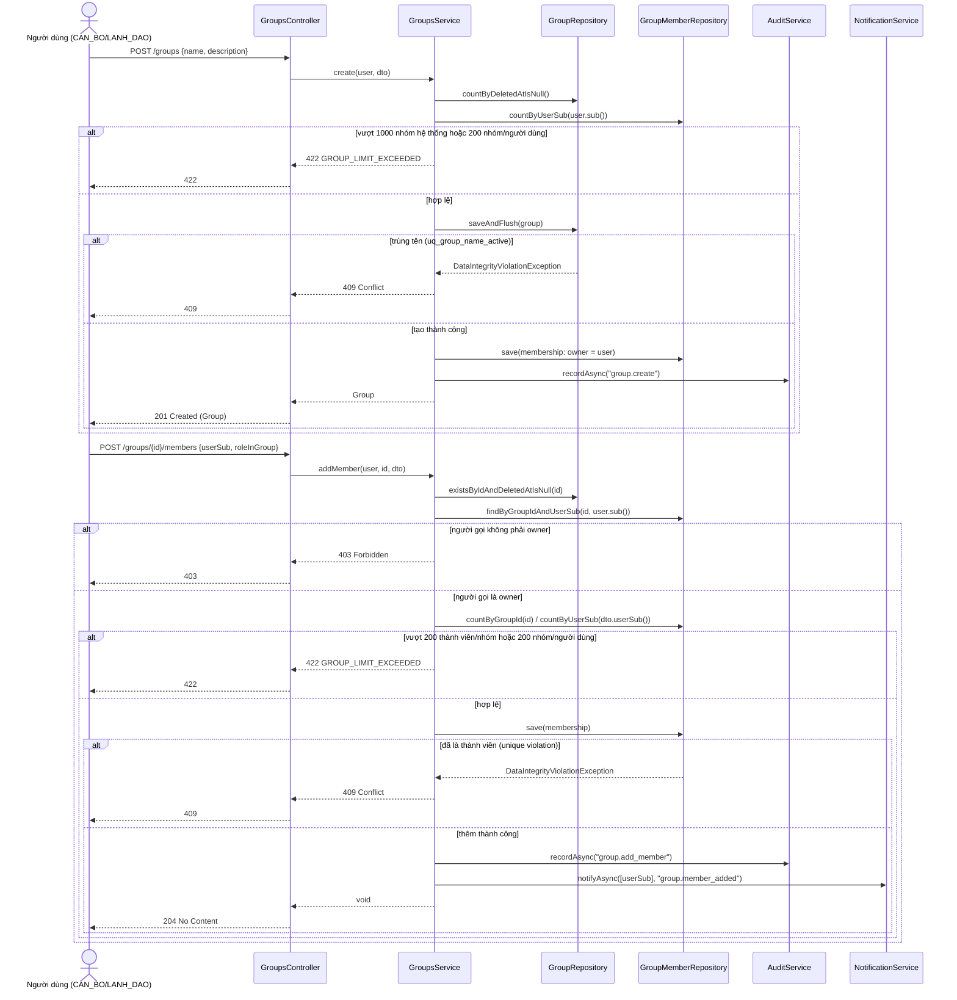

> Status: Draft

# Quản lý nhóm và thành viên nhóm

## Mục tiêu nghiệp vụ

Cho phép người dùng (Cán bộ, Lãnh đạo) tự tạo các nhóm làm việc, tự quản lý
thành viên của nhóm mình sở hữu, và rời khỏi nhóm khi không còn tham gia.
Nhóm là đơn vị phạm vi (scope) dùng để chia sẻ tài liệu (xem file
`01-quan-ly-nhom-chia-se-tai-lieu-b.md`): mọi thành viên của một nhóm sẽ nhìn
thấy các tài liệu đã được chia sẻ vào nhóm đó. Quản trị hệ thống (QUAN_TRI)
không được cấp quyền quản lý nhóm — việc quản lý nội dung nghiệp vụ và quyền
truy cập nội dung là việc của người dùng nghiệp vụ, không phải của admin.

## Tác nhân

- **CAN_BO**, **LANH_DAO**: có quyền `group.manage` (tạo nhóm, xem danh sách
  nhóm mình tham gia, xem thành viên, cập nhật/xóa nhóm mình sở hữu, thêm/xóa/
  đổi vai trò thành viên nếu là owner, rời nhóm).
- **QUAN_TRI**: **không** được cấp `group.manage` (xem seed
  `V12__init_groups.sql`, bảng `role_permission` — chỉ `CAN_BO`/`LANH_DAO` có
  permission này).
- Trong một nhóm, vai trò (`role_in_group`) là `owner` hoặc `member` — trục
  độc lập với vai trò Keycloak (CAN_BO/LANH_DAO/QUAN_TRI).

## Phạm vi

**Trong phạm vi:**
- Tạo nhóm (`POST /groups`), người tạo tự động là `owner` đầu tiên.
- Cập nhật tên/mô tả nhóm (`PATCH /groups/{id}`) — chỉ owner.
- Xóa mềm nhóm (`DELETE /groups/{id}`) — chỉ owner (bất kỳ owner nào, không
  cần tất cả owner đồng thuận).
- Xem danh sách nhóm mình tham gia (`GET /groups`), xem thành viên
  (`GET /groups/{id}/members`).
- Thêm thành viên (`POST /groups/{id}/members`), xóa thành viên
  (`DELETE /groups/{id}/members/{userSub}`), đổi vai trò thành viên
  (`PATCH /groups/{id}/members/{userSub}`) — chỉ owner.
- Rời nhóm (`POST /groups/{id}/leave`) — tự thực hiện cho chính mình.
- Giới hạn (cap) cứng: tối đa 200 thành viên/nhóm, tối đa 200 nhóm/người
  dùng, tối đa 1.000 nhóm active trong toàn hệ thống.
- Bất biến "mỗi nhóm còn ≥ 1 owner" áp dụng khi đổi vai trò, rời nhóm, xóa
  thành viên.

**Ngoài phạm vi (không mô tả ở đây):**
- Chia sẻ/gỡ chia sẻ tài liệu vào nhóm, và tác động của việc xóa mềm nhóm lên
  các tài liệu đã chia sẻ — xem
  `01-quan-ly-nhom-chia-se-tai-lieu-b.md`.
- Xóa cứng (hard delete) nhóm: không có endpoint nào thực hiện việc này;
  `DELETE /groups/{id}` chỉ set `deleted_at`.
- Tìm kiếm người dùng để chọn làm thành viên (`user.directory_search`) —
  thuộc module danh bạ người dùng, không thuộc file này.
- Cơ chế mời qua email/link mời: không tồn tại trong code hiện tại — thêm
  thành viên chỉ bằng `userSub` đã biết trước.

## Luồng nghiệp vụ chính

### A. Tạo nhóm (`POST /groups`, `GroupsService.create`)

1. Kiểm tra tổng số nhóm active trong hệ thống chưa vượt **1.000**
   (`groupRepository.countByDeletedAtIsNull()`); nếu vượt → lỗi
   `GROUP_LIMIT_EXCEEDED`.
2. Kiểm tra số nhóm mà người gọi đang tham gia chưa vượt **200**
   (`groupMemberRepository.countByUserSub`); nếu vượt → lỗi
   `GROUP_LIMIT_EXCEEDED`.
3. Tạo bản ghi `group` với `owner_sub = user.sub()`. Tên nhóm phải **duy nhất
   không phân biệt hoa/thường trong tập nhóm đang active** — ràng buộc thực
   thi bằng partial unique index `uq_group_name_active` (migration
   `V23__group_lifecycle.sql`), không phải kiểm tra ở tầng service; vi phạm
   → `409 Conflict`.
4. Ngay sau khi tạo nhóm, tự động thêm người tạo làm thành viên với
   `role_in_group = owner`.
5. Ghi audit log `group.create` (bất đồng bộ).

### B. Cập nhật nhóm (`PATCH /groups/{id}`, Story 1)

1. Nhóm phải đang active (`deleted_at IS NULL`), nếu không → `404`.
2. Chỉ **owner** của nhóm được cập nhật; không phải owner → `403`.
3. `name`/`description` là `null` nghĩa là "giữ nguyên" (không có nghĩa là
   xóa giá trị).
4. Đổi tên vẫn phải tuân thủ ràng buộc duy nhất tên (case-insensitive, trong
   nhóm active) → vi phạm là `409 Conflict`.

### C. Xóa mềm nhóm (`DELETE /groups/{id}`, Story 4)

1. Nhóm phải đang active; chỉ **owner** được xóa (không yêu cầu tất cả owner
   đồng thuận — một owner bất kỳ là đủ).
2. Xóa mềm chỉ set `deleted_at = now()`; **không** cascade xóa
   `group_member` hay `document_group_share` — các bản ghi này vẫn còn
   nguyên trong DB.
3. Tác động phía đọc: `GroupMemberRepository.findGroupIdsByUserSub` chỉ trả
   về group id của các nhóm **chưa** bị xóa mềm (theta-join với
   `g.deletedAt IS NULL`) — nên ngay sau khi xóa, `BusinessDataScope` (dùng
   bởi mọi luồng đọc tài liệu) sẽ không còn cấp quyền xem tài liệu qua nhóm
   này cho bất kỳ thành viên nào nữa, dù bản ghi `document_group_share` chưa
   bị xóa. Chi tiết ảnh hưởng tới tài liệu đã chia sẻ xem file `-b`.

### D. Thêm thành viên (`POST /groups/{id}/members`, Story 6)

1. Nhóm phải tồn tại (active); chỉ **owner** được thêm thành viên → không
   phải owner → `403`.
2. Kiểm tra số thành viên hiện tại của nhóm chưa vượt **200**; nếu vượt →
   `GROUP_LIMIT_EXCEEDED` (422).
3. Kiểm tra số nhóm mà người dùng được thêm vào đã tham gia chưa vượt **200**
   ; nếu vượt → `GROUP_LIMIT_EXCEEDED` (422).
4. Nếu người dùng đã là thành viên (vi phạm khóa chính `(group_id, user_sub)`)
   → `409 Conflict`.
5. Ghi audit `group.add_member`, gửi thông báo (`notification`) loại
   `group.member_added` cho chính người được thêm.

### E. Đổi vai trò thành viên (`PATCH /groups/{id}/members/{userSub}`, Story 2)

1. Nhóm phải active; chỉ owner được đổi vai trò.
2. Nếu hạ vai trò một owner xuống `member`, phải còn **ít nhất 1 owner khác**
   trong nhóm sau khi hạ — nếu không, người bị hạ là owner cuối cùng →
   `409 Conflict`. Việc **thăng cấp** thành viên lên `owner` không bị chặn và
   không tính vào bất kỳ cap thành viên nào.
3. Người dùng phải đang là thành viên của nhóm, nếu không → `404`.

### F. Xóa thành viên (`DELETE /groups/{id}/members/{userSub}`)

1. Nhóm phải tồn tại; chỉ owner được xóa thành viên.
2. Áp dụng cùng bất biến "không xóa owner cuối cùng" như mục E.
3. Ghi audit `group.remove_member`, gửi thông báo `group.member_removed` cho
   người bị xóa.

### G. Rời nhóm (`POST /groups/{id}/leave`, Story 3)

1. Nhóm phải active; người rời không được là **owner cuối cùng** của nhóm
   (cùng bất biến trên) → nếu là owner cuối cùng → `409 Conflict`.
2. Không đụng tới `document_group_share`: các tài liệu người này đã chia sẻ
   vào nhóm trước đó **vẫn hiển thị bình thường** cho các thành viên còn lại
   sau khi họ rời nhóm.
3. Gửi thông báo `group.member_removed` — người nhận là chính người vừa rời.

## Sequence diagram

## Luồng ngoại lệ / trường hợp đặc biệt

| Tình huống | HTTP | Ghi chú |
|---|---|---|
| Tên nhóm trùng (không phân biệt hoa/thường) trong tập nhóm active | 409 Conflict | Do partial unique index `uq_group_name_active`, không phải check ở tầng service |
| Vượt 1.000 nhóm active toàn hệ thống (khi tạo) | 422, body `{code: "GROUP_LIMIT_EXCEEDED"}` | `GroupsService.MAX_GROUPS_SYSTEM` |
| Vượt 200 nhóm/người dùng (khi tạo hoặc thêm thành viên) | 422, `GROUP_LIMIT_EXCEEDED` | `GroupsService.MAX_GROUPS_PER_USER` |
| Vượt 200 thành viên/nhóm (khi thêm thành viên) | 422, `GROUP_LIMIT_EXCEEDED` | `GroupsService.MAX_MEMBERS_PER_GROUP` |
| Nhóm không tồn tại hoặc đã bị xóa mềm | 404 Not Found | Mọi thao tác đều lọc `deleted_at IS NULL` trước |
| Người gọi không phải owner khi update/delete/thêm-xóa-đổi vai trò thành viên | 403 Forbidden | `requireOwner` |
| Thêm một `userSub` đã là thành viên | 409 Conflict | Vi phạm PK `(group_id, user_sub)` |
| Hạ vai trò / xóa / rời nhóm khi là **owner cuối cùng** | 409 Conflict | Bất biến "≥ 1 owner", `requireNotLastOwner` |
| Đổi vai trò / xóa thành viên với `userSub` không phải thành viên | 404 Not Found | |
| Xem danh sách thành viên (`GET /groups/{id}/members`) khi người gọi không phải thành viên nhóm | 403 Forbidden | |

## Dữ liệu liên quan

| Entity / bảng DB | Vai trò | File code |
|---|---|---|
| `"group"` (entity `Group`) | Nhóm: tên, mô tả, owner tạo nhóm, `deleted_at` (soft-delete) | `backend/src/main/java/com/aismartstore/backend/groups/Group.java`; migration `V12__init_groups.sql`, `V23__group_lifecycle.sql` |
| `group_member` (entity `GroupMember`, khóa chính composite `GroupMemberId`) | Thành viên của nhóm + vai trò (`owner`/`member`) | `groups/GroupMember.java`, `groups/GroupMemberId.java`, `groups/GroupMemberRepository.java` |
| `notification` | Thông báo `group.member_added` / `group.member_removed` gửi tới thành viên bị ảnh hưởng | `backend/src/main/java/com/aismartstore/backend/notifications/NotificationService.java`; migration `V24__document_sharing_notifications.sql` |
| `audit_log` (qua `AuditService`) | Ghi log `group.create` / `group.update` / `group.delete` / `group.add_member` / `group.remove_member` / `group.change_member_role` / `group.leave` | `backend/src/main/java/com/aismartstore/backend/audit/AuditService.java` |
| `permission` / `role_permission` (bảng tham chiếu, không có API ghi) | `group.manage` chỉ gán cho `CAN_BO`, `LANH_DAO` | `V12__init_groups.sql` |

## File code tham chiếu

- `backend/src/main/java/com/aismartstore/backend/groups/GroupsController.java` — dòng 57-135 (toàn bộ endpoint `/groups*` liên quan file này).
- `backend/src/main/java/com/aismartstore/backend/groups/GroupsService.java`:
  - `create` dòng 134-179
  - `listForCurrentUser` dòng 182-188
  - `listMembers`/`toMemberView` dòng 190-220
  - `update` dòng 227-263
  - `changeMemberRole` dòng 271-290
  - `leaveGroup` dòng 298-315
  - `deleteGroup` dòng 324-335
  - `addMember` dòng 337-370
  - `removeMember` dòng 372-393
  - `requireGroupExists`/`requireActiveGroup`/`requireOwner`/`requireNotLastOwner` dòng 588-626
  - Hằng số cap: `MAX_MEMBERS_PER_GROUP`, `MAX_GROUPS_PER_USER`, `MAX_GROUPS_SYSTEM` dòng 47-52
- `backend/src/main/java/com/aismartstore/backend/groups/Group.java` — toàn bộ (entity, cột `deletedAt` dòng 43-49).
- `backend/src/main/java/com/aismartstore/backend/groups/GroupMember.java`, `GroupMemberId.java`, `GroupRole.java` — toàn bộ.
- `backend/src/main/java/com/aismartstore/backend/groups/GroupRepository.java`, `GroupMemberRepository.java` — toàn bộ (đặc biệt `findGroupIdsByUserSub` dòng 20-22 của `GroupMemberRepository.java`, join loại trừ nhóm đã xóa mềm).
- `backend/src/main/java/com/aismartstore/backend/groups/dto/CreateGroupDto.java`, `UpdateGroupDto.java`, `AddGroupMemberDto.java`, `ChangeGroupMemberRoleDto.java` — toàn bộ.
- `backend/src/main/resources/db/migration/V12__init_groups.sql` — bảng `group`, `group_member`, seed permission `group.manage`.
- `backend/src/main/resources/db/migration/V23__group_lifecycle.sql` — cột `deleted_at`, index `UQ_group_name_active`.
- `backend/src/main/java/com/aismartstore/backend/notifications/NotificationService.java` — dòng 79-86 (`notifyAsync`, dùng cho `group.member_added`/`group.member_removed`).

## Điểm cần xác nhận thêm

- `GroupsController.list()` (`GET /groups`) không hỗ trợ phân trang — trả về
  toàn bộ danh sách nhóm người dùng tham gia (tối đa 200 theo cap). Chưa rõ
  đây là quyết định có chủ đích hay thiếu sót cần bổ sung sau này.
- Không có endpoint xem chi tiết một nhóm đơn lẻ (`GET /groups/{id}`) — chỉ
  có `GET /groups` (list) và `GET /groups/{id}/members` /
  `GET /groups/{id}/documents`. Cần xác nhận đây có phải giới hạn cố ý của
  MVP hay không.
- Xóa mềm nhóm không cascade xóa `group_member`/`document_group_share` —
  đây là quyết định thiết kế có chủ đích (xem comment "Quyết định 5 SA"
  trong code), nhưng nghĩa là dữ liệu thành viên/chia sẻ của một nhóm đã xóa
  vẫn tồn tại vĩnh viễn trong DB, không có cơ chế dọn dẹp (purge) nào được
  thấy trong code đã đọc.
