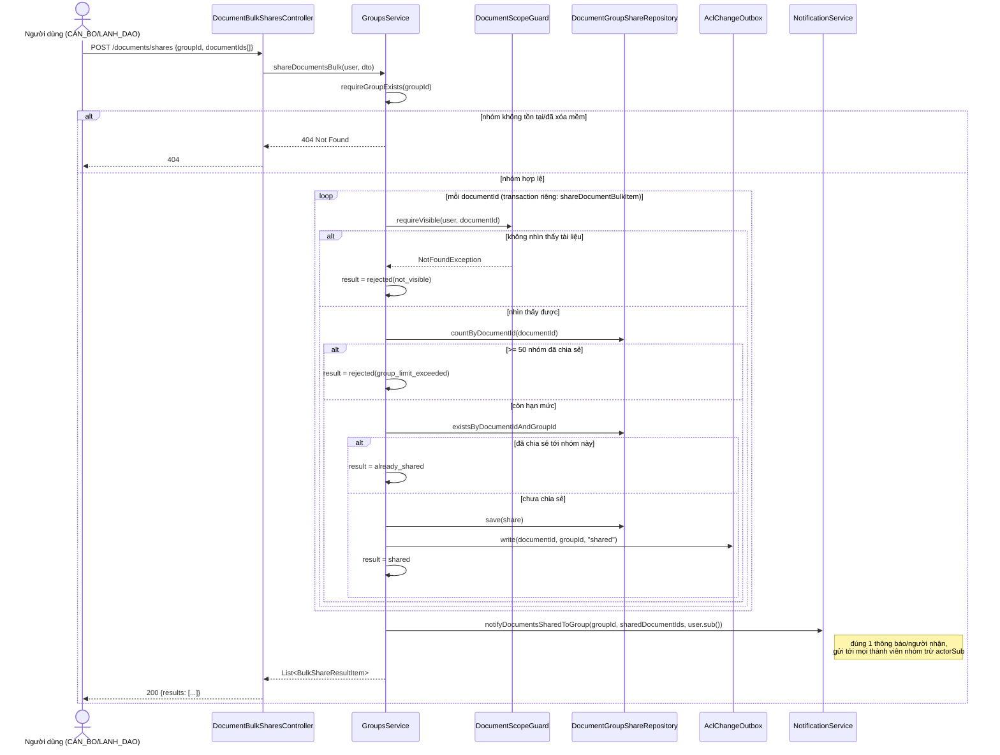

> Status: Draft

# Chia sẻ / gỡ chia sẻ tài liệu lên nhóm

## Mục tiêu nghiệp vụ

Cho phép người dùng chia sẻ một hoặc nhiều tài liệu mình đang nhìn thấy vào
một nhóm, để mọi thành viên của nhóm đó có quyền đọc tài liệu mà không cần
chia sẻ từng người. Việc chia sẻ chỉ cấp thêm quyền đọc thông qua thành viên
nhóm (`BusinessDataScope`), không sao chép nội dung tài liệu. Tài liệu này mô
tả luồng chia sẻ đơn lẻ, chia sẻ hàng loạt (bulk), gỡ chia sẻ, và ảnh hưởng
của việc một nhóm bị xóa mềm (xem file `-a`) lên các tài liệu đã chia sẻ vào
nhóm đó.

## Tác nhân

- **CAN_BO**, **LANH_DAO**: có quyền `document.share` (chia sẻ, gỡ chia sẻ,
  xem danh sách nhóm đã chia sẻ của một tài liệu).
- **QUAN_TRI**: không được cấp `document.share` (cùng nguyên tắc NFR-04 như
  file `-a` — admin không quản lý quyền truy cập nội dung nghiệp vụ).
- Điều kiện tiên quyết để chia sẻ một tài liệu: người thực hiện phải đang
  **nhìn thấy** tài liệu đó theo `BusinessDataScope` hiện tại (là người tải
  lên, hoặc tài liệu đã được chia sẻ vào một nhóm mà họ là thành viên) —
  không thể chia sẻ một tài liệu mình không có quyền xem.

## Phạm vi

**Trong phạm vi:**
- Chia sẻ 1 tài liệu vào 1 nhóm (`POST /documents/{id}/shares`).
- Chia sẻ hàng loạt: 1 nhóm, tối đa 100 tài liệu/lần
  (`POST /documents/shares`).
- Gỡ chia sẻ (`DELETE /documents/{id}/shares/{groupId}`).
- Xem danh sách nhóm đã được chia sẻ của một tài liệu
  (`GET /documents/{id}/shares`).
- Xem danh sách tài liệu đã chia sẻ vào một nhóm, có phân trang
  (`GET /groups/{id}/documents`).
- Giới hạn cứng 50 nhóm/tài liệu — chỉ áp dụng cho luồng **bulk share**.
- Thông báo (`notification`) khi chia sẻ hàng loạt; ghi outbox event
  `document.acl.changed` cho mọi lượt chia sẻ/gỡ chia sẻ (đơn lẻ hoặc bulk)
  để dịch vụ tìm kiếm đồng bộ chỉ mục quyền truy cập.
- Ảnh hưởng khi nhóm đích bị xóa mềm.

**Ngoài phạm vi (không mô tả ở đây):**
- Tạo/xóa nhóm, thêm/xóa thành viên — xem file
  `01-quan-ly-nhom-chia-se-tai-lieu-a.md`.
- Luồng thùng rác/khôi phục tài liệu (`TrashService.restore`) và cảnh báo
  `groupsLostEffect` khi khôi phục — thuộc module xóa mềm/thùng rác riêng
  (`backend/src/main/java/com/aismartstore/backend/trash/TrashService.java`),
  chỉ được nhắc tới ở đây như một hệ quả liên quan.
- Đồng bộ chỉ mục tìm kiếm (`search-service` đọc `outbox_event`) — chỉ mô tả
  việc backend ghi sự kiện, không mô tả phía tiêu thụ sự kiện.

## Luồng nghiệp vụ chính

### A. Chia sẻ 1 tài liệu (`POST /documents/{id}/shares`, `GroupsService.shareDocument`)

1. Kiểm tra tài liệu **hiện đang nhìn thấy được** với người gọi qua
   `DocumentScopeGuard.requireVisible` (dùng chung `BusinessDataScope` với
   mọi luồng đọc tài liệu khác) — nếu không thấy được (không tồn tại hoặc
   ngoài phạm vi) → `404`, không phân biệt hai lý do (tránh rò rỉ thông tin
   tồn tại).
2. Nhóm đích phải tồn tại và đang active (`requireGroupExists`) → nếu không
   → `404`.
3. Tạo bản ghi `document_group_share (document_id, group_id, shared_by_sub,
   shared_at)`. Cặp `(document_id, group_id)` là khóa chính — chia sẻ trùng
   → `409 Conflict`.
4. Ghi outbox event `document.acl.changed` (action `shared`) để đồng bộ chỉ
   mục tìm kiếm.
5. Ghi audit `document.share`.
6. **Lưu ý:** luồng chia sẻ đơn lẻ này **không** gửi thông báo
   (`notification`) cho thành viên nhóm — thông báo chỉ được gửi ở luồng
   bulk share (mục B bước 6).

### B. Chia sẻ hàng loạt (`POST /documents/shares`, `GroupsService.shareDocumentsBulk`)

1. Request: 1 `groupId`, tối đa **100** `documentIds` (`BulkShareDto`, ràng
   buộc `@Size(max = 100)`).
2. Nhóm đích phải tồn tại và active — nếu không → `404` cho toàn bộ request.
3. Mỗi tài liệu trong danh sách được xử lý **độc lập, trong transaction
   riêng** (`shareDocumentBulkItem`, gọi qua self-proxy để đảm bảo chạy dưới
   `@Transactional` thật) — một tài liệu lỗi không làm rollback các tài liệu
   khác trong cùng request.
4. Với mỗi tài liệu: nếu không nhìn thấy được → kết quả `rejected` lý do
   `not_visible`; nếu tài liệu đã đạt giới hạn **50 nhóm được chia sẻ tới**
   (đếm mọi share, kể cả share tới nhóm đã bị xóa mềm — xem
   `DocumentGroupShareRepository.countByDocumentId`) → `rejected` lý do
   `group_limit_exceeded`; nếu đã chia sẻ tới nhóm này rồi → `already_shared`;
   ngược lại → tạo share, kết quả `shared`.
5. Race condition (2 request đồng thời chia sẻ cùng 1 cặp document/group):
   pre-check `existsByDocumentIdAndGroupId` không đủ để loại race tuyệt đối
   — nếu insert vẫn vi phạm unique constraint, item đó được coi là
   `already_shared` thay vì lỗi 500.
6. Sau khi xử lý xong **toàn bộ** danh sách, gửi **đúng 1** thông báo
   `document.shared_to_group` cho mỗi thành viên hiện tại của nhóm (trừ
   chính người thực hiện), bất kể request chia sẻ bao nhiêu tài liệu.
7. Response trả về danh sách kết quả theo từng `documentId`:
   `shared` | `already_shared` | `rejected` (kèm `reason`).
8. Giới hạn 50 nhóm/tài liệu **chỉ** áp dụng ở luồng bulk này — luồng chia
   sẻ đơn lẻ (mục A) không kiểm tra cap này.

### C. Gỡ chia sẻ (`DELETE /documents/{id}/shares/{groupId}`, `GroupsService.unshareDocument`)

1. Tài liệu phải đang nhìn thấy được với người gọi (cùng
   `DocumentScopeGuard.requireVisible`) → không thấy được → `404`.
2. Bản ghi chia sẻ `(documentId, groupId)` phải tồn tại → không có →
   `404 "Document is not shared to this group"`.
3. Chỉ 3 nhóm người được phép gỡ chia sẻ: **owner của nhóm đích**, **người
   đã tạo chính share này** (`shared_by_sub`), hoặc **người tải lên tài liệu**
   (`document.uploader_sub`). Không thỏa điều kiện nào → `403 Forbidden`, và
   một audit `document.unshare` trạng thái `failure` (403) được ghi lại
   trước khi ném lỗi. (Trước đây bất kỳ ai nhìn thấy tài liệu cũng gỡ được —
   đã được vá theo rà soát bảo mật Task 6.)
4. Xóa bản ghi `document_group_share`, ghi outbox `document.acl.changed`
   (action `unshared`), ghi audit `document.unshare` thành công.

### D. Xem danh sách nhóm đã chia sẻ của 1 tài liệu (`GET /documents/{id}/shares`)

1. Tài liệu phải nhìn thấy được (`requireVisible`) → không thì `404`.
2. Trả về danh sách `{groupId, groupName, sharedBySub, sharedAt}`, sắp theo
   thời gian chia sẻ tăng dần. `groupName` có thể `null` nếu nhóm không còn
   tồn tại trong kết quả tra cứu (hiếm, do dữ liệu không nhất quán).

### E. Xem danh sách tài liệu đã chia sẻ vào 1 nhóm (`GET /groups/{id}/documents`)

1. Nhóm phải tồn tại (active); người gọi phải **là thành viên** của nhóm đó
   → không phải thành viên → `403`.
2. Trả về trang (page, mặc định 50, tối đa 50/trang) các tài liệu đang chia
   sẻ vào nhóm, **loại trừ tài liệu đã bị xóa mềm** (`d.deletedAt IS NULL`),
   sắp theo `sharedAt` giảm dần, kèm `uploaderSub`/`sharedBySub`/`sharedAt`.

## Sequence diagram

## Luồng ngoại lệ / trường hợp đặc biệt

| Tình huống | HTTP | Ghi chú |
|---|---|---|
| Tài liệu không tồn tại hoặc ngoài phạm vi nhìn thấy | 404 Not Found | `DocumentScopeGuard.requireVisible`, cùng lý do 404 cho cả 2 trường hợp (không rò rỉ tồn tại) |
| Nhóm đích không tồn tại/đã xóa mềm (share đơn, unshare, list group documents) | 404 Not Found | `requireGroupExists` |
| Chia sẻ đơn lẻ trùng `(documentId, groupId)` | 409 Conflict | Vi phạm PK `document_group_share` |
| Gỡ chia sẻ một cặp `(documentId, groupId)` chưa từng được chia sẻ | 404 Not Found | |
| Gỡ chia sẻ bởi người không phải owner nhóm / người tạo share / uploader tài liệu | 403 Forbidden | Có ghi audit `document.unshare` thất bại (403) trước khi trả lỗi |
| Xem `GET /groups/{id}/documents` khi không phải thành viên nhóm | 403 Forbidden | |
| Bulk share: tài liệu không nhìn thấy được | 200, item `status: "rejected", reason: "not_visible"` | Không làm fail cả request |
| Bulk share: tài liệu đã đạt 50 nhóm chia sẻ | 200, item `status: "rejected", reason: "group_limit_exceeded"` | Cap chỉ áp dụng cho bulk, không áp dụng share đơn lẻ |
| Bulk share: tài liệu đã chia sẻ vào nhóm này trước đó (kể cả do race condition đồng thời) | 200, item `status: "already_shared"` | Không coi là lỗi |
| Bulk share: >100 documentIds trong 1 request | 400 (validation `@Size(max = 100)`) | |
| Nhóm bị xóa mềm **sau khi** đã chia sẻ tài liệu vào đó | Không có lỗi trực tiếp | Bản ghi `document_group_share` vẫn còn, nhưng không còn cấp quyền xem cho ai — xem mục dưới |

### Ảnh hưởng khi nhóm bị xóa mềm lên tài liệu đã chia sẻ

Khi một nhóm bị xóa mềm (`Group.deletedAt` khác `null`, xem file `-a` mục C):

- Bản ghi `document_group_share` liên kết tới nhóm đó **không bị xóa** —
  vẫn còn nguyên trong DB (`GroupsService.deleteGroup` không cascade).
- Nhưng `GroupMemberRepository.findGroupIdsByUserSub` (dùng bởi
  `BusinessDataScope.forDocuments` — cơ sở của mọi luồng đọc tài liệu, và
  cũng dùng bởi `DocumentScopeGuard.requireVisible`) chỉ trả về group id của
  nhóm **chưa** bị xóa mềm. Kết quả: tài liệu đã chia sẻ vào nhóm đã xóa
  **không còn hiển thị** cho bất kỳ thành viên nào của nhóm đó nữa, kể cả
  người từng tải lên tài liệu (trừ khi họ là uploader hoặc còn được chia sẻ
  qua một nhóm active khác).
- Hệ quả gián tiếp: vì tài liệu không còn "nhìn thấy được" qua nhóm đã xóa,
  các thao tác gỡ chia sẻ tới đúng nhóm đó qua
  `DELETE /documents/{id}/shares/{groupId}` cũng sẽ thất bại với 404 nếu
  người gọi không còn cách nào khác để nhìn thấy tài liệu (guard 404 chạy
  trước khi tìm bản ghi share).
- `DocumentGroupShareRepository.countByDocumentId` (dùng cho cap 50
  nhóm/tài liệu ở luồng bulk share) đếm **mọi** bản ghi share, kể cả share
  tới nhóm đã xóa mềm — khác với `countActiveSharesForDocument` (chỉ đếm
  share tới nhóm còn active). Nghĩa là một tài liệu có thể "dùng hết" một
  phần cap 50 bởi các share tới nhóm đã xóa mà không còn tác dụng thực tế.
- `DocumentGroupShareRepository.findDeletedGroupIdsForDocument` được dùng
  riêng bởi `TrashService.restore` (module thùng rác, ngoài phạm vi tài liệu
  này) để tính cảnh báo `groupsLostEffect` khi khôi phục một tài liệu đã xóa
  mềm — chỉ mang tính cảnh báo, không tự động khôi phục lại hiệu lực chia sẻ.

## Dữ liệu liên quan

| Entity / bảng DB | Vai trò | File code |
|---|---|---|
| `document_group_share` (entity `DocumentGroupShare`, khóa composite `DocumentGroupShareId`) | Bản ghi 1 lượt chia sẻ tài liệu vào nhóm: `document_id`, `group_id`, `shared_by_sub`, `shared_at` | `backend/src/main/java/com/aismartstore/backend/groups/DocumentGroupShare.java`, `DocumentGroupShareId.java`, `DocumentGroupShareRepository.java` |
| `"group"` | Nhóm đích của việc chia sẻ (đọc, không ghi ở đây) | Xem file `-a` |
| `document` | Tài liệu được chia sẻ; `uploader_sub`/`deleted_at` dùng trong kiểm tra phạm vi | `backend/src/main/java/com/aismartstore/backend/documents/Document.java` |
| `outbox_event` | Sự kiện `document.acl.changed` (`action: shared|unshared`) để đồng bộ chỉ mục tìm kiếm | `backend/src/main/java/com/aismartstore/backend/groups/AclChangeOutbox.java`; `backend/src/main/java/com/aismartstore/backend/outbox/` |
| `notification` | `document.shared_to_group` — chỉ gửi ở luồng bulk share, 1 lần/người nhận/request | `backend/src/main/java/com/aismartstore/backend/notifications/NotificationService.java` dòng 88-118 |
| `audit_log` | `document.share` / `document.unshare` (kèm `failure` khi 403) | `backend/src/main/java/com/aismartstore/backend/audit/AuditService.java` |

## File code tham chiếu

- `backend/src/main/java/com/aismartstore/backend/groups/DocumentSharesController.java` — toàn bộ (dòng 31-49): `POST/DELETE/GET /documents/{id}/shares...`.
- `backend/src/main/java/com/aismartstore/backend/groups/DocumentBulkSharesController.java` — toàn bộ (dòng 36-40): `POST /documents/shares`.
- `backend/src/main/java/com/aismartstore/backend/groups/GroupsController.java` — dòng 76-87 (`GET /groups/{id}/documents`).
- `backend/src/main/java/com/aismartstore/backend/groups/GroupsService.java`:
  - `shareDocument` dòng 401-426
  - `unshareDocument` dòng 434-463
  - `listShares` dòng 465-484
  - `shareDocumentsBulk` dòng 496-518
  - `shareDocumentBulkItem` dòng 525-569
  - `listGroupDocuments` dòng 577-586
  - Hằng số `MAX_GROUPS_PER_DOCUMENT_BULK = 50` dòng 55
- `backend/src/main/java/com/aismartstore/backend/groups/DocumentScopeGuard.java` — toàn bộ (`requireVisible` dòng 53-75).
- `backend/src/main/java/com/aismartstore/backend/groups/BusinessDataScope.java` — toàn bộ (`forDocuments` dòng 51-80).
- `backend/src/main/java/com/aismartstore/backend/groups/AclChangeOutbox.java` — toàn bộ.
- `backend/src/main/java/com/aismartstore/backend/groups/DocumentGroupShareRepository.java` — đặc biệt `deleteByDocumentId` dòng 27-29, `findDeletedGroupIdsForDocument` dòng 60-66, `countActiveSharesForDocument` dòng 74-77, `countByDocumentId` dòng 24.
- `backend/src/main/java/com/aismartstore/backend/groups/dto/ShareDocumentDto.java`, `BulkShareDto.java`, `BulkShareResultItem.java` — toàn bộ.
- `backend/src/main/java/com/aismartstore/backend/notifications/NotificationService.java` — dòng 88-118 (`notifyDocumentsSharedToGroup`).
- `backend/src/main/java/com/aismartstore/backend/trash/TrashService.java` — dòng 399, 416, 418 (`groupsLostEffect`, chỉ để tham chiếu chéo, ngoài phạm vi tài liệu này).
- `backend/src/main/resources/db/migration/V12__init_groups.sql` — bảng `document_group_share`, seed permission `document.share`.

## Điểm cần xác nhận thêm

- Chia sẻ đơn lẻ (`POST /documents/{id}/shares`) không gửi notification cho
  thành viên nhóm, trong khi bulk share thì có. Cần xác nhận đây có phải
  chủ đích (chia sẻ đơn được coi là thao tác nhỏ, không cần làm phiền) hay
  là thiếu sót cần bổ sung.
- Cap 50 nhóm/tài liệu chỉ áp dụng cho luồng bulk share, không áp dụng cho
  chia sẻ đơn lẻ lặp lại nhiều lần — về lý thuyết một tài liệu có thể vượt
  quá 50 nhóm nếu người dùng chia sẻ đơn lẻ nhiều lần liên tiếp. Cần xác
  nhận đây có phải là một khoảng trống (gap) trong việc thực thi giới hạn
  hay là chủ đích thiết kế.
- Không có cơ chế dọn dẹp/cảnh báo chủ động khi một `document_group_share`
  trỏ tới nhóm đã bị xóa mềm từ lâu (ngoài cảnh báo bị động
  `groupsLostEffect` chỉ xuất hiện khi khôi phục tài liệu từ thùng rác) —
  các bản ghi "chết" này tồn tại vô thời hạn và vẫn tính vào cap
  `countByDocumentId` của luồng bulk share.
