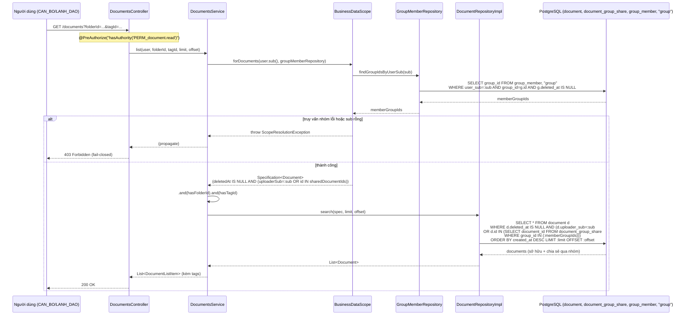
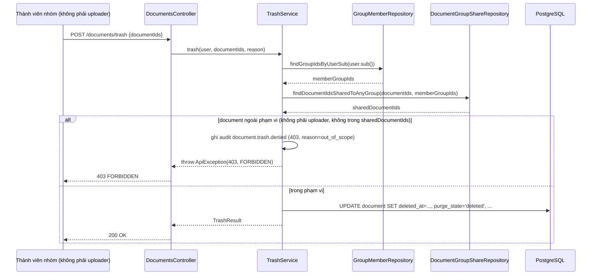

> Status: Draft

# Mở rộng phạm vi dữ liệu — người dùng thấy thêm tài liệu được chia sẻ tới nhóm mình là thành viên

## Mục tiêu nghiệp vụ

Mặc định, mỗi người dùng (CAN_BO/LANH_DAO) chỉ nhìn thấy tài liệu do chính mình
tải lên. Tính năng này mở rộng phạm vi đó: một tài liệu do người khác tải lên
vẫn hiển thị với người dùng nếu tài liệu đó đã được chia sẻ tới ít nhất một
nhóm mà người dùng là thành viên. Mục đích là cho phép cộng tác trong nhóm
(ví dụ cùng phòng ban) mà không phải cấp quyền xem toàn bộ kho tài liệu. Việc
mở rộng này áp dụng thống nhất cho mọi điểm đọc dữ liệu tài liệu (danh sách,
xem chi tiết, tải nội dung, xem trang ảnh, trạng thái số hoá video...), thông
qua một bộ lọc dùng chung ở tầng truy vấn, để tránh lệch quy tắc giữa các API.

## Tác nhân

- **Người dùng có vai trò CAN_BO hoặc LANH_DAO** (giữ quyền `PERM_document.read`):
  người xem danh sách/nội dung tài liệu, được mở rộng thêm các tài liệu chia
  sẻ qua nhóm.
- **Người chia sẻ tài liệu** (chủ sở hữu tài liệu hoặc người đang có quyền
  xem tài liệu, giữ quyền `PERM_document.share`): thực hiện hành động
  `POST /documents/{id}/shares` để đưa tài liệu vào phạm vi nhìn thấy của một
  nhóm.
- **Thành viên nhóm (`GroupMember`, `role_in_group = member`)**: là đối tượng
  hưởng lợi trực tiếp của tính năng — tự động thấy thêm tài liệu ngay khi được
  thêm vào nhóm đã có tài liệu chia sẻ, không cần thao tác gì thêm.
- Vai trò `QUAN_TRI` (quản trị hệ thống) **không** có `PERM_document.read` nên
  không tham gia luồng này (NFR-07 — quản trị viên không đọc nội dung nghiệp
  vụ).

## Phạm vi

**Trong phạm vi:**
- Quy tắc mở rộng khả năng nhìn thấy (visibility) tài liệu: `uploader_sub =
  current_user` HOẶC tài liệu đã được share tới một nhóm mà `current_user`
  đang là thành viên.
- Áp dụng quy tắc này cho: `GET /documents` (danh sách + lọc theo
  `folderId`/`tagId`), `GET /documents/unclassified-doc-type`, `GET
  /documents/{id}`, `GET /documents/{id}/content`, `GET
  /documents/{id}/pages/{pageNo}/image`, `GET /documents/{id}/video-status`.
- Loại trừ tài liệu đã bị xoá mềm (`deleted_at IS NOT NULL`) khỏi phạm vi mở
  rộng này (tài liệu trong thùng rác có quy tắc hiển thị riêng, xem file
  `TrashService`).
- Hành vi khi thao tác ghi (xoá mềm `POST /documents/trash`) trên tài liệu
  chỉ được nhìn thấy qua chia sẻ nhóm — được mô tả ở mục "Luồng ngoại lệ" vì
  đây là hệ quả trực tiếp của cùng một cơ chế phân giải nhóm.
- Cơ chế fail-closed khi không xác định được nhóm thành viên của người dùng.

**Ngoài phạm vi:**
- Cách tạo/gỡ một lượt chia sẻ tài liệu tới nhóm (`POST`/`DELETE
  /documents/{id}/shares`, `POST /documents/shares` chia sẻ hàng loạt) — chỉ
  nhắc tới như bước tiền đề, không mô tả chi tiết quy tắc nghiệp vụ của riêng
  API đó.
- Quản lý vòng đời nhóm và thành viên nhóm (tạo nhóm, thêm/xoá thành viên,
  giới hạn 200 thành viên/nhóm, 200 nhóm/người dùng).
- Quy tắc phục hồi tài liệu từ thùng rác (`TrashService#restore`) — chỉ nêu
  điểm khác biệt về quyền so với tính năng này.
- Chuyển quyền sở hữu tài liệu (`DocumentOwnershipController`, chỉ `QUAN_TRI`).
- Đồng bộ chỉ mục tìm kiếm toàn văn (search-service) — tài liệu chia sẻ nhóm
  có ảnh hưởng tới kết quả tìm kiếm nhưng cơ chế lọc phạm vi cho search nằm ở
  một service riêng, không thuộc phần này.

## Luồng nghiệp vụ chính

1. Người chia sẻ gọi `POST /documents/{id}/shares` (yêu cầu quyền
   `PERM_document.share`). `GroupsService.shareDocument` trước tiên gọi
   `DocumentScopeGuard.requireVisible(user, documentId)` — **quy tắc nghiệp
   vụ**: chỉ có thể chia sẻ một tài liệu mà chính người chia sẻ đang nhìn thấy
   được (là chủ sở hữu, hoặc đã thấy tài liệu đó qua một lượt chia sẻ nhóm
   khác) — không thể chia sẻ tài liệu nằm ngoài phạm vi của mình.
2. Nếu nhóm đích tồn tại (và chưa bị xoá mềm), hệ thống ghi một dòng vào bảng
   `document_group_share (document_id, group_id, shared_by_sub, shared_at)`.
   Từ thời điểm này, mọi thành viên hiện tại và tương lai của nhóm đó đều nhìn
   thấy tài liệu — **quy tắc nghiệp vụ**: chia sẻ gắn với nhóm, không phải với
   từng thành viên tại thời điểm chia sẻ; một người dùng gia nhập nhóm sau này
   vẫn thấy ngay các tài liệu đã share trước đó, không cần chia sẻ lại.
3. Khi người dùng gọi bất kỳ API đọc tài liệu nào (`GET /documents`, `GET
   /documents/{id}`, ...), controller lấy `KeycloakUser` hiện tại rồi gọi vào
   `DocumentsService`. Endpoint yêu cầu quyền tĩnh `PERM_document.read`
   (`@PreAuthorize`) — đây là kiểm tra ở **tầng permission theo vai trò
   (role-based)**, độc lập với nhóm.
4. `DocumentsService` (hoặc `DocumentScopeGuard` cho các API theo một
   `documentId`) dựng bộ lọc hàng (`row-level`) bằng
   `BusinessDataScope.forDocuments(user.sub(), groupMemberRepository)`.
5. `BusinessDataScope` truy vấn ngay lập tức (eager, không trì hoãn vào bên
   trong specification) toàn bộ `group_id` mà người dùng là thành viên qua
   `GroupMemberRepository.findGroupIdsByUserSub` — **quy tắc nghiệp vụ**: chỉ
   tính các nhóm còn hoạt động (`Group.deleted_at IS NULL`); thành viên của
   một nhóm đã bị xoá mềm không còn được tính vào phạm vi mở rộng.
   - **Fail-closed**: nếu `sub` rỗng hoặc truy vấn nhóm lỗi, ném ngay
     `ScopeResolutionException` — không bao giờ rơi về "không lọc gì" (xem
     mục Luồng ngoại lệ).
6. Nếu người dùng không thuộc nhóm nào, `Specification` chỉ gồm
   `deletedAt IS NULL AND uploaderSub = :sub` (hành vi như trước khi có tính
   năng chia sẻ nhóm).
7. Nếu có ít nhất một nhóm, `Specification` dựng thêm một subquery SQL tương
   quan (không load dữ liệu vào Java):
   `id IN (SELECT document_id FROM document_group_share WHERE group_id IN
   (:memberGroupIds))`, rồi kết hợp bằng `OR` với điều kiện là chủ sở hữu:
   `deletedAt IS NULL AND (uploaderSub = :sub OR id IN (subquery))`.
8. `Specification` này được nối thêm (`.and(...)`) các bộ lọc khác của từng
   API cụ thể (theo `folderId`, `tagId`, hoặc điều kiện "chưa gán doc_type"),
   rồi thực thi qua `DocumentRepositoryImpl.search` (Criteria Query, hỗ trợ
   `limit`/`offset` tuỳ ý — khác với `Pageable` mặc định của Spring Data).
9. Với các API theo một `documentId` (`findOne`, `getContent`,
   `getPageImage`, `videoStatus`), `DocumentScopeGuard.requireVisible` áp
   cùng `Specification` đó kết hợp thêm điều kiện `id = :documentId`; nếu
   không có dòng nào khớp, trả về lỗi giống hệt trường hợp tài liệu không tồn
   tại (xem mục ngoại lệ).
10. Kết quả trả về cho người dùng là hợp của "tài liệu tự tải lên" và "tài
    liệu được chia sẻ tới nhóm mình tham gia" — người dùng không thấy sự khác
    biệt về nguồn gốc trong response (không có cờ `isShared` ở tầng dữ liệu
    được đọc trong mã nguồn này).

**Quyền đọc so với quyền sửa/xoá tài liệu được chia sẻ qua nhóm:**
Không tồn tại API sửa nội dung/metadata tài liệu cho người dùng thường (chỉ
có `note.write`/`tag.manage` là các thực thể phụ trợ riêng, không phải sửa
`Document`). Đối với **xoá mềm** (`POST /documents/trash`, quyền
`PERM_trash.manage`), `TrashService.trash` áp dụng đúng cùng một quy tắc
"chủ sở hữu HOẶC chia sẻ tới nhóm mình" (tính lại thủ công bằng
`GroupMemberRepository.findGroupIdsByUserSub` +
`DocumentGroupShareRepository.findDocumentIdsSharedToAnyGroup`, xem
`TrashService.java` dòng 192-224) — nghĩa là **thành viên nhóm có quyền xoá
mềm tài liệu người khác chia sẻ vào nhóm, giống hệt quyền đọc**, không bị thu
hẹp hơn. Ngược lại, **phục hồi** tài liệu từ thùng rác
(`TrashService.requireRestorePermission`, dòng 485-491) chỉ cho phép người đã
xoá (`deletedBySub`) hoặc chủ sở hữu gốc (`uploaderSub`) — thành viên nhóm
thông thường (không phải người xoá, không phải chủ sở hữu) **không** phục hồi
được, dù có thể đã nhìn thấy tài liệu đó trước khi nó bị xoá. Việc **gỡ chia
sẻ** (`DELETE /documents/{id}/shares/{groupId}`) cũng thu hẹp hơn quyền đọc:
chỉ chủ nhóm (`role_in_group = owner`), người đã tạo lượt chia sẻ đó, hoặc chủ
sở hữu tài liệu mới được gỡ (`GroupsService.unshareDocument`, dòng 428-463).

## Sequence diagram

## Luồng ngoại lệ / trường hợp đặc biệt

- **Không xác định được nhóm thành viên (fail-closed) — 403 Forbidden.**
  `BusinessDataScope.forDocuments` ném `ScopeResolutionException` nếu
  `currentUserSub` rỗng/null hoặc `groupMemberRepository.findGroupIdsByUserSub`
  ném lỗi (DB lỗi...). `ApiExceptionHandler` map exception này thành `403`
  (theo Javadoc của `ScopeResolutionException`) — hệ thống **không** bao giờ
  rơi về một specification rỗng/"khớp tất cả" để tránh lộ dữ liệu khi không
  chắc chắn về phạm vi.
- **Truy cập một tài liệu ngoài phạm vi (không sở hữu, không chia sẻ tới nhóm
  mình) — 404 Not Found.** `DocumentScopeGuard.requireVisible` cố tình trả về
  `NotFoundException` (404) giống hệt trường hợp tài liệu không tồn tại thật
  sự, để không lộ thông tin "tài liệu này có tồn tại nhưng bạn không có
  quyền". Trong nhánh này, hệ thống làm thêm một truy vấn *không lọc phạm vi*
  chỉ để ghi audit log `access.denied` (`reason=out_of_scope`) — kết quả
  truy vấn đó không bao giờ trả về cho người gọi.
- **Nhóm bị xoá mềm không còn mở rộng phạm vi.** `findGroupIdsByUserSub` lọc
  `g.deleted_at IS NULL`; nếu nhóm chia sẻ tài liệu bị xoá mềm, thành viên
  nhóm đó lập tức mất quyền nhìn thấy tài liệu đã từng được chia sẻ, dù dòng
  `document_group_share` vẫn còn tồn tại trong DB.
- **Xoá mềm (trash) một tài liệu chỉ nhìn thấy qua chia sẻ nhóm — 403
  `FORBIDDEN` nếu ngoài phạm vi.** `TrashService.trash` tính lại tập tài liệu
  "trong phạm vi" cho từng batch (`uploaderSub = sub` hoặc nằm trong
  `document_group_share` của nhóm mình) — nếu người dùng cố xoá một tài liệu
  không thuộc phạm vi này, toàn bộ batch bị từ chối với mã lỗi
  `FORBIDDEN`/HTTP 403, kèm ghi audit `document.trash.denied` cho từng
  `documentId` bị từ chối.
- **Phục hồi tài liệu bị xoá — 403 Forbidden nếu không phải người xoá/chủ sở
  hữu.** Đây là điểm quyền **hẹp hơn** quyền đọc: `requireRestorePermission`
  không xét thành viên nhóm, chỉ xét `deletedBySub`/`uploaderSub`.
- **Chia sẻ tài liệu ngoài phạm vi của người chia sẻ — 404 Not Found.**
  `shareDocument` gọi `requireVisible` trước; nếu người chia sẻ không tự thấy
  tài liệu đó (kể cả qua một nhóm khác), request bị từ chối 404 giống các
  route đọc khác.
- **Chia sẻ trùng nhóm — 409 Conflict.** Ràng buộc khoá chính
  `(document_id, group_id)` trên `document_group_share`; `shareDocument` bắt
  `DataIntegrityViolationException` (vi phạm unique) và ném `ConflictException`
  ("Document is already shared to this group").

## Dữ liệu liên quan

| Entity / bảng DB | Vai trò | File code |
|---|---|---|
| `document` (`Document`) | Tài liệu; cột `uploader_sub` xác định chủ sở hữu, `deleted_at`/`purge_state` xác định trạng thái xoá mềm | `backend/src/main/java/com/aismartstore/backend/documents/Document.java` |
| `document_group_share` (`DocumentGroupShare`) | Lượt chia sẻ một tài liệu tới một nhóm (khoá chính ghép `document_id + group_id`), chỉ lưu bản thân "quyền", không copy nội dung | `backend/src/main/java/com/aismartstore/backend/groups/DocumentGroupShare.java` |
| `group_member` (`GroupMember`) | Thành viên của nhóm, `role_in_group` = `owner`/`member` | `backend/src/main/java/com/aismartstore/backend/groups/GroupMember.java` |
| `"group"` (`Group`) | Nhóm; `deleted_at` quyết định nhóm còn "sống" (ảnh hưởng phạm vi) | `backend/src/main/java/com/aismartstore/backend/groups/Group.java` |
| `role_permission` (seed-only) | Ánh xạ vai trò tĩnh (CAN_BO/LANH_DAO/QUAN_TRI) → permission (`document.read`, `document.share`, `trash.manage`...), không có API ghi | `backend/src/main/resources/db/migration/V12__init_groups.sql`, `V29__trash_soft_delete.sql` |

## File code tham chiếu

- `backend/src/main/java/com/aismartstore/backend/groups/BusinessDataScope.java` — toàn bộ hàm `forDocuments` (dòng 40-81): logic lọc hàng cốt lõi `uploader_sub = :sub OR id IN (document_group_share theo nhóm)`, fail-closed tại dòng 53-62.
- `backend/src/main/java/com/aismartstore/backend/groups/DocumentScopeGuard.java` — `requireVisible` (dòng 53-75): áp `BusinessDataScope` cho một `documentId`, audit `access.denied` khi ngoài phạm vi, trả 404 đồng nhất.
- `backend/src/main/java/com/aismartstore/backend/documents/DocumentsService.java` — `list` (dòng 389-418) và `listUnclassifiedDocType` (dòng 428-436) dùng `BusinessDataScope.forDocuments`; `findOne`/`getContent` (dòng 438-465) dùng `DocumentScopeGuard`.
- `backend/src/main/java/com/aismartstore/backend/documents/DocumentsController.java` — các route `GET /documents`, `/{id}`, `/{id}/content`, `/{id}/pages/{pageNo}/image`, `/{id}/video-status` đều yêu cầu `PERM_document.read` (dòng 68-179).
- `backend/src/main/java/com/aismartstore/backend/documents/DocumentRepositoryImpl.java` — `search`/`searchTrash` (dòng 28-54): thực thi `Specification` bằng Criteria Query để hỗ trợ `limit`/`offset` tuỳ ý.
- `backend/src/main/java/com/aismartstore/backend/groups/GroupMemberRepository.java` — `findGroupIdsByUserSub` (dòng 27-29): loại trừ thành viên của nhóm đã xoá mềm.
- `backend/src/main/java/com/aismartstore/backend/groups/DocumentGroupShareRepository.java` — `findDocumentIdsSharedToAnyGroup` (dòng 55-58, dùng lại bởi `TrashService`); các truy vấn đếm/liệt kê liên quan chia sẻ.
- `backend/src/main/java/com/aismartstore/backend/groups/GroupsService.java` — `shareDocument` (dòng 401-426), `unshareDocument` (dòng 434-463): tạo/gỡ lượt chia sẻ, cả hai đều gọi `documentScopeGuard.requireVisible` trước.
- `backend/src/main/java/com/aismartstore/backend/groups/DocumentSharesController.java` — route `/documents/{id}/shares` (`PERM_document.share`).
- `backend/src/main/java/com/aismartstore/backend/groups/ScopeResolutionException.java` — hợp đồng fail-closed, map sang 403.
- `backend/src/main/java/com/aismartstore/backend/trash/TrashService.java` — `trash` (dòng 172-224): tính lại phạm vi thủ công cho xoá mềm, cùng logic với `BusinessDataScope`; `requireRestorePermission` (dòng 485-491): quyền phục hồi hẹp hơn, không xét nhóm.
- `backend/src/main/resources/db/migration/V12__init_groups.sql` — DDL `group`, `group_member`, `document_group_share`, seed `role_permission` (`document.read`, `document.share`).
- `backend/src/main/resources/db/migration/V29__trash_soft_delete.sql` — seed `trash.manage`.

## Điểm cần xác nhận thêm

- Mã nguồn không có cờ nào (ví dụ `isSharedViaGroup`/`ownerSub` riêng trong
  response) cho frontend phân biệt "tài liệu của tôi" và "tài liệu nhóm chia
  sẻ" trong danh sách `GET /documents` — nếu UI cần hiển thị khác biệt này,
  cần xác nhận có tính năng bổ sung ở tầng frontend/API khác hay chưa được
  triển khai.
- Chưa rà soát tầng search-service (đồng bộ chỉ mục tìm kiếm) xem có áp dụng
  đúng cùng quy tắc `BusinessDataScope` hay một cơ chế lọc phạm vi độc lập —
  nằm ngoài phạm vi tài liệu này nhưng có thể ảnh hưởng tính nhất quán giữa
  API tìm kiếm và API danh sách tài liệu.
- Tài liệu này không xác minh giới hạn hiệu năng (NFR-03 "vài chục/vài trăm
  nhóm mỗi người dùng") bằng đo đạc thực tế — chỉ trích dẫn lại comment trong
  code.
