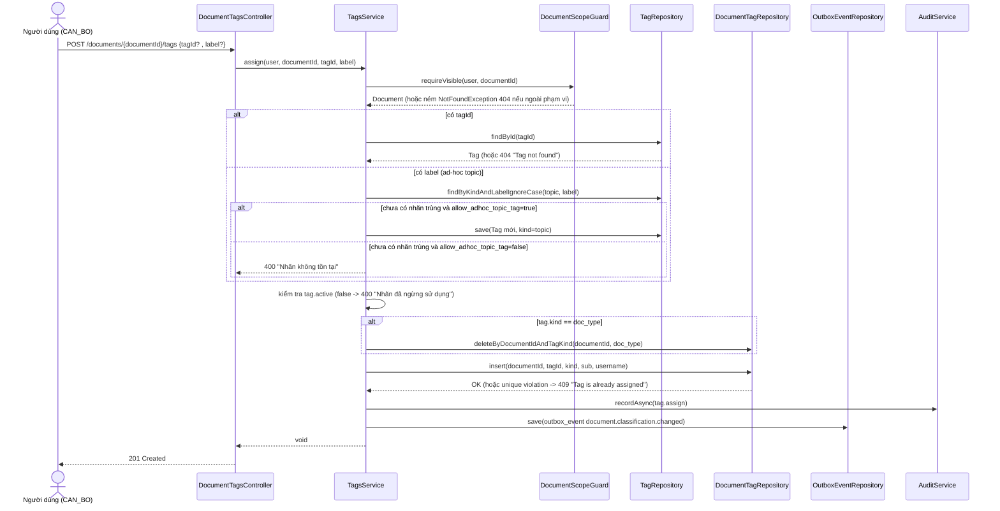
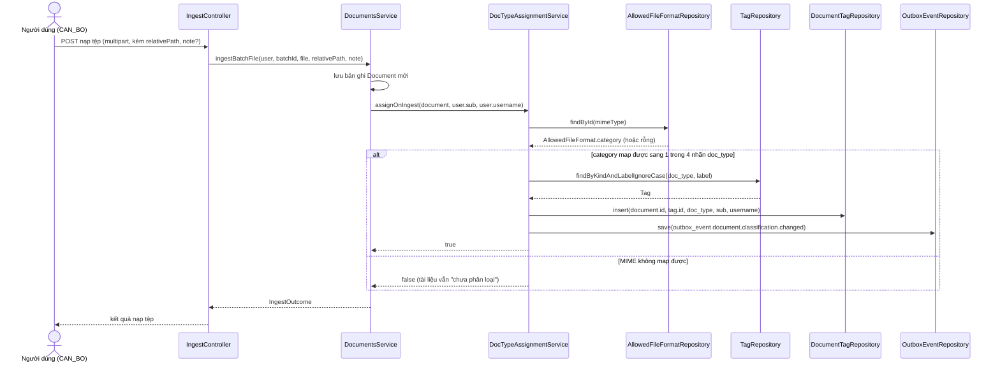

> Status: Draft

# Phân loại, gắn nhãn tài liệu (chủ đề `topic`, loại tài liệu `doc_type`)

## Mục tiêu nghiệp vụ

Hệ thống cho phép gắn hai loại nhãn độc lập lên mỗi tài liệu trong kho: nhãn
**chủ đề** (`topic`) do người dùng tự quản lý danh mục và gán tự do, và nhãn
**loại tài liệu** (`doc_type`) là danh mục cố định 4 giá trị được hệ thống tự
động gán theo định dạng tệp (MIME) ngay khi nạp tài liệu. Mục tiêu là giúp
tra cứu/lọc tài liệu theo chủ đề và loại nội dung, đồng thời đảm bảo mọi tài
liệu cuối cùng đều có đúng một loại tài liệu để phục vụ thống kê
(`GET /tags/report`). Việc gán/gỡ nhãn `topic` là thao tác thủ công của người
dùng có quyền; việc gán `doc_type` chủ yếu diễn ra tự động (lúc nạp tệp hoặc
qua tác vụ backfill khi khởi động ứng dụng), người dùng chỉ có thể *thay thế*
`doc_type` hiện có bằng một `doc_type` khác chứ không thể gỡ mà không thay.

## Tác nhân

- **Cán bộ (role `CAN_BO`)** — quyền `PERM_tag.manage`: tạo/đổi tên/ngừng
  dùng nhãn `topic`; gán/gỡ nhãn (`topic`/`doc_type`) cho tài liệu trong
  phạm vi nhìn thấy của mình.
- **Cán bộ / Lãnh đạo (`CAN_BO`, `LANH_DAO`)** — quyền `PERM_document.read`:
  xem danh mục nhãn, xem nhãn của một tài liệu, xem báo cáo thống kê nhãn.
  `LANH_DAO` có `document.read` nhưng **không có** `tag.manage` nên chỉ xem,
  không sửa được.
- **Hệ thống (ingest pipeline / `DocTypeBackfillRunner`)** — tự động gán
  `doc_type` ngay sau khi một tài liệu được lưu (lúc nạp batch), và tự động
  quét-gán cho tài liệu cũ chưa có `doc_type` mỗi khi ứng dụng khởi động.

## Phạm vi

**Trong phạm vi:**
- Quản lý danh mục nhãn `topic`: tạo (`POST /tags`), đổi tên
  (`PATCH /tags/{id}`), ngừng dùng (`POST /tags/{id}/deactivate` — không có
  xoá cứng).
- Xem danh mục nhãn (`GET /tags`, lọc theo `kind`).
- Gán nhãn cho tài liệu (`POST /documents/{documentId}/tags`), gỡ nhãn
  (`DELETE /documents/{documentId}/tags/{tagId}`), xem nhãn của một tài liệu
  (`GET /documents/{documentId}/tags`).
- Tạo nhãn `topic` "tại chỗ" (ad-hoc) ngay lúc gán, khi cấu hình hệ thống
  `classification.allow_adhoc_topic_tag` đang bật.
- Tự động gán `doc_type` theo MIME lúc nạp tài liệu (`DocumentsService`) và
  qua tác vụ backfill (`DocTypeBackfillRunner`) cho tài liệu cũ.
- Báo cáo thống kê số lượng theo nhãn (`GET /tags/report`), có scope theo
  `BusinessDataScope` của người gọi.

**Ngoài phạm vi (không có trong code):**
- Xoá cứng nhãn hoặc liên kết `document_tag` — không có API nào thực hiện
  việc này.
- Thêm/sửa/xoá danh mục `doc_type` qua API — 4 giá trị `doc_type` được seed
  cố định trong migration, không có endpoint quản trị.
- Giao diện chọn nhãn (frontend) — tài liệu này chỉ mô tả backend.
- Quản lý vai trò/quyền — vai trò và quyền đã được seed sẵn (`V12`), không
  thuộc phạm vi tính năng này.

## Luồng nghiệp vụ chính

### A. Quản lý danh mục nhãn `topic`

1. Người có `PERM_tag.manage` gọi `POST /tags` với `kind=topic` và `label`.
   `TagsService.create` **chỉ chấp nhận `kind=topic`**; gửi `doc_type` bị
   từ chối với 400 (`TagsService.java:74-80`).
2. Label được chuẩn hoá: trim + gộp khoảng trắng liên tiếp
   (`TagsService.normalizeLabel`, `TagsService.java:294-308`); trùng tên
   (không phân biệt hoa/thường, nhờ unique index `UQ_tag_kind_lower_label`
   trên `(kind, lower(label))`) trả 409.
3. Đổi tên (`PATCH /tags/{id}`) và ngừng dùng
   (`POST /tags/{id}/deactivate`) chỉ áp dụng cho nhãn `kind=topic`; gọi lên
   nhãn `doc_type` trả 400 (`TagsService.java:113-160`). Không kiểm tra
   người gọi có phải người tạo nhãn hay không — bất kỳ ai có
   `PERM_tag.manage` đều sửa/ngừng dùng được nhãn của người khác.
4. Ngừng dùng (`active=false`) không xoá các liên kết `document_tag` đã có
   — nhãn chỉ không thể **gán mới** nữa (Tag.java:37-43, TagsService
   `assign`).

### B. Gán / gỡ nhãn cho một tài liệu

1. `POST /documents/{documentId}/tags` với `tagId` (gán nhãn có sẵn) hoặc
   `label` (tạo `topic` mới tại chỗ) — đúng một trong hai trường
   (`AssignTagDto.java`).
2. Mọi thao tác đọc/ghi theo `documentId` đều đi qua
   `DocumentScopeGuard.requireVisible` trước tiên — tài liệu ngoài phạm vi
   nhìn thấy trả 404 giống hệt "không tồn tại" (`DocumentScopeGuard.java:43-75`).
3. Nếu dùng `label`: tìm `topic` trùng tên (không phân biệt hoa/thường); nếu
   chưa có và cấu hình `classification.allow_adhoc_topic_tag=true` thì tạo
   mới; nếu cấu hình tắt (mặc định `false`,
   `SystemConfigDefaults.java:194`) thì trả 400
   (`TagsService.resolveAssignTarget`, `TagsService.java:213-236`).
4. Nhãn đã `active=false` không thể gán — 400 (`TagsService.java:183-185`).
5. **Quy tắc riêng cho `doc_type`:** một tài liệu chỉ có **đúng một**
   `doc_type` tại một thời điểm — ép bằng unique index
   `UQ_document_tag_one_doc_type` (`V20`, dòng 90-92). Khi gán một
   `doc_type` mới, hệ thống **tự động xoá** liên kết `doc_type` cũ trong
   cùng transaction trước khi thêm liên kết mới — không trả 409 trùng
   trong trường hợp này (`TagsService.java:187-193`).
6. **Quy tắc riêng cho `topic`:** một tài liệu có thể có **nhiều** `topic`;
   gán lại một `topic` đã có sẵn cho cùng tài liệu là vi phạm khoá chính
   `(document_id, tag_id)` → 409 "Tag is already assigned to this document"
   (`TagsService.java:195-203`, `DocumentTagRepository.java:39-50`).
7. Gỡ nhãn (`DELETE /documents/{documentId}/tags/{tagId}`): nếu liên kết
   không tồn tại → 404; nếu liên kết đó là `doc_type` → 400, vì `doc_type`
   là bắt buộc và chỉ có thể *thay thế* qua bước B.5, không được gỡ trực
   tiếp (`TagsService.java:247-267`).
8. Mỗi lần gán/gỡ thành công đều ghi một dòng `outbox_event`
   (`document.classification.changed`) trong cùng transaction
   (`ClassificationOutbox.java:30-46`) và một bản ghi audit tương ứng
   (`tag.assign`/`tag.unassign`).

### C. Tự động gán `doc_type` lúc nạp tài liệu

1. Ngay sau khi một tài liệu được lưu trong `DocumentsService.ingestBatchFile`,
   hệ thống gọi `DocTypeAssignmentService.assignOnIngest`
   (`DocumentsService.java:296`) — **không** đi qua `DocumentScopeGuard` vì
   đây là ngữ cảnh hệ thống nội bộ, không phải yêu cầu người dùng tuỳ ý
   (`DocTypeAssignmentService.java:65-72`).
2. MIME của tệp được tra `AllowedFileFormat.category` (đã có sẵn từ danh
   sách định dạng cho phép nạp), rồi map sang 1 trong 4 nhãn `doc_type`
   cố định: `TEXT_DOC→"văn bản"`, `IMAGE→"hình ảnh"`, `AUDIO→"âm thanh"`,
   `VIDEO→"video"` (`DocTypeAssignmentService.java:36-40, 87-93`).
3. Nếu MIME không map được (ngoài allowlist hoặc giá trị cũ chưa từng
   biết), tài liệu **không** bị gán `doc_type` — không lỗi, tài liệu chỉ ở
   trạng thái "chưa phân loại" và lộ diện qua
   `GET /documents/unclassified-doc-type`
   (`DocumentsController.java` — endpoint `/unclassified-doc-type`,
   `DocumentSpecifications.missingDocType`).
4. Việc gán tự động cũng ghi `outbox_event` giống bước B.8, dùng chung
   `ClassificationOutbox`.

### D. Backfill `doc_type` cho tài liệu cũ

1. `DocTypeBackfillRunner` (một `CommandLineRunner`) chạy mỗi lần ứng dụng
   khởi động, xử lý theo trang 500 tài liệu/lần
   (`DocTypeBackfillRunner.java:34-73`).
2. Mỗi trang lấy các tài liệu chưa xoá và chưa có liên kết `doc_type`
   (`DocumentTagRepository.findDocumentIdsMissingDocType`,
   `DocumentTagRepository.java:84-92`), rồi gọi lại đúng
   `assignOnIngest` (actor `system/system`) — dùng chung một cơ chế với
   luồng C, không tạo luồng gán riêng.
3. Idempotent: tài liệu đã có `doc_type` sẽ không được truy vấn lại; tối đa
   1000 trang/lần khởi động để tránh treo quá trình boot.

### E. Báo cáo thống kê theo nhãn

1. `GET /tags/report` (quyền `PERM_document.read`, không phải
   `tag.manage`) trả số lượng tài liệu theo từng nhãn, có thể lọc theo
   `kind`, khoảng thời gian gán (`from`/`to`, theo ngày UTC) và `folderId`
   (`TagsController.java:69-78`).
2. Kết quả luôn được lọc qua `BusinessDataScope.forDocuments` trước khi
   `GROUP BY` — không bỏ qua phạm vi dữ liệu của người gọi, và không cache
   theo người dùng (`TagsService.java:275-290`).

## Sequence diagram

## Luồng ngoại lệ / trường hợp đặc biệt

| Tình huống | Nguồn | HTTP |
|---|---|---|
| Tạo nhãn qua `POST /tags` với `kind=doc_type` | `TagsService.java:76-78` | 400 |
| Tên `topic` trùng (không phân biệt hoa/thường) khi tạo/đổi tên | `TagsService.java:93-98, 125-129` | 409 |
| Đổi tên/ngừng dùng một nhãn không phải `topic` | `TagsService.java:117-119, 149-151` | 400 |
| Gán một nhãn đã `active=false` | `TagsService.java:183-185` | 400 |
| Gán lại một `topic` đã gán sẵn cho cùng tài liệu | `TagsService.java:198-201` (unique `(document_id, tag_id)`) | 409 |
| Gán bằng `label` khi nhãn chưa tồn tại và `allow_adhoc_topic_tag=false` | `TagsService.java:227-234` | 400 |
| Gán bằng `tagId` không tồn tại | `TagsService.java:214-215` | 404 |
| Gỡ nhãn `doc_type` qua `DELETE /documents/{id}/tags/{tagId}` | `TagsService.java:255-257` | 400 |
| Gỡ nhãn chưa được gán cho tài liệu | `TagsService.java:251-253` | 404 |
| Tài liệu ngoài phạm vi nhìn thấy (mọi thao tác đọc/ghi ở trên) | `DocumentScopeGuard.java:53-75` | 404 (giống "không tồn tại", có audit `access.denied`) |
| Thiếu quyền (`PERM_tag.manage`/`PERM_document.read`) | `ApiExceptionHandler.java:157-162` | 403 |
| MIME không map được `doc_type` lúc nạp tệp | `DocTypeAssignmentService.java:76-84` | không lỗi — tài liệu "chưa phân loại", xem `GET /documents/unclassified-doc-type` |

Luồng tự động gán `doc_type` lúc nạp tài liệu (kích hoạt bởi hệ thống, không
qua `DocumentScopeGuard`, không tương tác trực tiếp với người dùng cuối):

## Dữ liệu liên quan

| Entity / bảng | Vai trò | File code |
|---|---|---|
| `tag` | Danh mục nhãn: `topic` (tự do, quản lý bởi người dùng) và `doc_type` (4 giá trị cố định, seed ở migration) | `backend/src/main/java/com/aismartstore/backend/tags/Tag.java` |
| `document_tag` | Liên kết N-N tài liệu ↔ nhãn; cột `tag_kind` denormalize từ `tag.kind` để ép "đúng 1 `doc_type`/tài liệu" bằng index một phần | `backend/src/main/java/com/aismartstore/backend/tags/DocumentTag.java`, `DocumentTagId.java` |
| `outbox_event` | Sự kiện `document.classification.changed` ghi mỗi lần gán/gỡ nhãn thành công | `backend/src/main/java/com/aismartstore/backend/tags/ClassificationOutbox.java` |
| `allowed_file_format` | Cung cấp `category` (TEXT_DOC/IMAGE/AUDIO/VIDEO) dùng để suy ra nhãn `doc_type` từ MIME | `backend/src/main/java/com/aismartstore/backend/scanning/AllowedFileFormat.java` (đọc qua `AllowedFileFormatRepository`) |
| `audit_log` (qua `AuditService`) | Ghi `tag.create` / `tag.rename` / `tag.deactivate` / `tag.assign` / `tag.unassign` | `backend/src/main/java/com/aismartstore/backend/tags/TagsService.java` |
| `role_permission` (seed) | Nguồn của `PERM_tag.manage` / `PERM_document.read` và vai trò nào có quyền gì | `backend/src/main/resources/db/migration/V12__init_groups.sql:60-101` |

## File code tham chiếu

- `backend/src/main/java/com/aismartstore/backend/tags/Tag.java` — entity danh mục nhãn, cờ `active` (dòng 37-43).
- `backend/src/main/java/com/aismartstore/backend/tags/DocumentTag.java`, `DocumentTagId.java` — liên kết tài liệu-nhãn, khoá tổ hợp.
- `backend/src/main/java/com/aismartstore/backend/tags/TagKinds.java` — 2 kind hợp lệ: `topic`, `doc_type` (dòng 11-14).
- `backend/src/main/java/com/aismartstore/backend/tags/TagsController.java` — `POST/GET /tags`, `PATCH /tags/{id}`, `POST /tags/{id}/deactivate`, `GET /tags/report` (dòng 39-78).
- `backend/src/main/java/com/aismartstore/backend/tags/DocumentTagsController.java` — `GET/POST /documents/{documentId}/tags`, `DELETE /documents/{documentId}/tags/{tagId}` (dòng 36-55).
- `backend/src/main/java/com/aismartstore/backend/tags/TagsService.java` — toàn bộ nghiệp vụ danh mục + gán/gỡ + báo cáo (dòng 74-308).
- `backend/src/main/java/com/aismartstore/backend/tags/DocTypeAssignmentService.java` — tự động gán `doc_type` theo MIME, backfill (dòng 36-117).
- `backend/src/main/java/com/aismartstore/backend/tags/DocTypeBackfillRunner.java` — chạy backfill lúc khởi động (toàn file).
- `backend/src/main/java/com/aismartstore/backend/tags/ClassificationOutbox.java` — ghi `outbox_event` dùng chung (dòng 21-47).
- `backend/src/main/java/com/aismartstore/backend/tags/DocumentTagRepository.java`, `TagRepository.java` — truy vấn/insert (native) cho `document_tag`/`tag`.
- `backend/src/main/java/com/aismartstore/backend/tags/dto/CreateTagDto.java`, `RenameTagDto.java`, `AssignTagDto.java` — hợp đồng request.
- `backend/src/main/java/com/aismartstore/backend/documents/DocumentsService.java:296` — điểm gọi `assignOnIngest` ngay sau khi lưu tài liệu.
- `backend/src/main/java/com/aismartstore/backend/documents/DocumentsController.java` — endpoint `GET /documents/unclassified-doc-type` và tham số lọc `tagId` trên `GET /documents`.
- `backend/src/main/java/com/aismartstore/backend/groups/DocumentScopeGuard.java` — guard 404-thống nhất dùng chung cho mọi thao tác theo `documentId` (dòng 43-76).
- `backend/src/main/resources/db/migration/V20__classification_tags.sql` — schema `tag`/`document_tag`, seed 4 nhãn `doc_type`, unique index `UQ_document_tag_one_doc_type`.
- `backend/src/main/resources/db/migration/V12__init_groups.sql:60-101` — định nghĩa quyền `tag.manage`/`document.read` và vai trò nào có quyền gì.

## Điểm cần xác nhận thêm

- Theo seed `V12`, vai trò `QUAN_TRI` không có cả `PERM_document.read` lẫn
  `PERM_tag.manage` — nghĩa là tài khoản `QUAN_TRI` sẽ nhận 403 trên **mọi**
  endpoint nhãn, kể cả xem danh mục và báo cáo. Comment trong
  `TagsController.java:63-68` xác nhận đây là chủ ý ("R3 already lacks that
  permission... naturally 403s"), nhưng nên xác nhận lại với nghiệp vụ đây
  có còn là hành vi mong muốn hay không.
- Không tìm thấy endpoint quản trị cho danh mục `doc_type` (4 nhãn cố định
  hard-code trong `DocTypeAssignmentService.CATEGORY_TO_LABEL` + seed SQL).
  Muốn thêm loại tài liệu mới phải sửa code và migration, chưa có UI/API.
- Cấu hình `classification.allow_adhoc_topic_tag` mặc định là `false`
  (`SystemConfigDefaults.java:194`) — cần xác nhận giá trị thực tế đang
  bật/tắt trên môi trường vận hành trước khi coi tính năng "tạo topic tại
  chỗ" là hành vi mặc định cho người dùng.
- Không có giới hạn số lượng `topic` tối đa gán cho một tài liệu trong code
  đã đọc.
- Sửa/ngừng dùng một nhãn `topic` không kiểm tra người gọi có phải người đã
  tạo nhãn đó hay không — bất kỳ ai có `PERM_tag.manage` đều sửa được nhãn
  do người khác tạo.
