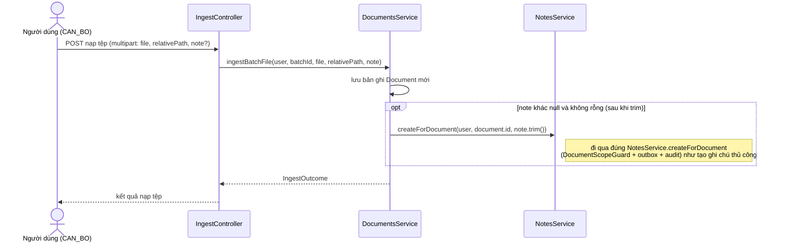

> Status: Draft

# Ghi chú cho tài liệu (document note)

## Mục tiêu nghiệp vụ

Mỗi tài liệu trong kho có thể được gắn thêm các ghi chú dạng văn bản tự do
để người dùng ghi lại thông tin nghiệp vụ liên quan (bối cảnh, tình trạng xử
lý, lưu ý...). Đây là annotation "chỉ thêm/sửa" (add/edit only) — hệ thống
không có API xoá ghi chú, để giữ nguyên vẹn dấu vết ghi chú đã tạo. Ghi chú
đầu tiên của một tài liệu có thể được tạo ngay trong lúc nạp tệp (kèm ghi
chú tuỳ chọn ở form upload); sau đó người dùng có thể tạo thêm ghi chú mới
hoặc sửa nội dung ghi chú đã có bất cứ lúc nào, miễn có quyền và tài liệu
nằm trong phạm vi nhìn thấy của họ.

## Tác nhân

- **Cán bộ (role `CAN_BO`)** — quyền `PERM_note.write`: tạo ghi chú mới, sửa
  nội dung ghi chú đã có (của mình hoặc của người khác — xem mục "Điểm cần
  xác nhận thêm").
- **Cán bộ / Lãnh đạo (`CAN_BO`, `LANH_DAO`)** — quyền `PERM_document.read`:
  xem danh sách ghi chú của một tài liệu. Theo seed quyền hiện tại
  (`V12__init_groups.sql`), chỉ `CAN_BO` có thêm `PERM_note.write`; `LANH_DAO`
  chỉ xem được, không tạo/sửa được.
- **Hệ thống (luồng nạp tệp)** — `DocumentsService.ingestBatchFile` tự động
  tạo một ghi chú thay mặt người nạp tệp nếu form upload có kèm nội dung
  `note`.

## Phạm vi

**Trong phạm vi:**
- Xem danh sách ghi chú của một tài liệu (`GET /documents/{documentId}/notes`).
- Tạo ghi chú mới (`POST /documents/{documentId}/notes`).
- Sửa nội dung một ghi chú đã có (`PATCH /documents/{documentId}/notes/{noteId}`),
  có tuỳ chọn kiểm soát tranh chấp bằng `expectedUpdatedAt` (optimistic
  concurrency).
- Tạo ghi chú tự động kèm theo lúc nạp tệp (tham số `note` trên endpoint
  ingest), tái sử dụng đúng `NotesService.createForDocument`.

**Ngoài phạm vi (không có trong code):**
- Xoá ghi chú — không có endpoint `DELETE` nào trong `NotesController`
  (chủ đích, xem `DocumentNote.java` dòng 12-16). Repository có
  `deleteByDocumentId` nhưng chỉ được `TrashPurgeService` gọi nội bộ khi
  xoá cứng toàn bộ tài liệu (không phải API cho người dùng xoá riêng một
  ghi chú).
- Lưu lịch sử các phiên bản nội dung trước khi sửa (chỉ có `updatedAt` /
  `updatedBySub` của lần sửa gần nhất, không có bảng version).
- Gắn tệp đính kèm/định dạng rich text cho ghi chú — trường `body` là văn
  bản thuần (`columnDefinition = "text"`).
- Giao diện soạn ghi chú (frontend) — tài liệu này chỉ mô tả backend.

## Luồng nghiệp vụ chính

1. Mọi thao tác đọc/ghi ghi chú đều nhận `documentId` và đi qua
   `DocumentScopeGuard.requireVisible` **trước tiên** — tài liệu ngoài
   phạm vi nhìn thấy trả 404, không phân biệt với "không tồn tại"
   (`NotesService.java:68-70, 94-95, 106-108`; `DocumentScopeGuard.java:43-75`).
2. **Tạo ghi chú** (`POST /documents/{documentId}/notes`, quyền
   `PERM_note.write`): nội dung `body` bắt buộc, tối đa 4000 ký tự
   (`NoteConstraints.NOTE_MAX_LENGTH`, `CreateNoteDto.java`). Một tài liệu
   có thể có **nhiều** ghi chú — không có ràng buộc "chỉ 1 ghi chú/tài
   liệu" (`DocumentNoteRepository` không có unique theo `documentId`).
   Ghi chú mới có `createdBySub`/`createdByUsername` là người gọi,
   `updatedBySub`/`updatedByUsername` để `null` (chưa từng sửa)
   (`NotesService.java:69-91`).
3. **Xem danh sách** (`GET /documents/{documentId}/notes`, quyền
   `PERM_document.read`): trả về theo thứ tự **mới nhất trước**
   (`findByDocumentIdOrderByCreatedAtDesc`, `NotesService.java:93-97`).
4. **Sửa ghi chú** (`PATCH /documents/{documentId}/notes/{noteId}`, quyền
   `PERM_note.write`): tìm đúng ghi chú theo `(noteId, documentId)`, không
   tồn tại → 404 "Note not found" (`NotesService.java:99-113`).
   - Nếu client gửi `expectedUpdatedAt` và giá trị này **khác**
     `updatedAt` hiện tại của ghi chú trong DB → 409 "Ghi chú đã được
     người khác sửa đổi; tải lại trước khi lưu" (kiểm soát tranh chấp lạc
     quan — optimistic concurrency, `NotesService.java:114-116`).
   - Nếu không gửi `expectedUpdatedAt`, không có kiểm tra tranh chấp — ghi
     đè trực tiếp.
   - Khi sửa thành công: `body` được thay, `updatedBySub`/
     `updatedByUsername` đổi thành người sửa, `updatedAt` cập nhật lại.
     **Không kiểm tra người sửa có phải người tạo ghi chú hay không** —
     bất kỳ ai có `PERM_note.write` và nhìn thấy tài liệu đều sửa được ghi
     chú do người khác tạo (`NotesService.java:118-122`, không có so sánh
     với `createdBySub`).
5. Mỗi lần tạo/sửa thành công đều ghi một dòng `outbox_event`
   (`document.note.changed`, payload chỉ gồm `documentId`/`changedAt`/
   `changedBySub`, **không** có `body`) trong cùng transaction với thay đổi
   `document_note`, và một bản ghi audit (`note.create`/`note.update`)
   (`NotesService.java:84-90, 124-153`).
6. **Tạo lúc nạp tệp:** nếu tham số `note` trên form ingest khác rỗng, ngay
   sau khi tài liệu được lưu, `DocumentsService.ingestBatchFile` gọi
   `notesService.createForDocument(user, document.getId(), note.trim())`
   — đi qua đúng luồng bước 2 ở trên, không có đường riêng
   (`DocumentsService.java`, đoạn gọi `notesService.createForDocument`
   ngay sau bước ghi audit upload; `IngestController.java:154,159`
   truyền `note` vào `ingestBatchFile`).

## Sequence diagram

```mermaid
sequenceDiagram
    actor U as Người dùng (CAN_BO)
    participant NC as NotesController
    participant NS as NotesService
    participant DSG as DocumentScopeGuard
    participant NR as DocumentNoteRepository
    participant OB as OutboxEventRepository
    participant AS as AuditService

    alt Tạo ghi chú mới
        U->>NC: POST /documents/{documentId}/notes {body}
        NC->>NS: createForDocument(user, documentId, body)
        NS->>DSG: requireVisible(user, documentId)
        DSG-->>NS: Document (hoặc 404 nếu ngoài phạm vi)
        NS->>NR: save(DocumentNote mới)
        NS->>OB: save(outbox_event document.note.changed)
        NS->>AS: recordAsync(note.create)
        NS-->>NC: DocumentNote
        NC-->>U: 200 DocumentNote
    else Sửa ghi chú đã có
        U->>NC: PATCH /documents/{documentId}/notes/{noteId} {body, expectedUpdatedAt?}
        NC->>NS: update(user, documentId, noteId, dto)
        NS->>DSG: requireVisible(user, documentId)
        DSG-->>NS: Document (hoặc 404 nếu ngoài phạm vi)
        NS->>NR: findByIdAndDocumentId(noteId, documentId)
        NR-->>NS: DocumentNote (hoặc 404 "Note not found")
        alt expectedUpdatedAt không gửi hoặc khớp updatedAt hiện tại
            NS->>NR: save(note với body/updatedBySub/updatedAt mới)
            NS->>OB: save(outbox_event document.note.changed)
            NS->>AS: recordAsync(note.update)
            NS-->>NC: DocumentNote
            NC-->>U: 200 DocumentNote
        else expectedUpdatedAt lệch (người khác đã sửa trước)
            NS-->>NC: ConflictException
            NC-->>U: 409 "Ghi chú đã được người khác sửa đổi; tải lại trước khi lưu"
        end
    end
```

## Luồng ngoại lệ / trường hợp đặc biệt

| Tình huống | Nguồn | HTTP |
|---|---|---|
| `body` rỗng hoặc vượt 4000 ký tự (tạo/sửa) | `NoteConstraints.java:5`, `CreateNoteDto.java`, `UpdateNoteDto.java` | 400 |
| Tham số `note` trên form nạp tệp vượt 4000 ký tự | `ApiExceptionHandler.java:114-123` (bắt `ConstraintViolationException` cho `@RequestParam` — không tạo ghi chú nào) | 400 |
| Sửa ghi chú không tồn tại (theo `noteId` + `documentId`) | `NotesService.java:110-112` | 404 |
| Sửa ghi chú với `expectedUpdatedAt` không khớp `updatedAt` hiện tại | `NotesService.java:114-116` | 409 |
| Tài liệu ngoài phạm vi nhìn thấy (mọi thao tác) | `DocumentScopeGuard.java:53-75` | 404 (giống "không tồn tại", có audit `access.denied`) |
| Thiếu quyền (`PERM_note.write` để tạo/sửa, `PERM_document.read` để xem) | `ApiExceptionHandler.java:157-162` | 403 |
| Xoá ghi chú | Không có endpoint — `NotesController` chỉ có `GET`/`POST`/`PATCH` (`NotesController.java:24-56`) | n/a (không hỗ trợ) |

Luồng tạo ghi chú tự động khi nạp tệp (điểm vào thay thế, không qua
`NotesController` mà qua `IngestController`, nhưng tái sử dụng cùng
`NotesService.createForDocument` ở bước tạo mới của sơ đồ chính):



## Dữ liệu liên quan

| Entity / bảng | Vai trò | File code |
|---|---|---|
| `document_note` | Nội dung ghi chú của tài liệu; giữ cả người/thời điểm tạo và người/thời điểm sửa gần nhất, không giữ lịch sử các bản sửa trước | `backend/src/main/java/com/aismartstore/backend/notes/DocumentNote.java` |
| `outbox_event` | Sự kiện `document.note.changed` (không mang `body`) ghi mỗi lần tạo/sửa ghi chú thành công | `backend/src/main/java/com/aismartstore/backend/notes/NotesService.java:142-153` |
| `audit_log` (qua `AuditService`) | Ghi `note.create` / `note.update` | `backend/src/main/java/com/aismartstore/backend/notes/NotesService.java:86-89, 126-129` |
| `role_permission` (seed) | Nguồn của `PERM_note.write` / `PERM_document.read` và vai trò nào có quyền gì | `backend/src/main/resources/db/migration/V12__init_groups.sql:62, 81-82, 88` |

## File code tham chiếu

- `backend/src/main/java/com/aismartstore/backend/notes/DocumentNote.java` — entity, comment "add/edit only" (dòng 12-16).
- `backend/src/main/java/com/aismartstore/backend/notes/NotesController.java` — `GET/POST /documents/{documentId}/notes`, `PATCH /documents/{documentId}/notes/{noteId}`; không có `DELETE` (toàn file).
- `backend/src/main/java/com/aismartstore/backend/notes/NotesService.java` — toàn bộ nghiệp vụ tạo/xem/sửa, optimistic concurrency, outbox, audit (dòng 60-154).
- `backend/src/main/java/com/aismartstore/backend/notes/NoteConstraints.java` — `NOTE_MAX_LENGTH = 4000` (dòng 5).
- `backend/src/main/java/com/aismartstore/backend/notes/dto/CreateNoteDto.java`, `UpdateNoteDto.java` — hợp đồng request, `expectedUpdatedAt` tuỳ chọn.
- `backend/src/main/java/com/aismartstore/backend/notes/DocumentNoteRepository.java` — `findByDocumentIdOrderByCreatedAtDesc`, `findByIdAndDocumentId`, `deleteByDocumentId` (chỉ dùng nội bộ bởi trash purge).
- `backend/src/main/java/com/aismartstore/backend/groups/DocumentScopeGuard.java` — guard 404-thống nhất dùng chung cho mọi thao tác theo `documentId` (dòng 43-76).
- `backend/src/main/java/com/aismartstore/backend/documents/DocumentsService.java` — điểm gọi `notesService.createForDocument` ngay sau khi lưu tài liệu trong `ingestBatchFile`.
- `backend/src/main/java/com/aismartstore/backend/ingest/IngestController.java:154,159` — tham số `note` (tối đa 4000 ký tự) trên endpoint nạp tệp, truyền vào `ingestBatchFile`.
- `backend/src/main/java/com/aismartstore/backend/common/ApiExceptionHandler.java:95-123` — xử lý 400 cho `note` vượt độ dài trên `@RequestParam` (khác đường với `@RequestBody`).
- `backend/src/main/resources/db/migration/V12__init_groups.sql:62, 81-82, 88` — định nghĩa quyền `note.write`/`document.read` và vai trò nào có quyền gì.

## Điểm cần xác nhận thêm

- Sửa ghi chú **không** kiểm tra người sửa có phải tác giả ban đầu hay
  không — theo code, bất kỳ ai có `PERM_note.write` và nằm trong phạm vi
  nhìn thấy tài liệu đều sửa được ghi chú do người khác tạo. Theo seed
  quyền hiện tại chỉ `CAN_BO` có `PERM_note.write`, nên trong thực tế đây
  là "bất kỳ Cán bộ nào thấy được tài liệu", không giới hạn theo tác giả
  hay chủ sở hữu tài liệu. Nên xác nhận đây có phải hành vi nghiệp vụ mong
  muốn hay cần bổ sung kiểm tra quyền sở hữu.
- Không có API xoá ghi chú — nếu nghiệp vụ cần "gỡ" một ghi chú nhập sai,
  hiện chỉ có thể sửa đè nội dung (`PATCH`), không có cách nào loại ghi
  chú đó khỏi danh sách hiển thị.
- Không lưu lịch sử nội dung các lần sửa trước — `outbox_event` và
  `audit_log` chỉ ghi nhận **có** thay đổi (`documentId`, `changedAt`,
  `changedBySub`/actor) chứ không ghi nội dung `body` cũ/mới, nên không
  thể dựng lại lịch sử chỉnh sửa từ các bảng này.
- `expectedUpdatedAt` là tham số tuỳ chọn — client có thể bỏ qua hoàn toàn
  cơ chế chống tranh chấp; nên xác nhận frontend hiện tại có luôn gửi giá
  trị này hay không (nằm ngoài phạm vi đọc code của tài liệu này).
