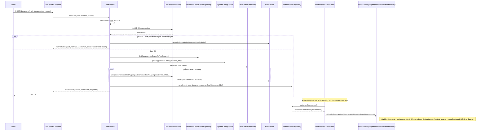

> Status: Draft

# Xóa mềm vào thùng rác (kéo theo dữ liệu số hoá liên quan)

## Mục tiêu nghiệp vụ

Cho phép người dùng chuyển tài liệu vào thùng rác (xóa mềm) thay vì xóa vĩnh
viễn ngay lập tức, để có thể phục hồi lại nếu xóa nhầm (xem file `-b` cho
luồng phục hồi). Tài liệu trong thùng rác được giữ trong một khoảng thời gian
lưu trữ (mặc định 365 ngày, cấu hình qua `retention.trash_retention_days`)
trước khi bị một tiến trình nền xóa cứng riêng biệt. Việc xóa mềm chỉ đánh
dấu cờ trên bảng `document`; dữ liệu số hoá liên quan (kết quả OCR/STT, đoạn
nội dung...) trong Postgres không bị đụng tới mà chỉ "biến mất" khỏi các
truy vấn nhờ điều kiện lọc theo `document.deletedAt`, đồng thời bị gỡ hẳn
khỏi chỉ mục tìm kiếm OpenSearch.

## Tác nhân

- Người dùng có quyền `PERM_trash.manage`: gọi API xóa mềm một lô tài liệu.
- Hệ thống nền `SearchIndexOutboxPoller` (poll định kỳ theo
  `app.search-index.poll-interval-ms`, mặc định 2000ms): gỡ tài liệu khỏi
  chỉ mục OpenSearch sau khi nhận sự kiện outbox `document.trash`.

## Phạm vi

**Trong phạm vi:**
- `POST /documents/trash`, `POST /documents/trash-preview` — xóa mềm một lô
  tài liệu và xem trước tác động (số nhóm chia sẻ đang hoạt động sẽ mất hiệu
  lực).
- Hiệu ứng dây chuyền lên chỉ mục tìm kiếm OpenSearch khi xóa mềm.
- Cách dữ liệu số hoá (bảng `digitization_run`, `content_segment`, ...) bị
  ảnh hưởng gián tiếp bởi xóa mềm (không có cascade UPDATE/DELETE nào chạy
  trên các bảng này).

**Ngoài phạm vi:**
- Phục hồi từ thùng rác — xem file
  `04-xoa-mem-thung-rac-phuc-hoi-b.md`.
- Xóa cứng (hard purge) sau khi hết hạn lưu — `TrashPurgeService.purgeOne`
  được nêu ở mục "Điểm cần xác nhận thêm" chỉ để đối chiếu ranh giới.
- Xem danh sách/chi tiết thùng rác (`GET /trash`, `GET /trash/{id}`), thống
  kê thùng rác (`GET /trash/stats`).

## Luồng nghiệp vụ chính

1. Client gọi `POST /documents/trash` với danh sách `documentIds` và lý do
   (`reason`) → `DocumentsController.trash` (yêu cầu quyền
   `PERM_trash.manage`) → `TrashService.trash(user, documentIds, reason)`.
2. **Quy tắc nghiệp vụ — giới hạn lô:** tối đa 500 tài liệu một lần
   (`MAX_BATCH_SIZE`), danh sách rỗng hoặc vượt ngưỡng bị từ chối ngay
   (`INVALID_BATCH_SIZE`, 400).
3. **Quy tắc nghiệp vụ — tồn tại & chưa bị xóa:** nếu có `documentId` không
   tìm thấy → `DOCUMENT_NOT_FOUND` (404); nếu có tài liệu đã có
   `deletedAt != null` → `DOCUMENT_ALREADY_DELETED` (409).
4. **Quy tắc nghiệp vụ — phạm vi quyền:** chỉ được xóa tài liệu do chính
   mình tải lên (`uploaderSub == sub`) hoặc được chia sẻ tới một nhóm mà
   mình là thành viên; ngược lại → `FORBIDDEN` (403), đồng thời ghi audit
   `document.trash.denied` cho từng tài liệu bị từ chối (ghi độc lập qua
   `recordIndependently`, không bị rollback theo transaction đang throw).
5. Tính `purgeAfter = now + retention.trash_retention_days` (mặc định 365
   ngày, đọc qua `SystemConfigService`). Tạo một bản ghi `TrashBatch` mới
   (nhóm các tài liệu bị xóa cùng một lần thao tác).
6. Với mỗi tài liệu: set `deletedAt`, `deletedBySub`, `deletedByUsername`,
   `deletedReason`, `purgeAfter`, `trashBatchId`, `purgeState = DELETED`,
   rồi lưu lại — **đây là toàn bộ thay đổi dữ liệu của bước xóa mềm**, chỉ
   trên bảng `document`, không có câu lệnh nào chạm tới bảng số hoá.
7. Ghi audit log `document.trash` (thành công) cho từng tài liệu; ghi một sự
   kiện outbox `document.trash` (payload gồm toàn bộ `documentIds` trong
   lô) để xử lý bất đồng bộ phía sau.
8. **Quy tắc nghiệp vụ — hệ quả trên dữ liệu số hoá (gián tiếp, không phải
   cascade thật):** các repository đọc dữ liệu số hoá theo tài liệu (ví dụ
   `DigitizationRunRepository.findDistinctDocumentIdByReviewState`) lọc kèm
   điều kiện `document.deletedAt IS NULL`, nên ngay khi `document.deletedAt`
   được set, các bản ghi số hoá liên quan không còn xuất hiện trong các luồng
   nghiệp vụ dùng những truy vấn này, dù bản thân chúng vẫn còn nguyên trong
   Postgres.
9. (Bất đồng bộ) `SearchIndexOutboxPoller.poll()` claim sự kiện `document.
   trash` và gọi `handleDocumentTrashed` → xóa hẳn (không phải đánh dấu cờ)
   document + mọi segment tương ứng khỏi OpenSearch (`deleteDocumentsFromIndex`
   gọi `segmentIndexer.deleteByDocumentIds` + `documentIndexer.deleteByIds`).

## Sequence diagram

## Luồng ngoại lệ / trường hợp đặc biệt

| Tình huống | Mã lỗi HTTP | Code | Nguồn |
|---|---|---|---|
| `documentIds` rỗng hoặc > 500 phần tử | 400 | `INVALID_BATCH_SIZE` | `TrashService.invalidBatchSize()` |
| Có id không tồn tại | 404 | `DOCUMENT_NOT_FOUND` | `TrashService.documentsNotFound()` |
| Có tài liệu đã ở trong thùng rác | 409 | `DOCUMENT_ALREADY_DELETED` | `TrashService.alreadyDeleted()` |
| Có tài liệu không do mình tải lên và không thuộc nhóm chia sẻ của mình | 403 | `FORBIDDEN` | `TrashService.forbiddenDocuments()` (kèm ghi audit `document.trash.denied` độc lập cho từng id) |

**Trường hợp đặc biệt về dữ liệu số hoá:** không có nhánh lỗi/ngoại lệ riêng
nào cho `digitization_run`/`content_segment` — vì bước xóa mềm không thao
tác trực tiếp lên các bảng đó, mọi rủi ro dữ liệu số hoá "biến mất" chỉ nằm
ở tầng OpenSearch (bất đồng bộ, qua outbox), không nằm ở tầng Postgres.

## Dữ liệu liên quan

| Entity / bảng DB | Vai trò trong tính năng | File code |
|---|---|---|
| `document` | Đối tượng duy nhất bị thay đổi khi xóa mềm (`deletedAt`, `deletedBySub`, `deletedByUsername`, `deletedReason`, `purgeAfter`, `trashBatchId`, `purgeState`). | `backend/src/main/java/com/aismartstore/backend/documents/Document.java` |
| `trash_batch` | Nhóm các tài liệu bị xóa mềm trong cùng một lần thao tác. | `backend/src/main/java/com/aismartstore/backend/trash/TrashBatch.java` |
| `document_group_share` | Đọc để tính `activeGroupShareCount` (preview); KHÔNG bị đụng tới ở bước xóa mềm (chỉ bị DELETE ở bước xóa cứng, xem "Điểm cần xác nhận thêm"). | `backend/src/main/java/com/aismartstore/backend/groups/DocumentGroupShareRepository.java` |
| `outbox_event` | Mang sự kiện `document.trash` để `SearchIndexOutboxPoller` xử lý bất đồng bộ. | `backend/src/main/java/com/aismartstore/backend/outbox/OutboxEventRepository.java` |
| `audit_log` | Ghi vết `document.trash`, `document.trash.denied`. | `backend/src/main/java/com/aismartstore/backend/audit/AuditService.java` |
| `digitization_run`, `content_segment`, `digitization_batch`, `document_digitization_status`, `segment_revision`, `sound_event` | Dữ liệu số hoá — **không hề bị cascade UPDATE/DELETE** khi xóa mềm; "biến mất" khỏi các truy vấn nghiệp vụ chỉ là hệ quả của điều kiện lọc `document.deletedAt IS NULL` trong các repository đọc. | `backend/src/main/java/com/aismartstore/backend/digitization/results/*.java` |
| Chỉ mục OpenSearch (`documentIndexer`, `segmentIndexer`) | Bị xóa hẳn (không phải đánh dấu cờ) khi trash. | `backend/src/main/java/com/aismartstore/backend/search/index/SearchIndexOutboxPoller.java` |

## File code tham chiếu

- `backend/src/main/java/com/aismartstore/backend/trash/TrashService.java`
  - `trash()`: dòng 171-278 (toàn bộ luồng xóa mềm và các quy tắc ở trên).
  - `preview()`: dòng 280-289.
  - Các hàm dựng lỗi liên quan (`invalidBatchSize`, `documentsNotFound`,
    `alreadyDeleted`, `forbiddenDocuments`): dòng 570-599.
- `backend/src/main/java/com/aismartstore/backend/documents/DocumentsController.java` — route `/documents/trash`, `/documents/trash-preview`: dòng 133-142.
- `backend/src/main/java/com/aismartstore/backend/digitization/results/DigitizationRunRepository.java` — `findDistinctDocumentIdByReviewState` (điều kiện `d.deletedAt IS NULL` cho thấy dữ liệu số hoá "biến mất" khỏi truy vấn khi trashed): dòng 130-146.
- `backend/src/main/java/com/aismartstore/backend/search/index/SearchIndexOutboxPoller.java`
  - Hằng số event type `EVENT_DOCUMENT_TRASHED`: dòng 55.
  - `processOne` (dispatch theo `event_type`): dòng 202-218.
  - `handleDocumentTrashed()`: dòng 361-372 (xóa hẳn khỏi OpenSearch).
  - `deleteDocumentsFromIndex()`: dòng 406-410.
  - `poll()` (lịch chạy `fixedDelayString`, mặc định 2000ms): dòng 132-133.
- `backend/src/main/java/com/aismartstore/backend/systemconfig/SystemConfigDefaults.java` — `RETENTION_TRASH_RETENTION_DAYS` default 365 ngày: dòng 113-114.
- `backend/src/main/java/com/aismartstore/backend/trash/purge/TrashPurgeService.java` — `purgeOne()`: dòng 155-219 (chỉ để đối chiếu ranh giới với xóa cứng, xem "Điểm cần xác nhận thêm").

## Điểm cần xác nhận thêm

1. **Purge cứng không xóa hết dữ liệu số hoá (thuộc tính năng khác, nêu ở
   đây để làm rõ ranh giới):** `TrashPurgeService.purgeOne()` (dòng 155-219)
   chỉ DELETE cứng `document_tag`, `document_note`, `document_group_share`,
   `digitization_source`, `source_separation_job`, sau đó "bia mộ hóa" row
   `document`. Các bảng `digitization_run`, `content_segment`,
   `digitization_batch`, `document_digitization_status`, `segment_revision`,
   `sound_event` **không** bị xóa cứng — vẫn còn nguyên trong Postgres, trỏ
   tới một `document_id` đã bị rỗng hóa. Chưa rõ đây là chủ ý hay thiếu sót
   — cần người biết rõ quyết định thiết kế xác nhận.
2. Không có cơ chế dọn/nhắc riêng cho các bảng số hoá "mồ côi" sau khi tài
   liệu bị purge — nếu ý định thiết kế là chúng phải bị xóa theo, đây là một
   thiếu sót cần bổ sung job/migration dọn dẹp.
