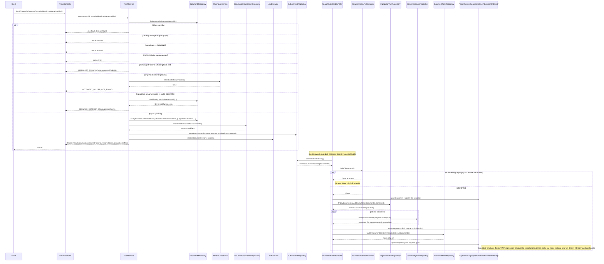

> Status: Draft

# Phục hồi tài liệu từ thùng rác

## Mục tiêu nghiệp vụ

Cho phép người dùng đưa một tài liệu đã bị xóa mềm (xem file `-a` cho luồng
xóa mềm) trở lại trạng thái hoạt động, xử lý các xung đột có thể phát sinh
trong lúc chờ trong thùng rác (thư mục gốc bị xóa, trùng tên, đã bắt đầu bị
xóa cứng...). Vì bước xóa mềm không cascade xuống dữ liệu số hoá, "phục hồi
dữ liệu số hoá" ở đây thực chất là dựng lại chỉ mục tìm kiếm OpenSearch từ dữ
liệu quan hệ vẫn còn nguyên trong Postgres, chứ không phải khôi phục dữ liệu
đã mất.

## Tác nhân

- Người dùng có quyền `PERM_trash.manage`, đồng thời là người đã xóa
  (`deletedBySub`) hoặc người tải lên (`uploaderSub`) tài liệu: gọi API phục
  hồi một hoặc nhiều tài liệu.
- Hệ thống nền `SearchIndexOutboxPoller` (poll định kỳ theo
  `app.search-index.poll-interval-ms`, mặc định 2000ms): dựng lại document +
  segment trong OpenSearch sau khi nhận sự kiện outbox `document.restored`.

## Phạm vi

**Trong phạm vi:**
- `GET /trash`, `GET /trash/{id}` — xem danh sách/chi tiết tài liệu trong
  thùng rác (phục vụ trực tiếp cho việc chọn tài liệu để phục hồi).
- `POST /trash/{id}/restore`, `POST /trash/restore-batch` — phục hồi một hoặc
  nhiều tài liệu, gồm 8 nhánh xung đột.
- Hiệu ứng dây chuyền lên chỉ mục tìm kiếm OpenSearch khi phục hồi (dựng lại
  từ Postgres qua `SearchIndexOutboxPoller`).

**Ngoài phạm vi:**
- Xóa mềm (đưa vào thùng rác) — xem file
  `04-xoa-mem-thung-rac-phuc-hoi-a.md`.
- Xóa cứng (hard purge) sau khi hết hạn lưu.
- Thống kê thùng rác (`GET /trash/stats`).

## Luồng nghiệp vụ chính

1. Client gọi `POST /trash/{id}/restore` (đơn lẻ) hoặc `POST /trash/restore-
   batch` (nhiều tài liệu, lặp qua `restore()` cho từng id qua self-injection
   để giữ `@Transactional` theo từng item, lỗi của một item không chặn các
   item khác) → `TrashService.restore(user, id, targetFolderId,
   onNameConflict)`.
2. **Quy tắc nghiệp vụ — 8 case kiểm tra tuần tự, dừng ở điều kiện đầu tiên
   khớp:**
   1. Không tìm thấy tài liệu đã xóa mềm với id này → 404 (`Trash item not
      found`, không có `code`).
   2. Không phải người đã xóa (`deletedBySub`) và không phải người tải lên
      (`uploaderSub`) → 403 (`ForbiddenException`, không có `code`).
   3. `purgeState == PURGING` (đang bị xóa cứng, do `TrashPurgeService`
      claim) → 409 `PURGING`.
   4. `purgeState == PURGED` hoặc `purgeAfter` đã qua → 410 `GONE` (không
      thể phục hồi qua thùng rác nữa).
   5. Không có `targetFolderId` và thư mục gốc (`document.folderId`) đã
      `null` → 409 `FOLDER_MISSING`, kèm `suggestedFolderId` (tổ tiên gần
      nhất còn tồn tại, dò từ `deletedFolderPathIds` theo thứ tự lá→gốc).
   6. Có `targetFolderId` nhưng thư mục đích không tồn tại
      (`WarehouseService.folderExists`) → 400 `TARGET_FOLDER_NOT_FOUND`.
   7. Trùng tên tại thư mục đích (cùng `folderId`, `relativePath`,
      `originalName`, `status = CLEAN`, `deletedAt IS NULL`) và
      `onNameConflict != AUTO_RENAME` → 409 `NAME_CONFLICT`, kèm tên gợi ý
      đổi (`"<tên> (khôi phục yyyyMMdd-HHmm)"`).
   8. Còn lại: thực hiện phục hồi.
3. Khi phục hồi: đặt lại `originalName` (đổi tên nếu `AUTO_RENAME`),
   `folderId = effectiveFolderId`, xóa `deletedAt`/`deletedBySub`/
   `deletedByUsername`/`deletedReason`/`purgeAfter` (về `null`),
   `purgeState = ACTIVE`. `trashBatchId` **được giữ nguyên** (lưu vết lịch
   sử batch đã xóa, không xóa khi phục hồi).
4. Tính `groupsLostEffect` = các nhóm chia sẻ đã mất hiệu lực khi tài liệu ở
   trong thùng rác (`findDeletedGroupIdsForDocument`) — trả về trong response
   để client biết cần chia sẻ lại (bản thân việc phục hồi không tự động cấp
   lại chia sẻ nhóm).
5. Ghi audit `document.restore` (thành công); ghi sự kiện outbox
   `document.restored` (payload chỉ một `documentId`).
6. **Quy tắc nghiệp vụ — không có logic phục hồi riêng cho dữ liệu số hoá:**
   vì bước xóa mềm (file `-a`) không cascade xóa các bảng số hoá, bước phục
   hồi cũng không cần (và không có) bất kỳ câu UPDATE/INSERT nào trên
   `digitization_run`, `content_segment`... Toàn bộ "phục hồi dữ liệu số
   hoá" trong luồng này thực chất là **dựng lại chỉ mục OpenSearch từ
   Postgres**, không phải khôi phục dữ liệu quan hệ (dữ liệu quan hệ chưa
   từng mất).
7. (Bất đồng bộ) `SearchIndexOutboxPoller.handleDocumentRestored` đọc lại
   toàn bộ dữ liệu hiện tại của tài liệu từ Postgres và index lại: document +
   segment tiêu đề (`indexDocumentAndTitleSegment`), mọi segment đã confirm
   của mọi task OCR/STT/SED/summary (`indexConfirmedSegmentsForAllTasks`,
   bỏ qua segment đã soft-delete `ContentSegment.isDeleted()`), và segment
   ghi chú gộp nếu có (`indexNoteSegmentIfAny`). Nếu tài liệu đã bị xóa cứng
   ngay sau khi restore (race hiếm) thì `fieldsBuilder.build` trả rỗng và
   handler không làm gì.

## Sequence diagram

## Luồng ngoại lệ / trường hợp đặc biệt

8 case xung đột (xem sequence diagram ở trên), kiểm tra tuần tự, dừng ở điều
kiện đầu tiên khớp:

| # | Điều kiện | Mã lỗi HTTP | Code |
|---|---|---|---|
| 1 | Không tồn tại/chưa bị xóa mềm | 404 | (không có `code`, message "Trash item not found") |
| 2 | Không phải người xóa & không phải người tải lên | 403 | (không có `code`, `ForbiddenException`) |
| 3 | `purgeState == PURGING` | 409 | `PURGING` |
| 4 | `purgeState == PURGED` hoặc quá `purgeAfter` | 410 | `GONE` |
| 5 | Thiếu `targetFolderId`, thư mục gốc đã mất | 409 | `FOLDER_MISSING` |
| 6 | `targetFolderId` không tồn tại | 400 | `TARGET_FOLDER_NOT_FOUND` |
| 7 | Trùng tên tại thư mục đích, không `AUTO_RENAME` | 409 | `NAME_CONFLICT` |
| 8 | Hợp lệ | 200 | — |

`restoreBatch` gọi `restore()` cho từng id; một item lỗi không làm hỏng các
item khác trong cùng batch — mỗi item trả về `RESTORED`/`CONFLICT`/`ERROR`
độc lập (`RestoreBatchItem`, "CONFLICT" ứng với `HttpStatus.CONFLICT`, còn
lại gộp chung "ERROR").

**Trường hợp đặc biệt về dữ liệu số hoá:** không có nhánh lỗi/ngoại lệ riêng
nào cho `digitization_run`/`content_segment` trong luồng phục hồi — vì phục
hồi không thao tác trực tiếp lên các bảng đó, mọi rủi ro dữ liệu số hoá
"quay lại"/"không quay lại" đúng chỉ nằm ở tầng OpenSearch (bất đồng bộ, qua
outbox), không nằm ở tầng Postgres.

## Dữ liệu liên quan

| Entity / bảng DB | Vai trò trong tính năng | File code |
|---|---|---|
| `document` | Đối tượng duy nhất bị thay đổi khi phục hồi (`deletedAt`, `deletedBySub`, `deletedByUsername`, `deletedReason`, `purgeAfter` trở về `null`; `folderId`, `originalName` có thể đổi; `purgeState = ACTIVE`; `trashBatchId` giữ nguyên). | `backend/src/main/java/com/aismartstore/backend/documents/Document.java` |
| `document_group_share` | Đọc để tính `groupsLostEffect` trả về cho client; KHÔNG có ghi/khôi phục tự động nào lên bảng này khi restore. | `backend/src/main/java/com/aismartstore/backend/groups/DocumentGroupShareRepository.java` |
| `outbox_event` | Mang sự kiện `document.restored` để `SearchIndexOutboxPoller` xử lý bất đồng bộ. | `backend/src/main/java/com/aismartstore/backend/outbox/OutboxEventRepository.java` |
| `audit_log` | Ghi vết `document.restore`. | `backend/src/main/java/com/aismartstore/backend/audit/AuditService.java` |
| `digitization_run`, `content_segment` | Đọc lại (không ghi) để dựng lại segment trong OpenSearch — mọi run có `reviewState = confirmed` của mọi task, bỏ qua segment đã soft-delete. | `backend/src/main/java/com/aismartstore/backend/digitization/results/DigitizationRunRepository.java`, `ContentSegmentRepository.java` |
| `document_note` | Đọc lại để dựng segment ghi chú gộp (`content_source = 'note'`) trong OpenSearch. | `backend/src/main/java/com/aismartstore/backend/notes/DocumentNoteRepository.java` |
| Chỉ mục OpenSearch (`documentIndexer`, `segmentIndexer`) | Được dựng lại hoàn toàn từ Postgres khi restore (không phải "un-delete" một cờ). | `backend/src/main/java/com/aismartstore/backend/search/index/SearchIndexOutboxPoller.java` |

## File code tham chiếu

- `backend/src/main/java/com/aismartstore/backend/trash/TrashService.java`
  - `list()`, `getOne()`: dòng 293-335.
  - `restore()`: dòng 352-419 (8 case xung đột, thứ tự kiểm tra đúng như code).
  - `restoreBatch()`: dòng 421-435.
  - `requireRestorePermission()`: dòng 485-491.
  - `suggestFolderId()`: dòng 499-515.
  - `renamedName()`: dòng 517-521.
  - Các hàm dựng lỗi (`purging`...`invalidView`): dòng 601-648.
- `backend/src/main/java/com/aismartstore/backend/trash/TrashController.java` — route `/trash`, `/trash/{id}`, `/trash/{id}/restore`, `/trash/restore-batch`: dòng 40-81.
- `backend/src/main/java/com/aismartstore/backend/trash/dto/RestoreDto.java`, `RestoreBatchDto.java` — shape request body restore.
- `backend/src/main/java/com/aismartstore/backend/documents/DocumentRepository.java` — `findByIdAndDeletedAtIsNotNull` dòng 75, `findFirstByFolderIdAndRelativePathAndOriginalNameAndStatusAndDeletedAtIsNull` dòng 32.
- `backend/src/main/java/com/aismartstore/backend/search/index/SearchIndexOutboxPoller.java`
  - Hằng số event type `EVENT_DOCUMENT_RESTORED`: dòng 57.
  - `processOne` (dispatch theo `event_type`): dòng 202-218.
  - `handleDocumentRestored()`: dòng 374-393 (dựng lại toàn bộ từ Postgres).
  - `indexDocumentAndTitleSegment()`: dòng 289-308.
  - `indexConfirmedSegmentsForAllTasks()`: dòng 412-430.
  - `indexNoteSegmentIfAny()`: dòng 252-277.
  - `poll()` (lịch chạy `fixedDelayString`, mặc định 2000ms): dòng 132-133.
- `backend/src/main/java/com/aismartstore/backend/trash/purge/TrashPurgeService.java` — `purgeOne()`, dòng 155-219 (`purgeState == PURGING/PURGED` mà `restore()` kiểm tra ở case 3/4 tham chiếu tới trạng thái do file này set).

## Điểm cần xác nhận thêm

1. Case 1 (404) và case 2 (403) của luồng phục hồi không có trường `code`
   trong body JSON (khác với case 3-7 đều có `code` rõ ràng như `PURGING`,
   `GONE`...) — nên xác nhận với FE xem có cần bổ sung `code` cho nhất quán
   hay hành vi hiện tại (dựa vào status HTTP) đã đủ.
2. `restoreBatch` gộp mọi lỗi không phải `CONFLICT` thành `"ERROR"` chung
   (`RestoreBatchItem.failed`, dựa trên `e.getStatus() == HttpStatus.
   CONFLICT`) — nghĩa là 404/403/400/410 đều hiển thị outcome `"ERROR"`
   giống nhau ở batch, dù `code` chi tiết vẫn được giữ trong trường `code`.
   Cần xác nhận đây có phải hành vi UI mong muốn hay không.
3. Xem thêm mục "Điểm cần xác nhận thêm" ở file
   `04-xoa-mem-thung-rac-phuc-hoi-a.md` về việc purge cứng không xóa hết các
   bảng số hoá — có liên quan gián tiếp tới case 4 (`GONE`) ở đây, vì sau khi
   một tài liệu bị purge, các bảng số hoá "mồ côi" của nó vẫn còn trong
   Postgres dù không còn đường nào phục hồi tài liệu đó qua thùng rác nữa.
