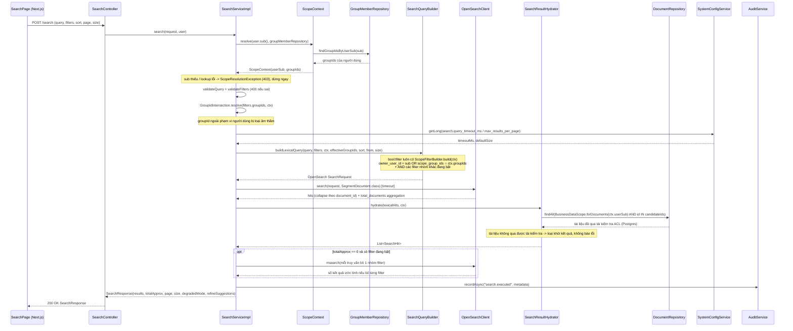
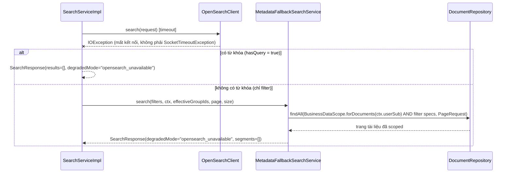

> Status: Draft

# Tìm kiếm nâng cao theo nhiều tiêu chí (từ khóa, loại tài liệu, thời gian, nhãn, nhóm)

## Mục tiêu nghiệp vụ

Cho phép người dùng tìm tài liệu đã số hóa bằng một hoặc kết hợp nhiều tiêu
chí: từ khóa toàn văn, loại tài liệu, nhãn chủ đề, khoảng thời gian nạp kho,
nhóm chia sẻ, thư mục, loại nội dung (tài liệu/âm thanh/video), nguồn xác
nhận (thủ công/tự động). Đây là một view lọc trên đúng tập tài liệu người
dùng đã có quyền xem (`document.read`), không phải một kênh truy cập dữ liệu
riêng — kết quả tìm kiếm không được vượt quá phạm vi mà các API xem tài liệu
khác đã cho phép. Khi index toàn văn (OpenSearch) không khả dụng, hệ thống cố
gắng phục vụ tiếp bằng lọc metadata thuần trên Postgres (nếu không có từ
khóa) thay vì báo lỗi hoàn toàn.

## Tác nhân

- Người dùng có quyền `PERM_document.read` (mọi vai trò được cấp quyền này
  theo `rbac-group-scope.md`, khớp với `DocumentsController`) — gọi qua trang
  `Tìm kiếm & tra cứu` (`web/src/app/search/page.tsx`).
- Hệ thống nền: `SearchServiceImpl` (điều phối), OpenSearch (`segment`/
  `document` alias) cho tìm kiếm toàn văn/lọc chính, Postgres
  (`MetadataFallbackSearchService`) cho lọc dự phòng khi OpenSearch không khả
  dụng.

## Phạm vi

**Trong phạm vi:**
- `POST /search` — kết hợp `query` (từ khóa) và/hoặc `filters` (docType,
  topicTags + AND/OR, uploadedFrom/uploadedTo, groupIds, folderId,
  mediaType, confirmSource); ít nhất một trong `query`/`filters` phải khác
  rỗng.
- Phân trang (`page`, `size`) và sắp xếp (`sort=relevance|recent`).
- Lọc phạm vi quyền xem (ownership + group membership) áp dụng hai lớp: tại
  OpenSearch và tái kiểm tra tại Postgres.
- Gợi ý "bỏ bộ lọc X sẽ có N kết quả" khi kết quả bằng 0 và có ít nhất một
  filter đang bật (AC12).
- Chế độ suy giảm (degraded) khi OpenSearch không khả dụng: fallback
  Postgres nếu không có từ khóa, trả kết quả rỗng có đánh dấu nếu có từ
  khóa.
- Ghi audit `search.executed` cho mỗi lần tìm kiếm.

**Ngoài phạm vi (không mô tả ở đây):**
- Tìm kiếm ngữ nghĩa (`search-semantic`, dùng `SearchService.lexicalSearch`
  làm một trong các nguồn RRF) — không phải là `POST /search`.
- Định vị chính xác kết quả trên trang/khung thời gian (đánh dấu highlight,
  bbox, mốc thời gian) và việc đồng bộ chỉ mục từ Postgres sang OpenSearch —
  thuộc các tính năng khác trong cùng nhóm `search-fulltext-*`.
- Quản lý nhóm/chia sẻ tài liệu vào nhóm (nguồn của `scope_group_ids`) —
  thuộc tính năng quản lý nhóm.

## Luồng nghiệp vụ chính

1. Người dùng nhập từ khóa và/hoặc chọn filter trên `SearchFilterPanel`, bấm
   tìm kiếm. Frontend gọi `POST /search` kèm bearer token, body do
   `buildSearchRequest`/`buildFiltersBody` dựng (chỉ gửi field filter nào có
   giá trị) — `web/src/app/search/page.tsx:155-181`,
   `web/src/lib/search-request.ts`.
2. `SearchController.search` yêu cầu quyền `PERM_document.read`
   (`@PreAuthorize`), rồi giao toàn bộ nghiệp vụ cho `SearchServiceImpl`
   (`SearchController.java:40-44`).
3. **Quy tắc — fail closed trước khi chạm OpenSearch:** `SearchServiceImpl`
   resolve `ScopeContext` (userSub + danh sách groupId người dùng đang là
   thành viên, qua `GroupMemberRepository.findGroupIdsByUserSub`) ngay bước
   đầu tiên; nếu token thiếu `sub` hoặc lookup nhóm lỗi, ném
   `ScopeResolutionException` → HTTP 403, không có request nào tới OpenSearch
   (`SearchServiceImpl.java:117-120`, `ScopeContext.java:32-45`).
4. **Quy tắc — bắt buộc có ít nhất một tiêu chí:** nếu cả `query` (sau khi
   trim) và `filters` đều rỗng → 400 "Vui lòng nhập từ khóa hoặc chọn ít
   nhất một bộ lọc" (`SearchServiceImpl.java:122-130`).
5. Validate `query` (≤ 256 ký tự, ≤ 32 từ) và `filters` (mỗi danh sách
   `topicTags`/`groupIds`/`mediaType` ≤ 20 giá trị; `docType` phải thuộc
   danh mục tag `doc_type` đã seed; `confirmSource` chỉ nhận `manual`/`auto`)
   — sai bất kỳ điều kiện nào → 400 (`SearchServiceImpl.java:439-468`).
6. **Quy tắc — thu hẹp `groupIds` về đúng phạm vi người dùng:** `filters.
   groupIds` được giao (∩) với `ScopeContext.groupIds()`; groupId người dùng
   yêu cầu nhưng không phải thành viên bị **âm thầm loại bỏ** (không báo
   lỗi, không lộ thông tin nhóm tồn tại hay không), chỉ được ghi vào audit
   (`GroupIdIntersection.java:25-44`, `SearchServiceImpl.java:501-505`).
7. Chuẩn hóa `sort` (`recent` hoặc mặc định `relevance`), `page` (mặc định
   0, phải ≥ 0), `size` (mặc định lấy từ system-config
   `search.max_results_per_page` = 20, tối đa cứng 50; `from + size` không
   được vượt 10.000) — sai → 400 (`SearchServiceImpl.java:137-149,
   424-437`).
8. **Xây dựng truy vấn OpenSearch — lọc phạm vi quyền xem (bắt buộc, luôn
   có mặt):** `SearchQueryBuilder.buildFilterClauses` luôn thêm
   `ScopeFilterBuilder.build(ctx)` làm điều kiện đầu tiên trong
   `bool.filter[]`:
   ```
   owner_user_id = ctx.userSub()  OR  scope_group_ids ∩ ctx.groupIds() ≠ ∅
   ```
   (bool.should + minimum_should_match=1) — điều kiện `owner_user_id` luôn có
   mặt dù người dùng không thuộc nhóm nào (`ScopeFilterBuilder.java:29-39`,
   dùng trong `SearchQueryBuilder.java:230-276`).
9. **Quy tắc — kết hợp filter là AND giữa các nhóm, có thể AND/OR trong một
   nhóm:** mỗi filter đang bật (`docType`, `topicTags`, `uploadedFrom/To`,
   `effectiveGroupIds`, `folderId`, `mediaType`, `confirmSource`) được thêm
   là một clause riêng trong cùng `bool.filter[]` → các nhóm filter kết hợp
   **AND** với nhau và với điều kiện phạm vi ở bước 8. Trong nội bộ một
   nhóm nhiều giá trị: `topicTags` hỗ trợ chọn `AND` (mặc định, mỗi tag một
   `term` clause) hoặc `OR` (`resolvedTopicTagsMode()`, một `terms` clause);
   `groupIds`/`mediaType` dùng `terms` (khớp **bất kỳ** giá trị nào trong
   danh sách, tức OR nội bộ nhóm) (`SearchQueryBuilder.java:239-276`,
   `SearchFilters.java:66-68`).
10. Nếu `query` rỗng: truy vấn trực tiếp trên index `document` (không
    collapse, mỗi hit đã là một tài liệu), sort mặc định `uploaded_at desc`.
    Nếu có `query`: truy vấn `simple_query_string` (toán tử mặc định AND
    giữa các từ, hỗ trợ cú pháp `PHRASE|AND|OR|NOT|PRECEDENCE|WHITESPACE`)
    trên index `segment`, `collapse` theo `document_id` kèm tối đa 3
    `inner_hits`/đoạn trích mỗi tài liệu; `sort=recent` đổi sang
    `uploaded_at desc`, mặc định là điểm liên quan (`_score`)
    (`SearchQueryBuilder.java:100-145`).
11. Gọi OpenSearch với timeout lấy từ system-config
    `search.query_timeout_ms` (mặc định 1500 ms); hết hạn → 504
    (`SearchServiceImpl.java:151, 320-352`,
    `SystemConfigDefaults.java:97-204`).
12. **Quy tắc — tái kiểm tra quyền xem lần hai tại Postgres (lớp phòng thủ
    thứ hai):** `SearchResultHydrator.hydrate` lọc lại toàn bộ
    `documentId` ứng viên qua
    `BusinessDataScope.forDocuments(ctx.userSub(), groupMemberRepository)`
    (chủ sở hữu HOẶC tài liệu đã chia sẻ vào nhóm người dùng là thành viên,
    và loại tài liệu đã xóa mềm) trong Postgres; tài liệu OpenSearch báo
    khớp nhưng không qua được vòng kiểm tra này bị loại khỏi kết quả, không
    báo lỗi (`SearchResultHydrator.java:71-135`,
    `groups/BusinessDataScope.java:1-40`). Đây chính là cơ chế chống rủi ro
    "A nhìn thấy tài liệu của B" khi index OpenSearch bị lệch dữ liệu so
    với Postgres.
13. Vì bước 12 có thể loại bớt kết quả, `runSearch` lặp lại tối đa 2 vòng,
    mỗi vòng lấy dư (`over-fetch` ×1.5 + 10) để bù số bị loại, cho tới khi
    đủ `size` hoặc OpenSearch hết dữ liệu để trả (`SearchServiceImpl.java:
    212-262`).
14. Nếu tổng số kết quả xấp xỉ (`totalApprox`, đếm theo `document_id` bằng
    `cardinality` aggregation) bằng 0 và có ít nhất một nhóm filter đang bật,
    hệ thống chạy thêm 1 truy vấn `_msearch` (tối đa 5 truy vấn con), mỗi
    truy vấn bỏ đúng một nhóm filter, để gợi ý "bỏ bộ lọc X sẽ ra N kết
    quả" — best-effort, lỗi ở bước này không làm hỏng kết quả tìm kiếm
    chính (`SearchServiceImpl.java:264-302`, `FilterGroup.java`).
15. Ghi audit `search.executed` (query đã cắt còn tối đa 200 ký tự, filters,
    số kết quả, sort, danh sách groupId bị loại ở bước 6) — lỗi ghi audit
    chỉ log cảnh báo, không làm fail request (`SearchServiceImpl.java:
    486-522`).
16. Trả `SearchResponse` gồm `results`, `totalApprox`, `page`, `size`,
    `degradedMode`, `refineSuggestions` (`SearchResponse.java`).

## Sequence diagram



## Luồng ngoại lệ / trường hợp đặc biệt

- **403 Forbidden** — token thiếu `sub`, hoặc lookup group membership lỗi
  (`ScopeResolutionException`, resolve trước khi gọi OpenSearch)
  (`ScopeContext.java:32-45`, `ApiExceptionHandler.java:170-177`).
- **400 Bad Request** — `query` và `filters` cùng rỗng; `query` > 256 ký tự
  hoặc > 32 từ; một danh sách filter (`topicTags`/`groupIds`/`mediaType`) >
  20 giá trị; `docType`/`confirmSource` ngoài danh mục đóng; `page` < 0;
  `size` ≤ 0 hoặc > 50; `page*size + size` > 10.000
  (`SearchServiceImpl.java:122-149, 424-468`).
- **504 Gateway Timeout** — truy vấn OpenSearch chính vượt
  `search.query_timeout_ms` (future timeout của executor), hoặc bản thân
  request bị `SocketTimeoutException` ở tầng transport — cả hai đều được
  coi là lỗi tạm thời của một truy vấn, **không** kích hoạt fallback Postgres
  (`SearchServiceImpl.java:320-352`).
- **500 Internal Server Error** — lỗi OpenSearch khác (không phải kết nối,
  không phải timeout) hoặc luồng bị interrupt
  (`SearchServiceImpl.java:333-351`).
- **Chế độ suy giảm khi OpenSearch mất kết nối** (`IOException` không phải
  `SocketTimeoutException`, ví dụ connection refused) — xem sequence diagram
  phụ bên dưới:
  - Nếu **có từ khóa** (`hasQuery=true`): không có phương án thay thế cho
    tìm kiếm toàn văn trên Postgres → trả `200 OK` với `results=[]`,
    `degradedMode="opensearch_unavailable"` (`SearchServiceImpl.java:
    161-166`).
  - Nếu **không có từ khóa** (chỉ lọc filter): fallback sang
    `MetadataFallbackSearchService`, dùng `Specification<Document>` thuần
    Postgres, **vẫn scoped qua `BusinessDataScope.forDocuments`** (cùng ngữ
    nghĩa ownership/group-share, không có full-text) — trả
    `degradedMode="opensearch_unavailable"`, mỗi `SearchHit.segments()`
    rỗng, không có highlight/vị trí (`SearchServiceImpl.java:156-160`,
    `MetadataFallbackSearchService.java:66-119`).
- **0 kết quả với filter đang bật (AC12)** — chạy thêm diagnostics
  `_msearch` bỏ từng nhóm filter để gợi ý; nếu diagnostics tự lỗi/timeout
  thì chỉ log cảnh báo, trả `refineSuggestions=[]`, không ảnh hưởng response
  chính (`SearchServiceImpl.java:264-302`).
- **groupId yêu cầu ngoài phạm vi người dùng** — không báo lỗi, âm thầm bị
  loại khỏi truy vấn (không làm rỗng toàn bộ kết quả nếu còn filter khác/
  điều kiện phạm vi khác vẫn thỏa), chỉ ghi lại trong audit
  (`GroupIdIntersection.java:41-44`).
- **Segment giả (pseudo-segment) từ tiêu đề/ghi chú tài liệu** — các đoạn
  khớp trên `title`/`note` được index với id tổng hợp
  (`"{documentId}:note"`/`":title"`), không phải UUID `content_segment`
  thật; `SearchResultHydrator` chủ động bỏ qua parse UUID lỗi thay vì để lộ
  lỗi 400 cho toàn bộ response (bug đã được sửa, ghi chú tại
  `SearchResultHydrator.java:137-159`).



## Dữ liệu liên quan

| Entity / bảng DB | Vai trò | File code |
|---|---|---|
| OpenSearch alias `document` (index `document-v1`) | Nguồn cho truy vấn metadata-only khi `query` rỗng | `search/SearchIndexNames.java`, `search/SearchQueryBuilder.java:110-119` |
| OpenSearch alias `segment` (index `segment-v1`) | Nguồn cho truy vấn toàn văn (`simple_query_string`, collapse theo `document_id`) | `search/SearchIndexNames.java`, `search/SearchQueryBuilder.java:122-138` |
| Trường `owner_user_id`, `scope_group_ids` (OpenSearch) | Lọc phạm vi quyền xem lớp 1 tại OpenSearch | `search/ScopeFilterBuilder.java` |
| `document` (Postgres, `Document`/`DocumentRepository`) | Tái kiểm tra ACL lớp 2 + hydrate tên/docType tài liệu | `search/SearchResultHydrator.java`, `documents/DocumentRepository.java` |
| `document_group_share` (`DocumentGroupShare`) | Nguồn xác định "tài liệu đã chia sẻ vào nhóm X" (cả 2 lớp) | `groups/BusinessDataScope.java`, `search/MetadataFilterSpecifications.java:64-71` |
| Thành viên nhóm (`GroupMemberRepository.findGroupIdsByUserSub`) | Nguồn `ScopeContext.groupIds()` — nhóm người dùng đang là thành viên | `search/ScopeContext.java` |
| `content_segment` (`ContentSegment`/`ContentSegmentRepository`) | Hydrate nội dung/segment khớp để build highlight | `search/SearchResultHydrator.java:84-94` |
| `tag`/`document_tag` (`TagRepository`, `DocumentTagRepository`) | Validate `docType`/`topicTags`, resolve nhãn cho fallback Postgres | `search/SearchServiceImpl.java:458-461`, `search/MetadataFallbackSearchService.java:121-159` |
| `warehouse_folder` (`WarehouseFolderRepository`) | Lấy toàn bộ thư mục con của `folderId` (tối đa 5 cấp) | `search/MetadataFallbackSearchService.java:161-169` |
| `digitization_run` (`DigitizationRun`) | Nguồn `confirmSource` (manual/auto) cho fallback Postgres | `search/MetadataFilterSpecifications.java:103-124` |
| `document_digitization_status` | Hydrate `SearchHit.documentDigitizationStatus` | `search/SearchResultHydrator.java:96-102` |
| `system_config` (`search.max_results_per_page`, `search.query_timeout_ms`) | Kích thước trang mặc định, timeout truy vấn | `systemconfig/SystemConfigDefaults.java:97-204` |
| `audit_log` (entry `search.executed`) | Ghi lại mỗi lần tìm kiếm, gồm `droppedGroupIds` | `search/SearchServiceImpl.java:486-522` |

## File code tham chiếu

- `backend/src/main/java/com/aismartstore/backend/search/SearchController.java:40-44` — endpoint `POST /search`, permission `PERM_document.read`.
- `backend/src/main/java/com/aismartstore/backend/search/SearchServiceImpl.java:117-171` — điều phối chính (`search()`).
- `backend/src/main/java/com/aismartstore/backend/search/SearchServiceImpl.java:212-262` — `runSearch`, vòng lặp over-fetch + double-check ACL.
- `backend/src/main/java/com/aismartstore/backend/search/SearchServiceImpl.java:264-302` — diagnostics gợi ý bỏ filter (AC12).
- `backend/src/main/java/com/aismartstore/backend/search/SearchServiceImpl.java:439-468` — validate query/filters.
- `backend/src/main/java/com/aismartstore/backend/search/ScopeContext.java:32-45` — resolve scope, fail-closed.
- `backend/src/main/java/com/aismartstore/backend/search/ScopeFilterBuilder.java:29-39` — điều kiện lọc quyền xem tại OpenSearch (owner OR group-share).
- `backend/src/main/java/com/aismartstore/backend/search/GroupIdIntersection.java:25-44` — thu hẹp `groupIds` về đúng phạm vi người dùng.
- `backend/src/main/java/com/aismartstore/backend/search/SearchQueryBuilder.java:100-276` — dựng truy vấn OpenSearch chính + kết hợp filter (AND/OR).
- `backend/src/main/java/com/aismartstore/backend/search/FilterGroup.java` — 5 nhóm filter dùng cho diagnostics AC12.
- `backend/src/main/java/com/aismartstore/backend/search/SearchResultHydrator.java:71-159` — tái kiểm tra ACL lớp 2 tại Postgres + hydrate kết quả.
- `backend/src/main/java/com/aismartstore/backend/search/MetadataFallbackSearchService.java:66-119` — fallback lọc Postgres khi OpenSearch mất kết nối (chỉ khi không có từ khóa).
- `backend/src/main/java/com/aismartstore/backend/search/MetadataFilterSpecifications.java` — `Specification<Document>` cho từng nhóm filter ở fallback.
- `backend/src/main/java/com/aismartstore/backend/groups/BusinessDataScope.java:1-40` — định nghĩa "phạm vi của tôi" dùng chung ở lớp 2 và fallback.
- `backend/src/main/java/com/aismartstore/backend/search/dto/SearchRequest.java`, `SearchFilters.java`, `SearchResponse.java`, `SearchHit.java`, `SegmentHit.java`, `RefineSuggestion.java` — hợp đồng API.
- `backend/src/main/java/com/aismartstore/backend/systemconfig/SystemConfigDefaults.java:97-204` — default `search.max_results_per_page=20`, `search.query_timeout_ms=1500`.
- `web/src/app/search/page.tsx:155-192` — nơi frontend gọi `POST /search`, xử lý gợi ý refine.
- `web/src/lib/search-request.ts` — validate phía client (mirror giới hạn backend), build request body.
- `web/src/lib/api.ts:46-63` — `apiFetch`/`apiJson`, gọi thẳng backend kèm bearer token từ NextAuth session.
- `web/src/components/search/SearchFilterPanel.tsx`, `SearchResultCard.tsx` — UI chọn filter và hiển thị kết quả.

## Điểm cần xác nhận thêm

- Tài liệu này mô tả đúng hành vi code hiện tại của `POST /search` (nhóm
  tính năng `search-fulltext-01`/`-02`/`-04`). Phần định vị chính xác kết
  quả trên trang/khung thời gian và đồng bộ chỉ mục (`search-fulltext-03`,
  `-04`) không được mô tả chi tiết ở đây — nên xác nhận có cần tách file
  riêng cho 2 phần đó không nếu người đọc cần đầy đủ pipeline.
- Không tìm thấy giới hạn tần suất gọi (rate limit) riêng cho `POST
  /search` trong code đã đọc — nếu có ở tầng gateway/hạ tầng ngoài
  `backend/`, tài liệu này chưa phản ánh.
- Giá trị `search.max_results_per_page`/`search.query_timeout_ms` là default
  seed; giá trị thực tế trên môi trường chạy có thể đã bị admin chỉnh qua
  `system_config` — tài liệu chỉ nêu default trong code, không tra giá trị
  runtime.
- Trường hợp mất kết nối OpenSearch **và có từ khóa**: hệ thống trả 200 với
  `results=[]` thay vì báo lỗi rõ ràng cho người dùng — hành vi này khớp
  code hiện tại nhưng nên xác nhận với sản phẩm xem đây có phải trải nghiệm
  mong muốn (người dùng có thể hiểu nhầm là "không có kết quả" thay vì "hệ
  thống tìm kiếm đang lỗi").
