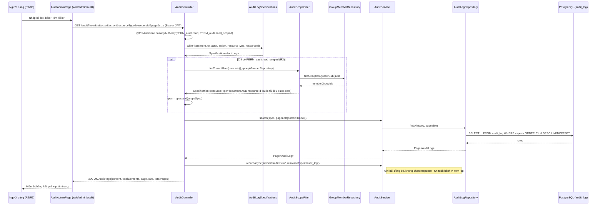
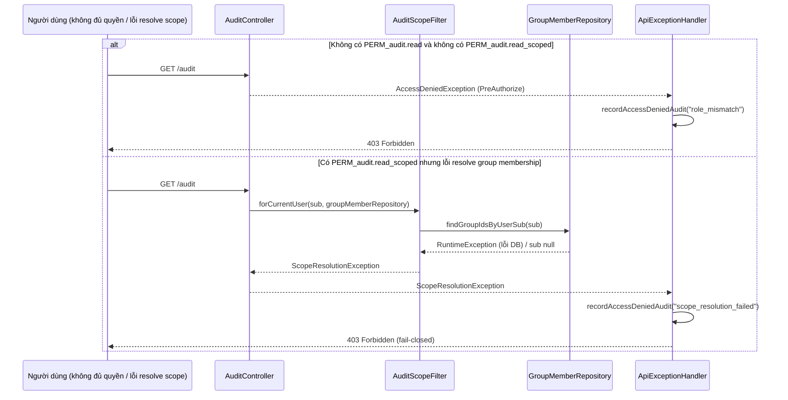

> Status: Draft

# Tra cứu, lọc nhật ký hoạt động (Audit Log)

## Mục tiêu nghiệp vụ

Hệ thống ghi lại tự động các hành động nghiệp vụ quan trọng (tạo/tải/xóa/khôi
phục tài liệu, thao tác nhóm, thay đổi tài khoản, cấu hình hệ thống, v.v.) vào
một nhật ký hoạt động (audit log) bất biến, không thể sửa hoặc xóa sau khi ghi.
Tính năng "tra cứu, lọc nhật ký hoạt động" cho phép người dùng có thẩm quyền
xem lại nhật ký này qua một màn hình tìm kiếm/lọc theo thời điểm, người thực
hiện, loại hành động và tài nguyên liên quan, phục vụ mục đích truy vết trách
nhiệm và điều tra sự cố. Phạm vi nhìn thấy được giới hạn theo vai trò: Lãnh đạo
(R2) chỉ thấy nhật ký liên quan tới tài liệu mà mình có quyền truy cập, còn
Quản trị hệ thống (R3) thấy toàn bộ nhật ký không giới hạn. Bản thân hành vi
xem nhật ký cũng được ghi lại như một sự kiện audit khác.

## Tác nhân

- **Lãnh đạo (R2 - `LANH_DAO`)**: có quyền `PERM_audit.read_scoped`, xem được
  nhật ký nhưng bị giới hạn phạm vi (chỉ sự kiện trên tài liệu mình sở hữu
  hoặc được chia sẻ qua nhóm).
- **Quản trị hệ thống (R3 - `QUAN_TRI`)**: có quyền `PERM_audit.read`, xem
  được toàn bộ nhật ký không giới hạn phạm vi, và là vai trò duy nhất được
  gọi thêm chức năng xác minh toàn vẹn chuỗi hash (`/audit/verify`).
- **Cán bộ (R1) và các vai trò khác**: không có cả hai quyền trên nên không
  truy cập được màn hình/API này (bị chặn ở tầng UI và tầng API).
- **Hệ thống (background job / interceptor)**: là tác nhân ghi nhật ký, không
  trực tiếp tham gia luồng tra cứu nhưng tạo ra dữ liệu mà luồng này đọc.

## Phạm vi

**Trong phạm vi:**
- API `GET /audit`: liệt kê, lọc theo `from`, `to`, `actor`, `action`,
  `resourceType`, `resourceId`, phân trang (`page`, `size`), sắp xếp mới nhất
  trước.
- Thu hẹp phạm vi kết quả theo vai trò (R2 vs R3).
- Ghi lại chính hành vi xem nhật ký (`audit.view`).
- Trang quản trị `web/src/app/admin/audit/page.tsx` (bộ lọc, bảng kết quả,
  chi tiết mở rộng theo dòng, phân trang).
- Tính bất biến (append-only) của dữ liệu được hiển thị.

**Ngoài phạm vi (không mô tả chi tiết trong tài liệu này):**
- `GET /audit/verify` — xác minh toàn vẹn chuỗi hash (chain verification),
  chỉ dành cho R3, là một tính năng riêng (chống giả mạo) chứ không phải
  tra cứu/lọc; chỉ nhắc tới ở mục luồng ngoại lệ vì dùng chung controller.
  - `AuditSealerJob`, `AuditCheckpointJob`, `AuditPartitionMaintenanceJob`,
  `AuditRetentionJob` — các job nền tính hash/niêm phong/phân vùng/dọn dẹp,
  không phải luồng tra cứu do người dùng khởi tạo.
- Danh sách đầy đủ các loại hành động (`action`) được ghi log ở khắp hệ
  thống (nằm rải rác ở nhiều service khác nhau, không thuộc riêng module
  audit).

## Luồng nghiệp vụ chính

1. Người dùng đăng nhập với vai trò `LANH_DAO` hoặc `QUAN_TRI` mở trang
   "Nhật ký hoạt động" (`/admin/audit`). Trang chỉ hiển thị nếu
   `canSeeFeature(session, 'audit')` trả `true` — tức vai trò của phiên nằm
   trong `[Role.LANH_DAO, Role.QUAN_TRI]`
   (`web/src/app/admin/audit/page.tsx:67`, `web/src/lib/features.ts:192-199`);
   nếu không, hiển thị `AccessDenied`.
2. Trang tự động gọi `GET /audit` không kèm bộ lọc ngay khi mount (trang đầu
   tiên, kích thước 50 bản ghi) để hiển thị dữ liệu mặc định.
3. Người dùng nhập điều kiện lọc: khoảng thời gian (`from`/`to`), người thực
   hiện (`actor`), hành động (`action`), loại tài nguyên (`resourceType`),
   ID tài nguyên (`resourceId`), rồi bấm "Tìm kiếm" (reset về trang 0) hoặc
   "Xóa bộ lọc".
4. **Quy tắc nghiệp vụ**: mỗi điều kiện lọc là so khớp **chính xác** (`equal`),
   không phải tìm kiếm mờ/`LIKE`, và tất cả điều kiện được kết hợp bằng AND;
   điều kiện nào để trống thì bị bỏ qua (`AuditLogSpecifications.java:14-43`).
5. Backend nhận request tại `AuditController.list()`, yêu cầu một trong hai
   quyền `PERM_audit.read` hoặc `PERM_audit.read_scoped`
   (`AuditController.java:59`); kích thước trang bị giới hạn tối đa 200 bản
   ghi/trang bất kể client gửi gì (`AuditController.java:71`).
6. **Quy tắc nghiệp vụ (thu hẹp phạm vi R2)**: nếu người dùng hiện tại
   **không** có quyền `PERM_audit.read` (tức chỉ có `read_scoped`), hệ thống
   tự động AND thêm điều kiện phạm vi từ `AuditScopeFilter.forCurrentUser()`
   vào specification lọc, trước khi truy vấn (`AuditController.java:74-78`).
   Điều kiện này giới hạn kết quả chỉ còn các sự kiện có
   `resource_type = 'document'` và `resource_id` là ID của tài liệu mà người
   dùng sở hữu (`uploaderSub`) hoặc được chia sẻ qua nhóm mà họ là thành viên
   (`AuditScopeFilter.java:50-69`). Đây là giới hạn phiên bản v1: các
   `resource_type` khác (`folder`, `group`, …) **không** có luật thu hẹp
   tương đương nên R2 **không thấy** bất kỳ sự kiện nào ngoài loại
   `document` (fail-closed theo thiết kế, không phải thiếu sót —
   `AuditScopeFilter.java:18-23`).
7. **Quy tắc nghiệp vụ (fail-closed)**: nếu không xác định được `sub` của
   người dùng hiện tại, hoặc việc tra cứu group-membership của họ gặp lỗi,
   hệ thống ném `ScopeResolutionException` và **không** trả về bất kỳ dữ
   liệu nào thay vì trả về danh sách rỗng hoặc không giới hạn
   (`AuditScopeFilter.java:39-48`).
8. `AuditService.search()` chạy specification (bộ lọc + phạm vi nếu có) qua
   `AuditLogRepository` (Spring Data JPA `Specification`), sắp xếp theo `id`
   giảm dần — tức bản ghi mới nhất trước (`AuditController.java:72`,
   `AuditService.java:234-236`).
9. Ngay sau khi trả kết quả, controller ghi thêm (bất đồng bộ, không chặn
   response) một bản ghi audit mới với `action = "audit.view"` để chính hành
   vi xem nhật ký cũng được lưu vết (`AuditController.java:82-86`).
10. Kết quả được đóng gói vào DTO `AuditPage` (nội dung trang, tổng số bản
    ghi, số trang) và trả về client (`AuditController.java:37-43`).
11. Trang hiển thị bảng: thời điểm, người thực hiện, hành động, tài
    nguyên (`resourceType`/`resourceId`), kết quả (`outcome` + `statusCode`),
    IP. Bấm vào một dòng sẽ mở rộng để xem thêm `method`/`path`, trạng thái
    niêm phong (`sealedAt`) và `metadata` dạng JSON
    (`web/src/app/admin/audit/page.tsx:277-330`).
12. **Quy tắc nghiệp vụ (bất biến)**: mỗi bản ghi audit là append-only —
    một trigger DB (`audit_log_no_update_delete`) chặn mọi `UPDATE`/`DELETE`
    lên bảng `audit_log`, chỉ cho phép `INSERT`
    (`V1__init_audit_log.sql:29-39`). Ngoài ra mỗi bản ghi được job nền tính
    `hash`/`prev_hash` tạo thành chuỗi hash móc nối, giúp phát hiện chỉnh sửa
    sau khi ghi (không thuộc phạm vi chi tiết tài liệu này).
13. **Quy tắc nghiệp vụ (nội dung được ghi)**: không phải mọi trường dữ liệu
    tùy ý đều được phép đi vào `metadata` — với một số `action` nằm trong
    danh sách cho phép (`ALLOWED_METADATA_KEYS`), chỉ các key được khai báo
    trước mới được giữ lại, key lạ bị loại bỏ và log cảnh báo (không ghi giá
    trị bị loại vào log) trước khi lưu (`AuditService.java:58-79,175-196`);
    những `action` không nằm trong danh sách này giữ nguyên hành vi cũ
    (không lọc).

## Sequence diagram

## Luồng ngoại lệ / trường hợp đặc biệt

- **Không có quyền `audit.read`/`audit.read_scoped` (403)**: `@PreAuthorize`
  chặn trước khi vào thân hàm, Spring ném `AccessDeniedException`, được
  `ApiExceptionHandler.handleAccessDenied()` bắt, trả `403 Forbidden`
  (`{"error":"Forbidden resource", ...}`) và tự ghi thêm một bản ghi audit
  `access.denied` (lý do `role_mismatch`) — kể cả yêu cầu bị từ chối cũng để
  lại dấu vết (`ApiExceptionHandler.java:157-162`).
- **Không xác định được phạm vi của R2 (403, fail-closed)**: nếu token thiếu
  `sub`, hoặc truy vấn `GroupMemberRepository` lỗi (ví dụ sự cố DB), hệ thống
  ném `ScopeResolutionException`, bị `ApiExceptionHandler.handleScopeResolution()`
  bắt và cũng trả `403 Forbidden` — **không** rơi về "coi như không giới hạn"
  hay "coi như rỗng", để tránh vô tình lộ dữ liệu ngoài phạm vi; cũng ghi
  thêm audit `access.denied` (lý do `scope_resolution_failed`)
  (`ApiExceptionHandler.java:170-178`).
- **Chưa đăng nhập / token không hợp lệ (401)**: request không lọt qua tầng
  xác thực Spring Security, không tới được `AuditController`; UI phía
  `AuditAdminPage` cũng tự chặn hiển thị nếu `session` rỗng.
- **Gọi `GET /audit/verify` khi chỉ có `read_scoped` (403)**: endpoint này
  yêu cầu riêng `PERM_audit.read` (`AuditController.java:92`), R2 gọi sẽ bị
  từ chối giống trường hợp đầu tiên; trên UI, nút "Xác minh toàn vẹn chuỗi"
  chỉ hiển thị khi `hasRole(session, Role.QUAN_TRI)`
  (`web/src/app/admin/audit/page.tsx:68,196-243`), nên R2 thường không nhìn
  thấy chức năng này chứ không chỉ bị chặn ở API.
- **Không có bản ghi khớp bộ lọc**: không phải lỗi — `AuditPage.content`
  rỗng, UI hiển thị dòng "Không có bản ghi nào khớp bộ lọc."
  (`web/src/app/admin/audit/page.tsx:270-275`).
- **`size` vượt quá 200**: bị âm thầm kẹp (clamp) về tối đa 200, không báo
  lỗi cho client (`AuditController.java:71`).
- **Ghi audit thất bại trong lúc xử lý một request khác (không ảnh hưởng
  luồng tra cứu)**: các nghiệp vụ khác dùng `recordAsync` để không chặn
  response chính; nếu ghi log lỗi thì chỉ log lỗi ở server
  (`AuditService.java:224-231`) — không liên quan trực tiếp đến việc tra
  cứu nhưng giải thích vì sao đôi khi một hành động thành công có thể không
  xuất hiện tức thời trong kết quả tra cứu (ghi bất đồng bộ).

## Dữ liệu liên quan

| Entity / bảng DB | Vai trò trong tính năng | File code |
|---|---|---|
| `audit_log` (entity `AuditLog`) | Bảng chính chứa từng sự kiện: actor, action, resource, outcome, metadata, hash chain; append-only nhờ trigger DB | `backend/.../audit/AuditLog.java`; `backend/.../db/migration/V1__init_audit_log.sql` |
| `role_permission` (seed) | Ánh xạ vai trò → quyền `audit.read` (QUAN_TRI) / `audit.read_scoped` (LANH_DAO), quyết định ai gọi được `GET /audit` và phạm vi nào | `V12__init_groups.sql:56-57,101`; `V22__audit_checkpoint_and_scoped_read.sql:14-21` |
| `document` (entity `Document`) | Dùng trong subquery của `AuditScopeFilter` để xác định tài liệu R2 được phép xem (chủ sở hữu hoặc được chia sẻ) | `backend/.../groups/AuditScopeFilter.java:50-69` |
| `document_group_share` (entity `DocumentGroupShare`) | Xác định tài liệu được chia sẻ vào nhóm mà R2 là thành viên, dùng trong cùng subquery trên | `backend/.../groups/AuditScopeFilter.java:57-62` |
| `group_member` (qua `GroupMemberRepository`) | Tra cứu danh sách nhóm mà người dùng hiện tại thuộc về, phục vụ thu hẹp phạm vi R2 | `backend/.../groups/GroupMemberRepository.java` (dùng bởi `AuditScopeFilter.java:43-48`) |
| `audit_checkpoint` | Điểm mốc hash cho chức năng `/audit/verify` (ngoài phạm vi tài liệu này, chỉ liệt kê để tránh nhầm lẫn) | `backend/.../audit/AuditService.java:301-310` |

## File code tham chiếu

- `backend/src/main/java/com/aismartstore/backend/audit/AuditController.java:28-110` — endpoint `GET /audit` (dòng 58-88) và `GET /audit/verify` (dòng 91-104); phân quyền, thu hẹp phạm vi, tự ghi `audit.view`.
- `backend/src/main/java/com/aismartstore/backend/audit/AuditLogSpecifications.java:14-43` — logic ghép các điều kiện lọc (so khớp chính xác, kết hợp AND).
- `backend/src/main/java/com/aismartstore/backend/groups/AuditScopeFilter.java:31-72` — quy tắc thu hẹp phạm vi cho R2 (fail-closed, chỉ `resource_type=document`).
- `backend/src/main/java/com/aismartstore/backend/audit/AuditService.java:58-79,117-138,175-196,224-236,258-299` — ghi bản ghi (`record`/`recordAsync`), allowlist metadata theo action, `search()`, `verifyChain()`.
- `backend/src/main/java/com/aismartstore/backend/audit/AuditLog.java:24-206` — cấu trúc entity/các trường hiển thị trên UI.
- `backend/src/main/java/com/aismartstore/backend/audit/AuditLogRepository.java:12-46` — truy vấn `Specification` + các query hỗ trợ verify chain.
- `backend/src/main/java/com/aismartstore/backend/audit/AuditInterceptor.java:26-77` — fallback ghi log cho request không tự ghi thủ công (chỉ khi bị từ chối/lỗi server).
- `backend/src/main/java/com/aismartstore/backend/common/ApiExceptionHandler.java:157-200` (khoảng) — xử lý `AccessDeniedException`/`ScopeResolutionException` thành 403 + tự ghi `access.denied`.
- `backend/src/main/resources/db/migration/V1__init_audit_log.sql:29-39` — trigger DB chặn UPDATE/DELETE (bất biến).
- `backend/src/main/resources/db/migration/V12__init_groups.sql:56-57,88-102` — seed vai trò `LANH_DAO`/`QUAN_TRI` và quyền `audit.read`.
- `backend/src/main/resources/db/migration/V22__audit_checkpoint_and_scoped_read.sql:14-21` — thêm quyền `audit.read_scoped` cho `LANH_DAO`.
- `web/src/app/admin/audit/page.tsx:1-361` — toàn bộ màn hình tra cứu/lọc (bộ lọc dòng 129-194, bảng kết quả dòng 251-333, phân trang dòng 335-357).
- `web/src/lib/features.ts:192-199` — khai báo feature `audit`, giới hạn vai trò `[LANH_DAO, QUAN_TRI]` cho việc hiển thị menu/route.
- `web/src/lib/api.ts:559-592` — kiểu dữ liệu `AuditLogRow`, `AuditPageResponse`, `AuditChainVerification` phía frontend.

## Điểm cần xác nhận thêm

- Giới hạn v1 của `AuditScopeFilter` (R2 chỉ thấy sự kiện `resource_type =
  'document'`, không thấy `folder`/`group`/tài khoản/hệ thống) được code và
  comment xác nhận là quyết định có chủ đích ("đã confirm với user
  2026-09-01"), nhưng tài liệu này chỉ dựa trên comment trong code — nếu cần
  đối chiếu quyết định gốc thì nên tham khảo thêm
  `docs/03-dev/specs/audit-logging.md` (không đọc chi tiết trong lần khảo
  sát này để tránh suy diễn ngoài code).
- Danh sách đầy đủ mọi `action` được ghi log nằm rải rác ở hàng chục service
  khác nhau trong toàn hệ thống; tài liệu này không liệt kê đầy đủ tất cả
  (không thuộc phạm vi "tra cứu/lọc"), chỉ nêu một số ví dụ tiêu biểu tìm
  thấy khi grep (`document.create`, `document.download`, `document.trash`,
  `document.restore`, `document.trash.denied`, `account.*`, `group.*`,
  `note.*`, `tag.*`, v.v.).
- Bộ lọc `actor`/`action`/`resourceType`/`resourceId` hiện là so khớp chính
  xác (case-sensitive, không hỗ trợ tìm kiếm một phần); UI không có gợi ý
  giá trị hợp lệ nào ngoài placeholder ví dụ — người dùng phải biết chính
  xác giá trị (ví dụ đúng chuỗi `document.create`) mới lọc được, đây là hành
  vi hiện tại chứ không phải điểm cần sửa, chỉ nêu để người đọc không nhầm
  là tìm kiếm mờ.
