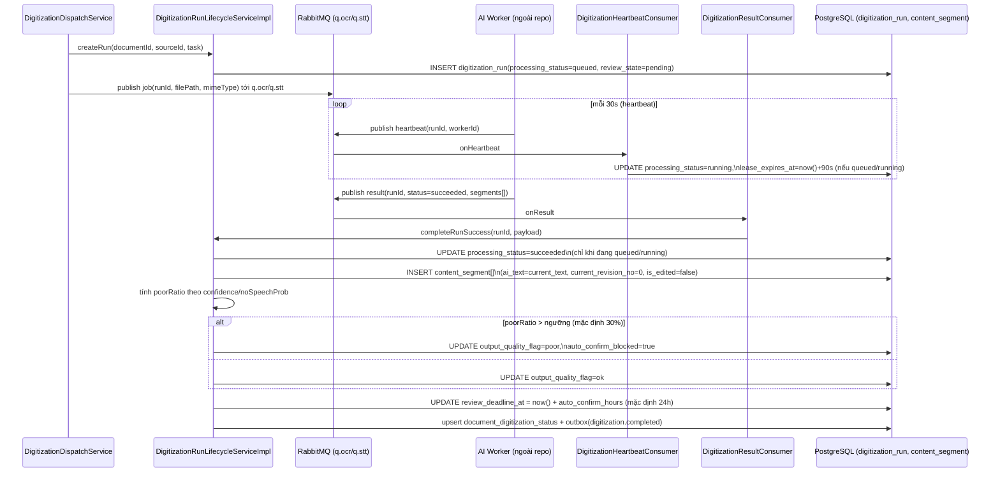
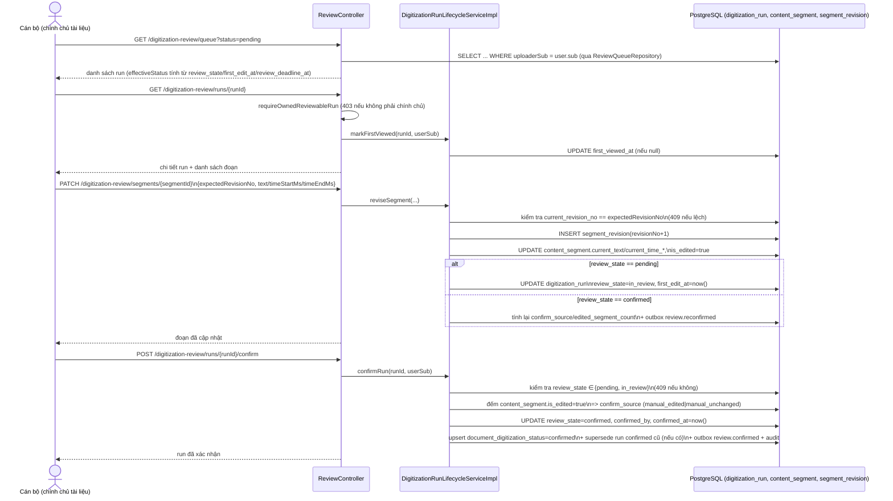

> Status: Draft

# OCR/STT kèm mốc thời gian - Chạy pipeline & kiểm duyệt thủ công

## Mục tiêu nghiệp vụ

Sau khi tài liệu (ảnh/PDF/audio) được nạp vào hệ thống, backend tự động chạy
OCR (ảnh/PDF) hoặc STT (audio) để sinh ra nội dung số hoá dưới dạng các đoạn
(`content_segment`), có mốc thời gian (`time_start_ms`/`time_end_ms`) đối với
STT. Kết quả AI luôn ở trạng thái "chờ duyệt" (`pending`) trước khi được coi
là chính thức. Cán bộ - chính chủ tài liệu - có thể xem, sửa văn bản/mốc thời
gian, thêm/xoá đoạn rồi xác nhận thủ công. Tài liệu này mô tả hai luồng đó
(chạy pipeline sinh dữ liệu, và kiểm duyệt thủ công); phần tự động xác nhận
sau thời hạn cấu hình (mặc định 24 giờ, do `AutoConfirmScheduler` thực hiện)
được tách sang `07-ocr-stt-kiem-duyet-b.md` do cùng một tài liệu vượt quá
~300 dòng.

## Tác nhân

- **Hệ thống pipeline số hoá** (`DigitizationDispatchService`, worker
  OCR/STT ngoài repo này, `DigitizationResultConsumer`): tạo run, chạy AI,
  ghi kết quả.
- **Cán bộ - chính chủ tài liệu** (`document.uploaderSub`, quyền
  `PERM_digitization_review.manage`, role `CAN_BO`): xem, sửa, xác nhận thủ
  công qua `ReviewController`.

## Phạm vi

**Trong phạm vi:**
- Luồng chạy OCR/STT tạo `digitization_run` + `content_segment` (task `ocr`,
  `stt`).
- Luồng kiểm duyệt thủ công: xem hàng chờ duyệt, xem chi tiết run, sửa/xoá/
  thêm đoạn, xác nhận (`POST /digitization-review/runs/{runId}/confirm`).

**Ngoài phạm vi (không mô tả chi tiết trong tài liệu này):**
- Tự động xác nhận sau thời hạn cấu hình (mặc định 24h) và cơ chế kill
  switch - xem `07-ocr-stt-kiem-duyet-b.md`.
- Task `sed` (phát hiện sự kiện âm thanh) và `video_summary` (tóm tắt video) -
  dùng chung cơ chế review/`ContentSegment` nhưng có quy tắc riêng
  (`digitization-review-04-sed-summary.md`).
- `ReviewStaleAlertJob` (cảnh báo run `in_review` bị treo quá hạn xử lý,
  mặc định 72 giờ) - là cảnh báo, không phải tự động xác nhận.
- Cơ chế dispatch/lease/retry/DLQ chi tiết của pipeline OCR/STT (xem
  `digitization-pipeline-02-ocr-stt-processing.md`).
- Đồng bộ tìm kiếm (OpenSearch) khi run được xác nhận.

## Luồng nghiệp vụ chính

### A. Chạy OCR/STT tạo run + đoạn nội dung

1. `DigitizationDispatchService.publish(source)` xác định `task` theo
   `mimeType` của `digitization_source`: `audio/*` → `stt`, `image/*` hoặc
   `application/pdf` → `ocr` (video/* → `video`, ngoài phạm vi tài liệu này).
2. Gọi `DigitizationRunLifecycleService.createRun(...)`: tạo một dòng
   `digitization_run` với `processing_status = queued`,
   `review_state = pending` (luôn set tường minh, không dựa DEFAULT
   `not_applicable` của cột). Quy tắc: chỉ **một** run "active" (review_state
   ngoài `superseded`/`void`) cho mỗi cặp `(document_id, task)` - ràng buộc
   `UQ_digitization_run_active`.
3. Message job (`runId`, `documentId`, `sourceId`, đường dẫn file...) được
   publish vào `q.ocr` hoặc `q.stt` (RabbitMQ, `priority=5` khi không thuộc
   batch).
4. Worker AI (bên ngoài repo) nhận job, định kỳ gửi heartbeat vào
   `q.heartbeat`. `DigitizationHeartbeatConsumer` chuyển
   `processing_status: queued → running` ở lần heartbeat đầu, sau đó chỉ gia
   hạn `lease_expires_at` (= now + 90s, 3x chu kỳ heartbeat 30s của worker).
   Thao tác này **không** cập nhật `document_digitization_status` (tránh ghi
   DB mỗi 30s).
5. Khi xong, worker gửi kết quả vào `q.result`.
   `DigitizationResultConsumer.onResult` phân nhánh theo `status`:
   - `succeeded` → `completeRunSuccess`.
   - `failed_retryable`/`failed_permanent` → `completeRunFailure` (ngoài
     phạm vi tài liệu này - xem pipeline spec).
6. `completeRunSuccess`:
   - Cập nhật `processing_status → succeeded` (UPDATE có điều kiện, chỉ
     chuyển từ `queued`/`running`, chống xử lý trùng kết quả).
   - Ghi các `content_segment` mới (`writeSegments`): với STT,
     `content_source = stt`, có `time_start_ms`/`time_end_ms`/`speaker_label`;
     với OCR, `content_source = ocr`, có `page_no`/`bbox_polygon`/
     `reading_order`/`line_from`/`line_to`. Cả hai đều khởi tạo
     `ai_text = current_text = <text AI sinh>`, `current_revision_no = 0`,
     `is_edited = false`.
   - Tính cờ chất lượng: một đoạn được tính "kém" nếu `confidence` thấp hơn
     ngưỡng theo task (OCR mặc định 60%, STT mặc định 55%) hoặc (chỉ STT)
     `noSpeechProb` vượt ngưỡng mặc định 80% (nghi ngờ ảo giác/"hallucination").
     Nếu tỉ lệ đoạn kém trên tổng số đoạn > ngưỡng mặc định 30% →
     `output_quality_flag = poor` và **`auto_confirm_blocked = true`**
     (chặn tự động xác nhận ở file -b, bắt buộc duyệt thủ công).
   - Đặt `review_deadline_at = now + auto_confirm_hours` (mặc định **24
     giờ**, cấu hình `ocr_stt.auto_confirm_hours`) - mốc thời gian dùng cho
     luồng tự động xác nhận (file -b).
   - `review_state` giữ nguyên `pending` (đã set từ bước tạo run).
   - Ghi read-model `document_digitization_status` (task → trạng thái tổng
     hợp từ `processing_status`+`review_state`) và một event outbox
     `digitization.completed`.

### B. Kiểm duyệt thủ công (xem, sửa, xác nhận)

1. Cán bộ mở hàng chờ duyệt: `GET /digitization-review/queue` - lọc theo
   `task`, `status` (danh sách `effectiveStatus`), `qualityFlag`; chỉ trả về
   run thuộc tài liệu do chính người gọi tải lên.
2. Mở chi tiết một run: `GET /digitization-review/runs/{runId}`.
   - Quy tắc "chính chủ": run phải có `task ∈ {ocr, stt, sed, video_summary}`
     và `document.uploaderSub == user.sub`, nếu không → 403/404.
   - Lần xem đầu tiên: `markFirstViewed` ghi `first_viewed_at`/`first_viewed_by`
     (best-effort, không làm hỏng response nếu lỗi). Không đổi `review_state`.
   - Trả về danh sách đoạn phân trang, cờ cảnh báo chồng lấp mốc thời gian
     liền kề (STT), và `effectiveStatus` tính từ `review_state` +
     `first_edit_at`/`review_deadline_at` (xem `ReviewEffectiveStatus`):
     - `in_review` + `first_edit_at` quá hạn `review_stale_hours` (mặc định
       72h) → hiển thị `stale`.
     - `pending` + `review_deadline_at` còn ≤ `review_upcoming_deadline_hours`
       (mặc định 4h) → hiển thị `upcoming_deadline`.
3. Sửa một đoạn: `PATCH /digitization-review/segments/{segmentId}` (khoá lạc
   quan bằng `expectedRevisionNo`).
   - Chỉ áp dụng `timeStartMs`/`timeEndMs` cho `task = stt` (OCR gửi field
     này → 400); giá trị phải hợp lệ so với độ dài file gốc
     (`0 ≤ start < end ≤ durationMs`), nếu không → 422.
   - Ghi một dòng `segment_revision` mới (số hiệu tăng dần), cập nhật
     `content_segment.current_text`/`current_time_*`/`current_revision_no`,
     đặt `is_edited = true`. `ai_text`/`ai_time_*` giữ nguyên bất biến.
   - **Quy tắc trạng thái run**: nếu run đang `pending`, lần sửa/xoá/thêm đoạn
     đầu tiên chuyển `review_state: pending → in_review` và ghi
     `first_edit_at = now`. Kể từ thời điểm này run **không còn đủ điều kiện
     bị tự động xác nhận** (xem điều kiện batch job ở file -b).
   - Nếu run đã `confirmed` và bị sửa tiếp (US4 AC2, "sửa sau khi đã duyệt"),
     `confirm_source`/`edited_segment_count` được tính lại ngay theo số đoạn
     `is_edited = true` hiện có, và phát outbox `review.reconfirmed`.
   - Revision không khớp `expectedRevisionNo` → 409, kèm bản mới nhất
     (`latestRevisionNo`, `latestText`, `latestTimeStartMs`, `latestTimeEndMs`).
4. Xoá một đoạn (xoá mềm): `DELETE /digitization-review/segments/{segmentId}`
   - Ghi `segment_revision(deleted=true)`, đặt `content_segment.is_deleted =
     true`; cùng quy tắc chuyển `pending → in_review` như bước 3.
5. Thêm đoạn thủ công: `POST /digitization-review/runs/{runId}/segments`
   - Chèn sau `afterSegmentIndex` (dồn chỉ số các đoạn sau), `origin =
     manual`, `ai_text = ""` (sentinel), `is_edited = true` ngay từ đầu.
   - Không áp dụng cho `task ∈ {sed, video_summary}` → 409.
6. Xác nhận: `POST /digitization-review/runs/{runId}/confirm`
   - Chỉ hợp lệ khi `review_state ∈ {pending, in_review}`, ngược lại → 409.
   - `confirm_source` được tính: nếu có ≥1 đoạn `is_edited = true` →
     `manual_edited`, ngược lại `manual_unchanged`.
   - `review_state → confirmed`, `confirmed_by`, `confirmed_at = now`,
     `edited_segment_count` được set. Cập nhật
     `document_digitization_status → confirmed`.
   - Nếu còn một run khác của cùng `(document_id, task)` đang `confirmed`
     (trường hợp chạy lại OCR/STT), run đó bị chuyển `review_state →
     superseded`.
   - Phát outbox `review.confirmed`, ghi audit `digitization_review.confirmed`.

## Sequence diagram

### (a) Chạy OCR/STT tạo run + đoạn nội dung

### (b) Kiểm duyệt thủ công: sửa và xác nhận

## Luồng ngoại lệ / trường hợp đặc biệt

- **Run không phải chính chủ / task không hỗ trợ duyệt**: mọi endpoint của
  `ReviewController` gọi `requireOwnedReviewableRun` - trả `404` nếu
  `runId` không tồn tại hoặc `task ∉ {ocr, stt, sed, video_summary}`; trả
  `403` nếu `document.uploaderSub != user.sub`.
- **Sửa mốc thời gian trên task không phải STT**: `PATCH segments/{id}` với
  `timeStartMs`/`timeEndMs` mà `task = ocr` hoặc `video_summary` → `400`
  (`BadRequestException`: "chỉ áp dụng cho run task=stt"); `task = sed` →
  `422` riêng ("SED không hỗ trợ sửa mốc thời gian sự kiện").
- **Mốc thời gian không hợp lệ** (STT): thiếu `durationMs` của source, hoặc
  `start < 0`, `start >= end`, `end > durationMs` → `422`
  (`UnprocessableEntityException`), không ghi gì (transaction chưa bắt đầu ở
  tầng service).
- **Xung đột chỉnh sửa đồng thời** (`expectedRevisionNo` không khớp
  `current_revision_no`, kể cả trường hợp race hai request cùng lúc, bắt bằng
  ràng buộc unique `(segment_id, revision_no)` khi `saveAndFlush`): `409`,
  body trả kèm `latestRevisionNo`/`latestText`/`latestTimeStartMs`/
  `latestTimeEndMs` để client hiển thị bản mới nhất.
- **Xác nhận khi run không ở trạng thái hợp lệ** (`review_state ∉ {pending,
  in_review}`, ví dụ đã `confirmed`/`superseded`/`void`): `409`.
- **Xoá đoạn với `task = video_summary`**: bị chặn hẳn (`409`, "Tóm tắt video
  không hỗ trợ xoá đoạn") vì run luôn có đúng 1 đoạn.
- **Thêm/xoá đoạn thủ công cho `task ∈ {sed, video_summary}`**: `POST
  .../segments` bị chặn (`409`, "Không hỗ trợ thêm đoạn thủ công cho tác vụ
  này").
- **Sửa đoạn sau khi run đã `confirmed`**: được phép (nhánh riêng trong
  `applyReviewStateEditSideEffect`), tự động tính lại
  `confirm_source`/`edited_segment_count` và phát outbox
  `review.reconfirmed` riêng (không phải `review.confirmed`).
- **Kết quả trùng/muộn từ worker** (`q.result` gửi lại hoặc đến sau khi run
  đã `succeeded`/`failed_*`): `completeRunSuccess`/`completeRunFailure` dùng
  UPDATE có điều kiện (`WHERE processing_status IN ('queued','running')`),
  0 dòng bị ảnh hưởng thì log cảnh báo và bỏ qua, không ghi đè lại đoạn.
- **Chất lượng đầu ra kém (`auto_confirm_blocked = true`)**: run bị loại
  hoàn toàn khỏi điều kiện tự động xác nhận (xem file -b), bất kể đã quá
  `review_deadline_at` bao lâu - chỉ có thể được xác nhận thủ công (luồng B
  ở trên).

## Dữ liệu liên quan

| Entity / bảng DB | Vai trò | File code |
|---|---|---|
| `digitization_run` | Một lần chạy AI cho `(document_id, task)`: gộp vòng đời xử lý (`processing_status`) và vòng đời duyệt (`review_state`, `review_deadline_at`, `confirm_source`, `auto_confirm_blocked`...) | `backend/src/main/java/com/aismartstore/backend/digitization/results/DigitizationRun.java`; `backend/src/main/resources/db/migration/V25__digitization_run_and_batch.sql` |
| `content_segment` | Một đoạn nội dung (OCR/STT/SED/summary), có bản AI bất biến (`ai_text`, `ai_time_*`) và bản hiện hành (`current_text`, `current_time_*`, `current_revision_no`, `is_edited`, `is_deleted`) | `backend/src/main/java/com/aismartstore/backend/digitization/results/ContentSegment.java`; `V26__digitization_content_segments.sql` |
| `segment_revision` | Lịch sử từng lần sửa/xoá một đoạn (audit trail nội dung, phục vụ khoá lạc quan) | `backend/src/main/java/com/aismartstore/backend/digitization/results/SegmentRevision.java`; `V26__digitization_content_segments.sql` |
| `document_digitization_status` | Read-model trạng thái số hoá theo từng `(document_id, task)`, phục vụ tìm kiếm/UI danh sách tài liệu | `backend/src/main/java/com/aismartstore/backend/digitization/results/DocumentDigitizationStatus.java`; `DocumentDigitizationStatusRepository.java` |
| `system_config` (`ocr_stt.auto_confirm_hours`, `ocr_stt.min_confidence_ocr_percent`, `ocr_stt.min_confidence_stt_percent`, `ocr_stt.poor_ratio_threshold_percent`, `ocr_stt.no_speech_prob_threshold_percent`, `ocr_stt.review_stale_hours`, `ocr_stt.review_upcoming_deadline_hours`) | Ngưỡng/khoảng thời gian cấu hình được cho luồng chạy pipeline và kiểm duyệt thủ công | `backend/src/main/java/com/aismartstore/backend/systemconfig/SystemConfigDefaults.java` |
| `outbox_event` (`digitization.completed`, `review.confirmed`, `review.reconfirmed`) | Sự kiện nội bộ phát ra sau khi run hoàn tất/được xác nhận, dùng cho các tiến trình downstream (vd. đồng bộ tìm kiếm) | `backend/src/main/java/com/aismartstore/backend/outbox/OutboxEvent.java` |
| `audit_log` (`digitization_review.segment_revised/deleted/added/confirmed`) | Nhật ký hành động của cán bộ trên luồng duyệt | ghi qua `AuditService` trong `DigitizationRunLifecycleServiceImpl.java` |

## File code tham chiếu

- `backend/src/main/java/com/aismartstore/backend/digitization/DigitizationDispatchService.java` (dòng 64-140: `publish`, `resolveTask` - tạo run, chọn queue theo mimeType)
- `backend/src/main/java/com/aismartstore/backend/digitization/results/DigitizationHeartbeatConsumer.java` (toàn bộ file - `queued → running`, gia hạn lease)
- `backend/src/main/java/com/aismartstore/backend/digitization/results/DigitizationResultConsumer.java` (dòng 29-43: `onResult` phân nhánh `succeeded`/`failed_*`)
- `backend/src/main/java/com/aismartstore/backend/digitization/results/DigitizationRunLifecycleServiceImpl.java`:
  - dòng 134-171: `createRun` (khởi tạo `review_state = pending`)
  - dòng 706-790: `completeRunSuccess` (ghi đoạn, tính cờ chất lượng, đặt `review_deadline_at = now + auto_confirm_hours`, dòng 775-776)
  - dòng 279-340: `reviseSegment`
  - dòng 342-387: `deleteSegment`
  - dòng 389-458: `addManualSegment`
  - dòng 460-471: `markFirstViewed`
  - dòng 473-533: `confirmRun`
  - dòng 585-625: `applyReviewStateEditSideEffect`, `computeConfirmSource` (chuyển `pending → in_review`, tính lại `confirm_source` sau khi confirmed)
- `backend/src/main/java/com/aismartstore/backend/digitization/review/ReviewController.java` (dòng 113-276: các endpoint queue/detail/patch/delete/add/confirm/page-image; dòng 280-290: `requireOwnedReviewableRun`)
- `backend/src/main/java/com/aismartstore/backend/digitization/review/ReviewEffectiveStatus.java` (toàn bộ file - tính `effectiveStatus` hiển thị)
- `backend/src/main/java/com/aismartstore/backend/digitization/review/ReviewQueueRepository.java` (dòng 39-46: biểu thức SQL tương đương `ReviewEffectiveStatus`)
- `backend/src/main/java/com/aismartstore/backend/digitization/results/ContentSegment.java` (toàn bộ file - cấu trúc đoạn, mốc thời gian, khoá lạc quan)
- `backend/src/main/java/com/aismartstore/backend/digitization/results/DigitizationRun.java` (toàn bộ file - hằng số trạng thái `PROCESSING_*`, `REVIEW_*`, `CONFIRM_*`)
- `backend/src/main/java/com/aismartstore/backend/digitization/results/SegmentRevisionConflictException.java` (toàn bộ file - body 409)
- `backend/src/main/java/com/aismartstore/backend/systemconfig/SystemConfigDefaults.java` (dòng 34, 43-51, 53-59, 133-161: định nghĩa + giá trị mặc định các cấu hình `ocr_stt.*`)
- `backend/src/main/resources/db/migration/V25__digitization_run_and_batch.sql`, `V26__digitization_content_segments.sql`, `V28__digitization_review_queue_and_permissions.sql`

## Điểm cần xác nhận thêm

- Tài liệu này mô tả đúng hành vi hiện tại của code; **không** xác nhận được
  liệu 24 giờ (`review_deadline_at = now + auto_confirm_hours`) có phải là
  giá trị đang thực sự áp dụng ở môi trường vận hành hay đã bị đổi qua bảng
  `system_config` (giá trị runtime override giá trị mặc định trong
  `SystemConfigDefaults`) - cần đối chiếu dữ liệu `system_config` thực tế nếu
  cần con số chính xác đang chạy. Cơ chế tự động xác nhận dùng mốc này được
  mô tả chi tiết ở `07-ocr-stt-kiem-duyet-b.md`.
- Ngưỡng `sedPromotionThreshold` trong `DigitizationProperties` được chính
  code chú thích là "TODO giá trị tạm (0.85), chưa có ngưỡng chính thức" -
  không liên quan trực tiếp OCR/STT nhưng dùng chung hạ tầng `ContentSegment`,
  nêu ở đây để tránh nhầm là đã chốt.
