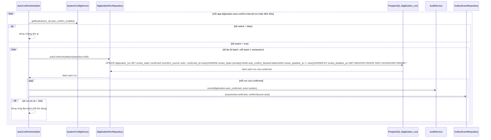

> Status: Draft

# OCR/STT kèm mốc thời gian - Tự động xác nhận sau 24 giờ (scheduler)

## Mục tiêu nghiệp vụ

Kết quả OCR/STT sau khi chạy xong luôn ở trạng thái chờ duyệt (`review_state
= pending`, xem `07-ocr-stt-kiem-duyet-a.md` cho luồng tạo run và kiểm duyệt
thủ công). Để nội dung không bị treo vô thời hạn nếu không cán bộ nào vào
xác nhận, một scheduler nền (`AutoConfirmScheduler`) chạy định kỳ, tự động
xác nhận (`confirm_source = auto`) mọi run đã quá một thời hạn cấu hình được
(mặc định **24 giờ**) kể từ khi OCR/STT chạy xong, miễn là chưa có ai bắt đầu
sửa và chất lượng đầu ra không bị đánh giá kém. Tài liệu này mô tả riêng cơ
chế đó, kèm quy tắc trạng thái chính xác quyết định một run có được tự động
xác nhận hay không.

## Tác nhân

- **AutoConfirmScheduler** (tác nhân hệ thống, chạy định kỳ theo
  `@Scheduled`): quét và xác nhận tự động các run quá hạn.
- **SystemConfigService**: cung cấp kill switch (`ocr_stt.auto_confirm_enabled`)
  và thời hạn (`ocr_stt.auto_confirm_hours`) - cấu hình runtime, không phải
  hằng số biên dịch.
- **Cán bộ** (gián tiếp): hành động sửa/xoá/thêm đoạn của cán bộ (mô tả ở
  `07-ocr-stt-kiem-duyet-a.md`, luồng B) là điều kiện loại một run ra khỏi
  diện tự động xác nhận (chuyển `review_state → in_review`).

## Phạm vi

**Trong phạm vi:**
- Điều kiện chính xác để một run `digitization_run` được tự động xác nhận.
- Cơ chế chạy theo batch, khoá dòng, transaction của `AutoConfirmScheduler`.
- Kill switch bật/tắt tính năng.

**Ngoài phạm vi:**
- Luồng tạo run OCR/STT và luồng kiểm duyệt/sửa/xác nhận thủ công - xem
  `07-ocr-stt-kiem-duyet-a.md`.
- `ReviewStaleAlertJob` (cảnh báo run `in_review` treo quá hạn xử lý, mặc
  định 72 giờ) - là một job riêng biệt, chỉ ghi audit cảnh báo, **không** tự
  động xác nhận run đang `in_review`.
- Cách tính `output_quality_flag`/`auto_confirm_blocked` (được tính ở bước
  `completeRunSuccess`, mô tả chi tiết ở file -a) - tài liệu này chỉ dùng lại
  kết quả cờ đó làm điều kiện lọc.

## Luồng nghiệp vụ chính

### C. Tự động xác nhận sau thời hạn cấu hình (mặc định 24 giờ)

1. `AutoConfirmScheduler.run()` chạy định kỳ theo cấu hình Spring
   `app.digitization.auto-confirm-interval-ms` (mặc định 60.000 ms = 1 phút).
2. **Kill switch**: nếu cấu hình hệ thống `ocr_stt.auto_confirm_enabled =
   false` (mặc định `true`), job dừng ngay ở đầu `run()`, không đọc/ghi gì
   thêm.
3. Mỗi lượt (`tick`) xử lý tối đa `MAX_BATCHES_PER_TICK = 20` batch, mỗi
   batch `BATCH_SIZE = 500` run (tối đa 10.000 run/tick) - mỗi batch là một
   transaction riêng (`TransactionTemplate`, không dùng `@Transactional`
   class-level vì `run()` tự gọi `processBatch()` nhiều lần trong cùng một
   lời gọi phương thức - self-invocation không đi qua Spring AOP proxy).
   Vòng lặp dừng sớm ngay khi một batch trả về ít hơn 500 run (nghĩa là đã
   hết tồn đọng).
4. **Điều kiện chính xác** để một run được tự động xác nhận (SQL trong
   `DigitizationRunRepository#autoConfirmDueBatch`, chạy như một câu lệnh
   `UPDATE ... WHERE id IN (SELECT ...) RETURNING *` nguyên tử) - **cả 3**
   điều kiện dưới đây phải đúng đồng thời:
   - `review_state = 'pending'` (nghĩa đen: run **chưa từng** bị ai sửa/xoá/
     thêm đoạn kể từ khi OCR/STT chạy xong - nếu có, run đã chuyển sang
     `in_review` ngay từ lần sửa đầu tiên, xem file -a mục B bước 3, và **bị
     loại vĩnh viễn** khỏi tự động xác nhận, kể cả nếu sau đó không ai sửa
     tiếp).
   - `auto_confirm_blocked = false` (run không bị đánh dấu chất lượng kém -
     cờ này được `completeRunSuccess` set một lần khi run kết thúc, không
     đổi sau đó qua luồng này).
   - `review_deadline_at IS NOT NULL AND review_deadline_at <= now()` - tức
     đã quá `auto_confirm_hours` (mặc định 24h, cấu hình
     `ocr_stt.auto_confirm_hours`) kể từ khi `completeRunSuccess` set giá trị
     này (`now() lúc OCR/STT thành công + auto_confirm_hours`).
   - Các run thoả điều kiện được chọn theo thứ tự `review_deadline_at` tăng
     dần (quá hạn lâu nhất xử lý trước), giới hạn `LIMIT :batchSize`, khoá
     bằng `FOR UPDATE SKIP LOCKED` để nhiều tick/instance chồng nhau không
     xác nhận trùng cùng một run (mỗi dòng chỉ một transaction giữ khoá tại
     một thời điểm, transaction khác bỏ qua thay vì chờ).
5. Với các run trúng batch, cùng một câu UPDATE đặt luôn:
   `review_state = 'confirmed'`, `confirm_source = 'auto'`,
   `confirmed_at = now()`, `updated_at = now()`. **Không** set
   `confirmed_by` (không có người thực hiện) và **không** thay đổi
   `edited_segment_count` (giữ nguyên 0, vì run chưa từng bị sửa).
6. Sau khi UPDATE trả về danh sách run vừa confirmed (`RETURNING *`), với
   **mỗi** run: `AutoConfirmScheduler.processBatch()` ghi một dòng audit
   `digitization.auto_confirmed` (actor = chuỗi `"system"`, không phải
   `sub` người dùng) và một event outbox `review.confirmed` (payload gồm
   `confirmSource = "auto"`, `confirmedAt`, `segmentCount`).
7. Nếu một batch lỗi giữa chừng (exception trong `processBatch`), chỉ
   transaction của batch đó rollback - các batch đã commit trước đó trong
   cùng tick **không** bị ảnh hưởng (rủi ro đã ghi nhận trong code: một dòng
   lỗi chỉ làm hỏng batch 500 dòng chứa nó).
8. Job **không** tự cập nhật `document_digitization_status` hay index tìm
   kiếm trực tiếp - các hệ quả đó (nếu có) phụ thuộc người tiêu thụ event
   outbox `review.confirmed`, nằm ngoài phạm vi tài liệu này.

## Sequence diagram

### (c) Tự động xác nhận sau 24 giờ (scheduler)

## Luồng ngoại lệ / trường hợp đặc biệt

- **Run đã bắt đầu sửa (`in_review`) không bao giờ được tự động xác nhận**:
  điều kiện SQL của `autoConfirmDueBatch` chỉ chọn `review_state = 'pending'`
  - kể cả khi cán bộ sửa một đoạn rồi bỏ dở không quay lại, run vẫn kẹt ở
    `in_review`, không tự chuyển `confirmed`. Trường hợp treo quá lâu (mặc
    định > 72 giờ kể từ `first_edit_at`) chỉ được **cảnh báo** bởi
    `ReviewStaleAlertJob` (ghi audit `digitization.review_stale`), job đó
    không tự xác nhận - nằm ngoài phạm vi tài liệu này.
- **Chất lượng đầu ra kém (`auto_confirm_blocked = true`)**: run bị loại
  hoàn toàn khỏi điều kiện lọc, bất kể `review_deadline_at` đã quá hạn bao
  lâu - chỉ có thể được xác nhận thủ công (xem `07-ocr-stt-kiem-duyet-a.md`,
  mục B bước 6). Không có cơ chế nào trong scheduler này tự gỡ cờ
  `auto_confirm_blocked`.
- **Kill switch tắt (`ocr_stt.auto_confirm_enabled = false`)**: run vẫn tiếp
  tục tích luỹ quá hạn `review_deadline_at` (giá trị không đổi), nhưng không
  bao giờ bị chọn bởi `autoConfirmDueBatch` cho tới khi cấu hình được bật
  lại - không có cơ chế "dồn" xử lý gấp khi bật lại ngoài việc tick kế tiếp
  quét như bình thường (có thể xử lý cả tồn đọng lớn nhờ tối đa 20 batch x
  500 = 10.000 run/tick).
- **`review_deadline_at IS NULL`**: run chưa từng qua `completeRunSuccess`
  (vd. còn `queued`/`running`, hoặc thất bại) không bao giờ khớp điều kiện
  `review_deadline_at <= now()` - không thể bị tự động xác nhận trước khi
  OCR/STT chạy xong thành công.
- **Hai tick/instance chạy chồng nhau** (nhiều instance backend cùng bật
  scheduler): `FOR UPDATE SKIP LOCKED` đảm bảo một run chỉ bị một transaction
  xác nhận - transaction thứ hai bỏ qua dòng đã bị khoá thay vì chờ hoặc xác
  nhận trùng.
- **Lỗi giữa một batch** (vd. lỗi ghi audit/outbox cho một run trong batch):
  toàn bộ transaction của batch đó rollback (bao gồm cả UPDATE
  `review_state='confirmed'` của các run khác cùng batch) - do dùng
  `TransactionTemplate` theo từng batch, batch tiếp theo trong cùng tick vẫn
  chạy bình thường.

## Dữ liệu liên quan

| Entity / bảng DB | Vai trò | File code |
|---|---|---|
| `digitization_run` (cột `review_state`, `review_deadline_at`, `auto_confirm_blocked`, `confirm_source`, `confirmed_at`) | Đối tượng được scheduler quét và cập nhật trạng thái | `backend/src/main/java/com/aismartstore/backend/digitization/results/DigitizationRun.java`; `V25__digitization_run_and_batch.sql` |
| `system_config` (`ocr_stt.auto_confirm_enabled`, `ocr_stt.auto_confirm_hours`) | Kill switch và thời hạn tự động xác nhận, đọc runtime mỗi lần job chạy | `backend/src/main/java/com/aismartstore/backend/systemconfig/SystemConfigDefaults.java` |
| `outbox_event` (`review.confirmed`, `confirmSource=auto`) | Sự kiện phát ra cho mỗi run vừa được tự động xác nhận | `backend/src/main/java/com/aismartstore/backend/outbox/OutboxEvent.java` |
| `audit_log` (`digitization.auto_confirmed`, actor=`system`) | Nhật ký hành động tự động của hệ thống, phân biệt với hành động của cán bộ (`digitization_review.confirmed`) | ghi qua `AuditService` trong `AutoConfirmScheduler.java` |

## File code tham chiếu

- `backend/src/main/java/com/aismartstore/backend/digitization/review/AutoConfirmScheduler.java` (toàn bộ file):
  - dòng 41-44: hằng số `BATCH_SIZE = 500`, `MAX_BATCHES_PER_TICK = 20`
  - dòng 68-86: `run()` - kill switch, vòng lặp batch theo tick
  - dòng 88-99: `processBatch()` - gọi `autoConfirmDueBatch`, ghi audit + outbox cho mỗi run
  - dòng 101-116: `writeReviewConfirmedOutboxEvent`
- `backend/src/main/java/com/aismartstore/backend/digitization/results/DigitizationRunRepository.java` (dòng 148-174: `autoConfirmDueBatch` - điều kiện SQL chính xác, `FOR UPDATE SKIP LOCKED`)
- `backend/src/main/java/com/aismartstore/backend/digitization/results/DigitizationRunLifecycleServiceImpl.java`:
  - dòng 535-538: `autoConfirmDueBatch` (service-layer, uỷ quyền repository)
  - dòng 774-776: nơi `review_deadline_at` được set lần đầu (`completeRunSuccess`, tham chiếu để hiểu nguồn gốc điều kiện lọc, chi tiết ở file -a)
- `backend/src/main/java/com/aismartstore/backend/digitization/results/DigitizationRun.java` (dòng 51-60: hằng số `REVIEW_PENDING`, `REVIEW_IN_REVIEW`, `REVIEW_CONFIRMED`, `CONFIRM_AUTO`)
- `backend/src/main/java/com/aismartstore/backend/systemconfig/SystemConfigDefaults.java` (dòng 34: khai báo `OCR_STT_AUTO_CONFIRM_HOURS`; dòng 51: `OCR_STT_AUTO_CONFIRM_ENABLED`; dòng 133-134: giá trị mặc định `"24"`; dòng 156-157: giá trị mặc định `"true"`)

## Điểm cần xác nhận thêm

- Giá trị 24 giờ và trạng thái bật/tắt (`ocr_stt.auto_confirm_enabled`) đều
  là **cấu hình runtime** trong bảng `system_config`, không phải hằng số
  biên dịch - `SystemConfigDefaults` chỉ là giá trị mặc định khi seed lần
  đầu. Cần đối chiếu dữ liệu `system_config` thực tế trên môi trường vận
  hành nếu cần biết giá trị đang áp dụng thật sự.
- Tài liệu chưa xác nhận được có tồn tại cơ chế thông báo (email/notification)
  cho cán bộ khi một run sắp bị tự động xác nhận (ngoài cờ hiển thị
  `upcoming_deadline` trên UI hàng chờ duyệt, xem file -a) hay không - phần
  code đọc được chỉ dừng ở việc tính toán/hiển thị cờ đó, không thấy job gửi
  thông báo chủ động.
- Quan hệ giữa `ReviewStaleAlertJob` (cảnh báo `in_review` quá 72 giờ) và
  tự động xác nhận (24 giờ, chỉ áp dụng cho `pending`) là hai cơ chế độc
  lập, không có liên hệ "hết hạn cảnh báo thì tự confirm" trong code hiện
  tại - cần xác nhận với BA/SA nếu nghiệp vụ thực tế kỳ vọng có liên hệ đó.
