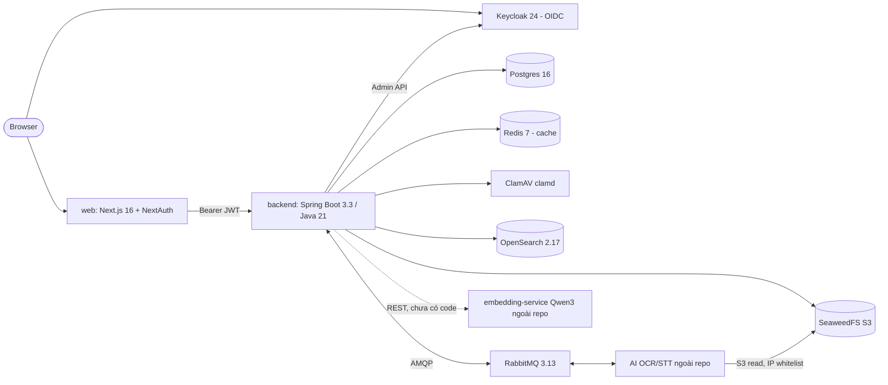

# Codebase Overview (brownfield baseline)

> File: `docs/01-sa/architecture/_codebase-overview.md` — Owner: SA
> Status: Draft
> Traceability ID: `ARCH-_codebase-overview` (tham chiếu nền, KHÔNG phải ADR của feature cụ thể)
> Khảo sát: 2026-09-30, bằng grep/glob có mục tiêu (không đọc toàn bộ repo).

## 1. Tổng quan hệ thống

AISmartStore — hệ thống kho tài liệu số cho cơ quan (tiếng Việt): nạp dữ liệu, kho chung
(warehouse) + lưu trữ cá nhân, số hoá OCR/STT qua hệ thống AI ngoài, tìm kiếm full-text,
nhóm chia sẻ, RBAC 3 vai trò (R1 Cán bộ, R2 Lãnh đạo, R3 Quản trị), audit log, thùng rác.

## 2. Cấu trúc repo (`/Users/linhnt/Documents/projects/c2/source_v2`)

| Thư mục | Nội dung | Ghi chú |
|---|---|---|
| `backend/` | Spring Boot, Maven, package `com.aismartstore.backend` (~300 file main) | git repo riêng |
| `web/` | Next.js 16 App Router, React 19, Tailwind 4 | git repo riêng |
| `keycloak/`, `postgres/`, `seaweedfs/`, `clamav/`, `opensearch/` | Config hạ tầng cho `docker-compose.yml`: keycloak realm/theme, postgres init, seaweedfs `s3.json`, clamd.conf, image OpenSearch (ICU + vi_stopwords). Đã chuyển lên gốc từ `main-workspace/` (superproject cũ, đã đưa ra ngoài folder này) | — |
| `docker-compose.yml` | Stack dev/prod-like đầy đủ (keycloak, postgres, seaweedfs, redis, clamav, opensearch, qdrant, rabbitmq, backend, web) | mount config từ các thư mục cùng cấp ở gốc |
| `docker-compose.dev.yml` | Override hot-reload cho backend/web (volume `maven_repo`) | |
| `stg/` | Deploy staging tự chứa: compose + nginx (web/api/auth/files/filer) + Cloudflare Flexible SSL, script `build-and-push.sh`, `pack-and-upload.sh`, `.env` | domain `*.green0tech.site` |
| `docs/` | Pipeline SA/BA/DEV/QA (01-sa … 04-qa, templates) | |

## 3. Backend

- **Stack:** Java 21, Spring Boot 3.3.4 (web, data-jpa, security + oauth2-resource-server,
  validation, data-redis, amqp), Flyway, Lombok, Caffeine, AWS SDK v2 S3, opensearch-java
  2.17 (httpclient5 5.4 + httpcore5 **pin chính xác 5.3**), PDFBox 3, ShedLock (JDBC).
- **Build/test:** `mvn test` (unit `*Test`), `mvn verify` (Failsafe, `*IT` Testcontainers,
  `reuseForks=false`, Testcontainers pin 1.21.4 vì Docker Engine 29). 34 lớp `*IT`.
  Không có linter/formatter (checkstyle/spotless) trong pom.
- **Entrypoint:** REST, port 3001; 23 controller; 2 `@RabbitListener` (result, heartbeat);
  18 lớp `@Scheduled` (pool 4 thread, claim bằng `FOR UPDATE SKIP LOCKED`, ShedLock cho purge).
- **Module (package theo domain):**

| Package | Trách nhiệm chính |
|---|---|
| `auth`, `config`, `rbac` | JWT Keycloak → authorities; quyền role→permission trong DB, cache Caffeine |
| `accounts`, `userdirectory` | Proxy Keycloak Admin API, trạng thái account (Redis), quota |
| `warehouse`, `documents`, `tags`, `notes` | Kho chung, cây thư mục, tài liệu, tag/phân loại, ghi chú |
| `ingest`, `upload`, `scanning`, `storage` | Upload batch + chunked session, ClamAV + MIME allowlist, S3 |
| `personal` (+`ingest`) | Lưu trữ cá nhân, quota, chuyển sang kho chung |
| `groups`, `notifications` | Nhóm, chia sẻ tài liệu, scope dữ liệu, thông báo |
| `digitization` (+`results`, `review`) | Dispatch OCR/STT/video qua RabbitMQ, lease/heartbeat, DLQ, review & auto-confirm |
| `search` (+`index`) | `POST /search` OpenSearch; indexer đọc `outbox_event` (poller + reconciliation) |
| `outbox`, `audit`, `trash`, `systemconfig`, `common` | Transactional outbox, audit (seal/partition/checkpoint/retention), soft-delete + purge, cấu hình động, exception → HTTP |

- **Data:** Postgres là source of truth, `ddl-auto: validate`, Flyway V1–V33 (**thiếu V14**,
  `baseline-on-migrate: true`). Redis chỉ là cache (degrade về DB khi lỗi). S3 buckets:
  `documents`, `personal`, `audit-archive`. OpenSearch index `segment-v1`, `document-v1`.
- **Convention:** controller/service/repository/dto theo package domain; exception phân cấp
  `ApiException` (400/403/404/409/413/422/503); `@PreAuthorize`/`hasAuthority` tại controller;
  `CurrentUser` argument resolver; comment dày đặc trỏ về spec (`docs/03-dev/specs/*.md` Task n).

## 4. Web

- **Stack:** Next.js 16.2 (App Router), React 19.2, next-auth 4 (Keycloak provider), Tailwind 4,
  Vitest + Testing Library (jsdom), ESLint 9. Node >= 22.
- **Scripts:** `dev`, `build`, `start`, `lint`, `test` (vitest run).
- **Cấu trúc:** `src/app/*` ~20 page (documents, personal, upload, search, groups, digitization,
  trash, admin/{folders,accounts,system-config,allowed-formats,rbac,document-ownership,audit,trash-stats});
  `src/components/*`; `src/lib/api.ts` (fetch client gắn bearer), `features.ts` (registry nav +
  role gating UI), `roles.ts`, `jwt.ts`.
- **Gọi API:** client-side trực tiếp tới `NEXT_PUBLIC_API_BASE_URL` (không qua BFF/proxy);
  `NEXT_PUBLIC_*` được inline lúc build → image gắn chặt với domain môi trường.
- Feature `reports` còn `enabled: false` (chưa build).

## 5. Integration bên ngoài

| Hệ thống | Loại | Giao thức | Ghi chú |
|---|---|---|---|
| Keycloak 24 | sync | OIDC/JWT; Admin REST | realm `aismartstore`, client `backend`, theme riêng |
| AI OCR/STT (ngoài repo) | async | RabbitMQ `q.ocr`/`q.stt`/`q.video` + result/heartbeat + DLQ | đọc file qua S3 `files.*` (IP whitelist) |
| ClamAV | sync | clamd TCP 3310 | fail-closed → 503 |
| OpenSearch | sync + async (outbox) | HTTP | security plugin tắt ở dev |
| embedding-service (Qwen3-Embedding-0.6B, ngoài repo) | sync | HTTP REST, `EMBEDDING_API_URL`, không xác thực | **chưa có code backend** (search-semantic); thay Qdrant — gỡ khỏi hạ tầng 2026-10-10 (compose/env gỡ ở bước implement) |

## 6. Kiến trúc đã có (docs/01-sa/architecture/*.md — chỉ liệt kê)

- Approved: `auth-session`, `account-lifecycle`, `system-config`, `rbac-permission-editing`,
  `rbac-group-scope`, `warehouse-structure`, `data-ingestion`, `chunked-file-upload`,
  `folder-upload-display-name`, `personal-storage-quota`, `personal-to-warehouse`,
  `classification-notes`, `group-management-sharing`, `audit-logging`, `delete-restore-trash`,
  `backup-restore`, `search-fulltext`, `ai-search-infra`, `digitization-pipeline`,
  `digitization-results-store`, `digitization-review`, `export-reporting`.
- Draft: `branding`, `external-api`, `search-semantic`.

## 7. Ràng buộc kỹ thuật rõ ràng

- Upload tối đa 2 GB/file (multipart + chunked session); scan virus bắt buộc trước khi lưu.
- Admin (R3) không được thấy nội dung nghiệp vụ (NFR-07) — áp ở backend và UI.
- Backend là nguồn phân quyền duy nhất; UI gating chỉ là UX.
- Pin phiên bản nhạy cảm: httpcore5 = 5.3 chính xác; opensearch-java khớp server 2.17.
- Nhiều instance backend được giả định (SKIP LOCKED, ShedLock) → job phải idempotent.
- Staging: Cloudflare Flexible (origin HTTP), các port raw TCP (5432/5672/15672/6333/6334) mở
  ra ngoài chỉ bảo vệ bằng iptables `DOCKER-USER`.

## 8. Nợ kỹ thuật / Rủi ro dễ thấy

| Rủi ro | Mức | Gợi ý giảm thiểu |
|---|---|---|
| Secret hard-code trong `docker-compose.yml` (Keycloak client secret, NEXTAUTH_SECRET, S3 key); `stg/.env` nằm trong cây thư mục, root không có `.gitignore` cho `.env` | H | Chuyển sang `.env`/secret store, kiểm tra git history, rotate |
| ~~Tài liệu lỗi thời NestJS/TypeORM~~ — `main-workspace/CLAUDE.md` đã đổi tên và đưa ra ngoài; comment `api.ts` đã sửa; `features.ts` cần rà lại | L | Rà `web/src/lib/features.ts` còn nhắc `@Roles()` |
| Config hạ tầng phân tán 2 nơi (root, `stg/config`) — trùng lặp, dễ lệch (vd seaweedfs 3.97 vs 4.44, opensearch image) | M | Hợp nhất một nguồn config |
| Không có Actuator/metrics/tracing; cảnh báo DLQ/stale chỉ qua log | M | Bổ sung actuator + Prometheus/log alert |
| Staging: Cloudflare Flexible (traffic origin không mã hoá), Postgres/RabbitMQ/Qdrant mở TCP public (Qdrant sẽ gỡ — 2026-10-10) | H | Full (strict) SSL, tunnel/VPN thay cho port public |
| OpenSearch security plugin tắt; RabbitMQ user/pass mặc định | M | Bật auth ở stg/prod |
| Qdrant chạy nhưng không dùng | L | **Đã chốt 2026-10-10:** gỡ hẳn — vector nằm trong OpenSearch k-NN (`search-semantic.md` QĐ 6); task gỡ compose/env ở `SPEC-search-semantic` |
| Service lớn (vd `DigitizationRunLifecycleServiceImpl` > 880 dòng), 18 scheduled job trong 1 process | M | Tách theo trách nhiệm; cân nhắc worker riêng khi tải tăng |
| Migration V14 bị khuyết + `baseline-on-migrate: true` | L | Xác nhận chủ ý; tránh baseline nhầm trên DB có dữ liệu |
| Web gọi API trực tiếp từ browser, token nằm client-side; build-time `NEXT_PUBLIC_*` | M | Cân nhắc BFF/route handler nếu cần giấu token hoặc 1 image nhiều môi trường |
| Không có linter/formatter backend, không thấy CI config | M | Thêm spotless/checkstyle + pipeline CI chạy `mvn verify` và `npm test` |

## 9. Câu hỏi mở

- [x] `main-workspace/` → **Chốt:** đã chuyển config lên gốc và đưa `main-workspace/` ra ngoài; còn lại: có gộp `stg/config` với config gốc không?
- [ ] `stg/.env` và secret trong `docker-compose.yml` có đang được commit vào git không? Có cần rotate?
- [ ] Có môi trường production riêng (ngoài `stg/`)? Yêu cầu HA/scale (số instance backend, cluster OpenSearch/Postgres) là gì?
- [ ] Hệ thống AI OCR/STT ngoài repo do ai sở hữu? Contract message (schema, version) được quản lý ở đâu?
- [x] Qdrant: giữ hay gỡ? → **Chốt 2026-10-10:** gỡ khỏi toàn bộ hạ tầng; `search-semantic` dùng vector k-NN trong OpenSearch (cập nhật: sơ đồ mục 2, bảng tích hợp, rủi ro).
- [ ] V14 migration khuyết là chủ ý (đã xoá) hay lỗi?
- [ ] Có CI/CD (GitHub Actions…) ở repo con không? Chuẩn lint/format backend mong muốn?
- [ ] Mục tiêu observability (metrics, tracing, alerting) cho NFR — đã có trong SRS chưa?
- [ ] SRS gốc (`dac_ta_yeu_cau_chuc_nang_phi_chuc_nang.md`) hiện nằm ở đâu trong `source_v2/docs`?
