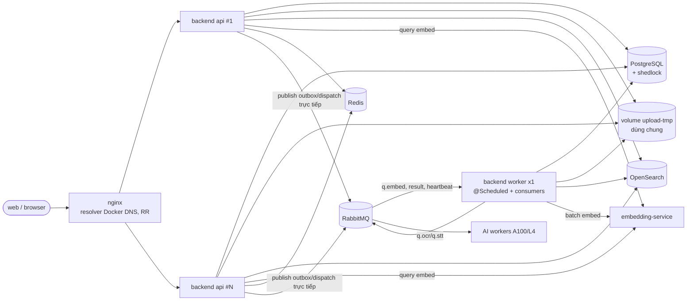

# Architecture: backend-multi-instance

> File: `docs/01-sa/architecture/backend-multi-instance.md` — Owner: SA
> Status: Approved
> Traceability ID: `ARCH-backend-multi-instance` (BA/DEV/QA tham chiếu ID này)

## 1. Bối cảnh / Vấn đề

- Backend (Spring Boot, cổng 3001) đang chạy **1 instance**. Process này vừa phục vụ API vừa chạy
  ~22 job `@Scheduled` và các consumer RabbitMQ (`q.embed`, digitization result, heartbeat).
- Mục tiêu: chạy **N instance API** (`docker compose --scale backend=N`, sau này là nhiều pod) và
  tách **worker role** (cùng image) để chạy job nền và consumer embed. Deploy vẫn theo khung bảo
  trì như quy trình prod hiện có (Q2 — không đòi zero-downtime).
- Khảo sát code 2026-10-12, các điểm chặn:
  - **Upload chia chunk**: `UploadSessionService` ghi chunk vào `Files.createTempFile` (`/tmp`
    trong container) và lưu đường dẫn vào `upload_session.temp_file_path` ⇒ chunk sang instance
    khác là hỏng. (Hôm nay, recreate container khi deploy cũng làm mất các upload đang dở.)
  - **`DigitizationDispatchRetryJob` không khoá** ⇒ N instance publish trùng job OCR/STT sang GPU.
- Trùng lặp (không hỏng dữ liệu nhưng tốn tài nguyên): các job không khoá chạy N lần; giới hạn
  trong bộ nhớ (`SemanticQueryLimiter`, `NameCheckRateLimiter`) nhân N; outbox poller xử lý song
  song sự kiện của cùng một tài liệu ⇒ có thể lệch thứ tự.
- Đã an toàn (giữ nguyên): claim `FOR UPDATE SKIP LOCKED` (outbox, AutoConfirm, ReviewStale,
  lease, report runner, source separation), `AuditAdvisoryLock` (các job audit), `@SchedulerLock`
  (TrashPurge, PurgeStuckRecovery, PersonalIngestCleanup), Flyway lock, JWT stateless, cache RBAC
  Caffeine 60s; chunk append đã khoá dòng `upload_session` (`findByIdForUpdate`) + kiểm `offset`.
- **In-scope:** mô hình role API/worker, phân loại job, lưu chunk upload, thứ tự outbox, giới hạn
  toàn cục, topology compose stg/prod, health/readiness, quy trình deploy (khung bảo trì).
- **Out-of-scope:** tách repo/service riêng cho embed (chỉ nêu tiêu chí — ADR-4); HA đa máy chủ
  (prod vẫn active/cold-standby theo `production-deployment.md`); cluster OpenSearch/Postgres;
  thay đổi hợp đồng API cho web.

## 2. Ràng buộc (Constraints)

- **Không đổi hợp đồng API** (đường dẫn, mã lỗi upload `CHUNK_OFFSET_MISMATCH`, ... giữ nguyên).
- Tận dụng **ShedLock** đã có (`shedlock-spring` + `JdbcTemplateLockProvider`, `usingDbTime`).
- Giữ cổng bật/tắt semantic qua env (`SEMANTIC_ENABLED`): khi tắt ⇒ endpoint 404, không producer,
  không consumer, không reconciliation (hành vi hiện tại).
- Chạy được bằng docker compose **trên 1 host** (stg linhhost; prod SRV-APP cũng 1 host).
- Một image duy nhất cho API và worker; **mặc định không cấu hình gì = all-in-one** như hiện nay
  (dev local, IT `mvn verify` không đổi).
- NFR-09: bucket `documents` là WORM (chỉ xoá qua thùng rác/purge) ⇒ không dùng làm vùng tạm.
- `MAX_UPLOAD_BYTES` = 2GB/tệp; nginx `client_max_body_size 2048m`, timeout 300s.
- Khai báo queue RabbitMQ phải khớp tham số ở mọi instance (lệch ⇒ 406, crash-loop — đã gặp stg).

## 3. NFR (Non-Functional Requirements)

| Loại | Yêu cầu (đo được nếu có thể) |
|---|---|
| Correctness | Với N API + worker bất kỳ: 0 upload chunk hỏng do định tuyến; mỗi source PENDING publish ≤ 1 lần/chu kỳ retry toàn hệ thống; mỗi job singleton chạy ≤ 1 bản tại một thời điểm |
| Performance | p95 API không xấu đi khi worker đang embed tài liệu lớn (4351 segment ≈ 66s) — nhờ tách heap; độ trễ lexical index ≤ 5s, vector ≤ 60s (giữ NFR của `search-semantic.md`) |
| Scalability | API scale ngang 1..N không cần đổi code/cấu hình ngoài số replica và ngân sách giới hạn (ADR-6) |
| Availability | Deploy trong **khung bảo trì** (`production-deployment.md` mục nâng cấp, bước 4 "Thông báo bảo trì"), không yêu cầu zero-downtime; ngoài khung bảo trì, replica API chết không làm gián đoạn dịch vụ (còn replica khác); upload chunk đang dở **sống qua** việc thay container (sau khi chuyển volume, ADR-3) |
| Resource | Prod (node ứng dụng 2×Xeon 6527P 24C/48T, 128GB): tổng backend giữ đúng ngân sách `hardware-resource-allocation.md` §4.1 = **10GB / 12 CPU** ⇒ API 2 × (3GB, 4 CPU) + worker (4GB, 4 CPU), `-XX:MaxRAMPercentage=65`; không đổi phân bổ workload khác. Stg (linhhost 10 CPU/15GB, backend hiện dùng ~0.6GB): API 2 × 1GB + worker 1.5GB (ADR-7) |
| Observability | Log mỗi dòng có `role` (api/worker) + instance id; metric/log khi job bị bỏ lượt do khoá; healthcheck container |
| Security | Endpoint health/actuator **không** đi qua nginx ra ngoài; volume tạm chỉ mount vào backend |

## 4. Sơ đồ ngữ cảnh (C4 - Container)

## 5. Integration points

| Hệ thống / dịch vụ | Loại | Giao thức | Ghi chú |
|---|---|---|---|
| nginx → backend api | sync | HTTP | `resolver 127.0.0.11 valid=10s` + biến `$upstream_backend` ⇒ RR qua các A record của service `backend`; không sticky |
| backend ↔ PostgreSQL | sync | JDBC | Bảng `shedlock` + advisory lock là cơ chế điều phối duy nhất giữa instance |
| backend ↔ volume `upload-tmp` | sync | POSIX FS | Dùng chung giữa các container trên cùng host (ADR-3) |
| worker ← RabbitMQ | async | AMQP | `q.embed`(+retry/dlq), digitization result, heartbeat — competing consumers |
| api/worker → embedding-service | sync | REST `EMBEDDING_API_URL` | API: embed câu hỏi; worker: embed batch |
| api → Redis | sync | RESP | Rate limit kiểm tra tên (ADR-6); Redis đã có, không persistence |

## 6. Phương án & Quyết định (ADR)

### ADR-1: Mô hình role — API replicas + 1 worker, cùng image, chọn bằng cấu hình

- **Ngữ cảnh:** job nền + consumer embed đang ăn heap/CPU của process API; nhiều job không khoá.
- **Các phương án xem xét:**
  - A) Giữ mọi thứ trong API, thêm ShedLock cho từng job.
  - B) Worker role (cùng image): API tắt scheduling + consumer; worker bật.
  - C) **B + ShedLock/khoá cho mọi job bắt buộc singleton (phòng thủ chiều sâu).**
- **Quyết định:** **C**.
  - Cờ mới (env, mặc định giữ hành vi all-in-one):
    - `app.scheduling.enabled` (`APP_SCHEDULING_ENABLED`, mặc định `true`) — bật/tắt **toàn bộ**
      `@Scheduled` (điều kiện hoá `@EnableScheduling`/bean job).
    - `app.semantic.consumer-enabled` (`SEMANTIC_CONSUMER_ENABLED`, mặc định `true`) — listener
      `q.embed` chỉ chạy khi `app.semantic.enabled && app.semantic.consumer-enabled`.
    - `app.messaging.consumers-enabled` (`APP_CONSUMERS_ENABLED`, mặc định `true`) — listener
      digitization result/heartbeat.
  - Spring profile tiện dụng: `api` (3 cờ trên = false) và `worker` (= true); compose đặt
    `SPRING_PROFILES_ACTIVE`. Không đặt profile = all-in-one.
  - `app.semantic.enabled` giữ nguyên ý nghĩa cổng tính năng (endpoint + producer + reconciliation),
    đặt **giống nhau** ở API và worker.
  - Heartbeat consumer và `DigitizationRunLeaseReconciliationJob` **cùng nằm ở worker** — tránh
    trường hợp consumer heartbeat dừng trong khi job lease vẫn chạy ⇒ hết hạn lease giả.
- **Lý do:** cô lập tải nền (embed giữ vài chục MB vector, 66s/tài liệu lớn) khỏi đường request;
  API scale ngang thuần stateless; ShedLock vẫn cần để an toàn khi cấu hình sai (vd. quên profile
  ⇒ API cũng chạy job) hoặc khi lỡ có 2 worker cùng chạy (scale nhầm, recreate chồng).
- **Hệ quả:** worker là điểm đơn — worker chết ⇒ job nền/embed dừng, message tồn ở RabbitMQ
  (durable, không mất), `restart: unless-stopped` tự dựng lại; thêm một service để vận hành/giám
  sát. ReportExport/AutoConfirm trễ theo worker.

### ADR-2: Phân loại job — job nào bắt buộc singleton

- **Ngữ cảnh:** cần danh sách rõ để DEV gắn khoá và QA kiểm.
- **Quyết định:** mọi job nhóm **S** phải có khoá toàn cục (ShedLock `@SchedulerLock`, trừ khi ghi
  khác), `lockAtMostFor` > thời lượng tick tối đa thực tế `[ĐX]` DEV đo; nhóm **C** giữ nguyên.

| Nhóm | Job | Lý do / ghi chú |
|---|---|---|
| S – **bắt buộc** | `DigitizationDispatchRetryJob` | Không khoá ⇒ gửi trùng OCR/STT sang GPU. Cả `retryPendingDispatch` và `rescueMissedDocuments` |
| S – **bắt buộc** | `SemanticIndexReconciliationJob` | Con trỏ trang `cursorPage` nằm trong bộ nhớ; N bản ⇒ N lần `embed.requested` |
| S – **bắt buộc** | `SearchIndexOutboxPoller` | Thứ tự sự kiện theo tài liệu (ADR-5); dùng advisory lock giữ suốt tick |
| S | `SearchIndexReconciliationJob`, `DocumentDigitizationStatusReconciliationJob` | Trùng lặp công việc/ghi index |
| S | `DigitizationDlqAlertJob` | Cảnh báo trùng N lần |
| S | `UploadCleanupJob`, `OutboxRetentionJob`, `NotificationService` retention, `ReportExportCleanupJob` | Đã idempotent; khoá để tránh N lần quét |
| C – đã an toàn | AutoConfirm, ReviewStale (claim + cảnh báo: UPDATE có điều kiện `stale_alerted` + audit cùng transaction), `DigitizationRunLeaseReconciliationJob`, `ReportExportJobRunner`, Audit*Job (advisory), TrashPurge/PurgeStuckRecovery/PersonalIngestCleanup (ShedLock) | Giữ nguyên; DEV xác nhận lại từng job khi triển khai |

- **Bổ sung `SemanticIndexReconciliationJob`:** kể cả 1 instance, job đang yêu cầu embed lại tài
  liệu còn nằm trong retry ⇒ phải **bỏ qua tài liệu đã có yêu cầu embed gần đây**, cửa sổ ân hạn
  **60 phút** (Q7: tổng backoff `EmbedRequestConsumer.BACKOFF_MS` 5s+30s+2m+10m+30m ≈ 43 phút với
  `embed-max-retries=5`, cộng thời gian xử lý), cấu hình qua env (vd. `SEMANTIC_RECONCILIATION_GRACE_MS`).
  Cơ chế ghi nhận (cột DB hay key Redis TTL) do DEV chọn.
- **Lý do:** liệt kê tường minh thay vì "khoá tất cả" giúp không khoá nhầm job vốn cần song song.
- **Hệ quả:** thêm dòng trong bảng `shedlock`; job khoá chạy trễ tối đa 1 chu kỳ khi worker đổi.

### ADR-3: Lưu chunk upload — volume dùng chung trên host

- **Ngữ cảnh:** chunk ghi vào `/tmp` riêng container; tối đa 2GB/tệp; `complete` cần tệp đầy đủ
  cục bộ để hash, quét ClamAV, sniff MIME rồi `putObject`.
- **Các phương án xem xét:**
  - A) **Named volume dùng chung** (`upload-tmp`) mount vào mọi container backend; thư mục cấu
    hình `app.upload.temp-dir` (`UPLOAD_TEMP_DIR`).
  - B) Ghi chunk lên SeaweedFS/S3 (multipart) vào bucket tạm riêng.
  - C) Sticky session theo `sessionId` ở nginx.
- **Quyết định:** **A** cho giai đoạn compose 1 host. B là đích khi lên nhiều host/pod (tiêu chí ở
  mục Hệ quả). Loại C.
- **Lý do:**
  - A: thay đổi nhỏ (chỉ đổi thư mục tạo tệp), giữ nguyên ngữ nghĩa append/truncate/offset;
    khoá dòng `upload_session` đã tuần tự hoá ghi giữa các instance; upload dở **sống qua deploy**
    (hôm nay bị mất). Không chạm bucket `documents` ⇒ không ảnh hưởng NFR-09.
  - B: không dùng được bucket `documents` (WORM NFR-09) ⇒ phải thêm bucket tạm có quyền xoá +
    lifecycle; S3 multipart cần part ≥ 5MB (ràng buộc `UPLOAD_CHUNK_SIZE_BYTES`), không truncate
    được khi `CHUNK_OVERFLOW`; `complete` phải đọc lại 2GB để hash/quét rồi copy sang `documents`
    ⇒ gấp đôi I/O; abort multipart khi hết hạn. Đáng làm khi thật sự đa host.
  - C: `init` chưa có `sessionId` (tệp tạm tạo ở instance A, chunk băm sang B); instance restart/
    deploy làm mất upload; sticky trên ingress k8s phức tạp; phá cân bằng tải với tệp 2GB.
- **Hệ quả (trade-off):**
  - Volume phải đủ dung lượng: tối đa ≈ số phiên OPEN đồng thời × 2GB `[ĐX]`; giám sát dung lượng.
  - Worker cũng mount volume (vì `UploadCleanupJob` xoá tệp tạm hết hạn chạy ở worker).
  - `temp_file_path` cũ trỏ `/tmp/...` của container cũ ⇒ phiên OPEN lúc chuyển đổi sẽ hỏng một
    lần — **đã chấp nhận (Q8)**, không làm bước di chuyển tệp tạm: client nhận lỗi và tải lại, phiên
    cũ hết hạn sau 24h và được `UploadCleanupJob` dọn.
  - Tệp tạm khác (single-file upload, report, audit export) chỉ sống trong 1 request/1 tick ⇒ giữ
    `/tmp`.
  - **Tiêu chí chuyển sang B:** API chạy trên > 1 host/node, hoặc không có storage RWX đáng tin cậy.
    Hiện **chưa có kế hoạch** (Q3): `production-deployment.md` §2 giữ Docker Compose, không dựng K8s
    cho quy mô 2 máy chủ ⇒ B chỉ làm khi quyết định đó thay đổi.

### ADR-4: Consumer embed — chưa tách service/codebase riêng

- **Quyết định:** giữ consumer `q.embed` trong cùng codebase, chạy ở **worker role** (ADR-1).
  Giữ QĐ Q-2 của `search-semantic.md` về vị trí code; chỉ đổi nơi chạy.
- **Lý do:** consumer dùng chung `EmbedSegmentLoader`, `EmbedTextBuilder`, mapping/ACL index
  `segment`, DB schema — tách repo ⇒ nhân đôi logic dựng `text_embed` và hợp đồng schema; worker
  role đã đạt mục tiêu cô lập tài nguyên.
- **Tiêu chí khi nên tách (bất kỳ):** (1) cần scale embed độc lập > 1 worker và tải embed chiếm
  phần lớn worker; (2) cần runtime/ngôn ngữ khác (vd. Python cạnh model); (3) nhóm khác sở hữu
  vòng đời triển khai; (4) heap/GC của worker vì embed ảnh hưởng job nền khác dù đã giới hạn
  concurrency; (5) phải triển khai sang host khác (SRV-AI) để gần GPU.
- **Hệ quả:** khi cần scale embed sớm, bước trung gian là thêm service compose thứ 3 "embed-worker"
  (cùng image, chỉ bật `SEMANTIC_CONSUMER_ENABLED`, tắt scheduling) — không cần repo mới.

### ADR-5: Thứ tự sự kiện outbox theo tài liệu

- **Ngữ cảnh:** claim `LIMIT 1 FOR UPDATE SKIP LOCKED` từng dòng ⇒ N poller có thể xử lý 2 sự kiện
  cùng `document_id` song song. Index document có external version bảo vệ; ghi vector
  (`SegmentVectorWriter`, partial update) thì không.
- **Các phương án:** A) poller **single-active** (khoá toàn cục suốt tick); B) N poller + serialize
  theo `document_id` (advisory xact lock theo hash `document_id`, bỏ qua dòng của tài liệu đang
  bận); C) không làm gì.
- **Quyết định:** **A** bây giờ — poller chỉ chạy ở worker và giữ **advisory lock phiên** suốt tick
  (theo mẫu `AuditAdvisoryLock`; tự nhả khi mất kết nối, không phụ thuộc `lockAtMostFor` vì tick có
  thể kéo dài tới 200 vòng × timeout 30s). Thứ tự giữ đúng như hiện tại (1 instance).
  B là phương án mở rộng khi 1 poller không theo kịp NFR ≤ 5s.
- **Ghi vector:** phía consumer, yêu cầu **ghi có điều kiện** để tránh vector cũ ghi đè vector mới
  khi 2 message cùng tài liệu xử lý song song (consumer concurrency > 1 hoặc > 1 embed-worker): kèm
  dấu nội dung (hash `text_embed` hoặc version segment) và bỏ ghi nếu segment đã đổi. Cơ chế cụ
  thể do DEV (`[ĐX]`). Với concurrency = 1 và 1 worker hiện tại, rủi ro thấp nhưng phải xử lý trước
  khi tăng concurrency.
- **Hệ quả:** throughput index bị chặn bởi 1 poller (như hôm nay); không thêm phức tạp claim.

### ADR-6: Giới hạn toàn cục — semantic query theo instance, kiểm tra tên qua Redis

- **`SemanticQueryLimiter`** (Semaphore, đường câu hỏi tương tác ở API): **giữ theo instance**;
  quy ước cấu hình `SEMANTIC_QUERY_CONCURRENCY` = ngân sách toàn cục / số replica API (ghi rõ trong
  compose). **Ngân sách toàn cục = 8** (Q4, giữ giá trị `search-semantic-query.md` T14) ⇒ 2 replica ×
  4. Giới hạn phía embedding-service vẫn chờ nhóm AI xác nhận (`03-workload-ai.md`); khi có số liệu
  thì chỉnh ngân sách, không đổi kiến trúc. Embed nền ở worker đã bị chặn bởi `embed-consumer-concurrency`.
  Lý do: Redis semaphore phân tán cần lease/timeout chống rò khi instance chết — phức tạp hơn lợi
  ích ở N = 2–3. Tiêu chí chuyển Redis: N API > 3, hoặc embedding-service trả 429/quá tải.
- **`NameCheckRateLimiter`**: **chuyển sang Redis** (đếm cửa sổ cố định theo `(sub, endpoint)`,
  INCR + EXPIRE), vì giới hạn nhân N làm mất ý nghĩa chống lạm dụng và Redis đã có sẵn
  (`spring-boot-starter-data-redis`). Khi Redis lỗi: **fail-open về limiter trong bộ nhớ** (không
  chặn người dùng vì hạ tầng phụ) — **đã chốt (Q5)**; rate limit này là chống lạm dụng, không phải
  kiểm soát truy cập nên không theo nguyên tắc fail-closed của ClamAV/phạm vi OpenSearch. Ghi log
  WARN khi rơi về limiter cục bộ.
- **Hệ quả:** cache RBAC Caffeine 60s giữ nguyên (chấp nhận lệch ≤ 60s giữa instance).

### ADR-7: Topology compose, health/readiness, deploy

- **Topology:**
  - `backend` (profile `api`): **2 replica** ở cả stg và prod (Q1); không publish port.
  - `backend-worker` (profile `worker`): **1** replica; không nhận traffic nginx.
  - Cả hai mount volume `upload-tmp`; cùng biến môi trường hạ tầng (dùng YAML anchor).
  - Tài nguyên (Q1, trong ngân sách backend 10GB / 12 CPU của `hardware-resource-allocation.md` §4.1):

    | Service | Prod `mem_limit` / `cpus` | Stg `mem_limit` | Ghi chú |
    |---|---|---|---|
    | `backend` (api) ×2 | 3GB / 4 mỗi replica | 1GB mỗi replica | Request stateless; upload 2GB đi qua đĩa (volume), không qua heap |
    | `backend-worker` ×1 | 4GB / 4 | 1.5GB | Embed tài liệu lớn (vài chục MB vector), Jasper report, job nền |
    | **Tổng** | **10GB / 12** | **3.5GB** | Prod không đổi tổng 92GB của node; stg host 15GB còn dư |

    Tất cả dùng `-XX:MaxRAMPercentage=65` (không `-Xmx` cứng). `SEMANTIC_QUERY_CONCURRENCY=4` ở API.
- **Health/readiness:** thêm `spring-boot-starter-actuator`, chỉ expose `health` (liveness,
  readiness) trên management port riêng (vd. 3002) **không proxy qua nginx**; Docker `HEALTHCHECK`
  gọi readiness. Readiness của API chỉ UP sau khi Flyway xong + kết nối DB; nginx vẫn RR theo DNS
  (Docker DNS không lọc container unhealthy) ⇒ dựa vào thứ tự rollout + `proxy_next_upstream`.
- **Graceful shutdown:** `server.shutdown=graceful`, `stop_grace_period` ≥ thời gian request dài
  nhất chấp nhận (chunk/complete 2GB, nginx timeout 300s) `[ĐX]`; listener RabbitMQ dừng nhận trước,
  message chưa ack được trả lại queue.
- **Deploy (Q2 — chấp nhận khung bảo trì):** giữ quy trình `production-deployment.md` (thông báo bảo
  trì → điểm khôi phục → `docker compose up -d backend backend-worker web`). **Không** đầu tư công cụ
  rolling. Healthcheck + graceful shutdown vẫn làm để container tự hồi phục và dừng sạch.
  Rolling deploy (scale lên → chờ healthy → bỏ bản cũ, `proxy_next_upstream`) là hướng mở rộng khi
  có yêu cầu zero-downtime.
- **Tương thích phiên bản:** vì deploy thay toàn bộ backend trong khung bảo trì, không bắt buộc
  expand/contract; vẫn khuyến nghị cho migration lớn để rollback dễ.
- **Hệ quả:** quy trình deploy stg (`reference_stg_backend_deploy`) phải cập nhật; thêm 1 service.

## 7. Tech stack đề xuất

- Backend: Spring Boot 3.3 / Java 21 (giữ); ShedLock JDBC (đã có); PostgreSQL advisory lock (mẫu
  `AuditAdvisoryLock`); Spring Data Redis (đã có) cho rate limit; thêm Spring Boot Actuator (health).
- Frontend: không đổi.
- Data store: bảng `shedlock` (đã có); Redis (không persistence); volume Docker `upload-tmp`.
- Infra/Deploy: docker compose (stg linhhost, prod SRV-APP); `--scale backend=N`; service
  `backend-worker`; healthcheck; không thêm công cụ rollout (Q2).

## 8. Rủi ro

| Rủi ro | Mức độ | Giảm thiểu |
|---|---|---|
| Quên profile/cờ ⇒ API cũng chạy job/consumer | H | ADR-1 C: ShedLock/advisory cho mọi job S; log `role` khi khởi động; QA kiểm cấu hình compose |
| Migration không tương thích ngược làm hỏng instance cũ khi rollout | L | Deploy trong khung bảo trì, thay toàn bộ backend cùng lúc (Q2); khuyến nghị expand/contract cho migration lớn |
| Volume `upload-tmp` đầy (nhiều phiên 2GB) | M | Giám sát dung lượng; `UploadCleanupJob` 24h; giới hạn phiên OPEN/người dùng `[ĐX]` |
| `lockAtMostFor` ngắn hơn tick ⇒ 2 bản chạy song song | M | Poller dùng advisory lock phiên; job khác đặt `lockAtMostFor` theo đo thực tế |
| Worker là điểm đơn, dừng ⇒ embed/OCR dispatch/alert ngưng | M | `restart: unless-stopped`, healthcheck, cảnh báo tồn queue `q.embed`/result |
| Docker DNS cache 10s trỏ tới container đã dừng ⇒ 502 ngắn (replica chết/restart ngoài khung bảo trì) | L | Graceful shutdown + nginx `proxy_next_upstream error timeout` cho request idempotent; deploy nằm trong khung bảo trì (Q2) |
| Vector cũ ghi đè vector mới khi tăng concurrency embed | M | ADR-5 ghi có điều kiện trước khi tăng concurrency |
| Khai báo queue lệch giữa api/worker ⇒ 406 crash-loop | L | Một image, cùng cấu hình queue; API không cần khai báo `q.embed` consumer |
| Bộ nhớ tổng tăng (N heap + worker) | M | Ngân sách `mem_limit` ADR-7, cần duyệt |

## 9. Câu hỏi mở

- [x] Số replica API mục tiêu cho stg và prod, và ngân sách RAM tổng cho backend trên SRV-APP (giữ 8GB hay tăng)? → **Chốt:** 2 API + 1 worker ở stg và prod; prod giữ ngân sách 10GB/12 CPU của `hardware-resource-allocation.md` §4.1 (node 2×Xeon 6527P, 128GB): API 2×3GB + worker 4GB; stg 2×1GB + 1.5GB (cập nhật: NFR Resource, ADR-7)
- [x] Có cần zero-downtime thật sự (đầu tư công cụ rollout) hay chấp nhận gián đoạn vài giây khi deploy? → **Chốt:** chấp nhận khung bảo trì theo quy trình prod hiện có; rolling deploy là hướng mở rộng (cập nhật: §1, NFR Availability, ADR-7, Rủi ro)
- [x] Dự kiến lên nhiều host/pod (k8s) trong bao lâu? Quyết định thời điểm làm ADR-3 phương án B (S3 staging). → **Chốt:** chưa có kế hoạch; B chỉ làm khi bỏ quyết định Compose/không K8s của `production-deployment.md` §2 (cập nhật: ADR-3)
- [x] Ngân sách đồng thời toàn cục gọi embedding-service cho câu hỏi tương tác là bao nhiêu? → **Chốt:** tổng 8 (giá trị spec T14), chia 4/replica; giới hạn phía server vẫn chờ nhóm AI, chỉ chỉnh số khi có (cập nhật: ADR-6, ADR-7)
- [x] Khi Redis lỗi, rate limit kiểm tra tên nên fail-open hay fail-closed? → **Chốt:** fail-open về limiter cục bộ + log WARN (cập nhật: ADR-6)
- [x] Digitization result/heartbeat consumer chỉ ở worker hay bật cả ở API? → **Chốt:** chỉ ở worker, cùng chỗ với `DigitizationRunLeaseReconciliationJob` (cập nhật: ADR-1 — giữ nguyên nội dung)
- [x] Cửa sổ ân hạn để `SemanticIndexReconciliationJob` bỏ qua tài liệu vừa được yêu cầu embed? → **Chốt:** 60 phút, cấu hình qua env (cập nhật: ADR-2)
- [x] Chấp nhận các phiên upload OPEN tại thời điểm chuyển sang volume dùng chung bị hỏng một lần không? → **Chốt:** chấp nhận, không di chuyển tệp tạm (cập nhật: ADR-3)
