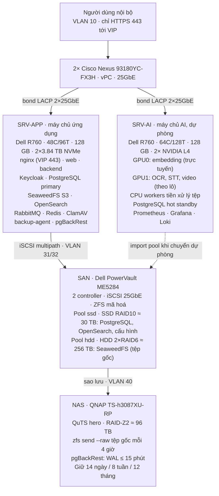

# Phương án triển khai hệ thống trên hạ tầng 2 Server + SAN + NAS

> File: `docs/01-sa/architecture/production-deployment.md` — Owner: SA
> Status: Draft
> Cập nhật: 2026-10-03 · Bản gốc soạn thảo: https://claude.ai/code/artifact/ce9007dd-2e4e-4492-a64c-c3fe2e318fb4

## 1. Tổng quan và phạm vi

Hệ thống AISmartStore được triển khai on-premise trên 2 máy chủ Dell R760, 1 SAN Dell PowerVault ME5284 và 1 NAS QNAP, chạy bằng Docker Compose trong VLAN cô lập. Máy chủ ứng dụng (SRV-APP) chạy toàn bộ dịch vụ nghiệp vụ và dữ liệu; máy chủ AI (SRV-AI) chạy OCR/STT/embedding và đóng vai trò máy dự phòng nguội cho SRV-APP.

**Mục tiêu**

- Đưa toàn bộ stack hiện có (đang chạy ở staging `stg/`) lên hạ tầng thật, không đổi công nghệ.
- Đạt RPO/RTO đã chốt ở `backup-restore.md`: RPO 15 phút (PostgreSQL), 4 giờ (tệp gốc); RTO 4 giờ (sự cố DB), 24 giờ (thảm hoạ).
- Không có cổng dữ liệu nào (5432, 5672, 9200…) lộ ra ngoài VLAN quản trị.
- Có quy trình vận hành, sao lưu, nâng cấp và chuyển dự phòng viết thành runbook.

**Phạm vi**: hạ tầng (OS, mạng, lưu trữ), triển khai ứng dụng, sao lưu/khôi phục, giám sát, vận hành. Không bao gồm: mua sắm thiết bị, nội dung mô hình AI (repo AI tách riêng).

**Giả định** (cần xác nhận ở mục 11)

- Cấu hình phần cứng lấy theo `stg/server.txt`; mạng lõi là 2× Cisco Nexus 93180YC-FX3H 25GbE theo sơ đồ vật lý.
- Tiếp tục dùng Docker Compose (đã kiểm chứng trên staging), không dựng Kubernetes cho quy mô 2 máy chủ.
- Ký hiệu `[ĐX]` = số liệu/cấu hình do tài liệu này đề xuất, chưa được khách hàng chốt.

## 2. Thành phần ứng dụng cần triển khai

Stack gồm 12 thành phần, lấy từ `docker-compose.yml` và `stg/docker-compose.yml`; phiên bản giữ nguyên như staging.

| Thành phần | Image / phiên bản | Vai trò | Dữ liệu bền | Máy chủ |
| --- | --- | --- | --- | --- |
| Nginx (API Gateway) | nginx:1.27-alpine | TLS, reverse proxy cho web/api/auth, rate limit | Chứng chỉ, cấu hình | SRV-APP |
| web | Next.js 16, Node 22 | Giao diện người dùng | Không | SRV-APP |
| backend | Spring Boot 3.3 / Java 21, cổng 3001 | API nghiệp vụ, 18 job định kỳ, consumer RabbitMQ | Không | SRV-APP |
| Keycloak | 24.0.0 | OIDC/IAM, realm `aismartstore` | DB `keycloak` trong PostgreSQL | SRV-APP |
| PostgreSQL | 16 | Metadata nghiệp vụ, audit, filer store SeaweedFS, DB Keycloak | Có — T0 | SRV-APP |
| SeaweedFS | 4.44 (master, volume, filer, S3 8333) | Kho object: bucket `documents`, `personal`, `audit-archive` | Có — T0 | SRV-APP |
| OpenSearch | 2.17 + ICU (image riêng) | Tìm kiếm toàn văn **và vector k-NN** (field vector trên `segment-v1`; thay Qdrant đã gỡ 2026-10-10), `document-v1` | Có — T1 (chứa vector, re-embed tốn kém) | SRV-APP |
| RabbitMQ | 3.13-management | Hàng đợi `q.ocr`, `q.stt`, `q.video`, `q.embed`, result, heartbeat, DLQ | Không sao lưu (outbox là nguồn) | SRV-APP |
| Redis | 7, không persistence | Cache cấu hình, trạng thái tài khoản | Không | SRV-APP |
| ClamAV | clamav-debian 1.4 | Quét virus khi upload (fail-closed → 503) | Chữ ký virus | SRV-APP |
| AI workers | Repo AI riêng | OCR, STT, xử lý video; `embedding-service` (Qwen3-Embedding-0.6B, REST, backend gọi qua `EMBEDDING_API_URL`) | Model, vùng tạm | SRV-AI |

Ràng buộc cần giữ khi triển khai:

- `NEXT_PUBLIC_*` của web được nhúng lúc build, nên image web phải build riêng cho domain production.
- Keycloak `--import-realm` chỉ chạy khi realm chưa tồn tại; production dùng `start` (không `start-dev`) với hostname cố định.
- Flyway chạy khi backend khởi động (`ddl-auto: validate`); không sửa tay schema trên production.
- Khai báo queue RabbitMQ phải khớp tham số với code (lệch tham số gây lỗi 406 và backend khởi động lại liên tục, đã gặp trên staging).
- Secret hiện đang hard-code trong `docker-compose.yml` phải đổi toàn bộ và chuyển sang file `.env` quyền 600 trước khi lên production.

## 3. Hạ tầng vật lý

Mọi dữ liệu bền nằm trên SAN (không nằm trên ổ cục bộ của máy chủ), nhờ vậy SRV-AI có thể nhận lại dữ liệu và chạy thay khi SRV-APP hỏng. Ổ NVMe cục bộ chỉ chứa hệ điều hành, image Docker, log và dữ liệu tạm.



Nét đứt: SRV-AI chỉ mở pool ZFS khi chuyển dự phòng. Trên thực tế, lưu lượng iSCSI và sao lưu đều đi qua cặp Nexus, mỗi loại trên VLAN riêng.

| Thiết bị | Cấu hình | Bố trí đĩa `[ĐX]` | Kết nối mạng `[ĐX]` |
| --- | --- | --- | --- |
| SRV-APP — Dell R760 | 48C/96T, 128 GB RAM, 2×3.84 TB NVMe | RAID1 (PERC): `/` 200 GB, `/var/lib/docker` + log phần còn lại | 2×25GbE bond LACP (dữ liệu), 2×25GbE iSCSI tách rời, 1GbE iDRAC |
| SRV-AI — Dell R760 | 64C/128T, 128 GB RAM, 2×3.84 TB NVMe, 2× NVIDIA L4 24 GB | RAID1: OS, model, vùng tạm OCR/STT, PostgreSQL standby | Giống SRV-APP |
| SAN — Dell PowerVault ME5284 | 2 controller, iSCSI 25GbE; 8×7.68 TB SSD SAS, 20×16 TB HDD SAS | SSD: 1 disk group RAID10 ≈ 30 TB dùng được; HDD: 2 disk group RAID6 (8+2), mỗi controller 1 nhóm, ≈ 256 TB dùng được | 4 cổng iSCSI/controller, chia đều 2 switch; cổng quản trị 1GbE |
| NAS — QNAP TS-h3087XU-RP | 6×24 TB HDD + 2×960 GB NVMe, QuTS hero (ZFS) | RAID-Z2 ≈ 96 TB dùng được; NVMe làm cache đọc | 1–25GbE vào VLAN sao lưu; cổng quản trị riêng |
| Mạng lõi — 2× Cisco Nexus 93180YC-FX3H | 25GbE, cặp vPC | VLAN theo mục 6, MTU 9216 trên VLAN iSCSI/sao lưu | Uplink tới mạng người dùng |

Lý do chọn RAID:

- **SSD RAID10**: PostgreSQL và OpenSearch cần ghi ngẫu nhiên nhỏ; RAID10 tránh phạt ghi của RAID6 và rebuild nhanh. 30 TB dư cho DB + chỉ mục ở giai đoạn đầu; nếu cần dung lượng hơn thì chuyển sang RAID6 (≈ 46 TB).
- **HDD 2×RAID6 (8+2)**: ổ 16 TB rebuild lâu, RAID6 chịu được hỏng 2 ổ trong lúc rebuild. Chia 2 nhóm cho 2 controller để cân tải. Có thể thay bằng ADAPT của ME5 nếu muốn rebuild nhanh hơn.
- **ZFS trên LUN của SAN** (đã chốt ở `kien_truc_he_thong.adoc`): ZFS phát hiện được bit-rot nhưng **không tự sửa** được vì dư thừa nằm ở RAID của SAN. Khối bị hỏng được lấy lại từ bản sao trên NAS.
- **NAS**: 6×24 TB chỉ còn ≈ 96 TB sau RAID-Z2, thấp hơn mức ≥ 140 TB ghi trong tài liệu kiến trúc. Không dùng RAID-Z1 vì rủi ro mất cả pool khi rebuild ổ 24 TB.

## 4. Phân bổ dịch vụ và mô hình dự phòng

SRV-APP chạy 11 container nghiệp vụ với tổng giới hạn bộ nhớ ≈ 120 GB; SRV-AI chạy AI workers, giám sát và PostgreSQL standby. Mỗi container đặt `mem_limit` để một dịch vụ không chiếm hết RAM của các dịch vụ khác.

**Ngân sách tài nguyên trên SRV-APP (128 GB RAM)** `[ĐX]`

| Dịch vụ | `mem_limit` | Tham số chính | Vị trí dữ liệu |
| --- | --- | --- | --- |
| PostgreSQL | 32 GB | `shared_buffers=24GB`, `effective_cache_size=48GB`, `max_connections=300` | `ssd/pg` |
| OpenSearch | 36 GB | heap `-Xms12g -Xmx12g`; phần còn lại cho page cache + k-NN native (vector `on_disk` + nén) — gộp 12 GB của Qdrant đã gỡ 2026-10-10 | `ssd/opensearch` |
| backend (api ×2) + backend-worker | 10 GB | api 2 × 3 GB + worker 4 GB, `-XX:MaxRAMPercentage=65`; job nền/consumer chỉ chạy ở worker (`ARCH-backend-multi-instance` ADR-1, ADR-7) | — |
| SeaweedFS | 6 GB | 1 master, 1 volume, 1 filer (filer store = PostgreSQL) | `hdd/seaweedfs` |
| Keycloak | 3 GB | chế độ `start`, DB `keycloak` | — |
| ClamAV | 3 GB | `clamd`, chữ ký nạp offline | NVMe |
| RabbitMQ | 3 GB | `vm_memory_high_watermark=0.6` | NVMe |
| Redis | 2 GB | `maxmemory 1536mb`, không persistence | — |
| web + nginx | 3 GB | — | — |
| ZFS ARC | 16 GB | `zfs_arc_max=17179869184` | — |
| Hệ điều hành, dự trữ | ≈ 14 GB | giảm 2 GB để backend lên 10 GB (`ARCH-backend-multi-instance`) | — |

Phải giới hạn ZFS ARC vì mặc định ARC chiếm tới 50% RAM và tranh chấp với `shared_buffers` và heap OpenSearch.

**SRV-AI**: GPU0 phục vụ trực tuyến (embedding; không rerank — bỏ 2026-10-08 theo `search-semantic.md` QĐ 2), GPU1 xử lý nền (OCR, STT, video). CPU workers tiền xử lý tệp. Ngoài ra chạy: Prometheus, Grafana, Alertmanager, Loki (để giám sát vẫn sống khi SRV-APP hỏng) và PostgreSQL hot standby nhận streaming replication từ SRV-APP.

**Mô hình dự phòng**: active / cold standby, chuyển thủ công theo runbook. Không dựng cluster tự động vì khách hàng đã chấp nhận RTO thảm hoạ 24 giờ (`backup-restore.md`), và cluster 2 node dễ bị split-brain khi không có node thứ ba làm trọng tài.

| Tình huống | Cách xử lý | RTO mục tiêu `[ĐX]` | RPO |
| --- | --- | --- | --- |
| SRV-APP hỏng, SAN còn | SRV-AI import pool ZFS từ SAN, chạy stack ứng dụng, chuyển VIP; AI chạy giảm tải | ≤ 2 giờ | 0 |
| Pool SSD trên SAN hỏng | Promote PostgreSQL standby trên SRV-AI; dựng lại OpenSearch từ outbox hoặc snapshot | ≤ 4 giờ (chỉ mục ≤ 72 giờ) | ≈ 0 (DB) |
| SRV-AI hỏng | Nghiệp vụ chạy bình thường; job số hoá xếp hàng chờ trong RabbitMQ | Không gián đoạn nghiệp vụ | 0 |
| Mất cả SAN | Khôi phục từ NAS theo runbook L3 của `backup-restore.md` | ≤ 24 giờ từ khi có thiết bị thay | 15 phút (DB), 4 giờ (tệp) |

An toàn khi chuyển dự phòng: LUN được map cho cả 2 máy chủ nhưng pool ZFS chỉ import trên 1 máy. Bật `multihost=on` (MMP) trên mọi pool để ZFS từ chối import khi máy kia còn đang dùng, và luôn tắt nguồn SRV-APP qua iDRAC trước khi import trên SRV-AI. Hai máy cùng ghi một pool sẽ hỏng pool vĩnh viễn.

## 5. Thiết kế lưu trữ

SAN cung cấp 3 LUN, gom thành 2 pool ZFS có mã hoá: `ssd` cho CSDL và chỉ mục, `hdd` cho tệp gốc. NAS chỉ nhận bản sao, không chạy dịch vụ nào của ứng dụng.

**LUN trên SAN** `[ĐX]`

| LUN | Disk group | Dung lượng | Controller ưu tiên | Pool ZFS |
| --- | --- | --- | --- | --- |
| `LUN-SSD-01` | SSD RAID10 | ≈ 28 TB (chừa 5–10% cho SAN) | A | `ssd` |
| `LUN-HDD-A` | HDD RAID6 nhóm A | ≈ 125 TB | A | `hdd` (vdev 1) |
| `LUN-HDD-B` | HDD RAID6 nhóm B | ≈ 125 TB | B | `hdd` (vdev 2) |

Map cả 3 LUN cho host group gồm IQN của SRV-APP và SRV-AI, bật CHAP. Không dùng snapshot của SAN cho các LUN này vì snapshot do ZFS đảm nhiệm.

**Dataset ZFS**

| Dataset | Mount | `recordsize` | Thuộc tính khác | Sao lưu |
| --- | --- | --- | --- | --- |
| `ssd/pg` | `/srv/data/pg` | 16K | `logbias=throughput`, `primarycache=metadata` | pgBackRest (WAL + base) |
| `ssd/pg-wal` | `/srv/data/pg-wal` | 128K | `logbias=latency` | cùng pgBackRest |
| `ssd/opensearch` | `/srv/data/opensearch` | 64K | — | snapshot OpenSearch hàng tuần |
| `ssd/config` | `/srv/data/config` | 128K | chứa `.env`, compose, nginx, realm export | zfs send hằng ngày |
| `ssd/exports` | `/srv/data/exports` | 1M | nơi ghi snapshot OpenSearch và export Keycloak | zfs send |
| `hdd/seaweedfs` | `/srv/data/seaweedfs` | 1M | `atime=off` | zfs snapshot mỗi 4 giờ + send |

Thuộc tính chung cho cả 2 pool: `ashift=12`, `compression=lz4`, `atime=off`, `xattr=sa`, `multihost=on`, `encryption=aes-256-gcm`, `keyformat=passphrase` (hoặc `raw` từ file khoá). Khoá ZFS không lưu trên máy chủ sau khi nạp; ký gửi ngoại tuyến 2 bản theo `backup-restore.md` Quyết định 6. Do đó sau mỗi lần khởi động lại, quản trị viên phải nạp khoá (`zfs load-key`) trước khi stack chạy.

**NAS (QuTS hero)**

| Thành phần | Mục đích | Quyền |
| --- | --- | --- |
| Pool `backup` RAID-Z2 | Nhận `zfs send --raw` từ `ssd/config`, `ssd/exports`, `hdd/seaweedfs` | Tài khoản `zrecv`: chỉ `receive,create,mount`, không có `destroy` |
| Share `pgbackrest` (NFS v4, VLAN sao lưu) | Kho pgBackRest: WAL liên tục + base backup, mã hoá bởi pgBackRest | Chỉ IP của SRV-APP và SRV-AI |
| Tài khoản `zprune` | Tỉa snapshot cũ theo GFS 14/8/12 | Chạy trên chính NAS, khoá SSH khác |

WAL của PostgreSQL được đẩy thẳng sang NAS (không chờ chu kỳ zfs send 4 giờ) để RPO 15 phút vẫn đạt khi mất cả SAN.

**Ước tính dung lượng NAS**: với ≈ 96 TB dùng được, NAS chứa được bản sao đầy đủ khi tệp gốc trên SAN dưới khoảng 70 TB (còn chỗ cho snapshot gia tăng và pgBackRest). Vượt ngưỡng này phải mở rộng NAS (thêm ổ vào khay còn trống hoặc thêm expansion unit). Cảnh báo ở 70%, tỉa bản cũ ở 85% (`backup.nas_usage_warn_percent / prune_percent`).

## 6. Mạng và bảo mật

Mạng chia 6 VLAN; người dùng chỉ đi được tới cổng 443 của VIP gateway, mọi cổng dữ liệu chỉ mở giữa 2 máy chủ. Dải địa chỉ dưới đây là ví dụ, cần thay bằng quy hoạch IP của đơn vị.

| VLAN | Mục đích | Dải ví dụ `[ĐX]` | MTU | Thành viên |
| --- | --- | --- | --- | --- |
| 10 — USER | Truy cập người dùng, hệ thống nghiệp vụ khác | 10.10.10.0/24 | 1500 | VIP gateway `10.10.10.10` |
| 20 — APP | Giao tiếp SRV-APP ↔ SRV-AI | 10.10.20.0/24 | 9000 | SRV-APP `.11`, SRV-AI `.12` |
| 31 — iSCSI-A | Đường iSCSI 1, không gateway | 10.10.31.0/24 | 9000 | NIC iSCSI-1 của 2 máy, cổng A0/B0 của SAN |
| 32 — iSCSI-B | Đường iSCSI 2, không gateway | 10.10.32.0/24 | 9000 | NIC iSCSI-2 của 2 máy, cổng A1/B1 của SAN |
| 40 — BACKUP | zfs send, NFS pgBackRest | 10.10.40.0/24 | 9000 | 2 máy chủ, NAS |
| 50 — MGMT | iDRAC, quản trị SAN/NAS/switch, SSH quản trị | 10.10.50.0/24 | 1500 | Chỉ máy trạm quản trị (jump host) |

Hai VLAN iSCSI không bond, mỗi VLAN đi qua một switch, để multipath có 2 đường độc lập khi một switch hỏng.

**Ma trận tường lửa** (`nftables` trên host + chuỗi `DOCKER-USER`; mặc định chặn)

| Nguồn | Đích | Cổng | Mục đích |
| --- | --- | --- | --- |
| VLAN 10 | VIP gateway | 443/tcp | Web, API, Keycloak (qua nginx) |
| SRV-AI | SRV-APP | 5672/tcp (AMQPS 5671 nếu bật TLS) | Nhận job, trả kết quả OCR/STT |
| SRV-AI | SRV-APP | 8333/tcp | AI đọc tệp qua S3 (tài khoản S3 riêng, chỉ quyền cần thiết) |
| SRV-APP | SRV-AI | `<port embedding-service>`/tcp | backend gọi `embedding-service` (không xác thực ⇒ chỉ mở cho SRV-APP) — thay 6333–6334 Qdrant đã gỡ 2026-10-10 |
| SRV-APP | SRV-AI | 5432/tcp | Streaming replication PostgreSQL |
| SRV-AI | SRV-APP | các cổng exporter (9100, 9187, 15692…) | Prometheus thu metric |
| SRV-APP, SRV-AI | NAS | 22/tcp, 2049/tcp | zfs send qua SSH, NFS pgBackRest |
| VLAN 50 | Tất cả | 22, 443, giao diện quản trị | Quản trị, chỉ từ jump host |

Các cổng 5432, 6379, 9200, 15672, 3001, 8080 **không** publish ra host trên production: bỏ khối `ports:` của chúng trong compose, chỉ để các dịch vụ nói chuyện qua mạng nội bộ của Docker. Cổng cần cho SRV-AI chỉ bind vào IP VLAN 20 (`10.10.20.11:5672:5672`).

**Bảo mật**

- TLS nội bộ bằng CA riêng của đơn vị; nginx giữ chứng chỉ cho `app.`, `api.`, `auth.` (tên miền nội bộ). Thay cơ chế Cloudflare Flexible của staging.
- Đổi toàn bộ mật khẩu mặc định (`aismartstore`, `admin`, client secret Keycloak, `NEXTAUTH_SECRET`, khoá S3) bằng giá trị sinh ngẫu nhiên 32 ký tự, lưu trong `.env` quyền 600, chủ sở hữu root.
- Keycloak chạy `start` với `KC_HOSTNAME`, `KC_PROXY_HEADERS=xforwarded`, tắt tài khoản admin mặc định sau khi tạo admin định danh.
- RabbitMQ: xoá user mặc định, tạo user riêng cho backend và cho AI workers, phân quyền theo vhost.
- OpenSearch không lộ ra ngoài mạng Docker; nếu phải lộ thì bật security plugin.
- SSH chỉ bằng khoá, tắt đăng nhập root, chỉ nhận từ VLAN 50. Bật `auditd`, áp dụng CIS Benchmark mức 1 cho Ubuntu.
- Đồng bộ thời gian bằng `chrony` từ NTP nội bộ cho mọi thiết bị. Lệch giờ làm JWT bị từ chối và làm sai thứ tự chuỗi hash của `audit_log`.

**Vận hành không Internet**: cần dựng sẵn trước khi cài đặt

- Kho gói APT offline (mirror Ubuntu hoặc bộ `.deb` đã tải) và bộ cài Docker, driver NVIDIA, NVIDIA Container Toolkit.
- Kho image nội bộ (registry trên SRV-AI) hoặc tệp `docker save` có checksum SHA-256.
- Chữ ký ClamAV: tải bằng `cvdupdate` trên máy có Internet, chuyển qua thiết bị lưu trữ được duyệt, nạp vào `/var/lib/clamav` tối thiểu hằng tuần. Tắt `freshclam` tự động.
- Firmware Dell (Dell Repository Manager), firmware SAN/NAS, bản cập nhật bảo mật: cập nhật theo đợt hằng quý.

## 7. Quy trình cài đặt

Cài đặt qua 10 bước theo thứ tự dưới đây; mỗi bước có điều kiện kiểm tra trước khi sang bước sau. Hệ điều hành đề xuất: Ubuntu Server 24.04 LTS cho cả 2 máy chủ (OpenZFS có sẵn trong kho gói chính thức, đã dùng trên staging).

**Bước 0 — Chuẩn bị**

- [ ] Chốt quy hoạch IP, tên miền nội bộ, VLAN (mục 6) và sơ đồ đấu cáp từng cổng.
- [ ] Chuẩn bị kho gói offline, bộ image Docker, chữ ký ClamAV, model AI (mục 6).
- [ ] Cập nhật firmware BIOS, iDRAC, PERC, NIC, SAN, NAS, switch lên cùng một đợt bản ổn định.
- [ ] BIOS: profile *Performance*, bật VT-d, SR-IOV tắt nếu không dùng.

**Bước 1 — Switch**: cấu hình vPC giữa 2 Nexus, tạo VLAN 10/20/31/32/40/50, port-channel LACP cho NIC dữ liệu của mỗi máy chủ, MTU 9216 trên VLAN 20/31/32/40. Cổng iSCSI là access port, không nằm trong port-channel.

**Bước 2 — SAN (PowerVault Manager)**

1. Tạo disk group SSD RAID10, 2 disk group HDD RAID6 (8+2), gán pool A/B.
2. Tạo 3 volume theo mục 5, đặt IP iSCSI cho 8 cổng controller trên VLAN 31/32.
3. Tạo host group `aismart-hosts` gồm IQN của SRV-APP và SRV-AI, bật CHAP, map 3 volume.
4. Cấu hình SNMP/syslog và email cảnh báo của SAN về hệ thống giám sát.

**Bước 3 — Hệ điều hành (cả 2 máy)**

1. Cài Ubuntu 24.04 trên RAID1 NVMe, LVM: `/` 200 GB, `/var/lib/docker` phần còn lại.
2. Cấu hình `netplan`: bond LACP (VLAN 10/20/40/50 trên bond), 2 NIC iSCSI riêng, MTU 9000.
3. `chrony` trỏ NTP nội bộ, SSH chỉ khoá, `auditd`, `nftables`.
4. Tham số kernel bắt buộc:

```bash
cat >/etc/sysctl.d/90-aismart.conf <<'EOF'
vm.max_map_count = 262144   # OpenSearch
vm.swappiness = 1
net.core.somaxconn = 4096
EOF
echo 'options zfs zfs_arc_max=17179869184' >/etc/modprobe.d/zfs.conf
zgenhostid   # hostid riêng cho từng máy, bắt buộc khi dùng multihost=on
```

**Bước 4 — iSCSI và multipath (cả 2 máy)**

```bash
apt install open-iscsi multipath-tools zfsutils-linux
# đặt CHAP trong /etc/iscsi/iscsid.conf, node.startup = automatic
iscsiadm -m discovery -t sendtargets -p 10.10.31.101
iscsiadm -m discovery -t sendtargets -p 10.10.32.101
iscsiadm -m node --login
```

`/etc/multipath.conf` (kiểm tra lại chuỗi vendor/product bằng `multipath -ll`):

```
defaults { user_friendly_names no; find_multipaths yes }
devices {
  device {
    vendor "DellEMC"
    product "ME5"
    path_grouping_policy group_by_prio
    prio alua
    hardware_handler "1 alua"
    path_checker tur
    failback immediate
    no_path_retry 30
  }
}
multipaths {
  multipath { wwid <WWID-SSD-01>; alias LUN-SSD-01 }
  multipath { wwid <WWID-HDD-A>;  alias LUN-HDD-A }
  multipath { wwid <WWID-HDD-B>;  alias LUN-HDD-B }
}
```

Kiểm tra: `multipath -ll` thấy mỗi LUN có 4 đường (2 active/optimized, 2 enabled); rút 1 cáp iSCSI thì I/O không gián đoạn.

**Bước 5 — Pool ZFS (chỉ trên SRV-APP)**

```bash
COMMON="-o ashift=12 -o multihost=on -O compression=lz4 -O atime=off -O xattr=sa \
  -O encryption=aes-256-gcm -O keyformat=passphrase -O keylocation=prompt -O mountpoint=none"
zpool create $COMMON ssd /dev/mapper/LUN-SSD-01
zpool create $COMMON hdd /dev/mapper/LUN-HDD-A /dev/mapper/LUN-HDD-B

zfs create -o mountpoint=/srv/data/pg -o recordsize=16K -o logbias=throughput ssd/pg
zfs create -o mountpoint=/srv/data/pg-wal ssd/pg-wal
zfs create -o mountpoint=/srv/data/opensearch -o recordsize=64K ssd/opensearch
zfs create -o mountpoint=/srv/data/config ssd/config
zfs create -o mountpoint=/srv/data/exports -o recordsize=1M ssd/exports
zfs create -o mountpoint=/srv/data/seaweedfs -o recordsize=1M hdd/seaweedfs

chown -R 70:70 /srv/data/pg /srv/data/pg-wal          # postgres:16-alpine
chown -R 1000:1000 /srv/data/opensearch               # opensearch
```

Tắt `zfs-import-cache`/`zfs-mount` tự động cho 2 pool này trên SRV-AI để SRV-AI không bao giờ tự import khi khởi động. Lập lịch `zpool scrub` hàng tuần.

**Bước 6 — NAS**: tạo pool RAID-Z2, dataset `backup/aismart`, user `zrecv` với `zfs allow zrecv receive,create,mount backup/aismart`, user `zprune` riêng, share NFS `pgbackrest` giới hạn theo IP VLAN 40. Kiểm tra bằng 1 lần `zfs send --raw` thử một dataset nhỏ.

**Bước 7 — Docker (cả 2 máy)**: cài Docker Engine + plugin compose từ gói offline, `/etc/docker/daemon.json`:

```json
{
  "data-root": "/var/lib/docker",
  "log-driver": "json-file",
  "log-opts": { "max-size": "100m", "max-file": "5" },
  "live-restore": true,
  "default-address-pools": [{ "base": "172.30.0.0/16", "size": 24 }]
}
```

`default-address-pools` tránh dải mạng Docker trùng dải IP của đơn vị.

**Bước 8 — Triển khai ứng dụng trên SRV-APP**

1. Cấu trúc thư mục: `/srv/data/config/aismartstore/` chứa `docker-compose.prod.yml` (dựa trên `stg/docker-compose.yml`), `.env`, `nginx/`, `keycloak/`, `seaweedfs/s3.json`, `clamav/clamd.conf`. Thư mục nằm trên SAN nên SRV-AI dùng được khi chuyển dự phòng.
2. Thay mọi named volume bằng bind mount vào `/srv/data/*`; thêm `restart: unless-stopped`, `mem_limit` (mục 4), bỏ `ports:` của dịch vụ nội bộ. PostgreSQL đặt `POSTGRES_INITDB_WALDIR=/var/lib/postgresql/wal` trỏ vào `ssd/pg-wal`.
3. Nạp image: `docker load -i <image>.tar` sau khi đối chiếu SHA-256. Image web phải build với `NEXT_PUBLIC_API_BASE_URL` và `NEXT_PUBLIC_KEYCLOAK_ISSUER` của production.
4. Khởi động theo lớp: `postgres` → `keycloak` (lần đầu import realm) → `seaweedfs`, `redis`, `rabbitmq`, `opensearch`, `clamav` → `backend` (Flyway, tạo bucket, khai báo queue, tạo index) → `web` → `nginx`.
5. Script `start-stack.sh` kiểm tra `zfs get keystatus` = `available` và các dataset đã mount rồi mới chạy `docker compose up -d`; không để Docker tự khởi động stack khi pool chưa mở khoá (container sẽ ghi vào thư mục rỗng trên NVMe).
6. Kiểm tra khói: đăng nhập 3 vai trò R1/R2/R3, upload tệp 2 GB, upload tệp EICAR (phải bị chặn), tìm kiếm toàn văn, xem nhật ký audit.

**Bước 9 — SRV-AI**

1. Cài driver NVIDIA bản server hỗ trợ L4 và NVIDIA Container Toolkit, chạy `nvidia-ctk runtime configure --runtime=docker`, kiểm tra `docker run --rm --gpus all <cuda-image> nvidia-smi` thấy 2 GPU.
2. Triển khai AI workers bằng compose riêng; ghim GPU bằng `device_ids: ['0']` cho dịch vụ trực tuyến, `['1']` cho OCR/STT. Kết nối RabbitMQ và S3 của SRV-APP qua VLAN 20.
3. Dựng PostgreSQL standby: `pg_basebackup -h 10.10.20.11 -U replicator -D <data> -R -X stream`, dữ liệu trên NVMe của SRV-AI; kiểm tra `pg_stat_replication` trên SRV-APP.
4. Triển khai stack giám sát (mục 9).

**Bước 10 — Sao lưu và nghiệm thu**: cài pgBackRest + `backup-agent` (systemd timer) theo mục 8, chạy 1 lượt sao lưu đầy đủ, 1 lượt khôi phục vào sandbox, 1 lần diễn tập chuyển dự phòng sang SRV-AI, rồi đi theo checklist nghiệm thu ở mục 11.

## 8. Sao lưu và khôi phục

Sao lưu làm đúng theo `docs/01-sa/architecture/backup-restore.md` (đã Approved): RPO 15 phút cho PostgreSQL, 4 giờ cho tệp gốc; NAS là đích sao lưu duy nhất. Mục này chỉ nêu cách thực hiện trên hạ tầng thật.

| Dữ liệu | Công cụ | Tần suất | Đích | Giữ lại |
| --- | --- | --- | --- | --- |
| PostgreSQL (nghiệp vụ, filer store, Keycloak, audit) | pgBackRest: `archive_command` + base backup, `repo1-cipher-type=aes-256-cbc` | WAL liên tục (`archive_timeout=900`); full Chủ nhật, diff các ngày khác 02:00 | NFS `pgbackrest` trên NAS | PITR 14 ngày; 14 ngày / 8 tuần / 12 tháng |
| Tệp gốc (`hdd/seaweedfs`) | `zfs snapshot` + `zfs send -i --raw` | 02:00 (mốc nhất quán) và 06, 10, 14, 18, 22 giờ | `backup/aismart` trên NAS | SAN 7 ngày; NAS 14 / 8 / 12 |
| Cấu hình, `.env`, realm export | `zfs send --raw` của `ssd/config` | Hằng ngày | NAS | 30 bản |
| OpenSearch (gồm vector) | snapshot repository `fs` tại `ssd/exports` → zfs send | Hàng tuần | NAS | 4 bản (T1 từ 2026-10-10) |
| Redis, RabbitMQ, vùng tạm AI | Không sao lưu | — | — | — |

**Trình tự lượt 02:00** do `backup-agent` (systemd timer trên SRV-APP) thực hiện:

1. Ghi `backup_run` = STARTED, đặt `backup.window_open=true` để chặn job `trash-purge`.
2. Chốt điểm PostgreSQL: `pgbackrest backup` hoàn tất, ghi LSN.
3. Trong vòng 15 phút sau đó: `zfs snapshot -r hdd/seaweedfs@daily-YYYYMMDD` (snapshot tệp phải chụp **sau** điểm DB, không bao giờ trước).
4. Gỡ `window_open`; chạy `zfs send -i --raw … | ssh zrecv@nas zfs receive -u …`.
5. Xác minh: `pgbackrest verify`, đối chiếu GUID snapshot nguồn/đích; đạt thì `backup_run` = VERIFIED.
6. Job `trash-purge` 03:00 chỉ chạy khi đã có điểm nhất quán của ngày.

**Cấp khôi phục**

| Cấp | Tình huống | Cách làm | RTO |
| --- | --- | --- | --- |
| L1 | Cần lại vài tài liệu đã xoá vĩnh viễn | `zfs clone` snapshot + PostgreSQL tạm (sandbox, cổng riêng, chỉ đọc) → lấy tệp, đối chiếu SHA-256 → nạp lại qua luồng upload; cần phiếu R1 được R2 duyệt | ≤ 4 giờ |
| L2 | Hỏng logic/hỏng DB, phần cứng còn | `pgbackrest restore --type=time` về mốc chọn; `zfs rollback` tệp về snapshot có thời điểm ≥ mốc DB; phát lại outbox | ≤ 4 giờ |
| L3 | Mất SAN | Dựng pool mới → `zfs receive` từ NAS → restore PostgreSQL → mở dịch vụ chế độ suy giảm → dựng lại chỉ mục | ≤ 24 giờ (+72 giờ chỉ mục) |

Trước mọi lần khôi phục L2/L3: nếu DB cũ còn đọc được, xuất `audit_log` thô làm bằng chứng; sau khôi phục ghi sự kiện `system.restore` nêu điểm gián đoạn chuỗi hash.

**Khoá mã hoá**: khoá ZFS và khoá pgBackRest được ký gửi 2 bản (USB niêm phong + bản in) ở 2 két khác nhau, mở cần 2 người. Mất khoá là mất toàn bộ dữ liệu và bản sao, nên phải thử mở khoá mỗi quý.

**Kiểm thử khôi phục**: tự động 04:00 ngày 7 hằng tháng (sandbox + SHA-256 100 tài liệu ngẫu nhiên); diễn tập L3 có người hằng quý, đo RTO thực tế.

## 9. Giám sát, log và cảnh báo

Stack giám sát (Prometheus, Alertmanager, Grafana, Loki + Promtail) chạy trên SRV-AI để vẫn báo được khi SRV-APP hỏng; cảnh báo gửi qua máy chủ email nội bộ vì hệ thống không có Internet.

| Nguồn | Cách thu | Chỉ số chính |
| --- | --- | --- |
| Máy chủ (OS, ZFS) | `node_exporter` (có collector ZFS) | CPU, RAM, đĩa NVMe, trạng thái pool, lỗi checksum, dung lượng |
| Container | cAdvisor | RAM so với `mem_limit`, số lần restart |
| Phần cứng Dell | iDRAC Redfish hoặc SNMP | Nguồn, quạt, nhiệt độ, ổ đĩa |
| SAN ME5284 | SNMP + email của SAN | Trạng thái controller, disk group, ổ hỏng |
| NAS QNAP | SNMP | Pool, ổ đĩa, dung lượng |
| PostgreSQL | `postgres_exporter` | Kết nối, độ trễ replication, WAL archive lỗi |
| RabbitMQ | plugin `rabbitmq_prometheus` (15692) | Độ dài queue, DLQ, consumer |
| OpenSearch | exporter OpenSearch | Trạng thái cluster, heap |
| GPU | `dcgm-exporter` | Mức dùng GPU, VRAM, nhiệt độ |
| Endpoint | `blackbox_exporter` | HTTPS web/api/auth, hạn chứng chỉ |
| Log | Promtail → Loki | Log mọi container, syslog, log `backup-agent` |

Backend chưa có Spring Actuator/metrics (nợ kỹ thuật trong `_codebase-overview.md`). Trước khi có, giám sát backend qua blackbox HTTP và luật cảnh báo trên log Loki (ví dụ cảnh báo DLQ/stale đang chỉ ghi log).

**Ngưỡng cảnh báo** `[ĐX]`

| Cảnh báo | Điều kiện | Mức |
| --- | --- | --- |
| Endpoint ngừng | HTTPS web/api/auth lỗi > 2 phút | Nghiêm trọng |
| Pool ZFS suy giảm | `zpool status` khác ONLINE hoặc có lỗi checksum | Nghiêm trọng |
| Mất đường multipath | Ít hơn 4 đường/LUN > 5 phút | Cao |
| Không có bản sao thành công | > 26 giờ | Nghiêm trọng |
| WAL archive lỗi | `pg_stat_archiver.failed_count` tăng | Cao |
| Replication trễ | Standby trễ > 5 phút | Cao |
| Dung lượng | Pool SAN > 80%, NAS > 70% | Cảnh báo |
| Hàng đợi | DLQ > 0, hoặc `q.ocr`/`q.stt` tăng liên tục 1 giờ | Cảnh báo |
| Container | Restart > 3 lần/15 phút | Cao |
| Chữ ký ClamAV | Cũ hơn 7 ngày | Cảnh báo |
| Chứng chỉ TLS | Hết hạn trong < 30 ngày | Cảnh báo |
| Lệch giờ | `chrony` lệch > 1 giây | Cao |

Giữ log 90 ngày trên Loki (NVMe của SRV-AI). Nhật ký nghiệp vụ (`audit_log`) nằm trong PostgreSQL và bucket `audit-archive`, không phụ thuộc Loki.

## 10. Vận hành

Vận hành gồm công việc định kỳ, quy trình phát hành phiên bản và runbook sự cố. Mọi thao tác trên production ghi vào sổ vận hành (ngày, người, việc, kết quả).

**Công việc định kỳ**

| Tần suất | Việc | Người làm |
| --- | --- | --- |
| Hằng ngày | Xem dashboard tổng quan, kết quả `backup_run` đêm qua, DLQ, cảnh báo còn mở | Quản trị hệ thống |
| Hàng tuần | Nạp chữ ký ClamAV offline; xem kết quả `zpool scrub` SAN; xem dung lượng SAN/NAS | Quản trị hệ thống |
| Hằng tháng | Xem kết quả kiểm thử khôi phục tự động; scrub NAS; rà tài khoản Keycloak không dùng | Quản trị hệ thống |
| Hằng quý | Diễn tập L3 và chuyển dự phòng sang SRV-AI; thử mở khoá ký gửi; cập nhật bản vá OS và firmware | Quản trị + lãnh đạo duyệt |
| Hằng năm | Gia hạn chứng chỉ TLS nội bộ, xoay vòng mật khẩu dịch vụ, rà lại dự báo dung lượng | Quản trị |

**Phát hành phiên bản mới**

1. Build image trên máy build (có Internet), chạy `mvn verify` và `npm test`, đánh tag theo phiên bản, `docker save` + tạo tệp SHA-256.
2. Thử trên staging với cùng image trước khi mang vào.
3. Chuyển qua thiết bị lưu trữ được duyệt, đối chiếu SHA-256, `docker load` trên SRV-APP.
4. Thông báo bảo trì; tạo điểm khôi phục: `pgbackrest backup --type=diff` và `zfs snapshot -r ssd@pre-<version> hdd@pre-<version>`.
5. Cập nhật tag trong `.env`, `docker compose up -d backend backend-worker web`; Flyway tự chạy migration.
6. Kiểm tra khói (mục 7, bước 8.6).
7. Lỗi: Flyway không có rollback, nên quay lại bằng cách dừng backend, khôi phục PostgreSQL về điểm ở bước 4, đổi tag về bản cũ. Chỉ rollback snapshot `hdd` nếu bản mới đã ghi sai tệp.

**Runbook: SRV-APP hỏng, chuyển sang SRV-AI**

1. Xác nhận SRV-APP không phục hồi được trong RTO (iDRAC, console).
2. Tắt hẳn SRV-APP qua iDRAC (`racadm serveraction powerdown`) — bước bắt buộc để tránh 2 máy cùng ghi pool.
3. Trên SRV-AI: dừng AI workers dùng GPU1 để nhường RAM; dừng PostgreSQL standby.
4. `zpool import ssd && zpool import hdd`, `zfs load-key -a`, `zfs mount -a`.
5. Gán VIP `10.10.10.10` và IP VLAN 20 `.11` lên SRV-AI (hoặc đổi DNS nội bộ).
6. `start-stack.sh` với cùng `docker-compose.prod.yml` trên `/srv/data/config`, `mem_limit` giảm theo profile `failover` `[ĐX]`.
7. Kiểm tra khói, thông báo người dùng. Sao lưu tiếp tục chạy từ SRV-AI.
8. Khi SRV-APP sửa xong: làm ngược lại trong khung bảo trì, dựng lại standby.

**Runbook sự cố thường gặp**

| Triệu chứng | Nguyên nhân hay gặp | Xử lý |
| --- | --- | --- |
| Backend khởi động lại liên tục, log 406 PRECONDITION_FAILED | Queue RabbitMQ khai báo tham số khác code | Xoá queue lệch (khi đã rỗng) để backend khai báo lại; kiểm tra đối chiếu trước mỗi release |
| Backend không lên, lỗi Flyway checksum | Migration đã chạy bị sửa | Không dùng `repair` tuỳ tiện; đối chiếu file migration với bản đã chạy, sửa ở code |
| Upload trả 503 | ClamAV chưa nạp xong chữ ký hoặc restart vòng lặp | Xem log `clamav`; kiểm tra `clamd.conf` có `LocalSocket` (lỗi đã gặp trên staging) |
| Tìm kiếm lỗi, OpenSearch RED | Hết đĩa, heap, shard hỏng | Giải phóng đĩa; nếu index hỏng thì xoá index, để job reconciliation dựng lại từ outbox |
| DLQ có message | AI xử lý lỗi tệp | Xem mã lỗi, sửa rồi đẩy lại từ giao diện số hoá/quản trị RabbitMQ |
| Không đăng nhập được, lỗi token | Lệch giờ hoặc sai `KC_HOSTNAME`/issuer | Kiểm tra `chronyc tracking`, issuer trong image web |
| Ổ SAN hỏng | Hỏng vật lý | Thay nóng ổ cùng loại; theo dõi rebuild; hạn chế tác vụ nặng (purge, re-index) cho đến khi xong |
| Sau khởi động lại, stack không chạy | Pool chưa nạp khoá | 2 người giữ khoá nạp `zfs load-key`, rồi `start-stack.sh` |

## 11. Nghiệm thu, rủi ro và câu hỏi mở

Hệ thống chỉ được đưa vào vận hành khi đạt hết checklist dưới đây, trong đó có 1 lần khôi phục thật và 1 lần chuyển dự phòng thật.

**Checklist nghiệm thu**

- [ ] Rút lần lượt 1 cáp iSCSI, 1 cáp bond, tắt 1 switch: dịch vụ không gián đoạn.
- [ ] Chuyển controller SAN (failover A → B): I/O tiếp tục, không lỗi ZFS.
- [ ] Thử import pool trên SRV-AI khi SRV-APP đang chạy: ZFS từ chối (MMP hoạt động).
- [ ] Diễn tập chuyển dự phòng sang SRV-AI đạt ≤ 2 giờ, không mất dữ liệu.
- [ ] Khôi phục L1 (1 tài liệu qua sandbox) và L2 (PITR PostgreSQL) thành công, SHA-256 khớp.
- [ ] Bản sao đầu tiên trên NAS VERIFIED; tài khoản `zrecv` không xoá được snapshot.
- [ ] Quét cổng từ VLAN 10: chỉ thấy 443.
- [ ] Mọi mật khẩu mặc định đã đổi; không còn secret trong compose.
- [ ] Kiểm thử tải đạt mục tiêu NFR về hiệu năng của SRS.
- [ ] Cảnh báo thử (đĩa đầy giả, dừng container) đến được email quản trị.
- [ ] Khoá mã hoá đã ký gửi 2 bản, đã thử mở.
- [ ] Bàn giao: tài liệu này, sơ đồ đấu nối thực tế, bảng IP, danh sách tài khoản, runbook.

**Rủi ro**

| Rủi ro | Mức | Giảm thiểu |
| --- | --- | --- |
| Hai máy cùng import một pool ZFS (split-brain), hỏng toàn bộ dữ liệu | Cao | `multihost=on`, tắt SRV-APP qua iDRAC trước khi import, không import tự động trên SRV-AI |
| Mất khoá mã hoá ZFS/pgBackRest | Cao | Ký gửi 2 bản, 2 người, thử mở hằng quý |
| NAS ≈ 96 TB không đủ khi tệp gốc vượt ≈ 70 TB | Trung bình | Theo dõi tăng trưởng; lập kế hoạch mở rộng NAS trước khi chạm 70% |
| ZFS trên LUN RAID không tự sửa bit-rot | Thấp | Scrub hàng tuần phát hiện sớm; lấy lại khối từ NAS |
| Không có Internet: chữ ký ClamAV, bản vá bảo mật bị trễ | Trung bình | Quy trình nạp offline hàng tuần/hằng quý, cảnh báo chữ ký cũ |
| Khi chuyển dự phòng, SRV-AI vừa chạy ứng dụng vừa chạy AI, thiếu RAM | Trung bình | Profile `failover` giảm `mem_limit`, tạm dừng xử lý nền GPU1 |
| Backend chưa có metrics | Trung bình | Bổ sung Spring Actuator + Micrometer Prometheus trước go-live |

**Câu hỏi mở**

- [ ] GPU của SRV-AI: `stg/server.txt` ghi 2× L4 24 GB, sơ đồ vật lý ghi L40S 48 GB + L4 24 GB. Cấu hình nào đúng?
- [ ] Sơ đồ vật lý vẽ “cụm 2 node” ứng dụng và có nhắc K8s; tài liệu này giả định 1 máy ứng dụng + 1 máy AI, dùng Docker Compose. Xác nhận?
- [ ] NAS RAID-Z2 ≈ 96 TB có đủ cho khối lượng dữ liệu dự kiến 3–5 năm không? Cần số liệu dự báo tăng trưởng.
- [ ] Quy hoạch IP, tên miền nội bộ, NTP, SMTP, CA nội bộ do đơn vị nào cung cấp?
- [x] AI workers có ghi trực tiếp vào Qdrant không? → **Chốt 2026-10-10:** gỡ hẳn Qdrant; AI chỉ cung cấp `embedding-service` (REST), backend tự gọi và ghi vector vào OpenSearch (`search-semantic.md` QĐ 6) — bỏ cổng 6333/6334, mở cổng embedding-service chiều SRV-APP → SRV-AI (mục 6).
- [ ] Quy trình mang dữ liệu (image, chữ ký virus, bản vá) qua vùng cách ly do ai duyệt, tần suất bao nhiêu?
