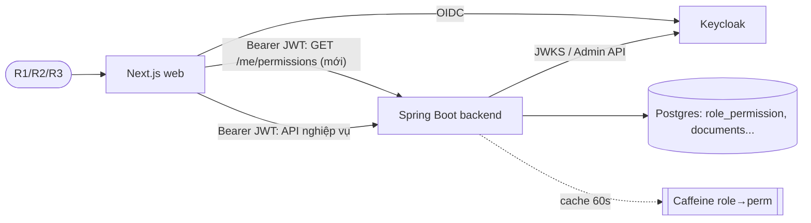

# Architecture: r2-business-parity

> File: `docs/01-sa/architecture/r2-business-parity.md` — Owner: SA
> Status: Approved
> Traceability ID: `ARCH-r2-business-parity` (BA/DEV/QA tham chiếu ID này)

Nền: `_codebase-overview.md`, `rbac-permission-editing.md`, `rbac-group-scope.md`,
`docs/_handoff/r2-business-parity.md`. Mô tả đích: `docs/00-overview/tinh-nang-phan-mem.adoc`.

## 1. Bối cảnh / Vấn đề

- Hiện R2 (Lãnh đạo, `LANH_DAO`) chỉ được đọc/chia sẻ/nhóm/kho cá nhân + nhật ký
  theo phạm vi; nghiệp vụ muốn **R2 có toàn bộ chức năng nghiệp vụ của R1**.
- Chuyển quyền sở hữu tài liệu (do R3 thực hiện) đang bắt buộc người nhận là R1
  (`DocumentOwnershipService.java:84`, FE `admin/document-ownership/page.tsx:107`).
- Web gate menu/nút theo **vai trò hard-code** (`web/src/lib/features.ts`,
  `documents/page.tsx` `canDelete`, `documents/[id]/page.tsx` `canWrite`,
  `personal/page.tsx` `canSeeFeature('upload')`...), trong khi backend gate theo
  **permission** (`hasAuthority('PERM_...')`, bảng `role_permission`, R3 sửa được
  qua RBAC). Khi R3 đổi quyền, UI lệch với backend.

**In-scope**

1. Cấp cho `LANH_DAO` 5 permission nghiệp vụ đang chỉ R1 có: `document.upload`
   (gồm `/ingest/from-personal`), `tag.manage`, `note.write`,
   `digitization_review.manage`, `trash.manage`.
2. Chuyển sở hữu: người nhận = **mọi tài khoản R1 hoặc R2 đang hoạt động**
   (khác người nạp hiện tại); người thực hiện vẫn **chỉ R3**.
3. Cơ chế expose **quyền hiệu lực** (effective permissions) của user hiện tại cho
   web; web chuyển gate menu/route/nút sang permission.
4. Cập nhật test (BE + ~7 file test web đang khẳng định R2 bị chặn).

**Out-of-scope**

- Thay đổi vai trò/realm role Keycloak, thêm vai trò mới, thêm permission mới
  ngoài nhu cầu expose (danh mục permission giữ nguyên).
- Cho R2 thực hiện chuyển sở hữu; thay đổi luồng/phạm vi `audit.read_scoped`.
  `AuditScopeFilter` đã lọc theo tài liệu R2 sở hữu hoặc được chia sẻ (không lọc
  theo loại hành động) → sự kiện upload/review/trash trên tài liệu của R2 tự hiện;
  sự kiện có `resource_type` khác `document` (tag/note...) vẫn ẩn theo giới hạn v1
  (audit-logging.md §4.4, chốt 2026-09-01).
- Gate dựa trên data-scope (vd. "chỉ tài liệu của tôi") ở FE — FE chỉ gate ở mức
  permission; ràng buộc theo bản ghi vẫn do backend.
- Các trang quản trị R3 gate bằng `hasRole('QUAN_TRI')` ở BE (RBAC, ...) — giữ
  nguyên cơ chế role.
- Quota lưu trữ theo vai trò (giữ nguyên default R2). R2 nạp kho chung dùng đúng
  cơ chế hiện có của `UploadBatchService` (`ingest.max_files_per_batch`,
  `max_batch_size_bytes`, dung lượng kho chung — cấu hình toàn hệ thống, không
  phân biệt vai trò); không sửa code ingest, chỉ thêm test cho uploader R2.

## 2. Ràng buộc (Constraints)

- Backend Spring Boot: authorities = `ROLE_<code>` (Keycloak realm role) +
  `PERM_<code>` từ `role_permission` (cache Caffeine 60s, evict khi R3 sửa RBAC).
- Schema đổi **chỉ qua Flyway** (migration kế tiếp: `V35`). Không sửa migration cũ.
- Prod/stg có thể đã bị R3 chỉnh `role_permission` → migration phải idempotent
  (`ON CONFLICT DO NOTHING`), không ghi đè lựa chọn khác của R3.
- Web Next.js 16 + NextAuth/Keycloak: session hiện chỉ có `roles`; SessionProvider
  refetch mỗi 4 phút. Không thêm thư viện JWT (theo `web/CLAUDE.md`).
- Guard chống tự khoá RBAC của R3 (rbac-permission-editing QĐ3) không bị ảnh hưởng.
- Logic nghiệp vụ hiện **không phụ thuộc vai trò** (hàng chờ duyệt lọc
  `uploader_sub`, thùng rác lọc người nạp/được chia sẻ) → mở quyền không cần sửa
  service, chỉ cần cấp permission (cần xác minh, xem Rủi ro R-1).

## 3. NFR (Non-Functional Requirements)

| Loại | Yêu cầu |
|---|---|
| Security | **Backend là nguồn sự thật duy nhất**: mọi endpoint giữ `@PreAuthorize`; FE ẩn/hiện chỉ là UX, không thay thế kiểm tra BE. Endpoint quyền hiệu lực chỉ trả quyền **của chính caller** (không nhận tham số user). Không lộ danh sách permission của vai trò khác. |
| Security | Không có leo thang đặc quyền ngoài 5 permission đã chốt cho `LANH_DAO`; không đổi quyền `QUAN_TRI`/`CAN_BO`. |
| Consistency | Sau khi R3 sửa RBAC, BE áp dụng ≤ 60s (cache hiện tại; evict ngay trên node đã sửa). Web phản ánh quyền mới ≤ 5 phút, hoặc ngay khi gặp 403 / focus lại tab. |
| Performance | `GET` quyền hiệu lực p95 < 50ms (đọc từ authorities đã tính trong `SecurityContext`, không gọi Keycloak/DB thêm). Web không gọi lại mỗi lần render — cache phía client. |
| Availability | Lỗi tải quyền ở web → **fail-closed** (ẩn chức năng cần quyền, hiện thông báo thử lại), không fail-open. |
| Observability | Audit hiện có cho upload/review/trash/ownership giữ nguyên (actor sub, role không đổi format). Log WARN khi web nhận 403 trên hành động mà UI đã hiển thị (dấu hiệu lệch quyền) — chỉ phía client console/telemetry nếu có. |
| Testability | Mỗi endpoint đổi quyền có test BE cho R1 (giữ), R2 (mới cho phép), R3 (vẫn chặn nếu trước đó chặn). |

## 4. Sơ đồ ngữ cảnh (C4 - Container)

## 5. Integration points

| Hệ thống / dịch vụ | Loại | Giao thức | Ghi chú |
|---|---|---|---|
| Backend `GET /me/permissions` (mới) | sync | REST/JSON | Mọi user đã xác thực; trả `{roles[], permissions[]}` của caller |
| Backend API nghiệp vụ (ingest, tags, notes, review, trash) | sync | REST | Gate không đổi (`PERM_*`); chỉ đổi dữ liệu `role_permission` |
| Backend `POST` chuyển sở hữu | sync | REST | Đổi validate người nhận (R1 ∪ R2) |
| Keycloak Admin API | sync | REST | `listUserRealmRoles` để kiểm vai trò người nhận (đã dùng) |
| Flyway | deploy-time | SQL | `V35` cấp 5 permission cho `LANH_DAO` |

## 6. Phương án & Quyết định (ADR)

### ADR-1: Cách mở chức năng R1 cho R2

- **Ngữ cảnh:** BE đã gate các chức năng nghiệp vụ bằng permission, không bằng role.
- **Phương án:** A) Sửa `@PreAuthorize` thành `hasAnyRole('CAN_BO','LANH_DAO')`;
  B) Cấp permission cho `LANH_DAO` qua Flyway `V35` (data-only);
  C) Hướng dẫn R3 tự bật trên màn RBAC, không migration.
- **Quyết định:** **B** — migration `V35` `INSERT INTO role_permission ... ON CONFLICT DO NOTHING`
  cho 5 permission đã chốt. Không sửa annotation.
- **Lý do:** Giữ đúng mô hình RBAC đã duyệt (R3 vẫn bật/tắt được); không đụng
  code gate; idempotent trên các môi trường; C không đảm bảo trạng thái mặc định
  nhất quán giữa dev/stg/prod.
- **Hệ quả:** Quyền R2 là **mặc định có thể bị R3 gỡ** — FE phải theo quyền thực
  (ADR-2/3). Cần rà các chỗ còn `hasAnyRole`/kiểm role trong service (R-1).

### ADR-2: Cơ chế đưa quyền hiệu lực xuống web

- **Ngữ cảnh:** Quyền nằm ở DB (R3 sửa runtime), không nằm trong token Keycloak.
- **Phương án:**
  A) Endpoint riêng `GET /me/permissions` (BE) — web cache phía client;
  B) Claim trong access token (Keycloak mapper/client scope đồng bộ từ DB);
  C) NextAuth `jwt` callback gọi BE lấy permission, nhét vào session.
- **Quyết định:** **A** — endpoint `GET /me/permissions` trả `roles` + `permissions`
  (mã permission không tiền tố `PERM_`) lấy từ authorities của `SecurityContext`
  hiện tại (cùng nguồn với `@PreAuthorize`). Yêu cầu chỉ `authenticated()`.
- **Lý do:** Một nguồn sự thật (cùng converter/cache với gate thật); không phải
  đồng bộ DB→Keycloak (B phức tạp, trễ tới khi token hết hạn); C gắn quyền vào
  vòng đời token/session, khó làm mới khi R3 sửa và làm phình cookie session.
- **Hệ quả:** Thêm 1 request khi khởi tạo app; chấp nhận độ trễ ≤ TTL cache BE
  60s + chu kỳ làm mới web (ADR-3).

### ADR-3: Gate UI theo permission ở web

- **Ngữ cảnh:** `features.ts` khai báo `roles` cho từng feature; nhiều page tự
  kiểm role cho nút (`canDelete`, `canWrite`, upload...).
- **Phương án:** A) Giữ role, cập nhật danh sách role thêm R2;
  B) Chuyển sang `permissions` (anyOf), giữ `roles` chỉ cho feature mà BE gate
  bằng role (trang R3 dùng `hasRole('QUAN_TRI')`); C) Gọi thử API rồi ẩn khi 403.
- **Quyết định:** **B**. Mỗi feature/nút khai báo permission **trùng với
  `@PreAuthorize` của endpoint BE tương ứng**; helper dùng chung
  (`can(perm)` / `canSeeFeature`) đọc từ một provider quyền phía client.
  Làm mới quyền: lúc đăng nhập, theo chu kỳ session refetch (hiện 4 phút; trần
  ≤ 5 phút theo NFR), khi focus lại tab, và **khi một API trả 403**. **Không** dùng
  SSE/push (R3 sửa RBAC rất hiếm; BE vẫn là chốt chặn). Trạng thái
  loading/lỗi → fail-closed.
- **Lý do:** A lặp lại vấn đề lệch khi R3 sửa RBAC; C gây UX xấu và nhiều 403.
- **Hệ quả:** Phải rà toàn bộ ~21 file đang dùng `canSeeFeature/hasAnyRole/hasRole`
  ở web; test web chuyển từ mock `roles` sang mock `permissions`.

### ADR-4: Người nhận khi chuyển quyền sở hữu

- **Ngữ cảnh:** Người dùng chốt: người nhận là mọi R1/R2 đang hoạt động; người
  thực hiện chỉ R3 (`document.transfer_ownership`, giữ nguyên).
- **Phương án:** A) Kiểm realm role người nhận ∈ {`can-bo`, `lanh-dao`};
  B) Kiểm người nhận có permission `document.upload` (theo RBAC hiện hành).
- **Quyết định:** **A** — đúng nghiệp vụ đã chốt, dễ giải thích, không phụ thuộc
  cấu hình RBAC thay đổi. Giữ các check hiện có (tồn tại, enabled, khác người nạp
  hiện tại). Thông báo lỗi đổi thành "Người nhận phải có vai trò Cán bộ (R1) hoặc
  Lãnh đạo (R2)". FE lọc danh sách người nhận tương ứng — nhưng BE vẫn là chốt chặn.
- **Hệ quả:** Tài khoản chỉ có vai trò R3 vẫn bị từ chối. Tài khoản có R3 **kèm**
  ít nhất một vai trò `can-bo`/`lanh-dao` vẫn là người nhận hợp lệ (giữ kiểu
  `anyMatch` hiện có). **Không** chặn người nhận thiếu `document.upload` (khi R3 đã
  gỡ quyền này khỏi vai trò R2) — BE chỉ kiểm vai trò; web hiển thị **cảnh báo**
  (không chặn) khi chọn người nhận như vậy nếu xác định được.
  Audit `document.ownership_transferred` không đổi format.

## 7. Tech stack đề xuất

- Backend: Spring Boot hiện có; controller mới nhỏ (`/me/permissions`) trong module
  `auth`/`rbac`; sửa `DocumentOwnershipService`; Flyway `V35__r2_business_parity.sql`.
- Frontend: Next.js 16 — provider quyền phía client (context) + helper `can()`;
  `features.ts` thêm field `permissions`; bỏ role hard-code ở các page.
- Data store: Postgres `role_permission` (data-only change).
- Infra/Deploy: không đổi; deploy BE trước (migration + endpoint) rồi web.

## 8. Rủi ro

| ID | Rủi ro | Mức | Giảm thiểu |
|---|---|---|---|
| R-1 | Sót endpoint/logic còn gate theo role (vd. `hasAnyRole`, check `can-bo` trong service, worker `from-personal`) → R2 nhận 403 dù UI hiện nút | H | DEV grep toàn bộ `hasRole/hasAnyRole/"can-bo"/Role.CAN_BO` ở BE + `Role.CAN_BO` ở web; test IT R2 cho từng endpoint của 5 permission (ma trận endpoint × role) |
| R-2 | Leo thang đặc quyền: migration/endpoint cấp nhầm quyền (vd. cho `QUAN_TRI` hay permission admin) | H | `V35` liệt kê tường minh 5 cặp `('LANH_DAO', ...)`; review SQL; `/me/permissions` read-only, không tham số; test R2 vẫn 403 trên endpoint R3 |
| R-3 | Regression R3/R1: đổi gate web làm mất menu admin của R3 hoặc chức năng R1 | M | Giữ `roles` cho feature BE gate bằng role; snapshot test menu cho R1/R2/R3 trước/sau |
| R-4 | UI lệch quyền do cache (BE 60s, web ≤ 5 phút) | L | Làm mới khi 403/focus; BE luôn chặn đúng |
| R-5 | Môi trường đã bị R3 chỉnh RBAC → migration xung đột/ghi đè | L | `ON CONFLICT DO NOTHING`; không DELETE |
| R-6 | Dữ liệu do R2 nạp đi qua pipeline số hoá/search/trash có giả định uploader là R1 (quota, thông báo, audit scoped) | M | DEV xác minh `UploadBatch` quota, notifications, audit scoped với uploader R2; bổ sung test |
| R-7 | Test web hiện khẳng định R2 bị chặn → CI đỏ / bị "sửa test cho xanh" sai ý | M | BA liệt kê AC đảo ngược rõ ràng; QA đối chiếu từng test đã đổi |

## 9. Câu hỏi mở

- [x] Q1: Nhật ký phạm vi (`audit.read_scoped`) của R2 có cần hiển thị các sự kiện
      mới phát sinh từ chính R2 (upload/review/trash/tag/note) không? Đề xuất:
      có, nếu catalog audit scoped hiện lọc theo loại sự kiện thì bổ sung loại. → **Chốt:** Không sửa audit scoped; sự kiện trên tài liệu của R2 đã tự hiện, resource_type khác giữ giới hạn v1 (cập nhật: §1 Out-of-scope)
- [x] Q2: Quota lưu trữ khi R2 nạp kho chung: áp dụng quota nào (nếu ingest có
      kiểm quota theo batch)? Đề xuất: giữ cơ chế hiện có, không phân biệt vai trò. → **Chốt:** Giữ cơ chế hạn mức ingest hiện có, không phân biệt vai trò; chỉ thêm test uploader R2 (cập nhật: §1 Out-of-scope)
- [x] Q3: Có cần chặn chuyển sở hữu cho người nhận thiếu `document.upload` (khi
      R3 đã gỡ quyền của R2)? Đề xuất: không (ADR-4 theo vai trò), chỉ cảnh báo FE. → **Chốt:** Không chặn ở BE (chỉ kiểm vai trò); web cảnh báo, không chặn (cập nhật: ADR-4)
- [x] Q4: Tài khoản đồng thời R3 + R1/R2 có được làm người nhận? Đề xuất: được
      (có ít nhất một vai trò R1/R2). → **Chốt:** Được, chỉ cần có ít nhất một vai trò can-bo/lanh-dao (cập nhật: ADR-4)
- [x] Q5: Chu kỳ làm mới quyền ở web: 4 phút (theo session refetch) có chấp nhận
      được, hay cần cơ chế đẩy (SSE) khi R3 sửa RBAC? Đề xuất: polling + 403-refresh, không SSE. → **Chốt:** Polling theo session refetch (4 phút, trần ≤ 5 phút) + focus + 403; không SSE (cập nhật: ADR-3)
