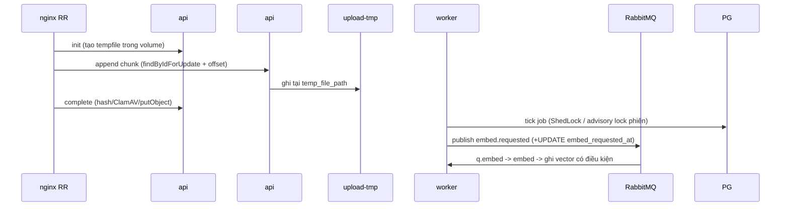

# Tech Spec: backend-multi-instance

> File: `docs/03-dev/specs/backend-multi-instance.md` — Owner: DEV
> Nguồn story: `docs/02-ba/stories/backend-multi-instance.md` (STORY-backend-multi-instance)
> Nguồn kiến trúc: `docs/01-sa/architecture/backend-multi-instance.md` (ARCH-backend-multi-instance, ADR-1..7)
> Status: Approved
> Spec ID: `SPEC-backend-multi-instance`

## 1. Tóm tắt kỹ thuật

Một image, hai role chọn bằng cấu hình (mặc định không cấu hình = all-in-one như hiện nay):

- **Cờ role** (mặc định `true`): `app.scheduling.enabled`, `app.semantic.consumer-enabled`, `app.messaging.consumers-enabled`; profile `api` đặt cả 3 = false, `worker` = true (`application-api.yml`, `application-worker.yml`).
- **Khoá job** nhóm S bằng ShedLock `@SchedulerLock` (hạ tầng có sẵn: `config/SchedulerLockConfig.java:25`); poller outbox dùng advisory lock **phiên** (mẫu `audit/AuditAdvisoryLock.java`, nhưng loại session-scoped).
- **Chunk upload** ghi vào `app.upload.temp-dir` (volume `upload-tmp`) thay `/tmp`.
- **Semantic**: cột `document.embed_requested_at` + cửa sổ ân hạn; ghi vector có điều kiện theo hash `text_embed`.
- **Rate limit tên** chuyển Redis (INCR+EXPIRE) fail-open về limiter cục bộ.
- **Hạ tầng**: Actuator health trên port 3002, graceful shutdown, compose `backend` (api x2) + `backend-worker`, nginx RR + `proxy_next_upstream`.

Hiện trạng đã định vị (file:dòng):

| Hạng mục | Vị trí |
|---|---|
| `@EnableScheduling` toàn cục | `BackendApplication.java:11`; pool `spring.task.scheduling.pool.size=4` (`application.yml:~17`) |
| `@Scheduled` (23 điểm) | Outbox `OutboxRetentionJob:53`, `DigitizationDlqAlertJob:32`, `DigitizationRunLeaseReconciliationJob:56`, `DigitizationDispatchRetryJob:52`, `DocumentDigitizationStatusReconciliationJob:41`, `AutoConfirmScheduler:68`, `ReviewStaleAlertJob:51`, `PersonalIngestCleanupJob:22`, `ReportExportJobRunner:110`, `ReportExportCleanupJob:45`, `TrashPurgeJob:44-45`, `PurgeStuckRecoveryJob:37`, `SearchIndexOutboxPoller:161`, `SemanticIndexReconciliationJob:95`, `SearchIndexReconciliationJob:85`, `Audit{PartitionMaintenance:33,Sealer:59,Retention:65,Checkpoint:32}Job`, `UploadCleanupJob:33`, `NotificationService:136` |
| `@RabbitListener` | `EmbedRequestConsumer:64-66` (`autoStartup=${app.semantic.enabled:false}`), `DigitizationResultConsumer:29`, `DigitizationHeartbeatConsumer:31` |
| Khai báo queue (api và worker cùng khai báo, cùng image) | `digitization/RabbitConfig.java:171-266` (comment: tham số PHẢI khớp stg, lệch = 406) |
| Chunk tempfile | `UploadSessionService.createTempFile():518` (`Files.createTempFile`), dùng ở `:108`, `:168`; đọc `:224`, `:311`; xoá `:468` |
| Rate limiter bộ nhớ | `displayname/NameCheckRateLimiter.java` (ConcurrentHashMap, cửa sổ 60s, `app.name-check.rate-limit-per-minute`) |
| Semaphore query | `search/SemanticQueryLimiter.java`, `app.semantic.query-concurrency` (mặc định 8, `application.yml:~177`) |
| Con trỏ trong bộ nhớ | `SemanticIndexReconciliationJob.cursorPage:~66` |
| Ghi vector | `search/index/SegmentVectorWriter.write():54` (bulk `update` phần, không điều kiện); mapping `resources/search/segment-v2-index.json:138-159` (chưa có field hash) |
| Poller | `SearchIndexOutboxPoller.poll():161` (`BATCH_LIMIT=200`, mỗi dòng 1 tx claim `claimNextForIndexing` `FOR UPDATE SKIP LOCKED`); publish embed `:530` |
| Cache in-memory (giữ, chấp nhận lệch ≤60s) | `rbac/RbacCacheConfig.java` (Caffeine 60s) |
| nginx | `stg/nginx/conf.d/api.conf` đã dùng `set $upstream_backend backend:3001` (resolver khai ở `00-common.conf`, kiểm lại) |
| Actuator | CHƯA có trong `backend/pom.xml` (chỉ có shedlock `:233-239`, data-redis `:72`) |

## 2. Data model

Migration `V37__embed_requested_at.sql` (additive, backward-compatible):

```sql
ALTER TABLE document ADD COLUMN embed_requested_at timestamptz NULL;
-- không cần index: reconciliation lọc trong tập trang đã đọc (page 500)
```

- Cập nhật mỗi lần publish `embed.requested`: trong `EmbedRequestPublisher.publish(...)` (`search/index/EmbedRequestPublisher.java:~31`) thêm `UPDATE document SET embed_requested_at = now() WHERE id = :id` (repo `@Modifying`, đặt sau `convertAndSend` thành công). Covers cả poller (`:530`) và reconciliation (`:131`).
- Bảng `shedlock`: đã có; thêm các `name` job mới (tự tạo dòng).
- OpenSearch `segment`: thêm field `embed_text_hash` (keyword) — thêm **additive** qua put-mapping ở `SearchIndexBootstrap` (không phải đổi phiên bản index `segment-v3`). Chốt Q1: hash lưu trên segment do `SegmentIndexer` ghi khi upsert lexical (phương án A, đúng AC-17).
- Message `EmbedRequestMessage` **không đổi** (tránh lệch consumer cũ/mới); hash tính trong consumer (xem Task 14).

## 3. API contract

Không đổi hợp đồng API cho web. Thêm duy nhất:

| Method | Endpoint | Ghi chú |
|---|---|---|
| GET | `:3002/actuator/health/{liveness,readiness}` | Management port riêng, không publish ra nginx/host; readiness gồm `readinessState`, `db` |

Mã lỗi upload (`CHUNK_OFFSET_MISMATCH`...) giữ nguyên. Phiên cũ trỏ `/tmp` (AC-14) trả lỗi hiện có `notOpen()` = 409 `UPLOAD_SESSION_NOT_OPEN` (chốt Q3, không thêm mã mới).

## 4. Luồng xử lý chính



1. Khởi động: đọc profile -> 3 cờ; log `role=...` (Task 5). `SchedulingConfig` chỉ `@EnableScheduling` khi `app.scheduling.enabled=true`; `@RabbitListener` dùng `autoStartup` SpEL theo cờ.
2. Job nhóm S: `@SchedulerLock(name, lockAtMostFor, lockAtLeastFor)`; lock bị giữ -> `LoggingLockProvider` ghi INFO "bỏ lượt do khoá" + counter.
3. Poller: mở 1 `Connection` riêng, `pg_try_advisory_lock(key)` (session), false -> bỏ lượt; true -> chạy vòng 200 `claimAndProcessOne`, `finally` `pg_advisory_unlock` + đóng; mất kết nối thì lock tự nhả.
4. Reconciliation semantic: bỏ tài liệu có `embed_requested_at > now() - grace`.

## 5. Test plan

- Unit: `NameCheckRateLimiterTest` (Redis mock: INCR/EXPIRE, vượt ngưỡng, Redis ném exception -> fallback cục bộ + WARN); `SemanticIndexReconciliationJobTest` (bỏ qua trong grace, yêu cầu lại sau grace); `SegmentVectorWriterTest` (script noop khi hash lệch); `UploadSessionServiceTest` (temp-dir cấu hình, phiên cũ `/tmp` -> lỗi); `ScheduledJobLockPolicyTest` (quét class: mọi `@Scheduled` nhóm S phải có `@SchedulerLock`, nhóm C nằm trong allowlist có chú thích).
- IT (chỉ chạy bằng `mvn verify`): `RoleFlagsIT` (mặc định: có `ScheduledAnnotationBeanPostProcessor` + container q.embed/result/heartbeat start; profile `api`: không có, container không start; profile `worker`: có); `SchedulerLockIT` (giữ lock thủ công qua `LockProvider` rồi gọi job -> thân job không chạy; bảng `shedlock` có dòng); `OutboxPollerAdvisoryLockIT` (2 poller song song, chỉ 1 vào tick; kill kết nối -> nhả lock); `UploadSessionControllerIT` mở rộng (temp-dir = thư mục tạm chung, init/append/complete qua 2 context/instance giả lập bằng 2 `UploadSessionService`); `UploadCleanupJobIT` (xoá tệp trong temp-dir); `SemanticIndexingIT` (embed_requested_at cập nhật, ghi vector bị noop khi hash khác); `QueueBacklogAlertJobIT` (queue có message, không consumer -> log ERROR `queue backlog`; dưới ngưỡng -> không log); `ActuatorManagementPortIT` (`:3002/actuator/health/readiness` = UP; `/actuator/**` ở port 3001 = 404; chỉ endpoint `health`); `GracefulShutdownIT` (đóng context khi consumer đang xử lý -> message chưa ack quay lại queue, không mất). Toàn bộ IT hiện có phải xanh (AC-1).
- Thủ công trên stg (checklist QA): 2 api + 1 worker, upload 2GB qua nginx RR, `docker stop` worker rồi dựng lại (message còn), `docker compose stop backend` (graceful), curl `:3002` từ ngoài (phải fail), grep log `role=`.
- Biên: Redis down; volume đầy; hai worker cùng chạy (cấu hình sai); `SEMANTIC_ENABLED=false` ở mọi role.
- Lưu ý: IT flaky đã biết (`TagsControllerIT`, `SearchScopeIT`, `SemanticIndexingIT.movingAFolder`) — không quy cho thay đổi này.

## 6. Task breakdown (map tới AC)

Thứ tự đề xuất: 1 -> 2 -> 3 -> **16a (thêm `spring-boot-starter-actuator` vào `pom.xml` để có Micrometer `MeterRegistry` — Task 5 phụ thuộc)** -> (4..9 song song) -> 10..14 -> 15..19.

- [x] **Task 1** → AC-1, AC-2, AC-3: `SchedulingConfig` (`@EnableScheduling` + `@ConditionalOnProperty app.scheduling.enabled matchIfMissing=true`), gỡ `@EnableScheduling` khỏi `BackendApplication.java:11`; giữ `SchedulerLockConfig`. Thêm 3 cờ vào `application.yml` **map tường minh đúng tên env của AC-2** (relaxed binding không tự khớp): `app.scheduling.enabled: ${APP_SCHEDULING_ENABLED:true}`, `app.semantic.consumer-enabled: ${SEMANTIC_CONSUMER_ENABLED:true}`, `app.messaging.consumers-enabled: ${APP_CONSUMERS_ENABLED:true}`; `application-api.yml`/`application-worker.yml` đặt giá trị theo role. Test: `RoleFlagsIT` có case đặt 3 env trên = false (không dùng profile) -> hành vi như `api`.
- [x] **Task 2** → AC-2, AC-3, AC-4: `autoStartup` cho 3 listener: `EmbedRequestConsumer` (`:64-66`) = `#{${app.semantic.enabled:false} and ${app.semantic.consumer-enabled:true}}`; result/heartbeat = `${app.messaging.consumers-enabled:true}`. KHÔNG đổi `RabbitConfig` (queue vẫn khai báo ở mọi role, tránh 406 — AC-27). Endpoint semantic/producer không phụ thuộc consumer-enabled.
- [x] **Task 3** → AC-5: `app.role` (api/worker/all) từ profile; `logging.pattern.level` thêm `role=${app.role} inst=${HOSTNAME}`; `ApplicationReadyEvent` log 1 dòng role + 3 cờ + `semantic.enabled`. Kiểm có `logback-spring.xml` hiện hữu chưa (grep) để không ghi đè.
- [x] **Task 4** → AC-6, AC-7: `@SchedulerLock` cho `DigitizationDispatchRetryJob` (1 method `run()` `:52-53` gọi cả `retryPendingDispatch` và `rescueMissedDocuments` -> 1 name), `SemanticIndexReconciliationJob`, `SearchIndexReconciliationJob`, `DocumentDigitizationStatusReconciliationJob`, `DigitizationDlqAlertJob`, `UploadCleanupJob`, `OutboxRetentionJob`, `NotificationService` retention, `ReportExportCleanupJob`. Bảng giá trị ở §6.1. **Chống trùng trong chu kỳ:** job `fixedDelay` ở các instance lệch pha nhau, nên `lockAtLeastFor` ngắn không ngăn instance khác chạy lại trong cùng chu kỳ. Với job mà chạy trùng gây hại (`digitization-dispatch-retry` – AC-6, `digitization-dlq-alert` – cảnh báo trùng) đặt `lockAtLeastFor = chu kỳ − 5s`; job còn lại idempotent giữ `lockAtLeastFor` ngắn. Test `SchedulerLockIT`: 2 instance lệch pha (instance B gọi job sau A ~30s) -> B bỏ lượt, mỗi source PENDING publish 1 lần.
- [x] **Task 5** → AC-7: `LoggingLockProvider` (decorator `LockProvider`: `Optional.empty` -> log INFO `job skipped: lock held name=...` + Micrometer counter `scheduler.lock.skipped{job}`); đăng ký trong `SchedulerLockConfig`.
- [ ] **Task 6** → AC-7: đo tick tối đa từng job nhóm S trên stg (log đầu/cuối tick hoặc `@Timed`), điền cột "tick max đo" §6.1 và chốt `lockAtMostFor` = `max(3 x tick_max, chu kỳ)` đúng AC-7 (chốt Q2; chấp nhận job ≥ 1h mất tối đa 1 lượt nếu worker crash giữa tick).
- [x] **Task 7** → AC-8: xác nhận từng job nhóm C (bảng §6.2) bằng đọc code + test; ghi kết quả vào §6.2 khi hoàn tất; thêm vào allowlist của `ScheduledJobLockPolicyTest`.
- [x] **Task 8** → AC-9: migration V37 + cập nhật `embed_requested_at` trong `EmbedRequestPublisher`; `SemanticProperties` thêm `reconciliationGraceMs` (`SEMANTIC_RECONCILIATION_GRACE_MS`, mặc định 3 600 000); `reconcileBatch()` (`:~100`) lọc document trong grace trước `expectedSegmentIds`. Giữ `cursorPage` (đã bảo vệ bằng ShedLock; chấp nhận mất con trỏ khi đổi worker).
- [x] **Task 9** → AC-10, AC-11, AC-12: `app.upload.temp-dir` (`UPLOAD_TEMP_DIR`, mặc định rỗng = `java.io.tmpdir`); `createTempFile()` -> `Files.createTempFile(dir, ...)`, tạo thư mục nếu thiếu; `Dockerfile`: `mkdir -p /data/upload-tmp && chown app:app` trước `USER app` (volume mới kế thừa quyền). Đổi `createTempFile` từ static sang instance.
- [x] **Task 10** → AC-14: ở append (`:224`) và complete (`:311`): nếu `temp_file_path` không nằm dưới temp-dir hiện tại hoặc tệp thiếu khi `receivedBytes>0` -> không ghi (tránh tạo tệp rỗng sai offset), trả lỗi `notOpen()`. **Không** đánh dấu EXPIRED trong `appendChunk` (`@Transactional` `:212`; `ApiException` là `RuntimeException` -> rollback mọi thay đổi trạng thái); phiên giữ nguyên OPEN và được `UploadCleanupJob` dọn sau 24h theo AC-14. `complete` (không transactional) xử lý tương tự, không đổi trạng thái. Test: append lặp lại vào phiên cũ luôn 409, không tạo tệp mới. Kiểm `writeBounded` không tự `CREATE` ngầm.
- [x] **Task 11** → AC-13, AC-15: `UploadCleanupJob` xoá tệp trong temp-dir (đã chạy ở worker, volume mount cho cả hai); cuối tick đo `Files.getFileStore(dir)` -> WARN `upload-tmp usage=xx%` khi >80% (AC-15); ghi lệnh `df` kiểm thủ công + ngưỡng vào runbook.
- [x] **Task 12** → AC-16: `SearchIndexPollerLock` (Connection riêng từ `DataSource`, `pg_try_advisory_lock(4915070L)`, unlock + đóng trong `finally`; nếu unlock lỗi thì huỷ kết nối vật lý); `poll()` bọc vòng 200 trong lock; thêm `@Profile`-free (poller chạy theo `app.scheduling.enabled`). Hằng key đặt cạnh `AuditAdvisoryLock` (4915063–66).
- [x] **Task 13** → AC-17: `SegmentVectorWriter.write()` nhận thêm `Map<segmentId,hash>`; đổi op `update` sang script Painless: `if (ctx._source.embed_text_hash != null && ctx._source.embed_text_hash != params.hash) { ctx.op='noop' } else { ctx._source.embedding=params.vec; model_version; embed_text_hash=params.hash }`; `WriteResult` thêm `skipped`. Hash so sánh là `embed_text_hash` do `SegmentIndexer` ghi trên segment (Task 14) — chốt Q1, phương án A.
- [x] **Task 14** → AC-17: `EmbedSegmentLoader`/`EmbedTextBuilder.EmbedItem` thêm `hash` (SHA-256 hex của `text_embed`, tính cùng chỗ `compose`, `EmbedTextBuilder:90`, `EmbedSegmentLoader:121`); `SegmentIndexer` (upsert lexical) ghi `embed_text_hash` hiện hành; mapping thêm field. Hash dùng **một hàm chung** (`EmbedTextHash.of(text_embed)`) và **cùng cấu hình** (`chunkSizeTokens`, `overlapTokens`, tập `EMBEDDABLE_SOURCES`) ở `SegmentIndexer` và consumer; `SegmentIndexer` phải nhận đủ segment cùng tài liệu (cùng run/page) để tính ngữ cảnh lân cận — `upsertChunk` dùng op `index` ghi đè toàn bộ document (`SegmentIndexer:98`) nên hash mới luôn thay hash cũ. Log INFO + counter `semantic.vector.write.skipped` mỗi lần noop. Test: đổi `chunkSizeTokens` không reindex -> phát hiện được qua counter. Đây là điều kiện trước khi tăng `SEMANTIC_EMBED_CONSUMER_CONCURRENCY` > 1.
- [x] **Task 15** → AC-18, AC-19, AC-20: `NameCheckRateLimiter` dùng `StringRedisTemplate`: key `namecheck:{sub}:{endpoint}:{nowMs/60000}`, `INCR`, `EXPIRE 120s` khi count==1; lỗi Redis -> bắt `DataAccessException`, WARN (giới hạn tần suất log), rơi về logic cục bộ hiện có; giữ chữ ký `check(sub,endpoint,nowMs)` cho test. **Giữ** `spring.data.redis.timeout: 2s` chung (đang dùng bởi `AccountStatusFilter` mỗi request, `EmbeddingClient`, `SystemConfigService`, `AccountsService`, `AllowlistService`); limiter tự giới hạn thời gian chờ riêng: gọi Redis qua `CompletableFuture...orTimeout(300ms)` hoặc template riêng có `LettuceClientConfiguration.commandTimeout(300ms)` -> quá hạn coi như Redis lỗi, fallback cục bộ. Compose: `SEMANTIC_QUERY_CONCURRENCY: 4` + comment "ngân sách 8 / số replica".
- [x] **Task 16** → AC-24, AC-25: thêm `spring-boot-starter-actuator`; `management.server.port=${MANAGEMENT_PORT:3002}`, `management.endpoints.web.exposure.include=health`, `management.endpoint.health.probes.enabled=true`, group readiness = `readinessState,db`; `server.shutdown=graceful`, `spring.lifecycle.timeout-per-shutdown-phase=320s`; `Dockerfile` `HEALTHCHECK --start-period=90s CMD wget -qO- http://localhost:3002/actuator/health/readiness`. Kiểm Spring Security/filter hiện có không chặn 3002 và `/actuator` không phục vụ ở 3001.
- [x] **Task 17** → AC-25, AC-26, AC-27: xác nhận listener container dừng nhận trước khi tắt (mặc định `SmartLifecycle` phase) và message chưa ack requeue; job mới `QueueBacklogAlertJob` (worker, ShedLock): `AmqpAdmin.getQueueProperties` cho `q.embed`, `q.result` -> ERROR khi depth > ngưỡng cấu hình hoặc consumer count = 0 trong >N tick; test khởi động api+worker không 406 (không đổi `RabbitConfig`).
- [x] **Task 18** → AC-21, AC-22, AC-23: `stg/docker-compose.yml` (chốt Q4: chỉ sửa stg; compose prod `/srv/data/config/aismartstore/docker-compose.prod.yml` nằm ngoài repo -> Task 19 ghi snippet khối `backend`/`backend-worker` giá trị prod vào runbook để vận hành áp dụng): anchor `x-backend-env: &backend-env`; `backend` (`SPRING_PROFILES_ACTIVE=api`, `deploy.replicas: 2`, `mem_limit`, không ports, `stop_grace_period: 330s`, `JAVA_TOOL_OPTIONS=-XX:MaxRAMPercentage=65`), `backend-worker` (profile `worker`, 1 replica), volume `upload-tmp` mount `/data/upload-tmp` + `UPLOAD_TEMP_DIR` cho cả hai; `restart: unless-stopped`. Giá trị: prod api 3GB/4 cpu x2, worker 4GB/4; stg 1GB x2, worker 1.5GB. `stg/nginx/conf.d/api.conf`: thêm `proxy_next_upstream error timeout;` (+ `proxy_next_upstream_tries 2`; không retry method không idempotent mặc định của nginx), xác nhận `resolver 127.0.0.11 valid=10s` trong `00-common.conf`. `SEMANTIC_ENABLED` cùng giá trị ở api và worker (anchor).
- [x] **Task 19** → AC-28: cập nhật `stg/README.md`/`stg/BUILD.md` (deploy `docker compose up -d backend backend-worker web`, service `backend-worker`, volume `upload-tmp`, cảnh báo xoá volume; snippet compose prod (Q4); cách theo dõi log cảnh báo `upload-tmp usage=`/`queue backlog` + lệnh `df` (Q5)); đề xuất SA/BA cập nhật `production-deployment.md` (file thuộc SA, DEV chỉ ghi đề xuất vào handoff).

### 6.1 Bảng khoá nhóm S (giá trị đo ở Task 6; cột "đề xuất" chỉ là điểm xuất phát)

| Job (name) | Chu kỳ | tick max đo | `lockAtMostFor` (đề xuất tạm) | `lockAtLeastFor` |
|---|---|---|---|---|
| `digitization-dispatch-retry` | 60s (fixedDelay) | _đo_ | PT5M | **PT55S** (chống trùng AC-6) |
| `semantic-reconciliation` | 10m | _đo_ | PT30M | PT30S |
| `search-index-reconciliation` | cron 03:00 (24h) | _đo_ | PT24H (≥ chu kỳ, AC-7) | PT1M |
| `document-status-reconciliation` | 5m | _đo_ | PT15M | PT10S |
| `digitization-dlq-alert` | 5m (fixedDelay) | _đo_ | PT15M | **PT4M55S** (chống cảnh báo trùng) |
| `upload-cleanup` | 15m | _đo_ | PT45M | PT30S |
| `outbox-retention` | 24h | _đo_ | PT24H (AC-7, chốt Q2) | PT1M |
| `notification-retention` | 24h | _đo_ | PT24H | PT1M |
| `report-export-cleanup` | 1h | _đo_ | PT3H | PT30S |

### 6.2 Xác nhận nhóm C (Task 7 điền kết quả)

| Job | Cơ chế đã có (SA khẳng định) | Cách DEV xác nhận |
|---|---|---|
| `AutoConfirmScheduler:68` | claim `FOR UPDATE SKIP LOCKED` | đọc query + test 2 luồng |
| `ReviewStaleAlertJob:51` | UPDATE có điều kiện `stale_alerted` + audit cùng tx | đọc code, test chạy 2 lần cùng lúc -> 1 audit |
| `DigitizationRunLeaseReconciliationJob:56` | claim | đọc + test |
| `ReportExportJobRunner:110` | claim `SKIP LOCKED` | đọc + test |
| `Audit*Job` (4) | `AuditAdvisoryLock` xact | đã có test; chỉ đọc |
| `SearchIndexOutboxPoller:161` | (mới) advisory lock phiên `SearchIndexPollerLock` + claim `SKIP LOCKED` | `OutboxPollerAdvisoryLockIT` |

**Kết quả xác nhận (Task 7, đọc code):** `AutoConfirmScheduler` (`DigitizationRunLifecycleService.autoConfirmDueBatch` = UPDATE ... SKIP LOCKED), `ReviewStaleAlertJob` (`DigitizationRunRepository:206-218` UPDATE `stale_alerted` có điều kiện + SKIP LOCKED), `DigitizationRunLeaseReconciliationJob` (`DigitizationRunRepository:131` SKIP LOCKED), `ReportExportJobRunner` (`ReportExportRepository:37` SKIP LOCKED) đều an toàn khi 2 instance cùng tick; đã đưa vào allowlist `ScheduledJobLockPolicyTest`. Chưa viết test 2 luồng riêng cho từng job (dựa trên truy vấn claim nguyên tử đã có).
| `TrashPurgeJob:44-45`, `PurgeStuckRecoveryJob:37-38`, `PersonalIngestCleanupJob:22-23` | `@SchedulerLock` | thấy trực tiếp trong code |

## 7. Observability

- Log: dòng khởi động `role=<api|worker|all> scheduling=<b> semanticConsumer=<b> messagingConsumers=<b> semantic=<b>`; mọi dòng log mang `role` + `inst` (HOSTNAME); INFO "job skipped: lock held name=..." (Task 5); WARN Redis fallback; WARN `upload-tmp usage`; ERROR backlog queue / không consumer.
- Metric: counter `scheduler.lock.skipped{job}` (Micrometer); chỉ expose `health` nên metric dùng nội bộ/log — chốt Q5: không thêm Prometheus/kênh gửi; cảnh báo = log WARN/ERROR có key cố định (`upload-tmp usage=`, `queue backlog`) + hướng dẫn kiểm trong runbook (Task 19).
- Alert: volume >80% (log + runbook), `q.embed`/`q.result` tồn hoặc không consumer, DLQ (đã có).

## 8. Security checklist

- [ ] Validate & sanitize input: `UPLOAD_TEMP_DIR` chuẩn hoá `normalize()`; chống path traversal — chỉ chấp nhận `temp_file_path` nằm dưới temp-dir.
- [ ] AuthN/AuthZ: không endpoint nghiệp vụ mới; management port `3002` không publish ra host, không proxy qua nginx, chỉ expose `health`.
- [ ] Không log dữ liệu nhạy cảm: key Redis chứa `sub` — chỉ nằm trong Redis, log rate-limit không in `sub`.
- [ ] Rate limit toàn cục (AC-19); fail-open có chủ đích (đã chốt Q5 ARCH).
- [ ] Volume `upload-tmp` chỉ mount vào `backend` và `backend-worker`; tệp thuộc user `app`; không dùng bucket `documents` (NFR-09).

## 9. Migration & Rollback plan

- Migration: V37 additive (cột nullable) — instance cũ vẫn chạy được. Mapping OpenSearch thêm field additive. Deploy trong khung bảo trì: tạo điểm khôi phục -> `docker compose up -d backend backend-worker web` (Flyway chạy ở instance đầu tiên, có Flyway lock). Phiên upload OPEN lúc chuyển đổi hỏng một lần (AC-14, đã chấp nhận). Đổi cấu hình chunk/overlap/model embed sau này -> reindex lexical toàn bộ (R5b).
- Rollback: quay image cũ + compose cũ (1 service `backend`, all-in-one, không volume); cột `embed_requested_at` và field `embed_text_hash` vô hại với bản cũ. Không cần down-migration.
- Feature flag: 3 cờ role + `SEMANTIC_ENABLED` + `SEMANTIC_RECONCILIATION_GRACE_MS`. Triển khai theo giai đoạn: (1) code + compose all-in-one 1 replica (hành vi cũ); (2) bật profile worker; (3) scale api = 2.

## 10. Rủi ro kỹ thuật

- **R1 (RabbitMQ 406)**: spec KHÔNG sửa `RabbitConfig` queue args (`RabbitConfig.java:171-266` phải khớp queue tạo tay trên stg: `q.embed` main priority 9 + DLX, retry không TTL, dlq không args). Mọi thay đổi khai báo queue sau này gây crash-loop 406 cả hai role. `autoStartup=false` ở api không làm bỏ khai báo queue (RabbitAdmin vẫn declare) — đúng ý, tránh lệch.
- **R2 (advisory lock phiên giữ 1 connection Hikari)** suốt tick tối đa 200 x 30s: kiểm `maximum-pool-size` api/worker; unlock lỗi có thể giữ lock đến khi connection đóng -> huỷ kết nối vật lý.
- **R3 (`lockAtMostFor` quá ngắn)**: tick vượt -> 2 bản chạy; ngược lại job cron hằng ngày với `lockAtMostFor=24h` sau crash có thể nuốt lượt kế — chấp nhận (chốt Q2; job 24h idempotent, mất tối đa 1 lượt).
- **R4 (volume)**: quyền sở hữu thư mục (user `app`), đầy đĩa (nhiều phiên 2GB), `docker compose down -v` xoá phiên đang upload; hai container ghi cùng tệp chỉ an toàn nhờ `findByIdForUpdate` + offset (đã có, test lại qua 2 instance).
- **R5b (hash lệch do đổi cấu hình)**: đổi `chunkSizeTokens`/`overlapTokens`/model làm hash consumer khác hash segment -> mọi ghi vector noop đến khi reindex lexical; bắt buộc reindex lexical toàn bộ khi đổi các cấu hình này (ghi vào runbook, Task 19), theo dõi counter `semantic.vector.write.skipped`.
- **R5 (hash vector)**: thêm `embed_text_hash` buộc `SegmentIndexer` (lexical upsert) cũng biết `text_embed` (cần segment lân cận); đã chốt phương án A (Q1), không dùng so sánh với DB. Segment cũ chưa có hash: script coi `null` = cho ghi (tương thích).
- **R6 (nginx Docker DNS)**: A record trỏ container chết ≤10s -> 502 ngắn; giảm bằng `proxy_next_upstream` + graceful. Docker DNS không lọc unhealthy.
- **R7 (Actuator + Security)**: management port có thể chịu filter bảo mật/CORS hiện có; cần test; `HEALTHCHECK` fail trong `start-period` khi Flyway chậm.
- **R8 (Redis timeout)**: Redis treo (không down) làm request kiểm tên chậm -> timeout 300ms riêng cho limiter (Task 15); không hạ timeout chung để tránh fallback giả ở `AccountStatusFilter` và các service khác.
- **R9 (worker điểm đơn)**: embed/OCR dispatch/alert ngưng khi worker chết; giảm nhờ restart + `QueueBacklogAlertJob`.
- **R10 (pool scheduler=4)**: worker gom hết job vào pool 4 luồng; poller 200 vòng x 30s có thể làm trễ job khác — cân nhắc `SCHEDULING_POOL_SIZE` ở worker.

## 11. Definition of Done

- [ ] Tất cả AC pass (đối chiếu QA report)
- [ ] Test unit/integration xanh (`mvn verify`, kể cả IT hiện có — AC-1)
- [ ] Lint/format sạch (`mvn -o compile`)
- [ ] Không giảm coverage đáng kể
- [ ] Doc/README/runbook stg + đề xuất cập nhật `production-deployment.md`
- [ ] Đã cân nhắc migration & rollback
- [ ] Bảng §6.1 điền số đo thật, §6.2 điền kết quả xác nhận

## 12. Câu hỏi mở

- [x] **Q1** — AC-17: hash "đang lưu trên segment" hiện chưa tồn tại (mapping `segment-v2-index.json` không có). Đề xuất: lexical upsert ghi `embed_text_hash` hiện hành (cần tính `text_embed` ở `SegmentIndexer`, kể cả ngữ cảnh lân cận). Nếu quá phức tạp, phương án B: consumer đọc lại hash từ DB ngay trước khi ghi và ghi `embed_text_hash` kèm vector, bỏ ghi khi hash DB hiện hành khác hash lúc embed. BA/SA chấp nhận B (so với DB thay vì so với segment) không? → **Chốt:** phương án A — `SegmentIndexer` ghi `embed_text_hash` trên segment, writer so với hash segment (đúng AC-17) (cập nhật: §2, Task 13, R5)
- [x] **Q2** — AC-7: job chạy theo cron/24h với `lockAtMostFor >= chu kỳ` (24h) có thể chặn lượt kế sau crash; đề xuất `lockAtMostFor = max(3 x tick, chu kỳ - 5 phút)` cho job chu kỳ ≥ 1h. Chấp nhận điều chỉnh này không? → **Chốt:** giữ AC-7 `max(3×tick, chu kỳ)`; chấp nhận mất ≤1 lượt sau crash; `search-index-reconciliation` đổi PT3H→PT24H (cập nhật: Task 6, §6.1, R3)
- [x] **Q3** — AC-14: lỗi trả cho phiên cũ dùng `notOpen()` hiện có (giữ hợp đồng) hay mã lỗi mới? Đề xuất giữ `notOpen()`. → **Chốt:** giữ `notOpen()` 409 `UPLOAD_SESSION_NOT_OPEN` (cập nhật: §3, Task 10)
- [x] **Q4** — Repo chỉ có `stg/docker-compose.yml` và `docker-compose.yml` (dev); compose prod nằm ngoài repo? Nếu có file prod, đường dẫn là gì để Task 18 áp dụng (AC-21/22)? → **Chốt:** compose prod ở `/srv/data/config/aismartstore/docker-compose.prod.yml` (ngoài repo); chỉ sửa stg, snippet prod vào runbook (cập nhật: Task 18, Task 19)
- [x] **Q5** — AC-15/AC-26: "cảnh báo" tạm đáp ứng bằng log ERROR/WARN (không có Prometheus/Alertmanager trong repo). Đủ cho story này, hay cần kênh gửi (email/Notification)? → **Chốt:** log WARN/ERROR + runbook là đủ, không thêm kênh gửi (cập nhật: §7, Task 19)
