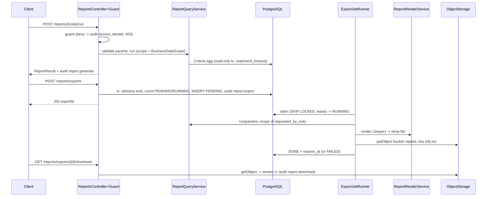

# Tech Spec: export-reporting

> File: `docs/03-dev/specs/export-reporting.md` — Owner: DEV
> Nguồn story: `docs/02-ba/stories/export-reporting.md` (STORY-export-reporting)
> Nguồn kiến trúc: `docs/01-sa/architecture/export-reporting.md` (ARCH-export-reporting)
> Status: Approved
> Spec ID: `SPEC-export-reporting`
> Phần chi tiết (truy vấn từng mẫu, DTO, Jasper): `docs/03-dev/specs/export-reporting-templates.md` (gọi tắt **Part T**)

## 1. Tóm tắt kỹ thuật

Module mới `com.aismartstore.backend.reporting` (backend) + trang `/reports`, `/reports/exports` (web).

- **Xem báo cáo (FR-30)**: `ReportQueryService` là điểm DUY NHẤT sinh truy vấn tổng hợp. Dùng **JPA Criteria** (`EntityManager`) và gọi nguyên `BusinessDataScope.forDocuments(sub, groupMemberRepository).toPredicate(root, query, cb)` (không viết lại scope, không SQL tay) để AC-3/AC-16 bảo đảm bằng cấu trúc. Chạy trong `@Transactional(readOnly = true)` + `SET LOCAL statement_timeout` = `reporting.query_timeout_seconds`.
- **Xuất tệp (FR-31)**: `POST /reports/exports` → ghi `report_export` (PENDING) → `ReportExportJobRunner` (`@Scheduled`, claim `UPDATE ... FOR UPDATE SKIP LOCKED RETURNING` + lease, đúng idiom `SourceSeparationJobRepository.claimNextBatch`) → `ReportQueryService` (tái tính số liệu theo scope của `requested_by_sub`) → `ReportRenderService` (JasperReports, `JRBeanCollectionDataSource`, PDF/XLSX/DOCX) → `ObjectStorageService.putObject` → DONE. Không dùng RabbitMQ.
- **Phân quyền**: 2 permission mới `report.read`, `report.export` (seed CAN_BO + LANH_DAO), cờ "không gán được cho QUAN_TRI" thêm vào bảng `permission` + chặn trong `RbacService`. Guard riêng `ReportAccessGuard` (không dùng `@PreAuthorize` thuần vì `ApiExceptionHandler.handleAccessDenied` chỉ ghi `access.denied`, không ghi `report.access_denied`).
- **Audit**: 4 action mới (`report.generate|export|download|access_denied`) + allowlist metadata trong `AuditService.ALLOWED_METADATA_KEYS`. `report.export` ghi **2 bản/job**: lúc tạo job (cùng transaction INSERT) và lúc runner kết thúc (`result` = `SUCCESS`/`FAILED`), cả hai mang `export_id` (chốt review #2).
- **Lưu tệp xuất (chốt Q2)**: bucket riêng `reports` (không dùng bucket `documents` vì WORM theo NFR-09 — tiền lệ `branding.md`), key `<exportId>.<ext>` (không lặp tiền tố `reports/` trong key, tránh đường dẫn `/reports/reports/...` — chốt review #6); thêm vào `StorageProperties` + `ensureBuckets`; cấp quyền Read/Write/Delete/List cho identity backend trên bucket `reports` ở cấu hình SeaweedFS stg/prod.
- Hiện trạng đã xác minh: `pom.xml` chưa có Jasper; POI có sẵn trong `~/.m2`, **Jasper chưa** (xem rủi ro R-1); `Document` dùng cột `uploader_sub` (story ghi `created_by`); V35 là migration mới nhất → migration mới là **V36**.

## 2. Data model

Migration `backend/src/main/resources/db/migration/V36__export_reporting.sql` (additive, backward-compatible):

```sql
-- 2.1 Cờ permission không gán được cho QUAN_TRI (AC-5)
ALTER TABLE permission ADD COLUMN admin_assignable BOOLEAN NOT NULL DEFAULT true;
INSERT INTO permission (code, description, admin_assignable) VALUES
  ('report.read',   'Xem danh mục mẫu, chạy báo cáo, lưu/mở/đổi tên/xoá báo cáo đã lưu', false),
  ('report.export', 'Tạo job xuất báo cáo, xem trạng thái/lịch sử, tải tệp xuất của mình', false);
INSERT INTO role_permission (role_code, permission_code) VALUES
  ('CAN_BO','report.read'),('CAN_BO','report.export'),
  ('LANH_DAO','report.read'),('LANH_DAO','report.export')
ON CONFLICT (role_code, permission_code) DO NOTHING;

-- 2.2 Danh mục mẫu (chỉ đọc, seed). Nguồn sự thật cho validate là ReportTemplateRegistry (code); bảng để FK + hiển thị.
CREATE TABLE report_template (
  code VARCHAR(48) PRIMARY KEY, name VARCHAR(200) NOT NULL, description TEXT NOT NULL,
  jasper_path VARCHAR(255) NOT NULL, formats VARCHAR(64) NOT NULL DEFAULT 'PDF,XLSX,DOCX');
INSERT INTO report_template (code,name,description,jasper_path) VALUES
 ('REPO_SUMMARY','Tổng hợp tình hình kho tài liệu theo kỳ','...','reports/repo_summary.jasper'),
 ('DIGITIZATION_PROGRESS','Tiến độ và chất lượng số hoá','...','reports/digitization_progress.jasper'),
 ('DOC_BY_CLASSIFICATION','Thống kê theo chủ đề và loại tài liệu','...','reports/doc_by_classification.jasper');

-- 2.3 Báo cáo đã lưu (riêng từng người, AC-11)
CREATE TABLE report_saved_query (
  id UUID PRIMARY KEY DEFAULT gen_random_uuid(),
  owner_sub VARCHAR(255) NOT NULL,
  template_code VARCHAR(48) NOT NULL REFERENCES report_template(code),
  name VARCHAR(100) NOT NULL CHECK (char_length(btrim(name)) BETWEEN 1 AND 100),
  params_json JSONB NOT NULL,
  created_at TIMESTAMPTZ NOT NULL DEFAULT now(), updated_at TIMESTAMPTZ NOT NULL DEFAULT now());
CREATE UNIQUE INDEX UQ_report_saved_query_owner_name ON report_saved_query (owner_sub, lower(btrim(name)));
CREATE INDEX IDX_report_saved_query_owner ON report_saved_query (owner_sub, updated_at DESC);

-- 2.4 Job xuất tệp (AC-21..33)
CREATE TABLE report_export (
  id UUID PRIMARY KEY DEFAULT gen_random_uuid(),
  template_code VARCHAR(48) NOT NULL REFERENCES report_template(code),
  params_json JSONB NOT NULL,
  format VARCHAR(8) NOT NULL CHECK (format IN ('PDF','XLSX','DOCX')),
  status VARCHAR(10) NOT NULL DEFAULT 'PENDING' CHECK (status IN ('PENDING','RUNNING','DONE','FAILED','EXPIRED')),
  requested_by_sub VARCHAR(255) NOT NULL, requested_by_username VARCHAR(255) NOT NULL,
  retry_of UUID REFERENCES report_export(id),
  object_key VARCHAR(512), byte_size BIGINT, row_count INT, error_message VARCHAR(500),
  attempt_count INT NOT NULL DEFAULT 0, lease_expires_at TIMESTAMPTZ,
  created_at TIMESTAMPTZ NOT NULL DEFAULT now(), started_at TIMESTAMPTZ, finished_at TIMESTAMPTZ, expires_at TIMESTAMPTZ);
CREATE INDEX IDX_report_export_pollable ON report_export (status, lease_expires_at, created_at) WHERE status IN ('PENDING','RUNNING');
CREATE INDEX IDX_report_export_owner ON report_export (requested_by_sub, created_at DESC);
CREATE INDEX IDX_report_export_expiry ON report_export (expires_at) WHERE status = 'DONE';

-- 2.5 Index thống kê (ADR-1). IDX_document_created_at đã có (V2).
-- Partial theo đúng predicate báo cáo: deleted_at IS NULL AND status='clean' (Q1, chốt review #8)
CREATE INDEX IDX_document_active_created ON document (created_at) WHERE deleted_at IS NULL AND status = 'clean';
CREATE INDEX IDX_document_uploader_created_active ON document (uploader_sub, created_at) WHERE deleted_at IS NULL AND status = 'clean';
CREATE INDEX IDX_digitization_run_created_active ON digitization_run (created_at, task) WHERE review_state NOT IN ('superseded','void');
```

- `params_json` chuẩn hoá: `{from,to,groupIds[],topicTagIds[],docTypeTagIds[],folderId,granularity}` (id sắp xếp, bỏ trùng) — dùng cho audit (AC-35) và so khớp.
- Index tạo thường (không CONCURRENTLY) vì Flyway chạy trong transaction; ghi chú downtime ngắn khi deploy trên bảng lớn (mục 9).
- Code: `PermissionEntity` thêm field `adminAssignable` (mapping, `ddl-auto: validate` yêu cầu cột tồn tại); `SystemConfigDefaults` thêm 6 key `reporting.*` (registry trong code, không seed DB): `export_ttl_days=7`, `max_rows_per_export=100000`, `max_concurrent_exports=10`, `max_exports_per_user=3`, `query_timeout_seconds=15`, `max_buckets=400` (chốt Q5).
- Entity/Repository mới: `ReportExport`, `ReportSavedQuery`, `ReportTemplate` (read-only) + repository tương ứng.

## 3. API contract

Base path `/reports`. Auth: JWT; guard `ReportAccessGuard.require(user, "report.read"|"report.export")`.

| Method | Endpoint | Request | Response | Lỗi |
|---|---|---|---|---|
| GET | `/reports/templates` | — | `[{code,name,description,params[{name,type,required}]}]` (3 mẫu) | 403 |
| POST | `/reports/{templateCode}/run` | `ReportParams` + `page?,size?` | `ReportResult` (Part T §3): `title,period,filters,scopeNotice,generatedAt,generatedBy,notes[],warnings[],empty,tables[],charts[]` | 400 tham số; 403; 404 mẫu lạ; 503 timeout |
| GET | `/reports/saved` | — | `[{id,name,templateCode,updatedAt}]` | 403 |
| POST | `/reports/saved` | `{name,templateCode,params}` | 201 `{id,...}` | 400 (tên/trùng/vượt 50/params sai) |
| GET | `/reports/saved/{id}` | — | `{id,name,templateCode,params,warnings[]}` (id mất/ngoài scope bị bỏ + cảnh báo chung) | 404 (không phải chủ = 404) |
| PATCH | `/reports/saved/{id}` | `{name}` | 200 | 400, 404 |
| DELETE | `/reports/saved/{id}` | — | 204 | 404 |
| POST | `/reports/exports` | `{templateCode,params,format}` | **202** `{exportId,status:"PENDING"}` | 400; 403; **429** (phân biệt 2 thông báo) |
| GET | `/reports/exports` | `page,size` | trang `[{id,templateCode,format,status,createdAt,finishedAt,expiresAt,errorMessage?}]` chỉ của mình | 403 |
| GET | `/reports/exports/{id}` | — | như một phần tử trên | 403 (không phải chủ, + audit `report.access_denied`), 404 |
| GET | `/reports/exports/{id}/download` | — | stream tệp, `Content-Disposition: attachment` (tên ASCII an toàn) | 403, 404, **410** hết hạn / chưa DONE → 409 |
| POST | `/reports/exports/{id}/retry` | — | **202** `{exportId (mới)}` | 409 nếu job không FAILED; 429; 403 |

- `report.read`: templates, run, saved/*. `report.export`: mọi `/reports/exports*`.
- Quy ước lỗi dùng `ApiException` có sẵn (`BadRequestException`, `ForbiddenException`, `NotFoundException`, `ConflictException`, `ServiceUnavailableException`); thêm `TooManyRequestsException` (429) và `GoneException` (410) trong `common/` + đăng ký ở `ApiExceptionHandler`.
- Mọi lỗi 400 tham số id (AC-9) dùng **một** thông báo/mã duy nhất ("Một số bộ lọc không hợp lệ hoặc không khả dụng, hãy chọn lại") cho: không tồn tại, nhóm người dùng không là thành viên, tag sai `kind`. Folder/tag là dữ liệu toàn cục (không có scope) nên "ngoài phạm vi" ở AC-9/AC-11 chỉ áp cho `groupIds` (chốt Q3).
- Mã lỗi (chốt Q4): timeout truy vấn → **503** (`ServiceUnavailableException`, kèm gợi ý thu hẹp bộ lọc); tải tệp `EXPIRED` → **410**; tải khi job chưa `DONE` (PENDING/RUNNING/FAILED) → **409**.
- RBAC (AC-5): `PUT` role-permission hiện có — `RbacService.updateRolePermissions` thêm bước: nếu `roleCode == QUAN_TRI` và có code với `admin_assignable=false` → `BadRequestException`, không đổi gì. `GET /rbac` trả thêm `adminAssignable` để UI ẩn ô chọn.

## 4. Luồng xử lý chính



1. **Guard**: không có `KeycloakUser`/thiếu authority → ghi `report.access_denied` (nếu có sub, bằng `AuditService.recordIndependently` vì sau đó ném exception) rồi `ForbiddenException`. Chưa có truy vấn nào chạy trước guard (AC-2). Phạm vi AC-2 "không có ngữ cảnh người dùng" (chốt review #4): request **không có/sai token** bị `SecurityConfig` (`anyRequest().authenticated()`) trả **401** trước khi tới guard — hành vi chung toàn hệ thống, không audit được vì không có chủ thể; token hợp lệ nhưng thiếu `sub`/không resolve được ngữ cảnh → guard trả **403** + `report.access_denied` (khi xác định được chủ thể). QA đối chiếu AC-2 theo phân định này.
2. **Validate params** (`ReportParamValidator`, AC-9): from/to bắt buộc, `from <= to`, `granularity` ∈ enum, số bucket ≤ `reporting.max_buckets` (mặc định 400, chống `day` trên nhiều năm; vượt → 400 "khoảng thời gian quá dài cho độ chi tiết đã chọn, hãy chọn tháng/quý/năm" — chốt Q5), id thuộc kiểu đúng; kiểm tra tồn tại tag (đúng `kind`), folder (`warehouse_folder`), group ∈ `groupMemberRepository.findGroupIdsByUserSub`. Không chạy truy vấn thống kê nếu sai.
3. **Kỳ**: `[from 00:00, to+1 00:00)` theo `Asia/Ho_Chi_Minh` → `OffsetDateTime` UTC. "Tồn kho tại T" = `created_at < T`. Mọi chỉ tiêu: `COUNT(DISTINCT document.id)` trên root `Document` + predicate scope + `status='clean'` (chốt Q1: loại `pending/infected/rejected/purged`, thống nhất `DocumentRepository` capacity) + các bộ lọc là **EXISTS subquery** (tag, group share, folder **gồm cả thư mục con** qua `warehouse_folder.path_ids` — chốt Q3, thống nhất `SearchQueryBuilder` `folder_path_ids`) để không nhân dòng. AC-16 "tệp kho cá nhân không bao giờ được tính" được bảo đảm bằng cấu trúc: root luôn là `Document`, tệp cá nhân nằm ở bảng riêng `personal_file` nên không thể lọt vào; tài liệu đã chuyển từ kho cá nhân sang kho chung (`document.source_kind='personal'`, V33) là tài liệu kho chung nên **được** tính (chốt review #7).
4. **Chạy nền**: runner `@Scheduled(fixedDelay 5s)`: claim ≤ 2 job (PENDING, hoặc RUNNING có `lease_expires_at < now()`; lease 5 phút, `attempt_count++`; quá 3 lần → FAILED "Quá số lần thử"). Sau restart job được claim lại (AC-23). **Gia hạn lease** (chốt review #5): sau bước truy vấn và trước bước render, runner `UPDATE report_export SET lease_expires_at = now() + 5 phút WHERE id = ? AND status = 'RUNNING'`; mọi cập nhật kết thúc (`DONE`/`FAILED`) đều có điều kiện `status = 'RUNNING' AND id = ?` và kiểm tra số dòng cập nhật — lần chạy trùng (do reclaim) không ghi đè, và xoá object nó vừa ghi nếu cập nhật trả 0 dòng. Đếm dòng (`row_count` = tổng số dòng các bảng của `ReportResult`) > `reporting.max_rows_per_export` → FAILED "báo cáo quá lớn, hãy thu hẹp khoảng thời gian/bộ lọc", không render (AC-28). Lỗi render khác → FAILED + thông báo chung (chi tiết chỉ vào log). Runner **không** kiểm tra lại quyền `report.export` (chốt Q6): job đã nhận vẫn chạy xong; việc tải về luôn đi qua guard với quyền hiện tại → bị thu hồi thì 403.
5. **Giới hạn (AC-30)**: trong 1 transaction: `pg_advisory_xact_lock(hashtext('report_export_quota'))`, đếm PENDING/RUNNING của user (≥ `max_exports_per_user` → 429 "bạn đang có N tệp đang tạo…") rồi toàn hệ thống (≥ `max_concurrent_exports` → 429 "hệ thống đang bận…"), rồi INSERT. 429 không INSERT, không audit `report.export`.
6. **Retry (AC-29)**: tạo job mới (`retry_of`), cùng params/format, qua đúng luồng mục 5 + audit `report.export` riêng.
7. **Cleanup (AC-33)**: `ReportExportCleanupJob` (`@Scheduled` mỗi 1 giờ): chọn `DONE` có `expires_at < now()` (LIMIT 200) → xoá object → `UPDATE status='EXPIRED'`; idempotent (xoá object đã mất không lỗi), nhiều instance an toàn.
8. **Download**: chỉ `requested_by_sub = sub`; sai chủ → 403 + `report.access_denied`; `EXPIRED` → 410; `DONE` → stream từ S3, audit `report.download`.
9. **Header/footer tệp (AC-25)** và dòng phạm vi (AC-4): cùng một nguồn `ReportResult.scopeNotice` + `filters`, truyền vào Jasper dưới dạng `parameters`.

## 5. Test plan

- **Unit (`mvn test`)**: `MimeGroupClassifierTest` (đủ 5 nhóm, ranh giới `application/vnd.ms-*`, `vnd.openxmlformats-*`, `text/*`, MIME lạ→khác); `ReportParamValidatorTest` (AC-9, id ngoài scope = id không tồn tại cùng thông báo); `PeriodTest` (múi giờ, nửa mở, ngày cuối tháng/DST không có); `GranularityBucketsTest` (đúng 400 bucket OK, 401 → 400); `ReportAccessGuardTest`; `ExportQuotaTest` (user vs system, thông báo N lấy từ cấu hình); `ReportRowCountTest`; `SavedQueryServiceTest` (tên 1–100, trùng không phân biệt hoa thường, 50/người, bỏ id mất + cảnh báo); `JrxmlGuardTest` (quét `src/main/resources/reports/*.jrxml`, fail nếu có `<queryString>` — AC-36, chạy ở `mvn test` nên fail build).
- **Integration (`*IT`, chỉ chạy bằng `mvn verify`, Testcontainers Postgres; theo pattern `BusinessDataScopeIT`/`ScopeFailClosedIT`)**: `ReportAccessIT` (R1/R2 OK, R3/R4/token thiếu `sub` → 403 + audit, không token → 401 (review #4); thu hồi riêng `report.export`); `ReportScopeIT` (2 user phạm vi khác nhau × 3 mẫu → số khác nhau đúng kỳ vọng, fail-closed — AC-37); `ReportCountingIT` (tài liệu nhiều nhãn/nhóm/segment đếm 1 lần; xoá mềm bị loại ở mọi chỉ tiêu; tài liệu `pending/infected/rejected/purged` không được đếm (Q1); lọc `folderId` cha gồm tài liệu ở thư mục con (Q3); tệp `personal_file` không xuất hiện, tài liệu `source_kind='personal'` được đếm (review #7); video có tách âm thanh chỉ tính thời lượng một lần (review #1); phục hồi tính lại; Bảng 1 luôn cân); `ReportTemplatesIT` (nội dung 3 mẫu theo AC-12/14/15, báo cáo rỗng AC-10); `ReportTimeoutIT` (statement_timeout nhỏ → 503 + gợi ý); `ReportExportFlowIT` (202 → runner → DONE → tải đúng chủ, người khác 403; restart giả lập lease hết hạn; vượt dòng → FAILED; 429 cả hai nhánh không tạo bản ghi/không audit export; retry; cleanup EXPIRED → 410; tải khi PENDING → 409; thu hồi `report.export` khi job đang chạy → job vẫn DONE, tải bị 403 (Q6); job có 2 bản audit `report.export` (tạo + kết quả) cùng `export_id` (review #2); reclaim giả lập → chỉ một lần chạy ghi được DONE (review #5)); `RbacReportPermissionIT` (gán `report.*` cho QUAN_TRI → 400); `ReportAuditMetadataIT` (chỉ khoá allowlist); `ReportRenderIT` (PDF/XLSX/DOCX mở lại được: PDFBox đọc text có dấu tiếng Việt + font nhúng, POI mở XLSX, XWPF mở DOCX — AC-24/26).
- Storage trong IT: dùng cách IT hiện có xử lý `ObjectStorageService` (grep trong `src/test` trước khi viết; nếu mock thì mock tương tự).
- Case biên: kỳ 1 ngày; `from=to`; tài liệu tạo đúng 00:00 ICT; nhãn `active=false`; tài liệu không nhãn → "Chưa phân loại"; run `superseded/void` bị loại; `review_deadline_at < now()`; nhiều instance claim cùng job.
- Hiệu năng AC-19/AC-27 `[ĐX]`: script đo tải riêng (không chặn nghiệm thu), seed ~1M document; ghi `EXPLAIN` từng truy vấn vào PR.
- Web: Vitest cho form tham số + chọn nhanh kỳ (AC-8) + poll trạng thái; `npx tsc --noEmit`, `npm run lint`.

## 6. Task breakdown (map tới AC)

- [x] **T1** Migration V36 + entity/repository + 6 key `reporting.*` trong `SystemConfigDefaults` → AC-5, AC-11, AC-21, AC-33
- [x] **T2** RBAC: `PermissionEntity.adminAssignable`, chặn gán `report.*` cho QUAN_TRI (400), `GET /rbac` trả cờ → AC-5
- [x] **T3** `ReportAccessGuard` + 4 action audit + allowlist metadata (`Map.ofEntries`, vì `Map.of` đã gần giới hạn 10 cặp) + `TooManyRequestsException`/`GoneException` → AC-1, AC-2, AC-34, AC-35
- [x] **T4** `ReportTemplateRegistry`, `ReportParams`, `ReportParamValidator`, `Period`, `MimeGroup` + `GET /reports/templates` → AC-6, AC-7, AC-9
- [x] **T5** `ReportQueryService` nền (Criteria + `BusinessDataScope`, bộ lọc EXISTS, timeout) → AC-3, AC-16, AC-17, AC-20
- [x] **T6** Mẫu `REPO_SUMMARY` (Part T §1) + chú thích bắt buộc → AC-12, AC-13, AC-10
- [x] **T7** Mẫu `DIGITIZATION_PROGRESS` → AC-14
- [x] **T8** Mẫu `DOC_BY_CLASSIFICATION` → AC-15
- [x] **T9** `POST /reports/{code}/run` (`ReportsController`, phân trang bảng chi tiết, audit `report.generate`, dòng phạm vi) → AC-4, AC-18, AC-34
- [x] **T10** Saved query CRUD (`/reports/saved`) → AC-11
- [x] **T11** Jasper 7.0.x (module tách: core, PDF, excel-poi, fonts, charts): dependency, `.jrxml` ×3, precompile build, `JrxmlGuardTest`, commit font `.ttf` DejaVu Sans + Liberation Serif vào `src/main/resources/fonts`, precompile bằng `exec-maven-plugin` gọi `JasperCompileManager` (Part T §4, review #3), `ReportRenderService` (PDF/XLSX/DOCX), header/footer → AC-24, AC-25, AC-26, AC-36, AC-27
- [x] **T12** Export API: tạo job (quota+advisory lock, 429), list/status/download (chỉ chủ), retry → AC-21, AC-29, AC-30, AC-31, AC-32
- [x] **T13** `ReportExportJobRunner` (claim/lease/attempt, gia hạn lease trước render + cập nhật kết thúc có điều kiện, vượt dòng, lỗi render, audit kết quả `SUCCESS/FAILED`) → AC-22, AC-23, AC-27, AC-28, AC-29, AC-34
- [x] **T14** `ReportExportCleanupJob` + bucket `reports` (`StorageProperties`, `ensureBuckets`, quyền identity SeaweedFS stg/prod — chốt Q2) → AC-33
- [x] **T15** Cô lập sự cố: module lỗi không ảnh hưởng ingest/search (không dùng OpenSearch/GPU, executor/connection tách, `try/catch` runner) → AC-38
- [x] **T16** Test: toàn bộ mục 5 (IT hồi quy phạm vi/đếm trùng = gate bắt buộc) → AC-37 (+ các AC liên quan)
- [x] **T17** Web: bật feature `reports` trong `web/src/lib/features.ts`, `/reports` (mẫu, tham số, chọn nhanh kỳ, kết quả, ghi chú, lưu báo cáo), `/reports/exports` (lịch sử, poll, tải, retry); đọc `web/AGENTS.md` + docs Next trong `node_modules` trước khi viết → AC-4, AC-6, AC-8, AC-10, AC-13, AC-17, AC-22, AC-32

## 7. Observability

- Log INFO một dòng mỗi lần: `report.run template= user= durationMs= rows=`, `report.export id= status= format= rows= bytes= durationMs=`, một dòng/lần quét cleanup (`scanned/expired/errors`) như `UploadCleanupJob`. Không log số liệu, tên tài liệu, tham số tự do; chỉ id đã chuẩn hoá.
- WARN: timeout truy vấn, job FAILED (kèm stack trong log, thông báo chung cho người dùng), job RUNNING bị reclaim.
- Không có Actuator/metrics trong codebase → cảnh báo "kẹt" bằng log: runner ghi WARN nếu có job PENDING > 10 phút (mẫu `ReviewStaleAlertJob`).
- Audit: xem T3 (metadata: `template_code, format, params chuẩn hoá, row_count, duration_ms, export_id`).

## 8. Security checklist

- [ ] Validate & sanitize input (enum, giới hạn độ dài tên, số bucket, id kiểu UUID; không nối chuỗi SQL — Criteria/tham số hoá)
- [ ] AuthN/AuthZ: mọi endpoint qua `ReportAccessGuard`; R3/R4 không có `report.*` (không gán được — AC-5); tệp chỉ chủ tải được
- [ ] Phạm vi: chỉ `BusinessDataScope`, không tham số/flag bỏ qua; thiếu sub → `ScopeResolutionException` → 403
- [ ] Jasper: không `<queryString>`, không upload/sửa template, `.jasper` precompile, chỉ `JRBeanCollectionDataSource`; tắt expression từ input người dùng (tham số chỉ truyền như dữ liệu, không ghép vào expression)
- [ ] Không log PII/số liệu; `Content-Disposition` dùng tên cố định `<template>_<yyyyMMdd>.<ext>` (chống header injection); nội dung ô Excel bắt đầu `= + - @` được escape (CSV/formula injection — chỉ tên nhãn/thư mục do người dùng đặt)
- [ ] Rate limit: 3 job/người, 10 job toàn hệ thống, 429

## 9. Migration & Rollback plan

- Migration V36 additive: thêm cột có DEFAULT, bảng mới, permission mới, index. Không đụng dữ liệu cũ. `CREATE INDEX` thường khoá ghi `document`/`digitization_run` trong thời gian tạo (vài giây–chục giây ở ~1M dòng); deploy ngoài giờ cao điểm. Ghi chú: cần kiểm tra checksum Flyway trên stg (đã có tiền lệ drift).
- Rollback: tắt tính năng bằng cách gỡ `report.*` khỏi 2 role (RBAC) và ẩn nav (`enabled:false`); code cũ vẫn chạy với schema mới (cột `admin_assignable` có DEFAULT, bảng thừa vô hại). Rollback schema (nếu cần): script thủ công `DROP TABLE report_export, report_saved_query, report_template; DELETE role_permission/permission WHERE code LIKE 'report.%'; DROP INDEX ...; ALTER TABLE permission DROP COLUMN admin_assignable` — chỉ chạy khi code đã quay về bản trước.
- Bucket `reports` còn lại sau rollback: xoá tay cả bucket (không ảnh hưởng bucket `documents`). Trước deploy: tạo bucket + cấp quyền identity backend trên stg/prod.
- Feature flag: nav `enabled` (web) + quyền `report.*`; không thêm cờ backend riêng.
- Image backend tăng ~30–40 MB (Jasper); build cần dependency Jasper (R-1).

## 10. Rủi ro kỹ thuật

- **R-1 (cao) Jasper không có trong `~/.m2`**: `mvn -o` sẽ hỏng cho tới khi tải được dependency (Jasper + font extension + chart/PDF module theo phiên bản + JFreeChart). Cần một lần build online hoặc mirror nội bộ; phiên bản đã chốt **JasperReports 7.0.x** (dòng đang bảo trì; module tách) — theo dõi CVE thủ công. Font `.ttf` commit vào repo (Q7). JR7 kéo theo: `.jrxml` định dạng mới (thiết kế bằng Jaspersoft Studio 7, không mở được bằng Studio 6), plugin Maven Jasper cũ không hỗ trợ JR7 → tự precompile bằng `exec-maven-plugin`, cần `jasperreports-jdt` (hoặc compiler tương đương) ở classpath lúc build (review #3). Môi trường air-gap prod: dependency đã nằm trong image/fat jar nên không ảnh hưởng runtime.
- **R-2 (cao) Rò rỉ phạm vi**: giảm thiểu bằng việc chỉ có `ReportQueryService` đụng DB, mọi truy vấn xuất phát từ `Root<Document>` + `BusinessDataScope`; IT hồi quy AC-37 là gate.
- **R-3 (TB) Criteria + hàm Postgres** (`date_trunc`, `timezone`, `COUNT DISTINCT` nhiều bảng) có thể bất tiện với Hibernate 6; dự phòng: `cb.function(...)` đã đủ cho hầu hết; nếu không, native query nhưng **bắt buộc** nhận subquery id đã scope (Part T §4) — vẫn không viết lại scope.
- **R-4 (TB) Hiệu năng ~1M tài liệu**: ma trận tag×tag và đếm tồn kho đầu/cuối kỳ; cần `EXPLAIN` từng truy vấn; dự phòng rollup (ADR-1 B) chỉ khi đo vượt NFR.
- **R-5 (TB) Lệch bố cục DOCX/XLSX từ band layout** (chấp nhận theo SA; fallback POI XWPF sau nghiệm thu).
- **R-6 (TB) Race quota/claim nhiều instance**: advisory lock khi tạo job; `SKIP LOCKED` khi claim; test IT đồng thời.
- **R-7 (thấp) Phạm vi tại thời điểm job chạy** có thể khác lúc bấm xuất (vài giây, hoặc chia sẻ đổi) — tệp ghi đúng thời điểm sinh.
- **R-8 (thấp) Lỗ hổng cũ**: `ApiExceptionHandler` ghi `access.denied` cho `AccessDeniedException`; module báo cáo không dựa vào đó.

## 11. Definition of Done

- [ ] Tất cả AC pass (đối chiếu QA report)
- [ ] Test unit/integration xanh (`mvn test` và `mvn verify`)
- [ ] `npx tsc --noEmit`, `npm run lint` sạch (web); backend không có linter
- [ ] Không giảm coverage đáng kể
- [ ] Doc/README: cập nhật `docs/00-overview/features.md`; hướng dẫn thêm font/build Jasper
- [ ] Đã cân nhắc migration & rollback; có kết quả `EXPLAIN` 3 mẫu

## 12. Câu hỏi mở

- [x] **Q1** Chỉ tiêu "số tài liệu" hiện chỉ có `deleted_at IS NULL` (AC), nhưng `BusinessDataScope` không lọc `document.status`; tài liệu `pending/infected/rejected/purged` sẽ bị đếm nếu không lọc. Đề xuất DEV: thêm `status = 'clean'` (nhất quán capacity/dedup hiện có, `purged` cũng bị loại). Cần BA xác nhận. → **Chốt:** chỉ đếm `status='clean'` (loại pending/infected/rejected/purged), thống nhất capacity hiện có (cập nhật: §4 bước 3, §5 ReportCountingIT)
- [x] **Q2** Tệp xuất lưu ở đâu: bucket mới `reports` (đề xuất, key `reports/<exportId>.<ext>`, thêm vào `StorageProperties`/`ensureBuckets`; tránh vi phạm tính bất biến NFR-09 và gotcha double-prefix của bucket `documents`) hay prefix `reports/` trong bucket `documents`? Cần xác nhận cả quyền identity SeaweedFS stg/prod cho bucket mới. → **Chốt:** bucket riêng `reports`, key `<exportId>.<ext>` (đổi theo review #6); cấp quyền identity SeaweedFS stg/prod (cập nhật: §1, §4 sơ đồ, T14, §9)
- [x] **Q3** Bộ lọc `folderId` có gồm thư mục con không? Đề xuất: có (dùng `warehouse_folder.path_ids`). Folder/tag là dữ liệu toàn cục (không có scope), nên "ngoài phạm vi" ở AC-9/AC-11 thực tế chỉ áp cho `groupIds` (người dùng không là thành viên) — xác nhận. → **Chốt:** gồm thư mục con (`path_ids`, như search); "ngoài phạm vi" chỉ áp cho `groupIds` (cập nhật: §3, §4 bước 3, §5)
- [x] **Q4** Timeout truy vấn (AC-20) trả HTTP nào? Đề xuất 503 (`ServiceUnavailableException` có sẵn) kèm gợi ý thu hẹp bộ lọc; 410 cho tệp hết hạn; 409 cho tải khi chưa DONE. → **Chốt:** timeout 503, hết hạn 410, chưa DONE 409 (cập nhật: §3)
- [x] **Q5** Giới hạn bảo vệ số bucket `granularity` (đề xuất ≤ 400 bucket, vượt → 400) — chưa có trong AC; chấp nhận thêm? → **Chốt:** ≤ `reporting.max_buckets` (400), vượt → 400 kèm gợi ý (cập nhật: §2 config, §4 bước 2, §5, T1)
- [x] **Q6** Job `PENDING/RUNNING` mà người dùng bị thu hồi `report.export` giữa chừng: đề xuất vẫn hoàn tất (không kiểm tra lại); tải về vẫn cần quyền hiện tại. → **Chốt:** job vẫn hoàn tất, runner không kiểm tra lại; tải về cần quyền hiện tại (cập nhật: §4 bước 4, §5 ReportExportFlowIT)
- [x] **Q7** Phiên bản Jasper và cách cấp dependency/font (Liberation Serif `.ttf` OFL commit vào `src/main/resources/fonts` + `jasperreports-fonts` cho DejaVu) — xác nhận chấp nhận commit file font (~vài trăm KB). → **Chốt:** JasperReports 7.0.x, commit font DejaVu Sans + Liberation Serif `.ttf` (cập nhật: T11, R-1, Part T §4)
- [x] (review spec) **#1** Thời lượng âm thanh/video Bảng 2 khi một tài liệu có nhiều nguồn → **Chốt:** mỗi tài liệu lấy `MAX(duration_ms)` trên các `digitization_source` rồi mới cộng (cập nhật: Part T §2.1, §5)
- [x] (review spec) **#2** Số bản audit `report.export` mỗi job → **Chốt:** 2 bản (tạo + kết quả `SUCCESS/FAILED`), cùng `export_id` (cập nhật: §1, §5)
- [x] (review spec) **#3** Ghi chú build JasperReports 7 → **Chốt:** `.jrxml` JR7/Studio 7, precompile bằng `exec-maven-plugin` + `JasperCompileManager`, `jasperreports-jdt` lúc build (cập nhật: T11, R-1, Part T §4)
- [x] (review spec) **#4** AC-2 "không có ngữ cảnh người dùng" → **Chốt:** không token = 401 của Spring Security (không audit); token thiếu `sub` = 403 + `report.access_denied` (cập nhật: §4 bước 1, §5)
- [x] (review spec) **#5** Lease không gia hạn → **Chốt:** gia hạn lease trước render, cập nhật kết thúc có điều kiện `status='RUNNING'` (cập nhật: §4 bước 4, T13, §5)
- [x] (review spec) **#6** Key object lặp `reports/` → **Chốt:** key `<exportId>.<ext>` trong bucket `reports` (cập nhật: §1, §4 sơ đồ, Q2)
- [x] (review spec) **#7** AC-16 tệp kho cá nhân → **Chốt:** thêm giải thích + ca test (`personal_file` không vào, `source_kind='personal'` được đếm) (cập nhật: §4 bước 3, §5)
- [x] (review spec) **#8** Index thống kê → **Chốt:** thêm `AND status = 'clean'` vào WHERE 2 index `document` (cập nhật: §2 V36)

## 13. Ghi chú triển khai (DEV, 2026-10-08)

- Đã implement T1-T17 + test (xem danh sách trong commit). Sai khác nhỏ so với spec, đều không đổi hợp đồng API/AC:
  - Jasper 7.0.8: JRXML phải theo **định dạng JR7** (không dùng cú pháp cũ); sinh bằng JasperDesign API rồi commit `.jrxml`. Thân báo cáo là danh sách "section" (TEXT/TABLE/CHART) dùng chung subreport `table`/`chart_bar`/`chart_stacked`; 3 master chỉ khác mã/tên. `JRXlsxExporter` nằm trong `jasperreports` core (không phải module excel-poi) — vẫn giữ `jasperreports-excel-poi` vì kéo theo POI cho test mở XLSX.
  - `JasperPrecompiler` và `JrxmlGuardTest` chặn cả `<queryString>` lẫn `<query>` (JR7), bỏ qua comment XML.
  - Lọc `folderId`: giải tập thư mục con bằng `WarehouseFolderRepository.findDescendants` rồi `folderId IN (...)` (thay vì subquery `path_ids` trong Criteria) — cùng ngữ nghĩa Q3.
  - Bucket ngày/tháng/quý/năm trả về dạng text `YYYY-MM-DD` (`to_char(date_trunc(...))`) để tránh lệch múi giờ JVM khi Hibernate đọc `timestamp`.
  - Loser của một lần chạy trùng (reclaim) chỉ xoá object nếu job không còn `DONE` với đúng key đó — key là `<exportId>.<ext>` nên xoá vô điều kiện sẽ xoá nhầm tệp của run thắng.
  - Runner chạy job trên executor riêng (không dùng pool scheduler chung); `Dockerfile`/`Dockerfile.dev` thêm fontconfig/freetype (AWT headless).
  - Chưa làm: đo tải ~1M document + `EXPLAIN` (AC-19/27 `[ĐX]`) — đã có `backend/scripts/report-perf-seed.sql`; quyền identity SeaweedFS stg/prod cho bucket `reports` (kiểm tra thủ công trước deploy, xem `docs/00-overview/runbooks/export-reporting-jasper-fonts.md`).
