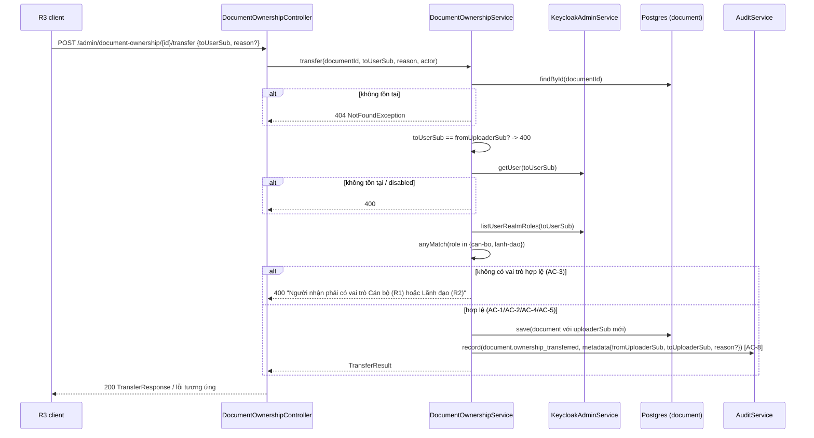

# Tech Spec: r2-business-parity-02-ownership-transfer

> File: `docs/03-dev/specs/r2-business-parity-02-ownership-transfer.md` — Owner: DEV
> Nguồn story: `docs/02-ba/stories/r2-business-parity-02-ownership-transfer.md` (STORY-r2-business-parity-02)
> Kiến trúc: `docs/01-sa/architecture/r2-business-parity.md` (ADR-4)
> Status: Approved
> Spec ID: `SPEC-r2-business-parity-02-ownership-transfer`

## 1. Tóm tắt kỹ thuật

- **Chỉ backend, chỉ 1 service.** Sửa điều kiện người nhận hợp lệ trong
  `DocumentOwnershipService.transfer()` (`backend/src/main/java/com/aismartstore/backend/documents/DocumentOwnershipService.java:83-87`):
  từ "chỉ `can-bo`" sang "`can-bo` **hoặc** `lanh-dao`" (ADR-4, phương án A —
  kiểm realm role, không kiểm permission). Đổi thông báo lỗi tương ứng.
- **Không** có bảng/migration mới, **không** đổi endpoint/DTO, **không** đổi
  `@PreAuthorize` (vẫn `PERM_document.transfer_ownership`, R3-only — AC-7).
  `V35` đã bị chiếm bởi `SPEC-r2-business-parity-01`; story này không cần
  migration nên không đụng số version.
- AC-5 (cảnh báo FE khi người nhận R2 thiếu `document.upload`) dùng nguyên
  endpoint sẵn có `GET /admin/rbac/roles` (`RbacController`, trả
  `RbacService.RoleView(code, displayName, permissionCodes)`) — **không** có
  thay đổi backend nào cho AC-5; phần FE thuộc
  `docs/03-dev/specs/r2-business-parity-03-web-permission-gating.md` (ngoài
  phạm vi file này, chỉ ghi chú phối hợp ở §3/§10).
- Thay đổi code: 1 service (logic + Javadoc), 1 test unit
  (`DocumentOwnershipServiceTest`), 1 test IT (`DocumentOwnershipControllerIT`).

## 2. Data model

Không đổi. Không có migration mới cho story này (ADR-4 chọn kiểm role thay vì
permission → không cần thêm/sửa `role_permission` hay `permission`).

## 3. API contract

Endpoint giữ nguyên, chỉ đổi **hành vi** và **nội dung lỗi**:

| Method | Endpoint | Request | Response | Lỗi/Status codes |
|---|---|---|---|---|
| POST | `/admin/document-ownership/{documentId}/transfer` | `TransferOwnershipDto{toUserSub, reason?}` (không đổi) | `TransferResponse{documentId, fromUploaderSub, toUploaderSub, transferredAt}` (không đổi) | 404 tài liệu không tồn tại (không đổi); 400 `"Tài khoản người nhận không tồn tại hoặc đã bị vô hiệu hoá"` (không đổi); 400 `"Người nhận trùng người nạp hiện tại"` (không đổi); **400 `"Người nhận phải có vai trò Cán bộ (R1) hoặc Lãnh đạo (R2)"`** (đổi từ "... vai trò Cán bộ (R1)" — AC-3); 403 nếu actor thiếu `PERM_document.transfer_ownership` (không đổi, AC-7) |

`GET /admin/rbac/roles` (AC-5, không đổi — tham chiếu để FE story 03 dùng):

| Method | Endpoint | Request | Response | Lỗi/Status codes |
|---|---|---|---|---|
| GET | `/admin/rbac/roles` | — (`hasRole('QUAN_TRI')`) | `List<RoleView{code, displayName, permissionCodes}>` | 403 nếu không phải R3 |

## 4. Luồng xử lý chính

1. Việc kiểm "chính chủ"/tồn tại/disabled/trùng người nạp giữ nguyên thứ tự
   hiện có (không đổi để tránh regression AC-6).
2. Chỉ `anyMatch` ở bước kiểm role đổi từ 1 điều kiện (`can-bo`) sang 2 điều
   kiện (`can-bo` hoặc `lanh-dao`) — không quan tâm actor/người nhận có thêm
   vai trò `quan-tri` hay không (AC-4, đã đúng với `anyMatch` hiện có, không
   cần sửa thêm).
3. Không truy vấn `document.upload` hay `GET /admin/rbac/roles` ở backend
   (AC-5 — BE chỉ kiểm vai trò, cảnh báo là việc của FE).

## 5. Test plan

### 5.1 Unit test — `DocumentOwnershipServiceTest`

- Sửa `transferRejectsWhenBLacksCanBoRole` (hiện chỉ có `lanh-dao`, kỳ vọng
  400) → đổi tên `transferRejectsWhenBHasNeitherCanBoNorLanhDaoRole`, roles =
  `List.of(new KcRole("r1","quan-tri"))`; assert message mới (AC-3).
- Mới `transferSucceedsWhenBIsAnActiveLanhDaoAccount` (AC-1): roles =
  `List.of(new KcRole("r1","lanh-dao"))` → 200, audit ghi đúng
  `document.ownership_transferred` (AC-8).
- Giữ `transferSucceedsWhenBIsAnActiveCanBoAccount` nguyên trạng (AC-2,
  regression).
- Mới `transferSucceedsWhenBHasQuanTriPlusLanhDaoRoles` (AC-4): roles =
  `List.of(new KcRole("r1","quan-tri"), new KcRole("r2","lanh-dao"))` → 200.
- Giữ nguyên `transferRejectsWhenDocumentNotFound`,
  `transferRejectsWhenBIsSameAsCurrentUploader`,
  `transferRejectsWhenBDoesNotExistInKeycloak`, `transferRejectsWhenBIsDisabled`
  (AC-6, regression — không sửa).

### 5.2 Integration test — `DocumentOwnershipControllerIT`

- Sửa `transfer_bWithoutCanBoRole_returns400` (dòng ~310, hiện mock
  `leader-x` có role `lanh-dao` và kỳ vọng 400 — **đảo ngược theo AC-1**):
  đổi tên `transfer_bAdminOnlyRole_returns400`, mock role `quan-tri` duy
  nhất, giữ assert 400 + message mới + `uploaderSub` không đổi (AC-3).
- Mới `transfer_bIsLeaderRole_returns200AndUpdatesUploader` (AC-1): mock
  `kc.listUserRealmRoles("leader-x")` = `[KcRole("r1","lanh-dao")]` → 200,
  `documentRepository.findById(...).getUploaderSub() == "leader-x"`.
- Mới `transfer_bHasQuanTriPlusLanhDao_returns200` (AC-4): roles =
  `[KcRole("r1","quan-tri"), KcRole("r2","lanh-dao")]` → 200.
- Giữ nguyên các test còn lại (AC-6 `transfer_bSameAsCurrentUploader_returns400`,
  `transfer_documentNotFound_returns404`; AC-7
  `transfer_nonAdminRoles_return403`; `mockBValid` helper dùng `can-bo` — giữ
  nguyên, dùng cho AC-2 regression ở các test khác đã có sẵn
  `afterTransfer_...`, `transfer_documentWithOnlyConfirmedRun_succeeds`, v.v.).
- Mới `transfer_recordsAuditEventWithUnchangedFormat` nếu chưa có test IT nào
  assert trực tiếp bảng `audit_log` cho ownership transfer (AC-8) — kiểm tra
  trước khi viết: nếu `transfer_chainedTwice_eachAuditRowHasItsOwnFromUploaderSub`
  (dòng ~269) đã cover định dạng audit, chỉ cần bổ sung case người nhận là
  `lanh-dao` vào test đó thay vì viết test mới (tránh trùng lặp).

### 5.3 Case biên

- AC-6: người nhận không tồn tại / bị disabled / trùng người nạp hiện tại —
  không đổi hành vi, chỉ chạy lại test cũ để xác nhận không regression.
- AC-7: actor không có `PERM_document.transfer_ownership` → 403, không đổi.
- Người nhận có vai trò khác ngoài 3 vai trò chuẩn (không xảy ra trong thực tế
  vì `AssignableRoles.ALL` chỉ có 3 role) — không cần test riêng.

## 6. Task breakdown (map tới AC)

- [x] **Task 1** → AC-1, AC-2, AC-3, AC-4: Sửa
      `DocumentOwnershipService.transfer()`: thêm hằng literal cục bộ
      `ROLE_LANH_DAO = "lanh-dao"` cạnh `ROLE_CAN_BO` (Javadoc trỏ về
      `AssignableRoles.ALL`, không sửa `AssignableRoles`); đổi `hasCanBoRole` →
      `hasEligibleRole = anyMatch(can-bo hoặc lanh-dao)`; đổi message lỗi
      thành `"Người nhận phải có vai trò Cán bộ (R1) hoặc Lãnh đạo (R2)"`.
      Cập nhật Javadoc class/method nếu còn nhắc "role CAN_BO" cứng.
- [x] **Task 2** → AC-1, AC-3, AC-4, AC-8: Cập nhật `DocumentOwnershipServiceTest`
      theo §5.1.
- [x] **Task 3** → AC-1, AC-3, AC-4, AC-6, AC-7, AC-8: Cập nhật
      `DocumentOwnershipControllerIT` theo §5.2.
- [x] **Task 4** → AC-6: Chạy lại toàn bộ test của 2 file trên + các IT dùng
      chung `DocumentOwnershipService`/`DocumentOwnershipController` (grep
      `DocumentOwnershipService` ở các test khác nếu có) để xác nhận không
      regression.
- [x] **Task 5** → tất cả AC: `mvn -o test -Dtest=DocumentOwnershipServiceTest,DocumentOwnershipControllerIT`
      (cần Docker cho IT) xanh; ghi kết quả vào "Ghi chú implement" cuối file
      khi implement.

## 7. Observability

- Log: không thêm log mới.
- Audit: `document.ownership_transferred` giữ nguyên field
  (`fromUploaderSub`, `toUploaderSub`, `reason?`), actor vẫn lấy từ JWT của
  R3 thực hiện (AC-8) — không đổi `AuditService.record` call.
- Không có metric/trace mới (thao tác tần suất thấp, admin-only).

## 8. Security checklist

- [x] Validate & sanitize input — không đổi (`TransferOwnershipDto` giữ
      nguyên `@NotBlank`/`@Size`).
- [x] AuthN/AuthZ — endpoint vẫn `PERM_document.transfer_ownership` (R3 only,
      AC-7); mở rộng **ai có thể là người nhận**, không mở rộng ai được gọi
      API.
- [x] Không log dữ liệu nhạy cảm — không đổi.
- [ ] Rate limit — không áp dụng (giữ nguyên, thao tác admin tần suất thấp).
- [ ] Review: người nhận R2 có thể thiếu `document.upload` (nếu R3 đã gỡ) mà
      vẫn nhận được quyền sở hữu tài liệu — đúng chủ đích ADR-4 (R-NFR
      Security của ARCH đã chấp nhận, Q3 §9 chốt "không chặn ở BE"), xác nhận
      lại với QA khi nghiệm thu.

## 9. Migration & Rollback plan

- Migration: không có — thay đổi thuần logic Java, không đụng schema.
- Rollback: revert lại bản deploy backend (không cần thao tác DB/Flyway).
- Feature flag: không có; vì không thể tắt riêng rẽ qua RBAC (ADR-4 cố tình
  không gắn với `role_permission`), rollback chỉ có thể bằng deploy lại bản
  cũ của `DocumentOwnershipService`.

## 10. Rủi ro kỹ thuật

- Đổi message lỗi là **breaking change nhỏ cho FE** nếu bất kỳ nơi nào ở web
  so khớp chuỗi lỗi cũ ("... vai trò Cán bộ (R1)") thay vì chỉ hiển thị
  nguyên văn — grep `web/src` trước khi coi Task 1 hoàn tất (không thuộc file
  spec này nhưng ảnh hưởng story 03, DEV cần báo khi phối hợp).
- `transfer_bWithoutCanBoRole_returns400` (IT) và test tương tự đang khẳng
  định `lanh-dao` bị từ chối — nếu sửa sai (quên đảo ngược) sẽ che giấu
  regression thay vì phát hiện (giống R-7 của ARCH).
- AC-5 phụ thuộc hoàn toàn vào `GET /admin/rbac/roles` trả đúng
  `permissionCodes` theo role — nếu story 01
  (`r2-business-parity-01-permission-grant`) chưa deploy, `lanh-dao` vẫn có
  `document.upload` mặc định cũ nên cảnh báo FE sẽ không bao giờ xuất hiện;
  không phải lỗi của story này nhưng cần lưu ý khi QA kết hợp cả 2 story.

## 11. Definition of Done

- [ ] Tất cả AC pass (đối chiếu QA report)
- [ ] Test unit/integration xanh (Task 5)
- [ ] Lint/format sạch
- [ ] Không giảm coverage đáng kể
- [ ] Doc/README cập nhật nếu có thay đổi hành vi — không cần (message lỗi
      không có doc riêng ngoài spec này)
- [ ] Đã cân nhắc migration & rollback (§9 — không có migration)

## 12. Câu hỏi mở

- [x] Có cần đổi tên hằng `ROLE_CAN_BO`/thêm `ROLE_LANH_DAO` thành dùng chung
      `AssignableRoles.ALL`/`Role` thay vì literal string riêng trong
      `DocumentOwnershipService`? Đề xuất: giữ literal cục bộ như code hiện
      tại (`ROLE_CAN_BO` đã là literal, không tham chiếu `AssignableRoles`),
      nhất quán phong cách cũ, tránh đổi phạm vi ngoài ý story.
      → **Chốt:** giữ literal cục bộ `ROLE_LANH_DAO` cạnh `ROLE_CAN_BO`, không
      thêm hằng vào `AssignableRoles` (cập nhật: §6 Task 1)

## Ghi chú implement

- Task 1-5 xong. Unit `DocumentOwnershipServiceTest` 9/9, IT `DocumentOwnershipControllerIT` 13/13 xanh (`mvn -o verify`). grep `web/src` không có chỗ so khớp chuỗi lỗi cũ. Backend docker đã rebuild.
