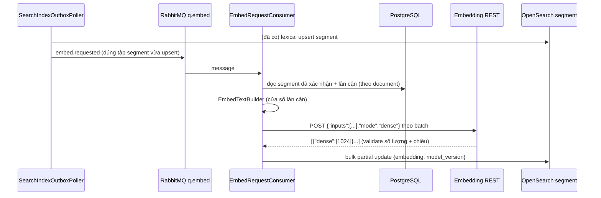

# Tech Spec: search-semantic — Indexing (đường ghi)

> File: `docs/03-dev/specs/search-semantic-indexing.md` — Owner: DEV
> Mục lục & task breakdown: [`search-semantic.md`](search-semantic.md) (SPEC-search-semantic)
> Nguồn story: `docs/02-ba/stories/search-semantic.md` (STORY-search-semantic)
> Nguồn kiến trúc: `docs/01-sa/architecture/search-semantic.md` QĐ 1, 4, 6; `ai-search-infra.md` QĐ 2, 4, 7
> Status: Approved (người dùng duyệt 2026-10-11)
> Spec ID: `SPEC-search-semantic` (phần indexing: T4–T10)

Phục vụ gián tiếp AC-2.4 (nội dung mới nhất), AC-2.5 (tóm tắt video có, `sed`
không), AC-4.3 (ACL trong chỉ mục là lớp 1). Không có AC riêng về độ trễ chỉ mục;
mục tiêu SA: `review.confirmed` → tra cứu được ≤ 60s p95, `acl.changed` ≤ 5s.

## 2. Data model

### 2.1 OpenSearch — index `segment-v2` (alias `segment`)

Thêm vào `backend/src/main/resources/search/segment-v2-index.json` (bản sao của
`segment-v1-index.json` + các phần sau); `SearchIndexNames.SEGMENT_PHYSICAL_INDEX = "segment-v2"`.

```json
"settings": { "index": { "knn": true, "knn.algo_param.ef_search": 100 } },
"mappings": { "properties": {
  "embedding": { "type": "knn_vector", "dimension": 1024, "space_type": "innerproduct",
                 "method": { "name": "hnsw", "engine": "faiss",
                             "parameters": { "m": 16, "ef_construction": 128,
                                             "encoder": { "name": "sq", "parameters": { "type": "fp16" } } } } },
  "model_version": { "type": "keyword" }
} }
```

- `embedding` chỉ có trên document segment đã embed; document chưa có vector bị k-NN bỏ qua (không lỗi).
- **Kết quả spike T4 (2026-10-11, OpenSearch 2.17.1):** `cosinesimil` bị faiss hnsw từ chối ⇒ dùng `innerproduct` (tương đương vì
  vector đã chuẩn hoá L2, norm = 1,0; `cosine = score − 1`); `mode: on_disk` + `compression_level` tạo được nhưng **mọi truy vấn k-NN
  trả 500** khi shard có document không có vector (title/note/`sed`/chưa embed — không tránh được) ⇒ bỏ, thay bằng encoder `sq fp16`
  (giảm 1/2 bộ nhớ). `ef_search`/`m`/`ef_construction` giữ giá trị `[ĐX]` trên. Chi tiết + phương án dự phòng (`lucene` + `cosinesimil`):
  `docs/00-overview/runbooks/search-semantic-opensearch-knn.md` §1.
- Không có text/toạ độ mới trong chỉ mục cho UI (QĐ 4): `text` chỉ phục vụ lexical sẵn có; UI luôn lấy từ Postgres.
- Các trường ACL/lọc (`owner_user_id`, `scope_group_ids`, `acl_version`, `doc_type`, `topic_tags`,
  `uploaded_at`, `folder_path_ids`, `media_type`, `confirm_source`, `content_source`) **dùng chung đã có**
  trên document `segment` — không thêm payload riêng.
- Không còn bảng Postgres mới (không V37) — xem `search-semantic.md` §1.3.

### 2.2 Thông điệp RabbitMQ

```java
record EmbedRequestMessage(UUID eventId, UUID documentId, List<UUID> segmentIds /* null = cả tài liệu */,
                           String reason /* confirmed|ingested|note|restored|reconcile */, long outboxVersion) {}
```

Queue `q.embed` (exchange `ai.jobs`, routing key `q.embed`), `x-max-priority=9`. Khoá idempotency = `eventId`;
thứ tự theo `document_id` (consumer concurrency 1 hoặc khoá mềm theo document nếu >1). Ghi vector là
partial update ghi đè ⇒ xử lý lại cùng message vô hại.

## 4. Luồng xử lý chính



### 4.1 Poller (T7) — mở rộng `SearchIndexOutboxPoller`

Sau khi bước lexical OpenSearch của một dòng outbox thành công, **trong cùng lần xử lý** (nếu
`app.semantic.enabled`):

| Sự kiện outbox | Hành động |
|---|---|
| `review.confirmed` / `review.reconfirmed` | publish `embed.requested` (segmentIds = segment vừa re-index; consumer mở rộng ±1 lân cận) |
| `document.ingested` | publish `embed.requested` (segment `title`) |
| `document.note.changed` | publish `embed.requested` (segment `note`) |
| `document.restored` | publish `embed.requested` (cả tài liệu, vì re-index ghi đè vector) |
| `document.acl.changed`, `document.classification.changed`, `document.trash`, `document.purged` | **chỉ nhánh lexical hiện có** (`updateByQuery`/delete theo `document_id`): vector nằm trên cùng document nên đi theo, **không** gọi embed, **không** `set_payload` riêng |
| `folder.moved` (mới, §4.4) | `updateByQuery` `folder_path_ids` — vector đi theo |

Lỗi publish ⇒ ném lỗi để hàng outbox thử lại (`attempts`, `maxAttempts=20` sẵn có); thao tác idempotent.
Segment bị loại (thay run, `deleteByRunId`) xoá cả document nên vector mất theo — không cần bước thêm.
**Bất biến (R4):** mọi đường gọi `SegmentIndexer.upsertSegments` cho segment đủ điều kiện embed phải đi kèm
`embed.requested` cho segment đó; thêm test duy trì bất biến.

### 4.2 Tập segment được embed

Chỉ segment đã xác nhận FR-18 với `content_source ∈ {ocr, stt, note, title, summary}`; **loại `sed`** (AC-2.5);
kho cá nhân không bao giờ (producer đã chặn, không dựa filter). Dùng **chung một hàm chọn tập segment** với đường
index lexical (tách method dùng chung) để ánh xạ 1-1 với document `segment` — điều kiện hợp nhất RRF.

### 4.3 `EmbedTextBuilder`, `EmbeddingClient`, ghi vector (T5, T8)

`text_embed = tail(prev, overlap) + text(segment) + head(next, overlap)`:
- `prev/next` = segment kề theo `segment_index` trong **cùng tài liệu** và cùng đơn vị vật lý (OCR: cùng
  `page_no`; STT: liền kề thời gian). `title`/`note`/`summary` (`position_type=none`) **không** ghép lân cận.
- Cắt phần lân cận trước nếu tổng > `chunk-size-tokens` (512); nếu riêng nội dung segment vẫn vượt ⇒ embed
  **nguyên nội dung segment** (không ghép lân cận, **không sub-point**; Qwen3 nhận ngữ cảnh dài). Đếm token xấp xỉ.
- Sửa một segment (FR-18) ⇒ embed lại chính nó **và 2 segment kề** (consumer tự mở rộng). Nội dung tài liệu
  **không** bọc instruction (chỉ câu hỏi bọc, query §4.1).
- Text rỗng/chỉ khoảng trắng ⇒ bỏ qua, không gọi endpoint.

`EmbeddingClient.embed(List<String> inputs)`: `POST ${EMBEDDING_API_URL}` JSON `{"inputs": [...], "mode": "dense"}`
(`RestClient` sẵn có, không xác thực); chia batch theo `app.embedding.batch-size`; **validate** `response.size() ==
inputs.size()` và mỗi `dense.size() == 1024`, sai ⇒ `EmbeddingException`. Consumer: lỗi ⇒ nack sang `q.embed.retry`
(backoff), vượt ngưỡng ⇒ `q.embed.dlq`; **không bao giờ ghi vector khi validate sai**.

`SegmentVectorWriter`: bulk `update` (không `doc_as_upsert`) với `doc = {embedding, model_version}`; 404
(document chưa được lexical index) ⇒ coi là lỗi tạm, retry (poller chỉ publish sau khi lexical thành công nên hiếm).
Không dùng external version ở `update`. Lưu ý: `update` tăng `_version` nội bộ thêm 1 (đơn vị µs của `contentVersion`), nên một
lexical upsert sau đó với **cùng** `contentVersion` sẽ bị `version_conflict` và được `SegmentIndexer` coi là vô hại — chấp nhận
được vì nội dung không đổi và vector vẫn còn; `contentVersion` mới (nội dung đổi) luôn lớn hơn nhiều ⇒ upsert bình thường rồi
embed lại (R4). Có IT: ghi vector → chạy lại cùng sự kiện lexical ⇒ vector còn nguyên. `segment` bị xoá/purge giữa chừng (404 kéo dài) ⇒ bỏ qua sau số lần retry tối đa, log.
Consumer đọc lại phạm vi từ Postgres, **không tin** dữ liệu ACL trong message (ACL không ghi bởi consumer này).

### 4.4 `folder.moved` (T10, Q-3)

- `WarehouseService.moveFolder` (hiện `WarehouseService.java:112`) ghi thêm `outbox_event` `folder.moved`
  (aggregate = folder id) **trong cùng transaction** với việc cập nhật `path_ids` của cây con.
- Payload (Q-10): chỉ `folderId`, `movedAt`, `movedBySub` — **không** mang path cũ/mới.
- Poller xử lý: lấy từ PostgreSQL danh sách document thuộc cây con của `folderId` (theo `path_ids` hiện tại),
  theo lô; với mỗi lô tính lại `folder_path_ids` bằng `DocumentIndexFieldsBuilder` (đúng như `document.acl.changed`
  tính lại `scope_group_ids`) rồi `updateByQuery` theo `document_id` trên alias `segment` và `document` (partial
  update — giữ nguyên vector). Rate limit `requests_per_second` cấu hình. Idempotent; event đến trễ/trùng/lệch thứ
  tự vẫn hội tụ về trạng thái DB hiện tại. Event không phụ thuộc cờ `app.semantic.enabled` (sửa cả nhánh fulltext).
- Thêm `EVENT_FOLDER_MOVED` vào `HANDLED_EVENT_TYPES`.

### 4.5 Đối soát (T9)

`SemanticIndexReconciliationJob` (định kỳ, cờ): lấy segment đủ điều kiện (§4.2) từ Postgres theo lô; hỏi OpenSearch
(`mget`/`terms ids`) xem document có `embedding` và `model_version` hiện hành không; thiếu/sai ⇒ publish `embed.requested(reason=reconcile)`.
Báo cáo tỷ lệ lệch (mục tiêu ≤ 0,1%). Cảnh báo khi `q.embed.dlq` > 0 hoặc outbox parked.

## 5. Test plan

- Unit `EmbedTextBuilder`: cửa sổ lân cận cùng trang/khác trang, `title/note/summary` không ghép, cắt theo ngưỡng,
  segment quá dài ⇒ nguyên nội dung (1 vector), segment đơn lẻ; `sed` bị loại; rỗng bị bỏ.
- Unit `EmbeddingClient` (WireMock): đúng body/thứ tự; số phần tử lệch ⇒ lỗi; vector 1023/1025 chiều ⇒ lỗi; HTTP 5xx/timeout ⇒ lỗi; chia batch.
- Unit poller routing bảng §4.1 (cờ tắt ⇒ không publish embed; `acl.changed`/`trash`/`purged` ⇒ không publish embed).
- IT (Postgres + RabbitMQ + OpenSearch Testcontainers, endpoint embed = WireMock): `review.confirmed` ⇒ message ⇒ document
  `segment` có `embedding` 1024 + `model_version`; **lexical re-index rồi consumer ⇒ vector có lại** (R4); sửa text ⇒ embed
  lại segment đó + 2 kề; `acl.changed` ⇒ `updateByQuery`, vector còn nguyên, không gọi endpoint; trash/purge ⇒ document biến mất.
- IT: endpoint lỗi/validate sai ⇒ retry, không ghi vector, vượt retry ⇒ `q.embed.dlq`; document xoá giữa chừng ⇒ bỏ qua.
- IT `folder.moved`: di chuyển folder có cây con ⇒ `folder_path_ids` document+segment đúng; lọc theo thư mục mới (fulltext) trả đúng, thư mục cũ không.
- Unit/IT reconciliation: thiếu vector ⇒ republish; `model_version` khác ⇒ republish; đủ ⇒ không làm gì.
- Spike T4: ghi lại kết quả mapping k-NN (space_type, on_disk, filter hiệu quả) vào PR/runbook.

## 7. Observability

- Log INFO (không log text): `eventId`, `documentId`, số segment, độ trễ embed + update, `reason`, kích thước batch.
- Metric: `embed_queue_depth`, `embed_latency_ms`, `embed_throughput_segments_per_s`, `embed_failures_total{cause}`,
  `q.embed.dlq` depth, `embed_validation_failures_total`, độ trễ `review.confirmed → có vector`, `reconcile_missing_vectors`.
- Alert: DLQ > 0; outbox parked; lệch đối soát > 0,1%.

## 8. Security checklist

- [ ] Kho cá nhân không bao giờ publish `embed.requested` (kiểm ở producer + test)
- [ ] Consumer không ghi/đổi trường ACL; không tin ACL trong message; vector chỉ gắn vào document đã có ACL đúng
- [ ] Không log text segment; không đưa text mới vào chỉ mục cho UI
- [ ] `EMBEDDING_API_URL` chỉ trỏ dịch vụ nội bộ ở stg/prod (NFR-04); domain công khai chỉ dev/test; không có khoá/token trong repo
- [ ] Validate bắt buộc phản hồi endpoint trước khi ghi (số phần tử, 1024 chiều)
- [ ] `folder.moved` chạy trong transaction với `moveFolder`; poller đọc lại path từ Postgres

## 9. Migration & rollback — riêng `q.embed` và mapping

Khai báo trong `RabbitConfig`, **phải khớp đúng** queue đã tạo tay trên stg (2026-09-15), nếu lệch ⇒ 406 crash-loop:

- `q.embed`: durable, `x-max-priority=9`, `x-dead-letter-exchange=ai.jobs.dlx`, `x-dead-letter-routing-key=q.embed.dlq`
- `q.embed.retry`: durable, `x-dead-letter-exchange=ai.jobs`, `x-dead-letter-routing-key=q.embed` (không TTL)
- `q.embed.dlq`: durable, không tham số
- Binding: `q.embed` + `q.embed.retry` → `ai.jobs`; `q.embed.dlq` → `ai.jobs.dlx` (key = tên queue).

Tái dùng `mainQueue/retryQueue` helper của `RabbitConfig` sau khi đối chiếu tham số (`rabbitmqctl list_queues name arguments`)
trước khi deploy stg. Dev local: tự khai báo.

Mapping: đổi sang `segment-v2` theo `search-semantic.md` §9 (reindex + đổi alias). `createIfAbsent` hiện chỉ tạo khi chưa có
index ⇒ bootstrap phải tạo `segment-v2` và, khi `segment-v1` đang giữ alias, **không tự đổi alias** nếu có dữ liệu: dùng
runbook reindex (log cảnh báo rõ ràng).
