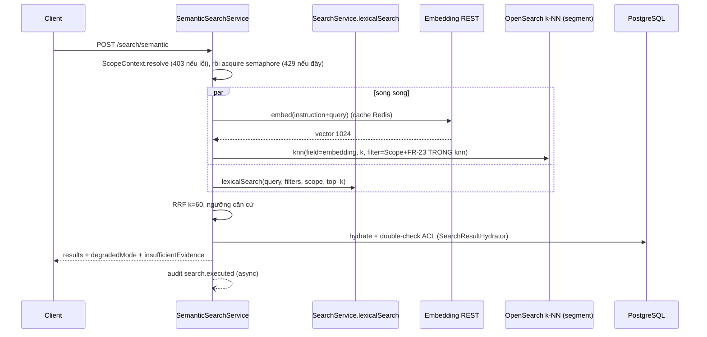

# Tech Spec: search-semantic — Query & Frontend (đường đọc)

> File: `docs/03-dev/specs/search-semantic-query.md` — Owner: DEV
> Mục lục & task breakdown: [`search-semantic.md`](search-semantic.md) (SPEC-search-semantic)
> Nguồn story: `docs/02-ba/stories/search-semantic.md` (STORY-search-semantic)
> Nguồn kiến trúc: `docs/01-sa/architecture/search-semantic.md` QĐ 1–6
> Status: Approved (người dùng duyệt 2026-10-11)
> Spec ID: `SPEC-search-semantic` (phần query/FE: T11–T21)

## 2. Data model

Không bảng mới (dùng `content_segment`, `document`, `document_digitization_status`). DTO:

```java
record SemanticSearchRequest(@NotBlank @Size(max=256) String query, SearchFilters filters,
                             @Min(0) @Max(1) int page, @Min(1) @Max(50) Integer size) {}

record SemanticSearchResponse(List<SemanticResult> results, String degradedMode /* none|lexical_only|semantic_only */,
                              boolean insufficientEvidence, long totalApprox, boolean hasMore, int maxPages /* 2 */) {}

record SemanticResult(String segmentId, String documentId, String documentName, String docType,
                      String excerpt, String contentSource /* ocr|stt|note|title|summary */,
                      String confirmSource /* manual|auto */, PositionInfo position /* tái dùng DTO /search */,
                      boolean matchedLexical, Double cosineScore, double rrfScore,
                      String documentDigitizationStatus /* như SearchHit */,
                      List<SourceReferenceView> sourceReferences /* chỉ summary */) {}
```

`excerpt` = `content_segment.current_text` đọc từ Postgres (không từ chỉ mục — AC-2.4, QĐ 4). Không có
highlight (AC-2.3). `PositionInfo`/`SourceReferenceView` tái dùng nguyên của `search.dto`. Nội bộ:
`record VectorHit(UUID segmentId, UUID documentId, double cosine)`;
`record FusedHit(UUID segmentId, UUID documentId, Double cosine, boolean matchedLexical, double rrf)`.
Mỗi `segment_id` chỉ có một vector ⇒ không còn bước gộp sub-point.

## 3. API contract

| Method | Endpoint | Request | Response | Lỗi/Status |
|---|---|---|---|---|
| POST | `/search/semantic` | `SemanticSearchRequest` (không có `mode`) | `SemanticSearchResponse` | 200 (kể cả rỗng/suy giảm); 400 `query` rỗng/>256 ký tự, `page`≥2, filter vượt giới hạn (dùng chung validate `/search`); 403 `SCOPE_UNRESOLVED` (AC-4.2); 429 `SEMANTIC_BUSY` (AC-5.3); 503 `SEARCH_UNAVAILABLE` cả hai nhánh lỗi (AC-5.2); 404 khi `app.semantic.enabled=false` |

- Authz: `@PreAuthorize("hasAuthority('PERM_document.read')")` như `SearchController` (Q-4 đã chốt).
- Rỗng ≠ lỗi: `results=[]` + `insufficientEvidence=true`, **200** (AC-3.1). Suy giảm mà rỗng ⇒ `insufficientEvidence=true`
  kèm `degradedMode` (UI hiện cả banner vàng và trạng thái rỗng).
- `page ∈ {0,1}`; `size` mặc định `search.max_results_per_page` (20, tối đa 50). `totalApprox` = số ứng viên sau ngưỡng và
  double-check (gần đúng, AC-6.2); `hasMore` = còn kết quả sau trang 2 ⇒ UI gợi ý thu hẹp.
- Không có tham số bỏ filter/hạ ngưỡng/chọn chế độ (AC-1.2, AC-3.2, AC-4). Trường lạ bị bỏ qua; không nhận `minScore` từ client.

## 4. Luồng xử lý chính



### 4.1 `SemanticSearchService.search` (T13)

1. Validate request. `ScopeContext.resolve(sub, groupMemberRepository)`; `ScopeResolutionException` ⇒ 403 `SCOPE_UNRESOLVED`,
   **không gọi engine/endpoint nào**, vẫn audit (AC-4.2, AC-7.2).
2. `SemanticQueryLimiter.tryAcquire()` (T14): `Semaphore(app.semantic.query-concurrency=8)` **toàn hệ thống (per instance)**,
   áp mọi chế độ; hết chỗ ⇒ `TooManyRequestsException` 429 (AC-5.3). Luôn `release` trong `finally`.
3. Song song (`CompletableFuture` trên executor riêng, có timeout):
   - Nhánh vector: `EmbeddingClient.embedQuery(query)` — bọc `Instruct: <app.embedding.query-instruction>\nQuery: <query>` khi
     `query-instruction-enabled` (Q-8); cache Redis key `hash(instruction+query)+model_version` TTL 10' (lỗi Redis = miss); timeout
     `app.embedding.timeout-ms`; validate 1024 chiều → `KnnSegmentSearcher.search(vector, k=semantic.top_k, ctx, filters)`.
     Mọi lỗi/timeout/validate sai của embed hoặc k-NN ⇒ nhánh vector "lỗi".
   - Nhánh lexical: `searchService.lexicalSearch(query, filters, scope, top_k)`; `OpenSearchUnavailableException`/timeout ⇒
     nhánh lexical "lỗi". Hợp đồng trả `query.LexicalHit(segmentId, documentId, bm25Score)` **chưa** ACL double-check.
4. **Cả hai lỗi ⇒ 503 `SEARCH_UNAVAILABLE`** (không trả rỗng giả; UI xoá kết quả cũ, AC-5.2).
5. `HybridFusion` (T12):
   - Cả hai nhánh sống: `rrf = Σ 1/(60 + rank_i)` (rank bắt đầu 1); giữ ứng viên nếu `cosine ≥ semantic.min_score` **hoặc**
     `matchedLexical`. Không bao giờ giữ ứng viên chỉ-vector dưới ngưỡng (AC-3).
   - Chỉ lexical sống (`lexical_only`): kết quả = hit lexical theo thứ tự BM25.
   - Chỉ vector sống (`semantic_only`): giữ `cosine ≥ min_score`, thứ tự cosine.
   - `min_score`, `top_k` đọc từ `system_config` mỗi request (cache ngắn của `SystemConfigService`), không hard-code.
   - Rỗng sau ngưỡng ⇒ `insufficientEvidence=true`; **cấm** hạ ngưỡng, cấm "gần đúng nhất".
6. Phân trang trong bộ nhớ: over-fetch (`size×1,5+10`) để bù hao hụt double-check; `hasMore` nếu còn sau trang 2.
7. `SemanticResultHydrator` (T15): double-check ACL qua `BusinessDataScope.forDocuments` (tái dùng logic `SearchResultHydrator`),
   rồi đọc `content_segment`, `document`, `document_digitization_status`; **loại mọi segment `content_source=sed`** và segment không
   còn tồn tại (AC-2.5, AC-4.3). Giữ thứ tự RRF, cắt về `size`.
8. Audit `search.executed` async (T17), không chặn response; ghi cả 403/429/503 (AC-7.2).

### 4.2 `KnnSegmentSearcher` (T11) — k-NN với efficient filtering

Một request `_search` tới alias `segment`:

```json
{ "size": <k>, "_source": false, "stored_fields": "_none_",
  "query": { "knn": { "embedding": {
      "vector": [ ...1024 ], "k": <semantic.top_k>,
      "filter": { "bool": { "filter": [
          <ScopeFilterBuilder.build(ctx)>,
          <clause FR-23 từ SearchQueryBuilder/FilterGroup>,
          { "term": { "model_version": "<model-version hiện hành>" } },
          { "bool": { "must_not": { "term": { "content_source": "sed" } } } }
      ] } } } } } }
```

- **Filter nằm TRONG `knn`**; không dùng `post_filter` hay `bool` ngoài knn để lọc phạm vi (sẽ cắt top-k sau khi chọn, vừa sai
  recall vừa rủi ro rò rỉ). Dùng **đúng** `Query` mà nhánh lexical dùng (`ScopeFilterBuilder.build(ctx)` + clause FR-23); id nhóm
  ngoài phạm vi bị bỏ im lặng như `/search` (`GroupIdIntersection`). Thiếu `ScopeContext` ⇒ ném lỗi, không bao giờ filter rỗng.
- Typed client `opensearch-java 2.17.0`: nếu `Query.knn` không hỗ trợ đủ `filter`, dựng bằng JSON thô (`JsonData`) nhưng vẫn
  nhúng `Query` filter đã sinh; có test cấu trúc request.
- Timeout `search.query_timeout_ms`; `ef_search` lấy từ cấu hình index. Kết quả: `segment_id` (= `_id`) + `_score`.
- **Đổi điểm → cosine** bằng `KnnScore.toCosine(spaceType, score)`: `cosinesimil` ⇒ `cos = 2·score − 1` (plugin trả
  `score = (1 + cos)/2`); `innerproduct` theo công thức riêng của plugin; unit test theo vector mẫu đã biết. `min_score`
  (khởi điểm 0,50 — Q-9) so sánh với cosine này.

### 4.3 Frontend (T18–T21) — đọc `web/AGENTS.md` trước

- `web/src/lib/features.ts`: mục `semantic-search`, label **"Tra cứu ngữ nghĩa"**, href `/search/semantic`, roles
  `[CAN_BO, LANH_DAO]`, `enabled: true` (giá trị tĩnh — `features.ts` không đọc được cờ runtime của backend; khi tắt cờ
  backend trả 404 và trang hiện banner lỗi đỏ như 503 — không thêm copy mới).
- `web/src/app/search/semantic/page.tsx` (không sửa `/search/page.tsx`): ô nhập đa dòng (≤256 ký tự); dòng gợi ý nguyên văn
  "Tìm theo số hiệu hoặc tên văn bản chính xác? Dùng trang Tìm kiếm toàn văn." link `/search` (AC-1.3); `SearchFilterPanel` dùng lại;
  **không** control chọn chế độ (AC-1.2).
- Danh sách tiêu đề **"Các đoạn nội dung liên quan"**; thẻ kết quả tái dùng `SearchResultCard` (badge vàng tự động nguyên văn, ghi
  chú chờ kiểm duyệt xám theo `documentDigitizationStatus` như `/search`, nhãn "Khớp từ khoá" khi `matchedLexical`, nhãn "Tóm tắt
  nội dung video" cho `summary`, không highlight). Bấm dẫn nguồn dùng `SearchPageViewer` (`position.type=none` ⇒ mở từ đầu).
- Trạng thái: rỗng trung tính (AC-3.3 nguyên văn, không banner); banner đỏ 403/503 (nguyên văn AC-4.2/AC-5.2, xoá danh sách);
  banner vàng 429 + "Thử lại"; banner vàng 2 chế độ suy giảm + "Thử lại" (disable khi đang gọi, gửi lại đúng query+filters).
- Phân trang: chỉ 2 trang; không điều hướng trang 3; `hasMore` ⇒ gợi ý thu hẹp; tổng "khoảng N" (AC-6).
- Mọi copy chỉ tiếng Việt; không dùng từ "câu trả lời".

## 5. Test plan

- Unit `HybridFusion`: RRF (chỉ lexical/chỉ vector/cả hai/trùng id), ngưỡng (a)/(b), ứng viên chỉ-vector < ngưỡng bị loại, rỗng ⇒
  `insufficientEvidence`, **không** hạ ngưỡng.
- Unit `KnnSegmentSearcher`: request có filter **bên trong** `knn`, không có `post_filter`; filter chứa đúng `ScopeFilterBuilder`
  output + FR-23 (từng filter) + `model_version` + loại `sed`; thiếu scope ⇒ lỗi; `KnnScore.toCosine` theo space_type.
- Unit `EmbeddingClient.embedQuery`: bọc instruction khi bật, không bọc khi tắt; cache hit/miss; vector sai chiều ⇒ lỗi.
- Unit `SemanticSearchService`: suy giảm từng nhánh, cả hai lỗi ⇒ 503, 403 không gọi engine/endpoint, semaphore 429 + `release` khi
  ngoại lệ, `size×1,5+10` + cắt trang, `hasMore`.
- IT `SemanticSearchControllerIT` (Testcontainers Postgres/Redis/OpenSearch có plugin k-NN; endpoint embed = WireMock):
  - **AC-4.1 (chặn go-live):** A tạo tài liệu X không chia sẻ; B hỏi bằng mô tả ý khác từ khoá ⇒ không thấy X; thêm case: k-NN
    **thực** với vector của X gần nhất vẫn không trả X (filter trong knn), và case mock engine trả X thì double-check Postgres loại.
  - AC-4.2: group lookup lỗi ⇒ 403, không request nào tới OpenSearch/endpoint embed.
  - AC-2.4: sửa `current_text` qua FR-18 ⇒ lần tìm sau trả văn bản mới.
  - AC-2.5: `summary` có nhãn, `sed` không bao giờ xuất hiện dù có vector trong chỉ mục.
  - AC-3/AC-3.1: rỗng ⇒ 200 + `insufficientEvidence`; lỗi hệ thống ≠ rỗng.
  - AC-5: embed timeout/lỗi ⇒ `lexical_only`; lỗi k-NN ⇒ `lexical_only`; lexical lỗi ⇒ `semantic_only`; cả hai ⇒ 503; filter phạm vi vẫn áp.
  - AC-5.3: 9 request đồng thời ⇒ có 429 (latch). AC-6: `page=2` ⇒ 400.
  - AC-7: audit có `query` ≤200 ký tự, `mode`, `degradedMode`, `minScore`, `resultCount`; **không** excerpt; ghi cả 403.
  - AC-8: tài liệu còn tác vụ số hoá chưa xác nhận ⇒ `documentDigitizationStatus` đúng.
  - ACL change / di chuyển thư mục: sau `acl.changed`/`folder.moved` kết quả k-NN theo phạm vi/thư mục mới (không cần đường riêng).
- FE (vitest/RTL theo mẫu `search/__tests__/page.test.tsx`): không control chọn chế độ; copy nguyên văn banner/nhãn; rỗng trung tính;
  Thử lại disabled khi đang gọi; không điều hướng trang 3; menu chỉ R1/R2. `npx tsc --noEmit`, `npm run lint`.
- Biên: query toàn khoảng trắng ⇒ 400; Redis lỗi ⇒ miss; `filters` null; embed trả sai chiều ⇒ nhánh vector lỗi; document chưa có vector chỉ thấy ở lexical.

## 7. Observability

- Log INFO mỗi request: userSub, độ dài query (không log nội dung), độ trễ từng nhánh (embed/knn/lexical/hydrate), `degradedMode`,
  `resultCount`, `insufficientEvidence`. Không log excerpt.
- Metric: `semantic_search_latency_ms` (p95 ≤3s, p99 ≤5s), `semantic_embed_latency_ms`, `semantic_knn_latency_ms`,
  `semantic_branch_failures_total{branch}`, `semantic_degraded_total{mode}`, `semantic_empty_ratio`, `semantic_429_total`, `semantic_inflight`.
- Alert: tỷ lệ suy giảm hoặc 503 tăng; p95 vượt 3s; `semantic_empty_ratio` bất thường.

## 8. Security checklist

- [x] Validate: `query` ≤256 ký tự, `page`∈{0,1}, `size`≤50, filter dùng chung validate `/search`; không nhận `minScore`/mode từ client
- [ ] AuthN/AuthZ: `PERM_document.read`; menu chỉ R1/R2; endpoint 404 khi tắt cờ (menu ẩn/xám chỉ là UX, không phải ranh giới bảo mật)
- [ ] Fail-closed: không có `ScopeContext` ⇒ 403, không gọi engine; suy giảm không bao giờ bỏ filter phạm vi
- [ ] Filter phạm vi **trong mệnh đề knn**, không `post_filter`; chỉ một bộ filter (`ScopeFilterBuilder`) cho cả hai nhánh
- [ ] Hai lớp kiểm tra (pre-filter trong chỉ mục + double-check Postgres) — mọi kết quả qua cả hai (AC-4.3)
- [ ] **Không cache kết quả tìm kiếm** (chỉ cache embedding câu hỏi, key không chứa user)
- [ ] Audit: query cắt ≤200 ký tự, không lưu excerpt; ghi cả 403/429/503
- [ ] Rate limit: ≤8 truy vấn đồng thời, 429 thông điệp rõ
- [ ] Không log text câu hỏi nguyên văn ở log ứng dụng (chỉ audit đã cắt); không log excerpt; câu hỏi chỉ gửi tới endpoint embed nội bộ (NFR-04)
