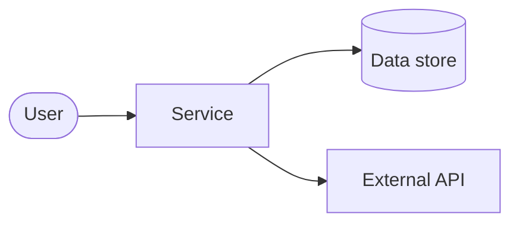

# Architecture: <slug>

> File: `docs/01-sa/architecture/<slug>.md` — Owner: SA
> Status: Draft
> Traceability ID: `ARCH-<slug>` (BA/DEV/QA tham chiếu ID này)

## 1. Bối cảnh / Vấn đề

- Vấn đề nghiệp vụ/kỹ thuật cần giải quyết là gì?
- Phạm vi (in-scope) và ngoài phạm vi (out-of-scope)?

## 2. Ràng buộc (Constraints)

- Ràng buộc kỹ thuật, tổ chức, thời gian...

## 3. NFR (Non-Functional Requirements)

| Loại | Yêu cầu (đo được nếu có thể) |
|---|---|
| Performance | vd: p95 < 300ms |
| Security | vd: OWASP ASVS L1, mã hoá at-rest |
| Scalability | vd: 1k RPS |
| Availability | vd: 99.9% |
| Observability | log/metric/trace cần có |
| Khác | |

## 4. Sơ đồ ngữ cảnh (C4 - Context / Container)

<!-- Sơ đồ mermaid tối thiểu: hệ thống này nằm ở đâu, nói chuyện với ai/gì -->

## 5. Integration points

| Hệ thống / dịch vụ | Loại (sync/async) | Giao thức | Ghi chú |
|---|---|---|---|
| | | | |

## 6. Phương án & Quyết định (ADR)

### ADR-1: <tên>

- **Ngữ cảnh:**
- **Các phương án xem xét:** A / B / C
- **Quyết định:**
- **Lý do:**
- **Hệ quả (trade-off):**

<!-- Thêm ADR-2, ADR-3... nếu cần. BA/DEV sẽ tham chiếu theo mã ADR-n. -->

## 7. Tech stack đề xuất

- Backend:
- Frontend:
- Data store:
- Infra/Deploy:

## 8. Rủi ro

| Rủi ro | Mức độ (H/M/L) | Giảm thiểu |
|---|---|---|
| | | |

## 9. Câu hỏi mở

- [ ] ...
