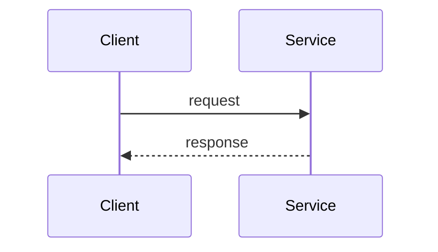

# Tech Spec: <slug>

> File: `docs/03-dev/specs/<slug>.md` — Owner: DEV
> Nguồn story: `docs/02-ba/stories/<slug>.md` (STORY-<slug>)
> Status: Draft
> Spec ID: `SPEC-<slug>`

## 1. Tóm tắt kỹ thuật

- Mô tả ngắn cách implement để đáp ứng story/AC liên quan.

## 2. Data model

```
<schema / entity / migration nếu cần>
```

## 3. API contract

| Method | Endpoint | Request | Response | Lỗi/Status codes |
|---|---|---|---|---|
| | | | | |

## 4. Luồng xử lý chính



1. ...
2. ...

## 5. Test plan

- Unit test: ...
- Integration test: ...
- Case biên / lỗi cần cover: ...

## 6. Task breakdown (map tới AC)

Mỗi task ghi rõ đáp ứng AC nào để QA truy vết được.

- [ ] **Task 1** → AC-1: ...
- [ ] **Task 2** → AC-2: ...
- [ ] **Task 3** → AC-3: ...

## 7. Observability

- Log: sự kiện/field cần log.
- Metric: chỉ số cần đo.
- Trace/Alert: nếu có.

## 8. Security checklist

- [ ] Validate & sanitize input
- [ ] AuthN/AuthZ cho endpoint mới
- [ ] Không log dữ liệu nhạy cảm (PII, secret)
- [ ] Rate limit / chống lạm dụng (nếu cần)

## 9. Migration & Rollback plan

- Migration: bước thay đổi schema/dữ liệu, thứ tự, backward-compatible?
- Rollback: cách quay lui an toàn nếu deploy lỗi.
- Feature flag (nếu có).

## 10. Rủi ro kỹ thuật

- ...

## 11. Definition of Done

- [ ] Tất cả AC pass (đối chiếu QA report)
- [ ] Test unit/integration xanh
- [ ] Lint/format sạch
- [ ] Không giảm coverage đáng kể
- [ ] Doc/README cập nhật nếu có thay đổi hành vi
- [ ] Đã cân nhắc migration & rollback

## 12. Câu hỏi mở

- [ ] ...
